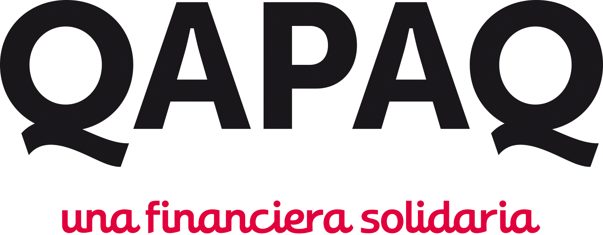
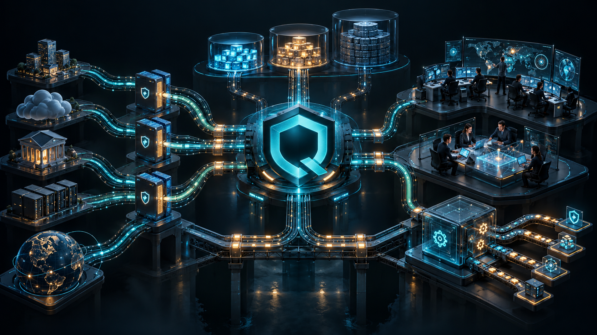

  

<h1 align="center">Qapaq SecOps</h1>

<strong>La operación de ciberseguridad defensiva de Financiera Qapaq: comprender, coordinar y responder.</strong>

  

## Qué es Qapaq SecOps

Qapaq SecOps es el espacio de trabajo del equipo de seguridad de Financiera Qapaq.
Convierte señales dispersas en una comprensión compartida del riesgo y ayuda a
actuar con oportunidad, criterio y trazabilidad. No es solo una pantalla de
alertas: reúne monitoreo, investigación, coordinación, respuesta y aprendizaje.

La plataforma combina herramientas abiertas con capacidades propias orientadas a
la realidad de una entidad financiera. El trabajo se construye por etapas: primero
se valida un recorrido acotado de monitoreo y trabajo del equipo de seguridad;
después se amplían las fuentes, las investigaciones colaborativas y la
automatización segura. El estado de cada función e integración se documenta por
separado para distinguir la visión del producto de lo que ya fue comprobado en
un entorno real.

## Qué queremos aportar

- **Claridad para el equipo de seguridad:** contexto útil para priorizar y
  comprender cada señal.
- **Investigaciones coordinadas:** responsables, tareas, hallazgos y decisiones en
  un expediente compartido.
- **Respuesta con control:** automatizaciones sujetas a permisos, aprobaciones y
  registro de resultados.
- **Memoria institucional:** antecedentes que ayuden a explicar incidentes y a
  mejorar detecciones y procedimientos.
- **Evolución sostenible:** herramientas abiertas que reducen la dependencia de
  licencias propietarias y un producto que puede ampliarse por etapas. Cada
  componente se revisa según su licencia; operación y mantenimiento se planifican
  como parte del costo total.

## Cómo evolucionará

La primera etapa se concentra en comprobar una ruta de seguridad prioritaria y el
trabajo del equipo que la rodea. Sobre esa base, **Ayni Qapaq** dará forma a la
investigación colaborativa de incidentes, inspirada en patrones de coordinación
en equipo. En la siguiente etapa, el equipo podrá activar automatizaciones
visuales con procedimientos aprobados y ampliar gradualmente el monitoreo y la
respuesta a otras fuentes autorizadas.

La meta es que Qapaq SecOps ayude a vigilar, detectar, investigar, responder,
mitigar y aprender de las amenazas tecnológicas. Las capacidades se habilitarán
cuando tengan integración, seguridad y operación verificadas; esta página no
presenta planes futuros como funciones ya disponibles.

## Documentación

| Para conocer…                                              | Ir a…                                                                                                                            |
| ---------------------------------------------------------- | -------------------------------------------------------------------------------------------------------------------------------- |
| La visión, el alcance inicial y las decisiones de producto | [Dirección de producto](docs/adr/029-qapaq-secops-product-direction.md)                                                          |
| La arquitectura y sus diagramas C4                         | [Arquitectura resiliente](docs/architecture/qapaq-secops-resilient-architecture.md) · [Modelo C4](docs/architecture/c4-model.md) |
| Cómo se investiga y documenta un incidente                 | [Ayni Qapaq](docs/product/ayni-qapaq.md)                                                                                         |
| Qué fuentes se integran y en qué etapa                     | [Estrategia de integración](docs/architecture/source-integration-strategy.md)                                                    |
| Cómo se ordenan las siguientes entregas                    | [Roadmap](docs/roadmap.md)                                                                                                       |
| Seguridad, continuidad y recuperación                      | [Seguridad](docs/architecture/security.md) · [Continuidad](docs/architecture/operations-and-continuity.md)                       |
| Guías de trabajo para desarrollo y operación               | [Índice de documentación](docs/README.md)                                                                                        |

## Estado

Qapaq SecOps se encuentra en evolución. El código, las pruebas, las aprobaciones
y la evidencia de cada ambiente determinan qué está realmente habilitado. La
arquitectura objetivo describe cómo crecer de forma segura; no acredita por sí
sola una integración o despliegue productivo.
