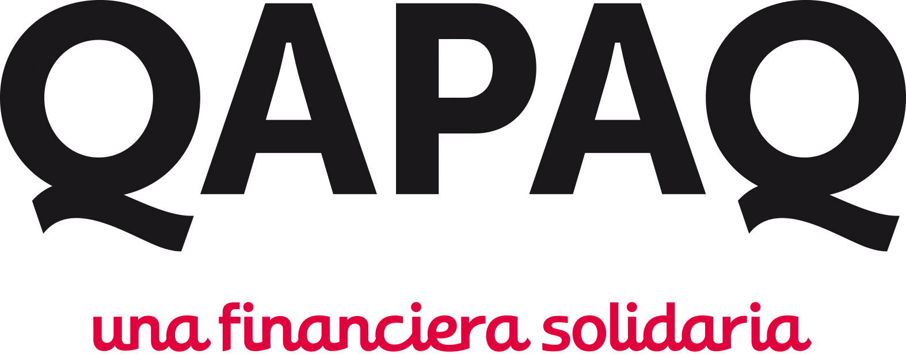

<p align="center">
  
</p>

# QAPAQ SOC

**Plataforma de operaciones de seguridad de la fintech QAPAQ.** Una URL y un login dan acceso al SIEM
(Wazuh con marca QAPAQ), a la cola de alertas, los incidentes y la auditoría del motor QAPAQ, a la
respuesta gobernada de **Ankay** y al asistente **Qapaqzito**.

- **En producción de demo:** `https://dev.security.qapaq.pe`, un nodo EC2 en la cuenta AWS de QAPAQ con
  ALB + WAF, sin recursos IAM ([arquitectura](docs/02-arquitectura.md)).
- **Fuentes:** agentes Wazuh, Microsoft 365, Bitdefender GravityZone, Snyk, Cloudflare y la propia
  cuenta AWS ([integraciones](docs/18-integraciones.md)).
- **Detección como código** en [`detections/`](detections/README.md) ([docs/17](docs/17-ingenieria-de-deteccion.md)).

## Documentación

Empieza por [`docs/README.md`](docs/README.md). Accesos directos:
[guía de usuario](docs/20-guia-de-usuario.md) · [operación](docs/06-operacion.md) ·
[identidad y acceso](docs/04-identidad-y-acceso.md) · [postura de seguridad](docs/21-postura-de-seguridad.md) ·
[brechas y roadmap](docs/19-brechas-y-roadmap.md).

## Estructura

| Ruta                                 | Contenido                                                                                                                                                                   |
| ------------------------------------ | --------------------------------------------------------------------------------------------------------------------------------------------------------------------------- |
| `wazuh/`                             | Overlay QAPAQ de Wazuh: dashboard (marca, `qapaq_ops`, `qapaq_i18n`), seguridad e ISM del indexer, políticas del manager, Office 365, collectors, correo de alertas, receptor AWS |
| `detections/`                        | Reglas, casos de prueba, catálogo de IDs y herramientas de despliegue                                                                                                       |
| `apps/api`                           | Motor QAPAQ: sesión, alertas, incidentes, auditoría, avisos y Qapaqzito                                                                                                           |
| `modules/`, `platform/`, `packages/` | Dominio hexagonal, configuración, base de datos, auditoría y contrato `SecurityEvent`                                                                                       |
| `ankay/`                       | Ankay: frontend rebrandeado, puente SSO y playbooks                                                                                                                   |
| `infra/aws-poweruser`                | Terraform y scripts del nodo vigente                                                                                                                                        |
| `infra/local`                        | Stack Docker local                                                                                                                                                          |
| `infra/aws-serverless`               | Diseño objetivo serverless (requiere IAM; no desplegado)                                                                                                                    |
| `infra/aws`, `infra/azure`           | Perfiles heredados de la base de código original; no se usan                                                                                                                |

## Desarrollo

```powershell
pnpm install
pnpm infra:up      # PostgreSQL, Redis y Wazuh locales (infra/local/README.md)
pnpm dev:api
pnpm verify        # lint, typecheck, unit, boundaries
```

Requisitos: Node 24.21 y pnpm 12.4 ([toolchain](docs/reference/toolchain-and-capacity.md)).

## Licencias y atribución

Código QAPAQ: ver [LICENSE](LICENSE). QAPAQ SOC se basa en software abierto que conserva sus licencias:
Wazuh (manager, reglas y decoders, GPLv2), Wazuh Indexer y Dashboard / OpenSearch (Apache-2.0) y
Shuffle (AGPL-3.0), base de Ankay, cuyo código fuente modificado se publica dentro de la imagen
del frontend. Las reglas derivadas que viven en `wazuh/` y `detections/` mantienen la atribución GPLv2.
