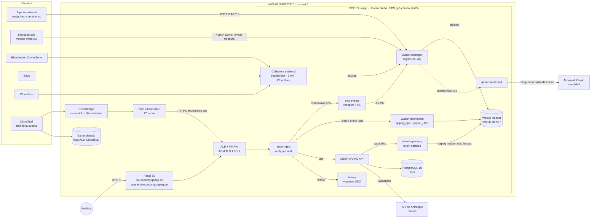

# 02 · Arquitectura

> Estado (2026-11-08): describe el despliegue **vigente** en AWS, modo PowerUser
> ([`infra/aws-poweruser`](../infra/aws-poweruser/README.md)). Cada afirmación se contrastó con el
> código del repositorio; lo que no se pudo comprobar se marca **por verificar**. El diseño
> serverless (Lambda, Cognito, Step Functions) es el **diseño objetivo** y no está desplegado: ver
> [Diseño objetivo](#diseño-objetivo-no-desplegado).

## En una frase

**QAPAQ SecOps corre en un solo nodo EC2 con Docker**: Wazuh 4.14.8 (manager, indexer y dashboard con
marca QAPAQ), el motor QAPAQ (API TypeScript + PostgreSQL), Ankay (SOAR) y un edge nginx que
impone la sesión QAPAQ en todo. Delante hay un ALB con WAF. No se usa ningún recurso IAM: la cuenta
solo concede el permission set `SOC-PowerUser`, que no puede crear roles ni hacer `iam:PassRole`.

## Despliegue AWS y flujos de datos

Flujo de una alerta: la fuente llega al **manager**, que aplica el ruleset oficial más las reglas
QAPAQ y escribe la alerta en `wazuh-alerts-*`. El **motor QAPAQ** la lee cada 60 s por el gateway de
solo lectura, la normaliza al contrato `SecurityEvent`, la promueve a la **cola de alertas** y la
persona la agrupa en **incidentes**; cada mutación queda en la **cadena de auditoría**. La persona
trabaja en el dashboard (vistas `qapaq_ops`), puede preguntar a **Qapaqzito**, abrir **Ankay** y,
cuando se conceda el permiso, recibir el **correo** de alertas de nivel ≥ 8.

## Recursos AWS (Terraform `infra/aws-poweruser`)

| Recurso | Detalle | Archivo |
| --- | --- | --- |
| Red | VPC `10.89.0.0/24`, dos subredes públicas (dos AZ, exigidas por el ALB), IGW; SG por defecto cerrado | `main.tf`, `public.tf` |
| Nodo | EC2 `r7i.xlarge` (x86_64: las imágenes del API están fijadas a amd64), Ubuntu 24.04, IMDSv2 obligatorio, **sin perfil de instancia**, gp3 100 GB cifrado con CMK, EIP | `main.tf`, `templates/cloud-init.sh` |
| SG del nodo | 443 solo desde el ALB; 22 desde `allowed_admin_cidrs`; TCP 1514–1515 desde `agent_cidrs` (hoy `0.0.0.0/0`, aprobado por el dueño el 2026-11-03) | `main.tf`, `environments/dev.tfvars` |
| Borde | ALB público con ACM (`ELBSecurityPolicy-TLS13-1-2-2021-06`), HTTP→HTTPS, access logs a S3 (90 días); WAFv2 con IpReputation, KnownBadInputs, CommonRuleSet y límite de 2000 peticiones/5 min por IP | `public.tf` |
| DNS | `dev.security.qapaq.pe` alias al ALB; `agents.dev.security.qapaq.pe` registro A a la EIP (los agentes no pasan por el ALB) | `main.tf` |
| Cifrado | CMK `alias/qapaq-soc-dev-data` (EBS y S3 de evidencia) y CMK del tema SNS, ambas con rotación | `main.tf`, `aws-monitoring.tf` |
| Evidencia | Bucket S3 con KMS, versionado, TLS obligatorio, sin acceso público, `force_destroy = false` | `main.tf` |
| Monitoreo de la cuenta | Trail de la cuenta (solo escritura de management events, multirregión, S3 SSE-S3 con expiración a 90 días); EventBridge → SNS → webhook en 17 regiones | `aws-trail.tf`, `aws-monitoring.tf`, `modules/aws-events-sentinel` |
| Presupuesto | AWS Budget mensual por etiqueta `project=qapaq` | `main.tf` |
| Estado | S3 `qapaq-tfstate-061098277310-us-east-1`, clave `aws-poweruser/dev/terraform.tfstate`, lock nativo | `backend.hcl` |

El trail de la organización vive en la cuenta de administración (258231095330) y no entrega a
EventBridge de esta cuenta; por eso existe el trail propio (`598294a`). Desde entonces llegan
eventos reales a Wazuh (p. ej. la regla 101616, cambio del pipeline).

## Contenedores del nodo (`infra/aws-poweruser/host`)

Proyecto Compose `qapaq`, red `172.30.89.0/24`. Base: `wazuh-docker` v4.14.8 (single-node) clonado en
`/opt/qapaq/wazuh-docker`, con los overrides QAPAQ.

| Servicio | Imagen | Función | Expuesto |
| --- | --- | --- | --- |
| `wazuh.manager` | `wazuh/wazuh-manager:4.14.8` | Agentes, reglas, módulos (office365, vulnerabilidades, SCA) | 1514/1515 públicos; API 55000 solo loopback |
| `wazuh.indexer` | `wazuh/wazuh-indexer:4.14.8` (heap 3 GB) | Almacena alertas, estados e inventario | 9200 solo loopback |
| `wazuh.dashboard` | `qapaq/wazuh-dashboard:4.14.8` (overlay QAPAQ) | UI; IP fija `172.30.89.10`, la única en la que el indexer confía para proxy auth | No |
| `edge` | `nginx:1.29.3` (IP fija `172.30.89.11`) | TLS (Let's Encrypt), `auth_request` a la API, rutas `/`, `/api`, `/ankay`, `/hooks/aws-sns` | 80/443 (443 solo desde el ALB) |
| `api` | `qapaq/api:local` | Motor QAPAQ: sesión, alertas, incidentes, auditoría, avisos, Qapaqzito | No |
| `postgres` | `postgres:18.6` | Estado del motor, TLS con CA interna | No |
| `wazuh-gateway` | `nginx:1.29.3` | Valida el token estático e inyecta la credencial `qapaq_reader` hacia el indexer | No |
| `aws-events` | `node:24.21.0` (solo lectura, sin capacidades, 128 MB) | Verifica firma SNS v2, deduplica y escribe JSONL para el manager | No |
| Ankay | `shuffle-backend`, `shuffle-orborus`, `shuffle-opensearch`, `ankay-qapaq-frontend`, `ankay-sso` | SOAR embebido y puente SSO | No (`compose.respond.yaml`) |

Fuera de Docker, en el host: el agente Wazuh del propio nodo (`001 qapaq-soc-dev-node`, grupo
`linux-pilot`), los collectors y el notificador de correo como timers systemd
([18](18-integraciones.md)).

## Identidad y sesión

Un solo login: el de QAPAQ (`/qapaq/login`, plugin `qapaq_ops`). El edge consulta
`/api/auth/introspect` en cada petición (caché ≤ 5 s) y fija `x-proxy-user`/`x-proxy-roles` hacia el
dashboard; el indexer solo acepta esas cabeceras desde `172.30.89.10`. El formulario del Security
plugin no es accesible. El despliegue usa la **identidad fija de demo** (sin Entra real) con cuentas
de contraseña por rol. Detalle en [04](04-identidad-y-acceso.md).

## Motor QAPAQ (`apps/api`)

- **Ingesta:** `QAPAQ_INGESTION_SOURCE=wazuh`, modo `static-token`, intervalo 60 s, ventana inicial de
  60 min. El cursor se corrigió en `833c088` para no quedarse atascado; las alertas de proveedores
  entran como alertas de primera clase.
- **Alertas → incidentes → auditoría:** la API promueve alertas a la cola, el analista las clasifica
  y las agrupa en incidentes; cada cambio se escribe con su evento de auditoría en la misma
  transacción, en una **cadena SHA-256** append-only (un trigger bloquea UPDATE/DELETE), verificable
  desde «Auditoría e integridad».
- **Roles y capacidades:** cuatro roles runtime (`qapaq.soc.analyst`, `qapaq.soc.lead`, `qapaq.auditor`,
  `qapaq.platform.admin`) con denegación por defecto (`modules/access/src/capabilities.ts`).
- **Qapaqzito:** Claude por la API directa de Anthropic ([15](15-qapaqzito-asistente.md)).

## Qué no hay en este modo (y por qué)

Todo lo que necesita una identidad IAM en el host o un rol de servicio: Secrets Manager/SSM,
Lambda, Step Functions, Scheduler, Session Manager, DLM (snapshots automáticos), Flow Logs,
CloudWatch Logs del trail, el módulo AWS de Wazuh y Bedrock. Consecuencias y mitigaciones en
[21 · Postura de seguridad](21-postura-de-seguridad.md); brechas abiertas en
[19](19-brechas-y-roadmap.md).

## Diseño objetivo (no desplegado)

Si un administrador de la cuenta crea los roles y concede `iam:PassRole` acotado a `qapaq-*`, el
destino es el diseño serverless de [`infra/aws-serverless`](../infra/aws-serverless/README.md):
CloudFront + WAF, Cognito federado con Entra, API Gateway HTTP + Lambda, Step Functions para QAPAQ
Respond, SQS/EventBridge y Aurora Serverless v2, con Wazuh como único nodo con servidor. Ese
Terraform pasó `fmt`/`validate` pero **no tiene plan ni apply**. Documentos de ese diseño:
[cloud/aws/architecture.md](cloud/aws/architecture.md), [09](09-plan-de-lanzamiento.md),
[11](11-cache-y-colas.md), [12](12-backend-en-el-siem.md) y [13](13-ankay-qapaq.md) §2–4.

## Principios que se conservan

1. **Monolito modular hexagonal** (`modules/*` sin frameworks; lo valida `pnpm boundaries`).
2. **Contrato canónico `SecurityEvent` 1.0.0** (`packages/contracts`).
3. **Mutación, auditoría y outbox en una transacción.**
4. **Denegación por defecto** y negaciones auditadas.
5. **Sin acciones automáticas:** Active Response de Wazuh apagada; toda acción con efectos pasa por
   Ankay con aprobación del Líder SOC.
6. **Secretos fuera de Git, del estado de Terraform y del user_data:** se generan en el host, en
   `/opt/qapaq/secrets` (0700, archivos 0600).

## Cómo se modifica el sistema

| Quiero… | Lo hago en… |
| --- | --- |
| Una detección nueva | `detections/`, según [17](17-ingenieria-de-deteccion.md) |
| Una fuente nueva por API | Un collector en `wazuh/provider-ingestion` y su rango en `detections/catalog.yaml` |
| Una vista o un texto de la consola | `wazuh/dashboard/plugins/qapaq_ops` (español en `qapaq_i18n`) |
| Una política de agente o del manager | `wazuh/manager/policy` ([16](16-politicas.md)) |
| Retención | `wazuh/indexer/ism` |
| Infraestructura | `infra/aws-poweruser` (plan revisado antes de cada apply) |
