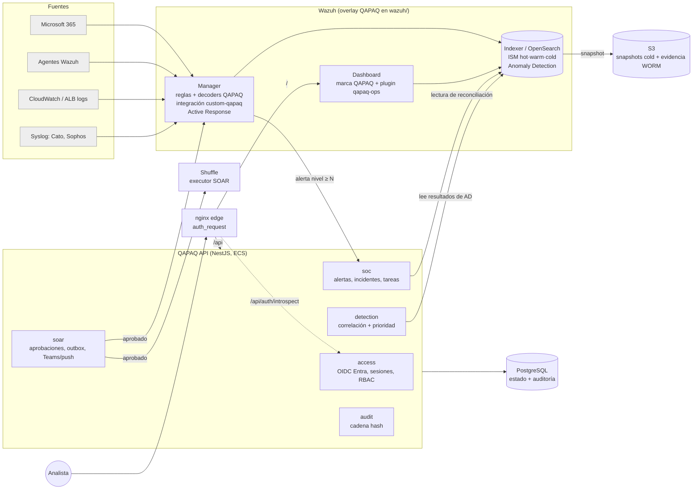

# 02 · Arquitectura

## En una frase

**Wazuh es el backend de datos y detección; QAPAQ (TypeScript) es el backend de trabajo,
identidad y gobierno; el dashboard de Wazuh es el único frontend.** Un login Entra protege todo.

## Piezas y responsabilidades

| Pieza | Corre en | Responsabilidad | Código |
| --- | --- | --- | --- |
| Wazuh Manager | EC2 | Recolección (agentes, Office 365, AWS, syslog), reglas, decoders, Active Response | `wazuh/manager/`, `wazuh/office365/` |
| Wazuh Indexer | EC2 | Almacenamiento de alertas, ISM hot/warm/cold, snapshots S3, Anomaly Detection | `wazuh/indexer/` |
| Wazuh Dashboard | EC2 | Frontend único: SIEM nativo más el plugin QAPAQ | `wazuh/dashboard/` |
| nginx edge | EC2 (mismo host) | TLS, `auth_request` contra QAPAQ y ruteo `/` → dashboard, `/api` → QAPAQ | `wazuh/edge/` |
| QAPAQ API | ECS Fargate | Identidad, casos, correlación, SOAR gobernado, auditoría y notificaciones | `apps/api`, `modules/*`, `platform/*` |
| Valkey | ElastiCache | Caché con TTL e invalidación, estado efímero compartido entre réplicas y colas BullMQ ([11](11-cache-y-colas.md)) | `platform/cache`, `apps/worker` |
| PostgreSQL | RDS | Estado operativo, sesiones y auditoría append-only | `platform/database` |
| S3 | AWS | Snapshots cold del Indexer (KMS) y evidencia con Object Lock | `infra/aws` |
| Shuffle (fase 3) | EC2 pequeña | Ejecutar playbooks **después** de la aprobación en QAPAQ | `wazuh/integrations/shuffle/` |

## Qué salió del diseño y por qué

| Retirado | Motivo | Reemplazo |
| --- | --- | --- |
| **Frontend propio** (`apps/web` en Vercel) | Duplicaba Discover, dashboards y agentes de Wazuh, y el dueño lo descartó | La UI de Wazuh rebrandeada como QAPAQ SecOps más el plugin `qapaq_ops` ([08](08-frontend-unificado.md)). `apps/web` eliminado (`4eab88f`) |
| **KrakenD** en el runtime | Su función era ser egress hacia APIs de proveedores, pero las fuentes nuevas entran por módulos de Wazuh. Hoy causa el bug de ingesta (`PROVIDER_RESPONSE_INVALID`) y corta el long-poll a 4 s. Además son 2 tareas Fargate | La API lee el Indexer por el proxy nginx allowlist que ya existe (`wazuh/access`), con usuario `qapaq_reader`. Se recupera de git si aparece una API de proveedor directa |
| **Grafana, Loki, Prometheus y `platform/observability`** | Ninguna app importaba la librería y solo existían en compose local. Su fin regulatorio (N1) lo cumple Wazuh | CloudWatch para métricas de infraestructura AWS. Los logs de API y ALB entran a Wazuh por el módulo AWS: un solo plano, autogestionado ([06](06-operacion.md)) |
| **Python analytics (ADR-007)** | Dormante y sin código | OpenSearch Anomaly Detection (RCF), que ya está en el Indexer ([07](07-deteccion-ml-y-soar.md)) |
| **Pipeline de admisión C-04 y raw en S3 propio** | Testeado pero no conectado a la API. Duplicaba la custodia que ya hace el Indexer | Wazuh conserva el raw (`archives`) y la retención se hace con ISM más snapshots |

## Arquitectura vital que se conserva

Esto es lo que da valor y no se toca sin una decisión en [10](10-decisiones.md):

1. **Monolito modular hexagonal.** Los módulos `access`, `soc`, `detection`, `soar`, `connectors`
   y `telemetry` no importan frameworks. NestJS y Fastify solo viven en `apps/api`. Las
   dependencias apuntan hacia dentro; lo valida `pnpm boundaries` (`.dependency-cruiser.cjs`).
2. **Contrato canónico `SecurityEvent` 1.0.0** (`packages/contracts`). Todo lo que viene de
   Wazuh se normaliza a ese contrato antes de entrar al dominio (`modules/telemetry/src/wazuh-*.ts`).
   El dominio nunca ve el formato de Wazuh.
3. **Mutación, auditoría y outbox en una sola transacción.** Cada caso de uso autoriza, cambia
   estado, escribe `AuditEvent` y encola el efecto externo (`modules/soc/src/use-cases.ts`). Si
   falla la auditoría, se revierte la mutación.
4. **Auditoría append-only verificable.** Cadena SHA-256 por tenant con secuencia monótona y un
   trigger que bloquea UPDATE/DELETE (`platform/audit`).
5. **Denegación por defecto** con 25 capacidades × 4 roles × 3 scopes. Las negaciones también se
   auditan (`modules/access/src/authorization.ts`).
6. **Efectos externos idempotentes** con lease y fencing token. Es un gate obligatorio antes de
   cualquier acción SOAR real.
7. **Secretos solo por referencia** (`secretRef`) a Secrets Manager. Nunca van en tfvars,
   estado, logs ni imágenes.

## Cómo se modifica el backend de ahora en adelante

| Quiero… | Lo hago en… |
| --- | --- |
| Detectar algo nuevo | Una regla o decoder Wazuh en `wazuh/manager/rules/` con test en `wazuh/**/tests` (logtest) |
| Una fuente nueva | Un módulo de Wazuh (wodle, syslog, `aws-s3`, `ms-graph`) configurado en `wazuh/manager/` |
| Agrupar alertas en un incidente o priorizarlas | TypeScript en `modules/detection` |
| Un flujo humano: estado, tarea o aprobación | TypeScript en `modules/soc` o `modules/soar` |
| Una acción de respuesta | Un catálogo en `modules/soar` que la ejecuta vía Wazuh Active Response o Shuffle, siempre con aprobación |
| Una vista nueva | El plugin `wazuh/dashboard/plugins/qapaq_ops` (componentes OUI de la UI de Wazuh) |
| Retención, ML o índices | JSON versionado en `wazuh/indexer/`, aplicado por script idempotente |
