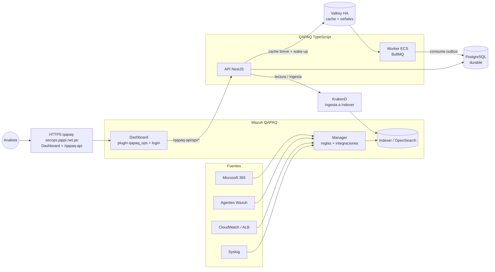

# 02 · Arquitectura

## En una frase

**Wazuh es el SIEM y el shell de interfaz; QAPAQ conserva la API TypeScript para identidad,
casos y gobierno.** El plugin QAPAQ vive dentro del Dashboard modificado y consume la API en el
mismo origen. PostgreSQL conserva los datos durables; Valkey acelera lecturas y BullMQ despierta
al worker, sin ser fuente de verdad.

## Piezas y responsabilidades

| Pieza | Corre en | Responsabilidad | Código |
| --- | --- | --- | --- |
| Wazuh Manager | EC2 | Recolección, reglas, decoders e integraciones | `wazuh/manager/`, `wazuh/office365/` |
| Wazuh Indexer | EC2 | Alertas, índices y búsquedas | `wazuh/indexer/` |
| Wazuh Dashboard | EC2 | Interfaz SIEM y plugin QAPAQ con su pantalla de login | `wazuh/dashboard/` |
| HTTPS y proxy del API | Host Wazuh → ALB privado | Sirve Dashboard en `/` y enruta `/qapaq-api/` a la API | `infra/aws/scripts/configure-wazuh-domain.sh` |
| QAPAQ API | ECS Fargate | Login Entra, sesiones, revocación, casos Ayni Qapaq, auditoría, eventos y notificaciones Teams | `apps/api`, `modules/*`, `platform/*` |
| QAPAQ worker | ECS Fargate | Drena el outbox PostgreSQL; BullMQ entrega señales de trabajo | `apps/worker` |
| PostgreSQL | RDS | Fuente durable para casos, sesiones, auditoría y outbox | `platform/database` |
| Valkey | ElastiCache Multi-AZ | Caché de eventos con TTL breve y transporte recuperable para señales BullMQ | `apps/api`, `apps/worker`, `infra/aws/modules/cache` |
| KrakenD | ECS Fargate | Gateway que usa la ingesta QAPAQ hacia Wazuh Indexer; se conserva | `platform/gateway`, `infra/aws/modules/runtime` |
| S3 | AWS | Snapshots del Indexer y evidencia según las políticas configuradas | `infra/aws` |
| Shuffle / Ankay Qapaq (siguiente scope) | Red privada | Ejecución SOAR después de aprobación | `wazuh/integrations/shuffle/` |

## Qué se retira y qué se conserva

| Componente | Decisión | Motivo |
| --- | --- | --- |
| `apps/web` y su hosting Vercel | Retirar del producto y del repositorio al completar el cambio | Sus pantallas se trasladan al plugin QAPAQ de Wazuh. La URL de producto será `https://qapaq-secops.jappi.net.pe` |
| API TypeScript (`apps/api`, `modules/*`, `platform/*`) | Conservar | El plugin depende de ella para Entra, sesión única, revocación, casos, auditoría, eventos y Teams |
| KrakenD | Conservar | La integración de ingesta QAPAQ → Wazuh Indexer lo necesita. No quitarlo como parte de retirar el frontend |
| Valkey y `apps/worker` | Incorporar en la arquitectura resiliente | La caché y las señales BullMQ son auxiliares; PostgreSQL/outbox sigue siendo durable y el API mantiene polling de respaldo |

El cambio de hosting del frontend **no** equivale a quitar el backend. No se elimina API,
módulos, Postgres, KrakenD ni secretos de Entra. La infraestructura solo se ajusta tras revisar
el plan Terraform y su state; todavía no se declara un apply realizado.

## Arquitectura vital que se conserva

1. **Monolito modular hexagonal.** Los módulos `access`, `soc`, `detection`, `soar`, `connectors`
   y `telemetry` no importan frameworks. NestJS y Fastify viven en `apps/api`.
2. **Contrato canónico `SecurityEvent` 1.0.0** (`packages/contracts`). Los eventos se normalizan
   antes de entrar al dominio.
3. **Mutación, auditoría y outbox en una transacción.** Una operación no se confirma si falla su
   auditoría. PostgreSQL conserva el outbox durable; BullMQ solo avisa que hay trabajo.
4. **Auditoría append-only verificable.** Cadena SHA-256 por tenant con secuencia monótona y
   trigger que bloquea UPDATE/DELETE (`platform/audit`).
5. **Denegación por defecto** con capacidades, roles y scopes; las negaciones también se auditan.
6. **Valkey recuperable.** El caché de eventos tiene TTL corto y falla abierto. El worker vuelve
   a consultar PostgreSQL; el API conserva polling de respaldo para despachar el outbox.
7. **Secretos solo por referencia** (`secretRef`) a Secrets Manager. El despliegue reutiliza las
   credenciales vigentes y no rota el client secret de Entra.

## Entra y cambio de origen

El callback previsto con el nuevo origen es
`https://qapaq-secops.jappi.net.pe/qapaq-api/api/auth/callback`. Antes de habilitar el login,
esa URI exacta debe estar registrada como redirect URI en la aplicación de Microsoft Entra. Es un
gate externo pendiente de verificación; no implica rotar el client secret.

## Cómo se modifica el sistema

| Quiero… | Lo hago en… |
| --- | --- |
| Detectar algo nuevo | Reglas o decoders Wazuh en `wazuh/manager/rules/` con pruebas `logtest` |
| Una fuente nueva | Módulo de Wazuh en `wazuh/manager/` |
| Agrupar alertas o priorizarlas | TypeScript en `modules/detection` |
| Un flujo humano de casos, tareas o aprobación | TypeScript en `modules/soc` o `modules/soar` y vistas en `wazuh/dashboard/plugins/qapaq_ops` |
| Una acción de respuesta | `modules/soar`, vía Wazuh Active Response o Shuffle, con aprobación |
| Una vista o interacción de QAPAQ | `wazuh/dashboard/plugins/qapaq_ops` |
| Retención, ML o índices | JSON versionado en `wazuh/indexer/` |
