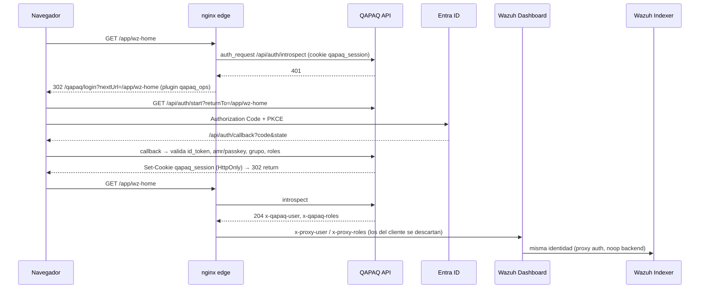

# 04 · Identidad y acceso

## Modelo

- **Entra ID decide quién es la persona y si puede entrar** (grupo SOC y app roles).
  **QAPAQ decide qué puede hacer**: capacidades, scope, SoD y auditoría.
- **Un solo login para todo.** El login TypeScript existente protege la consola de casos **y**
  el dashboard de Wazuh. No hay usuarios locales de Wazuh para personas. Los usuarios internos
  quedan solo para servicios (`qapaq_reader` y `wazuh-wui`) y para el break-glass.

## Excepción temporal del demo: MFA/passkey

**Activa solo en `qapaq-secops-demo` hasta 2026-10-17 03:40 UTC (2026-10-16 22:40, hora Lima).**
`QAPAQ_DEMO_MFA_EXCEPTION_UNTIL` permite completar el login a identidades que ya superaron
la validación OIDC y tienen capabilities QAPAQ aunque el token no pruebe MFA/passkey. No altera
MFA, Security Defaults ni Conditional Access de Entra. El código limita la excepción al tenant,
client ID y callback de QAPAQ, exige vencimiento de máximo 30 días y acorta la sesión a ese
vencimiento. Es un bypass temporal para la demo: una contraseña robada podría bastar para entrar.

## Flujo

## Piezas

| Pieza | Estado | Archivo |
| --- | --- | --- |
| OIDC PKCE, `state`/`nonce`, validación RS256, `amr` y passkey fuera de la red | Hecho, 79 tests | `modules/access/src/{oidc-handshake,id-token,sign-in,network}.ts` |
| Sesión opaca (30 min de inactividad, 8 h absolutas, hash en Postgres) | Hecho | `modules/access/src/session.ts` |
| `GET /api/auth/introspect` → 204 con `x-qapaq-user` y `x-qapaq-roles` | Trabajo en curso **sin commitear en `main`** | `apps/api/src/soc/auth.controller.ts` |
| nginx `auth_request` | Propuesto en esta rama | `wazuh/edge/qapaq-edge.conf` |
| Security plugin `proxy` (Indexer y Dashboard) | Propuesto en esta rama | `wazuh/indexer/security/`, `wazuh/dashboard/opensearch_dashboards.qapaq.yml` |
| Revocación al salir del grupo (Graph delta) | Hecho | `apps/api/src/runtime/directory-sync.ts` |

## Por qué proxy auth y no OIDC nativo de OSD

| Criterio | OIDC nativo de OSD | QAPAQ como proxy de identidad |
| --- | --- | --- |
| Passkey obligatoria fuera de la red | No | Sí (`network.ts`) |
| Revocación al salir del grupo SOC | Solo al expirar el token | Inmediata: cada request pasa por `introspect` |
| Revocación administrativa de sesión | No | Sí, en `/api/admin/sessions` |
| Auditoría del acceso | Logs de OSD | Cadena hash QAPAQ |
| Esfuerzo | Solo configuración | Configuración más el endpoint, que ya existe |

La configuración OIDC nativa queda como **fallback** documentado en
`wazuh/dashboard/opensearch_dashboards.qapaq.yml` (comentada).

## Mapeo de roles

| Rol Entra (`x-proxy-roles`) | Rol OpenSearch (`roles_mapping.yml`) | Rol Wazuh API (`run_as`) |
| --- | --- | --- |
| `qapaq.platform.admin` | `all_access` | `administrator` |
| `qapaq.soc.lead` | `qapaq_soc_lead` (lectura de `wazuh-*` y AD) | `readonly` + `active-response` (vía QAPAQ, no directo) |
| `qapaq.soc.analyst` | `qapaq_soc_analyst` (lectura de `wazuh-alerts-*`) | `readonly` |
| `qapaq.auditor` | `qapaq_auditor` (lectura sin export) | `readonly` |

## Administración de usuarios: estado, cambio de rol y revocación inmediata

Es un diferencial de negocio: ni Wazuh ni OSD lo tienen. **Cualquier cambio de acceso corta la
sesión al instante, en la consola y en el dashboard.**

### Lo que ya existe en el backend TS

| Función | Endpoint o mecanismo | Archivo |
| --- | --- | --- |
| Padrón del grupo SOC: membresía, `accountEnabled`, rol efectivo **y su origen**, última actividad, sesiones activas y si la sincronización está vieja | `GET /api/admin/users`, `GET /api/admin/users/:oid` | `apps/api/src/soc/admin-users.controller.ts` |
| Sesiones recientes y revocación manual | `GET /api/admin/sessions`, `POST /api/admin/sessions/:ref/revoke` | `apps/api/src/soc/admin-sessions.controller.ts` |
| **Salida del grupo en Entra → revocación automática** | Graph delta → `removedMembers` → `revokeSessionsByOid` (auditado) | `apps/api/src/runtime/directory-sync.ts` |
| Origen del rol: dueño del grupo, grupo admin, binding de deploy, app role de Entra o asignación aprobada por QAPAQ | `explainRole` | `apps/api/src/runtime/role-grants.ts` |

### Cambios de rol con aprobación y auditoría

La implementación está en la rama `codex/qapaq-admin-roles-main`; todavía no cuenta como parte de
`main` ni del despliegue hasta que su PR y CI se completen. El panel del plugin Wazuh usa solicitudes
de cambio, no escribe grants directamente ni modifica miembros/estado de cuenta en Entra.

| Operación | Endpoint | Control |
| --- | --- | --- |
| Leer grant editable y sus fuentes fijas | `GET /api/admin/users/:oid/role-grant` | `users.read`, miembro vigente, padrón Graph fresco |
| Solicitar concesión o retiro | `POST /api/admin/users/:oid/role-requests` | `roles.request`, CSRF, motivo, revisión CAS y solicitante distinto del objetivo |
| Consultar bandeja del tenant | `GET /api/admin/role-requests` | Capability de solicitud o aprobación; paginación acotada |
| Resolver etapa pendiente | `POST /api/admin/role-requests/:id/approve` o `/reject` | Aprobador declarado para la etapa, SoD, CSRF, revisión CAS y motivo |

- Los grants dinámicos viven en `access_role_grants`, separados de las asignaciones del deploy,
  app roles de Entra y dueños del grupo. `access_role_requests` conserva estado y aprobaciones; el
  historial íntegro se registra en la cadena de auditoría.
- Cada decisión exige que solicitante, objetivo y aprobador sean personas distintas y continúen
  habilitados en el grupo sincronizado. Sin Graph reciente o sin aprobadores declarados, se falla
  cerrado. `QAPAQ_ACCESS_APPROVER_OIDS` y `QAPAQ_SECURITY_APPROVER_OIDS` se configuran por entorno;
  no se publican OIDs de usuarios en el repositorio.
- El rol `qapaq.platform.admin` exige dos aprobaciones (Acceso y Seguridad). La etapa de Seguridad
  además exige autenticación fuerte y reciente. El login actual no entrega evidencia step-up; por
  eso hoy esa aprobación está bloqueada intencionalmente. No se relaja ni se simula desde el panel.
- Tras aprobar el cambio final, el backend confirma grant y auditoría y luego revoca las sesiones
  en otro store. Si quedan sesiones sin revocar, la respuesta informa `sessionRevocation.remaining`
  y registra el fallo. No es una transacción atómica entre grant y sesión: cerrar este hueco y
  verificar la propagación del corte al Dashboard sigue siendo un gate antes de producción.
- La sincronización del padrón cancela solicitudes abiertas cuando sus participantes dejan de ser
  miembros. Deshabilitar o dar de baja una cuenta sigue siendo responsabilidad de Entra; QAPAQ solo
  refleja ese estado y aplica la denegación/revocación correspondiente.

### Una sola sesión por persona (ya existe)

- Al abrir una sesión nueva, todas las sesiones `active` previas de la misma persona (mismo
  `subjectId` y tenant) pasan a `superseded` (`modules/access/src/session.ts:119`,
  `secops-runtime.ts:855`). El login redirige con `sessionNotice=superseded` para avisar.
- **En la plataforma unificada se extiende sola al dashboard.** El dashboard no tiene sesión
  propia y usa la de QAPAQ por proxy auth. Si alguien entra desde otro navegador, la primera
  sesión pierde la consola **y** el dashboard (≤ 5 s por la caché del edge). El estado
  `superseded` se ve en «Sesiones» y queda auditado.
- **Riesgo a cerrar (fase 1):** el reemplazo se hace en un bucle después de crear la sesión nueva,
  no de forma atómica. Dos logins casi simultáneos podrían dejar dos sesiones activas. Hay que
  agregar un índice único parcial en Postgres `(tenant_id, subject_id) WHERE state = 'active'` y
  hacer el reemplazo en la misma transacción.

### Estado que ve el admin

| Estado | Regla |
| --- | --- |
| **En línea** | Sesión activa con `lastSeenAt` dentro del idle de 30 min |
| **Inactiva** | Sesión activa pero sin actividad reciente |
| **Sin sesión** | Ninguna sesión activa |
| **Sin rol** | Origen `none`. Entra al grupo, pero QAPAQ la deniega con `NO_ROLE_ASSIGNED` |
| **Deshabilitada en Entra** | `accountEnabled = false` |
| **Fuera del grupo** | `membership = removed`. Sesiones ya revocadas |

## Pendientes y riesgos

0. **IP del cliente detrás del edge (corregido en esta rama).** El edge del host Wazuh llegaba a
   la API por el ALB **público** (`/qapaq-api/`). La API veía la EIP del host como cliente, fuera de
   la cadena de proxies confiables (`10.0.0.0/16`), así que la política de red trataba a todos como
   externos y exigía passkey. Ahora el edge usa Cloud Map dentro de la VPC (reglas
   `public_proxy_to_api` y `api_from_public_proxy`, salida `qapaq_edge_api_origin`), y la API ve la
   IP real del usuario.

1. **Stores en memoria.** El handshake OIDC, el lockout y la clave CSRF se crean en memoria al
   arrancar (`secops-runtime.ts:246-275`). Con más de una réplica, o tras un reinicio, el login y
   el CSRF fallan. Hay que moverlos a Postgres y a Secrets Manager antes de escalar la API.
2. **Coste del `introspect`.** Cada request del dashboard dispara uno. nginx lo cachea 5 s por
   cookie (`proxy_cache`). Una revocación tarda como máximo 5 s en aplicarse.
3. **Cabeceras de confianza.** nginx **borra** las `x-proxy-*` que manda el cliente. El Indexer
   solo acepta proxy auth desde `internalProxies` (127.0.0.1).
4. **Redirect URI.** La app de Entra necesita registrar `https://<dominio-soc>/api/auth/callback`.
5. **Sin step-up.** No hay reautenticación para acciones sensibles (aprobar SOAR, conceder roles).
   Hay que añadir `max_age`/`prompt=login` en la fase 3.
