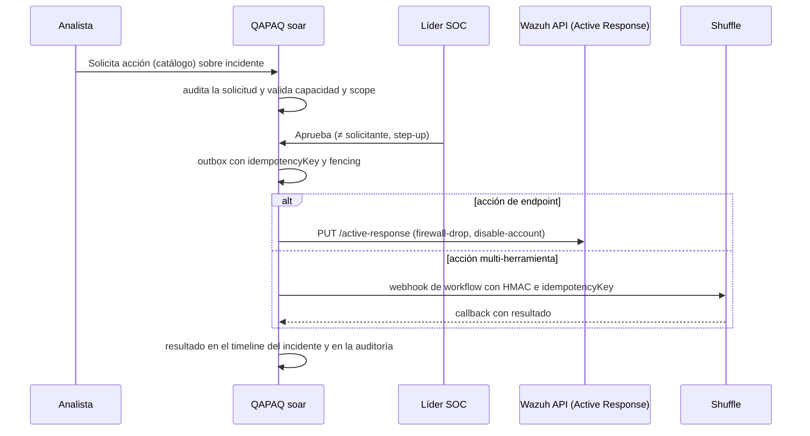

# 07 · Detección, ML y SOAR

## Detección en tres capas

| Capa | Dónde | Qué hace | Ejemplo |
| --- | --- | --- | --- |
| 1. Regla | **Wazuh** (`wazuh/office365/rules`, `wazuh/manager/rules`) | Evento → alerta con nivel y MITRE | 22 reglas Office 365 QAPAQ que ya existen. Login sin MFA, regla de reenvío en buzón |
| 1b. Secuencia simple | **Wazuh** (`if_matched_sid`, `same_field`, `timeframe`) | N eventos relacionados → alerta compuesta | Fallos de login seguidos de un login exitoso del mismo `UserId` en 10 min |
| 2. Anomalía (ML) | **OpenSearch Anomaly Detection** (RCF, en el Indexer) | Desvío del comportamiento por entidad | Volumen de descargas de SharePoint por usuario |
| 3. Contexto e incidente | **QAPAQ** `modules/detection` (TS) | Agrupa alertas y anomalías por entidad, aplica la cadena de compromiso M365 y asigna prioridad P1–P4 con razones | Credenciales, luego persistencia, luego exfiltración del mismo usuario en 24 h → incidente P1 |

Regla práctica: si se puede expresar sobre un solo flujo de eventos, va en Wazuh (capas 1 y
1b). Si necesita estado de casos, varias fuentes o explicación para el analista, va en TS (capa 3).

## ML con Anomaly Detection (fase 2)

Detectores versionados en `wazuh/indexer/anomaly-detection/`, aplicados por
`apply-detectors.sh`:

| Detector | Entidad (`category_field`) | Feature | Intervalo |
| --- | --- | --- | --- |
| `qapaq-m365-login-failures` | `data.office365.UserId` | Conteo de `UserLoginFailed` | 10 min |
| `qapaq-m365-file-downloads` | `data.office365.UserId` | Conteo de `FileDownloaded` y `FileSyncDownloadedFull` | 15 min |
| `qapaq-agent-alert-volume` | `agent.name` | Conteo de alertas con `rule.level ≥ 7` | 10 min |

**Integración con QAPAQ:**
1. `modules/connectors` añade la lectura de `.opendistro-anomaly-results*` con
   `anomaly_grade ≥ 0.7`. Usa la misma credencial de solo lectura, con acceso ampliado a ese
   índice.
2. `modules/telemetry` lo normaliza a `SecurityEvent` con `kind: anomaly`, conservando el
   detector, el grado, la confianza y la entidad.
3. `modules/detection` lo trata como una señal más. Una anomalía sola no crea un incidente: sube
   la prioridad de un grupo de alertas de la misma entidad, con la razón `ANOMALY_CORROBORATED`.

Python queda descartado. Volverá solo si un caso medido supera a RCF (el criterio de ADR-007
sigue vigente).

**Fase 4 (Wazuh 5):** Security Analytics con reglas Sigma y su motor de correlación entre tipos de
log, que vienen nativos en el Indexer 5.x. QAPAQ consume sus *findings* igual que consume AD.

## Ingesta: push más reconciliación

| Vía | Mecanismo | Rol |
| --- | --- | --- |
| **Push** (nueva) | Integración `custom-qapaq` del Manager (`wazuh/manager/integrations/custom-qapaq.py`). Llama a `POST /api/ingest/wazuh` con HMAC-SHA256 por alerta de nivel ≥ 7 | Latencia baja. Es best-effort: integratord no reintenta |
| **Pull** (existente) | El poller con cursor y lease con fencing lee `wazuh-alerts-*` | **Reconciliación**: garantiza que no se pierda nada. Deduplica por `_id` |

El endpoint `POST /api/ingest/wazuh` es código nuevo de la fase 2. Valida la firma y un timestamp
de no más de 5 minutos de antigüedad, admite solo la red privada y deduplica con la misma clave
que el pull.

## ¿Qué tan fácil es incorporarlo? (esfuerzo real)

| Pieza OSS | Compatibilidad con Wazuh | Qué hay que hacer | Esfuerzo |
| --- | --- | --- | --- |
| **OpenSearch Anomaly Detection** | El backend ya está en el Indexer de Wazuh. En 4.x la UI se copia desde el tarball de OSD 2.19.6 | 3 JSON de detectores (en esta rama) más un lector en `modules/connectors` | **Bajo**: 1–2 días |
| **Shuffle** | Integración **nativa** en el Integrator de Wazuh desde 4.4. Alianza oficial Wazuh–Shuffle (sept. 2025) | Contenedor Docker en una EC2 privada, workflows y un webhook firmado desde `modules/soar` | **Medio**: 2–3 días el servicio y 2 días la gobernanza en QAPAQ |
| **Wazuh Active Response** | Nativo | Usuario de Wazuh API con permiso mínimo y un adaptador en `modules/soar` | **Bajo**: 1 día |
| **Security Analytics (Sigma más correlación)** | Nativo en Wazuh 5. En 4.x hay reportes de que rompe el arranque del Indexer | Esperar a Wazuh 5 GA | **Bajo** en 5.x, **no recomendado** en 4.x |
| **Reglas Sigma (SigmaHQ)** | El motor de Wazuh 5 las usa directamente | Elegir el subconjunto M365/Entra | Fase 4 |

## SOAR: Ankay Qapaq (siguiente scope)

> **Decisión del dueño (2026-10-13):** el SOAR propio de QAPAQ no se construye. El SOAR será
> **Ankay Qapaq**: Shuffle en la red interna, con frontend rebrandeado al estilo QAPAQ y acceso
> directo desde el SIEM QAPAQ para escalar alertas y automatizar respuestas. Se monta **después**
> de lanzar el SIEM. Lo que sigue describe la gobernanza que Ankay Qapaq debe respetar
> (aprobación por segunda persona, auditoría y sin credenciales de escritura en la API).

## SOAR gobernado (requisitos para Ankay Qapaq)

Principio: **QAPAQ decide y deja evidencia; otros ejecutan.** QAPAQ nunca tiene credenciales de
escritura de Graph ni de firewalls. Esas credenciales viven en el executor.

**Catálogo inicial** (`modules/soar/src/actions/`, fase 3):

| Acción | Executor | Riesgo | Aprobación |
| --- | --- | --- | --- |
| `endpoint.block-ip` | Wazuh AR `firewall-drop` (con timeout) | Medio | Líder SOC |
| `endpoint.isolate-host` | Wazuh AR, script de aislamiento propio | Alto | Líder SOC con step-up |
| `m365.revoke-sessions` | Shuffle → Graph `revokeSignInSessions` | Alto | Líder SOC con step-up |
| `m365.disable-user` | Shuffle → Graph | Alto | Líder SOC con step-up |
| `enrich.ip-reputation` | Shuffle → apps OSS | Bajo | Ninguna (sin efectos) |

**Gates antes de la primera acción real:**
1. Fencing token en el outbox de notificaciones y acciones (P0). Hoy el outbox tiene lease pero
   no fencing.
2. Step-up (`max_age`) para aprobar.
3. Usuario de Wazuh API con permiso **solo** `active-response:command`.
4. Shuffle en una subred privada, con webhook firmado y callback autenticado.
5. Cerrar U-008: guardas de transición, catálogo y cardinalidades.
