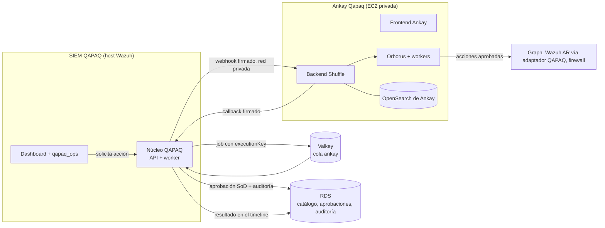

# 13 · Ankay Qapaq: plan de implementación del SOAR

**Ankay Qapaq** es el SOAR de QAPAQ SecOps: Shuffle con identidad QAPAQ, en la red interna,
conectado al SIEM QAPAQ para escalar alertas y automatizar respuestas. Se monta sobre Shuffle sin
reinventarlo, como ya se hizo con Wazuh: upstream fijado más un overlay versionado (ADR-028, A13).

**Alcance:** la UI con marca Ankay, la integración con el SIEM, la infraestructura y los primeros
playbooks. **Fuera de alcance:** los módulos para el equipo de riesgos no financieros, que define el
dueño con Franco.

**Arquitectura de la conexión con QAPAQ SecOps:** [14](14-ankay-conexion-qapaq.md).

### Estado de Ankay para Azure (revisión 26-10-2026)

El workflow `ankay-azure.yml` construye el **frontend** rebrandeado desde Shuffle v2.3.0, pero no el
resto del runtime. La inspección del upstream identificó estos bloqueos para un build completo:

- `backend/Dockerfile` descarga `app_sdk` desde `main`, sin fijarlo por commit.
- Orborus tiene una revisión asociada a v2.3.0 (`adcc814cb355b7f4b6cb869e0d8d5eed3c6baa95`), pero
  aún no se construyó ni probó junto al backend y worker fijados.
- `shuffle.security` se revisó en un commit de `main` (`89070968ec93f1d4ad37953d72910ec63c5fb9df`),
  pero su compatibilidad con Shuffle v2.3.0 no está demostrada ni es una versión aprobada.
- Compose upstream usa tags mutables para Shuffle; el OpenSearch 3.2.0 de Compose aún no está fijado
  por digest en un Compose QAPAQ revisado.

No se añadió un build multiimagen: sin un Compose verificable, construir los seis contenedores por
separado no demostraría que Ankay arranca ni reduciría el riesgo de integración. El gate Terraform
actual requiere todas las imágenes con digest ACR, un Compose completo con SHA verificado y health
checks para los cinco servicios persistentes. Mantener `ankay_host=null` hasta que CI construya los
componentes desde pins aprobados y una prueba de Compose confirme salud y compatibilidad.

El build [40057658958](https://github.com/CyberStill-GmbH/qapaq-secops/actions/runs/40057658958)
terminó correctamente desde `main` (`c13d968`): validó branding, subpath protegido e imagen de
frontend y subió un artefacto temporal del run. `publish_to_acr=false`; no publicó a ACR ni desplegó
Ankay en Azure.

`infra/azure/modules/ankay_host/` ya está conectado al root Azure como host opcional, desactivado
mientras `ankay_host` sea `null`. Exige digests SHA-256 ACR para frontend, backend, Orborus,
worker dinámico, OpenSearch y `shuffle-security`,
además del Compose completo con su SHA revisado. Crea VM Linux sin IP pública, NSG restrictiva,
identidad ACR de solo lectura y disco persistente con `prevent_destroy`; solo deja el Compose
verificado en disco. No instala ni inicia Shuffle y su salida informa `host_prepared_runtime_not_started`.
No existen aún imágenes/digests aprobados para todos esos componentes ni prueba de login, ejecución,
persistencia o recuperación en Azure.

El módulo requiere una subnet dedicada, ruta 0/0 a Azure Firewall con allowlist revisada, IP del edge,
API, firewall, SKU de VM y versión exacta de Ubuntu. `firewall_policy_reference` documenta una policy
externa: el módulo no crea ni configura el Firewall ni confirma que esa UDR exista. No se puede
conectar al root sin añadir subnet, direcciones estables, firewall y revisar costos. La VM, disco,
NAT/firewall y egreso autorizado agregan cargos mensuales; cotizar la SKU y el volumen antes de
integrar o aplicar. El workflow `ankay-azure-iac.yml` solo valida formato/esquema Terraform y no tiene
credenciales cloud ni despliega recursos.

### Auditoría de reproducibilidad y aislamiento (27-10-2026) · **NO LISTO**

Se inspeccionó en modo lectura el repositorio oficial Shuffle/Shuffle en el commit exacto
473cc335e5fcc663006d8e5ca16af5ee71fefa68 (tag v2.3.0). La revisión confirma que el artefacto
actual del workflow demuestra únicamente que se pudo construir una imagen frontend en un run; el
SHA-256 del tar conserva la integridad de ese artefacto, pero no demuestra que otra compilación dé
los mismos bytes.

- ankay/upstream.lock fija solo el monorepo Shuffle. El Compose upstream usa latest para
  shuffle-security, frontend, backend, Orborus y worker. El OpenSearch se fija en el tag 3.2.0,
  no por digest.
- El Compose upstream declara shuffle-security.build: ., pero el commit inspeccionado no contiene
  un Dockerfile en la raíz. Tampoco contiene fuente de Orborus ni de shuffle-security; sus
  imágenes no se pueden reconstruir desde el único repositorio/SHA fijado actualmente.
- backend/Dockerfile usa bases golang:1.25 y alpine:3.22.2 sin digest, descarga
  app_sdk/shuffle_sdk.py desde refs/heads/main y ejecuta go mod tidy durante el build. El tag
  del monorepo no fija esa dependencia ni las imágenes base.
- functions/onprem/worker/Dockerfile también usa bases sin digest y ejecuta go mod tidy.
  frontend/Dockerfile usa tags de Node/Nginx y ejecuta apt-get install sin fijar el paquete
  curl; docker build --pull puede traer bases distintas en ejecuciones posteriores.
- Compose upstream monta /var/run/docker.sock en backend y Orborus y entrega el socket al
  mecanismo que crea workers. Acceder a ese socket da control del daemon y equivale a autoridad
  root sobre el host. Orborus además configura seccomp:unconfined. Un montaje marcado como
  read_only no limita los métodos del API Docker; un proxy filtrado tampoco es seguro hasta
  validar la lista exacta de métodos que requiere la ejecución dinámica de workers.

Por eso no se incorpora un Compose QAPAQ ni un workflow que publique las seis imágenes como si ya
fueran compatibles y reproducibles. El Compose upstream tampoco cumple el contrato del host Azure:
expone puertos de backend/OpenSearch/seguridad que deben permanecer privados, y carece de health
checks y fijación por digest exigidos por ankay_host. Se mantiene el gate actual: **no habilitar
ankay_host ni enrutar /ankay/* a un runtime hasta completar estas pruebas**.

Criterios para levantar el gate, sin saltarse la verificación:

1. Fijar la fuente y el commit de cada componente (incluidos los repos separados de Orborus y
   shuffle-security), el app_sdk, cada base OCI por digest y los paquetes del sistema; construir
   en CI sin ramas main, tags mutables ni resolución de dependencias durante el build.
2. Crear un Compose QAPAQ revisado con los cinco servicios persistentes, worker dinámico,
   referencias a imágenes ACR @sha256:…, SHA-256 del Compose, health checks, persistencia y sin
   puertos de administración expuestos. Publicar desde el mismo candidato verificado, junto con
   SBOM por imagen, inventario de licencias, avisos AGPL y fuentes correspondientes.
3. Resolver el límite Docker en una VM dedicada y aislada: probar primero si backend puede carecer
   de socket; restringir lo que quede mediante una interfaz de Docker con política mínima; retirar
   seccomp:unconfined si la ejecución funciona con el perfil seccomp normal. Si los workers
   requieren autoridad Docker irrestricta, mantenerlos aislados en una VM dedicada y bloquear
   cualquier ruta hacia Wazuh/Core; no presentar esa separación como aislamiento del host.
4. Ejecutar una prueba de integración aislada con persistencia, login, workflow sintético,
   recuperación y control de red. Recién sus logs y digests revisados pueden alimentar el proceso
   protegido de publicación; publicar no equivale a desplegar ni a acreditar operación.

La revisión no cambió código de Shuffle, Compose, Terraform, secretos, Azure, DNS ni imágenes.

**Reparto:** Claude hace este plan y el rebrand del frontend. Codex despliega el SIEM y continúa la
integración. El dueño verifica el DevSecOps de Terraform.

## 1. Componentes de Shuffle v2.3.0 y qué cambia

| Componente | Qué hace | En Ankay |
| --- | --- | --- |
| `frontend` (React 18 + MUI, nginx) | Editor visual de workflows y administración | **Rebrandeado** (`ankay/`): tema, arte, textos y CSP |
| `backend` (Go) | API, workflows, organizaciones, ejecuciones | Sin cambios. Se configura por variables y por API (branding de la organización) |
| `orborus` | Orquesta los workers; necesita el socket de Docker | Sin cambios |
| `worker` y apps | Ejecutan cada acción en contenedores efímeros | Sin cambios. Apps OSS revisadas, sin servicios de terceros no aprobados |
| `opensearch` (base de datos de Shuffle) | Workflows, ejecuciones, credenciales cifradas | Propio de Ankay, pequeño y separado del Indexer de Wazuh (ver tradeoffs) |

## 2. Dónde encaja en el system design actual

Principios de ADR-028 que se mantienen:
- **QAPAQ decide y deja evidencia; Ankay ejecuta.** El catálogo de acciones, las versiones de playbook
  autorizadas, las aprobaciones (nadie aprueba lo que pidió), la idempotencia (`executionKey`) y la
  auditoría viven en el núcleo QAPAQ.
- Un timeout queda como `UNKNOWN` y se reconcilia antes de repetir, sin reintentos a ciegas.
- **Ankay nunca recibe credenciales del Indexer ni del Manager de Wazuh.** Active Response pasa por un
  adaptador QAPAQ con allowlist.

## 3. Tradeoffs analizados

| Decisión | Opciones | Recomendación | Por qué |
| --- | --- | --- | --- |
| **Dónde corre** | (a) en el host del SIEM; (b) host Linux privado dedicado; (c) servicio de contenedores sin socket Docker | **(b)**, aislado del SIEM; en AWS la propuesta original usa EC2 privada | (a) compite por memoria con Indexer, Manager y núcleo. Orborus necesita una interfaz Docker para lanzar workers efímeros. Un servicio que no exponga esa capacidad no sirve como sustituto directo. El socket Docker equivale a control root del host y exige aislamiento estricto |
| **Base de datos de Ankay** | Reutilizar el Indexer de Wazuh o un OpenSearch propio | **Propio**, un nodo pequeño | Reutilizar ahorra unos 2 GB, pero mezcla datos del SOAR con el SIEM, complica el Security plugin y acopla los upgrades. Un fallo de uno no debe tumbar al otro |
| **Identidad** | (a) SSO OpenID nativo de Shuffle contra Entra; (b) edge QAPAQ con `auth_request` | **(b) como puerta obligatoria más (a) para la sesión interna de Shuffle** | Shuffle no admite proxy auth y tiene sesiones propias. Ankay se publica **solo detrás del edge del SIEM** (`/ankay/` en el mismo host), que valida la sesión QAPAQ en cada request y conserva el SSO/roles propios de Ankay. La ruta no cambia autenticación, cookies ni roles QAPAQ. Al revocar la sesión QAPAQ, se pierde acceso al frontend en ≤ 5 s. Los analistas piden acciones desde el SIEM. Detalle en [14](14-ankay-conexion-qapaq.md) |
| **Rebrand** | Fork completo o overlay con codemod | **Overlay** (`ankay/`): 3 parches, arte con los mismos nombres de archivo y un codemod basado en AST | Unas 290 apariciones visibles y 460 colores en 180 archivos. Un fork se desincroniza en cada versión; el overlay se vuelve a aplicar sobre cualquier tag |
| **Servicios externos** (N1: no tercerizar) | Permitir o bloquear la nube de Shuffle, Algolia y servicios en Cloud Run | **Bloquear**: CSP de mismo origen en el frontend (parche 0003) y egress del host solo a destinos aprobados | El frontend llama a `shuffler.io`, Algolia y servicios de terceros. Con la CSP y el egress cerrado, no sale información del SOC. Se pierde la búsqueda de apps en la nube: las apps se cargan localmente |
| **Licencia** (AGPL-3.0) | Uso sin cambios o modificado | **Modificado, con el código fuente servido en `/source/`** | §13 de la AGPL: quien use Ankay por red debe poder obtener el código fuente modificado. `ankay/build.sh` lo empaqueta y lo publica dentro de la imagen. Pendiente: dictamen de Legal (U-022) |
| **Idioma** | Inglés de Shuffle o español | Inglés en la fase 1 y `qapaq_i18n` adaptado a React/MUI en una fase posterior | El editor lo usa un equipo técnico reducido; la UI del SIEM, que usan todos, ya está en español |
| **Costo** | — | Estimación histórica AWS: aprox. USD 60/mes (`t3.large` y 50 GB gp3); Azure requiere cotización aparte | No extrapolar ese monto a Azure. VM, discos, firewall y egreso se deben cotizar con SKU y región aprobadas antes del plan |

## 4. Fases y aceptación

| Fase | Contenido | Owner | Acepta cuando |
| --- | --- | --- | --- |
| **F0 · Rebrand del frontend** | Overlay `ankay/` | Claude | **Hecho en esta rama.** Los parches aplican sobre v2.3.0, el codemod pasa 8/8 tests, modifica 101 archivos sin romper sintaxis ni comparaciones y el build local llega hasta la imagen |
| F1 · Infraestructura | Host Linux privado con Compose completo, imágenes por digest, almacenamiento persistente, ruta protegida por sesión QAPAQ y egress por allowlist | Codex, con verificación del dueño | Todas las imágenes y servicios fijados, plan sin ingress público, policy/UDR revisadas, secretos por referencias seguras, y prueba de arranque/restauración. En Azure, `ankay_host` está conectado opcionalmente al root, pero permanece deshabilitado mientras `ankay_host=null`; habilitarlo requiere el perfil completo y las seis imágenes fijadas por digest. Aún no está desplegado |
| F2 · Conector SIEM ↔ Ankay | Cola `ankay` (docs/11), webhook firmado con HMAC, `executionKey` y callback autenticado hacia el núcleo | Backend | Una acción aprobada llega una sola vez aunque se reintente. Un timeout queda `UNKNOWN` y se reconcilia |
| F3 · Primeros playbooks | `enrich.ip-reputation` (sin efectos) → `endpoint.block-ip` (Wazuh AR) → `m365.revoke-sessions` (Graph), cada uno con aprobación | Backend y SOC | Ciclo completo en un sandbox con auditoría y SoD |
| F4 · Ankay dentro del SIEM | Catálogo, estado de ejecuciones y aprobaciones en `qapaq_ops`, más deep link al editor | Frontend | El analista no necesita entrar a Ankay para pedir ni seguir una acción |
| F5 · Automatizaciones OSS curadas (posterior a F4) | Evaluar contenido mantenido compatible con Wazuh, Shuffle/Ankay, M365, Sophos y Cato; fijar fuentes y versiones; adaptar con atribución/licencia | SOC, Security y Platform | QAPAQ, Ankay y las integraciones están operativas; cada regla/playbook se valida con eventos sintéticos, revisión de falsos positivos, permisos mínimos, aprobación humana para efectos y rollback. No importar ni activar contenido antes de esa aceptación |

## 5. Riesgos y decisiones abiertas

1. **U-022 (Legal):** confirmar el uso de AGPL con el código fuente ofrecido en `/source/`. Si no se
   acepta, el plan B es StackStorm (Apache-2.0), con más trabajo de integración.
2. **CSP estricta:** puede bloquear algún componente que use `eval` (editores de código). Hay que
   probarlo en el navegador. Si falla, se ajusta el parche 0003 sin abrir dominios externos.
3. **Unas 128 apariciones restantes de «Shuffle»** en comentarios, lógica y pantallas de licencias o
   facturación de la nube de Shuffle, que no se ven en una instalación propia. Se revisan en el navegador
   en F1.
4. **Catálogo de acciones (U-008):** cada acción con efectos necesita capacidad propia, aprobación y
   pruebas antes de habilitarse.
