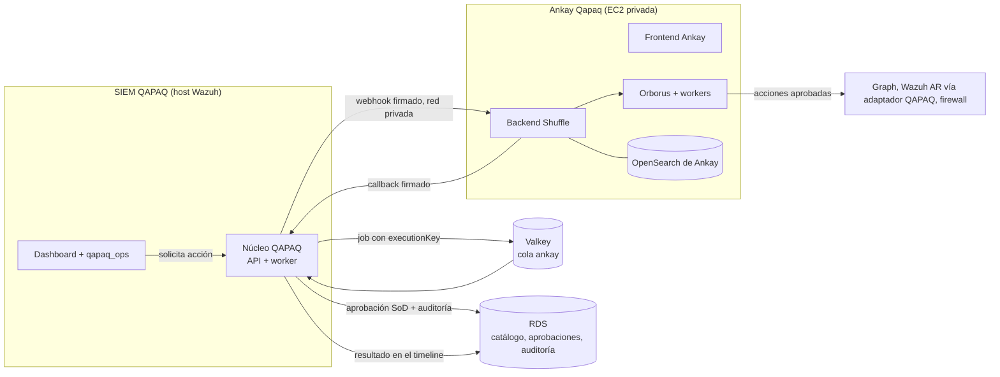

# 13 · Ankay Qapaq: plan de implementación del SOAR

**Ankay Qapaq** es el SOAR de QAPAQ SecOps: Shuffle con identidad QAPAQ, en la red interna,
conectado al SIEM QAPAQ para escalar alertas y automatizar respuestas. Se monta sobre Shuffle sin
reinventarlo, como ya se hizo con Wazuh: upstream fijado más un overlay versionado (ADR-028, A13).

**Alcance:** la UI con marca Ankay, la integración con el SIEM, la infraestructura y los primeros
playbooks. **Fuera de alcance:** los módulos para el equipo de riesgos no financieros, que define el
dueño con Franco.

**Arquitectura de la conexión con QAPAQ SecOps:** [14](14-ankay-conexion-qapaq.md).

### Estado de Ankay para Azure (revisión 29-10-2026)

Ankay queda preparado para levantarse con el alcance `soc` de `terraform-azure-demo-eus2.yml`. Todavía no está
desplegado ni probado de punta a punta en Azure.

| Componente | Origen | Estado |
| --- | --- | --- |
| frontend | Shuffle v2.3.0 + overlay `ankay/frontend` (marca, CSP, subruta `/ankay/`) | Build y fuente AGPL en CI |
| backend | Shuffle v2.3.0 + overlays Moby v29, seguridad Go y go-jose 4.1.6; sin acceso al daemon | Build, usuario 10001 y Trivy en CI |
| worker | Shuffle v2.3.0 + overlay Moby v29 | Build, usuario 10001 y Trivy en CI |
| orborus | Monorepo Shuffle **v2.2.0** (`36fad33`), último tag con Orborus bajo AGPL-3.0, portado a Moby v29 | Build y Trivy en CI; compatibilidad con backend 2.3.0 pendiente de la prueba en el host |
| opensearch | OpenSearch 3.9.0 por digest, derivada sobre AL2023 con dependencias parcheadas | Build, salud autenticada y Trivy en CI |
| docker-guard | Código QAPAQ (`ankay/runtime/docker-guard`) | Proxy del API Docker y único con el socket; probado contra el daemon real del runner |
| app `QAPAQ Ankay` 1.0.0 | Código QAPAQ + SDK de apps Shuffle (MIT, fijado por SHA-256) | Triage de solo lectura, verificación HMAC y retención de efectos |

`shuffle-security` queda fuera: no tiene licencia y no hace falta para ejecutar workflows. Su lugar lo ocupa
`docker-guard`, que cierra el gate del socket. Backend y frontend no tienen acceso al daemon; Orborus y los
workers solo hablan con el guard. El guard rechaza privileged, binds, namespaces del host, exec/attach, pull,
build y swarm, y solo opera sobre contenedores creados por él.

- Imágenes: `ankay-azure.yml` construye y verifica las siete imágenes. `ankay-azure-eus2-publish.yml` las
  publica en el ACR EUS2 por tag direccionado por contenido, junto con los paquetes de fuente AGPL, con una
  sola aprobación del environment `azure-demo-eus2`.
- Host: `infra/azure/modules/ankay_host` (VM `Standard_E2bds_v5`, única familia con cuota) y el Compose de
  `infra/azure/ankay-runtime/`, renderizado desde los digests publicados. OpenSearch usa una PKI propia por
  host y un usuario admin con hash bcrypt de la contraseña de Key Vault. Los siete secretos se generan al azar
  con `seed-eus2-key-vault-secret.yml`.
- Playbooks: `ankay/playbooks/build_workflows.py` genera los workflows desde todos los
  `docs/security/ankay-playbooks/*catalog*.yaml`, desde `playbooks.json` y desde los `*.workflow.json` revisados.
  El host los importa de forma idempotente cuando Compose está sano. El triage desde Wazuh es de solo lectura.
  Toda acción con efecto exige un despacho HMAC de QAPAQ Core con `approvalRef` y termina en
  `hold_for_outbox`, sin ejecutarse.
- Exposición: `/ankay/*` en el edge nginx del SIEM detrás de `auth_request` de la sesión QAPAQ, sin iframe y
  sin IP pública (bundle SIEM con `edge.json`).

Pendiente de evidencia en Azure: arranque y salud del Compose, login en Ankay, ejecución de un workflow
sintético con el worker vía docker-guard, persistencia tras reinicio, entrega del webhook Wazuh y revocación de
la sesión QAPAQ en el edge. El despacho gobernado desde el outbox de QAPAQ Core sigue sin implementarse en el
núcleo.

**Reparto:** Claude hace este plan y el rebrand del frontend. Codex despliega el SIEM y continúa la
integración. El dueño verifica el DevSecOps de Terraform.

## 1. Componentes de Shuffle v2.3.0 y qué cambia

| Componente | Qué hace | En Ankay |
| --- | --- | --- |
| `frontend` (React 18 + MUI, nginx) | Editor visual de workflows y administración | **Rebrandeado** (`ankay/`): tema, arte, textos y CSP |
| `backend` (Go) | API, workflows, organizaciones, ejecuciones | Sin cambios. Se configura por variables y por API (branding de la organización) |
| `orborus` | Orquesta los workers; necesita el socket de Docker | Sin cambios |
| `worker` y apps | Ejecutan cada acción en contenedores efímeros | Sin cambios. Apps OSS revisadas, sin servicios de terceros no aprobados |
| `opensearch` (base de datos de Shuffle) | Workflows, ejecuciones, credenciales cifradas | Propio de Ankay, pequeño y separado del Indexer de Wazuh (ver tradeoffs) |

## 2. Dónde encaja en el system design actual

Principios de ADR-028 que se mantienen:
- **QAPAQ decide y deja evidencia; Ankay ejecuta.** El catálogo de acciones, las versiones de playbook
  autorizadas, las aprobaciones (nadie aprueba lo que pidió), la idempotencia (`executionKey`) y la
  auditoría viven en el núcleo QAPAQ.
- Un timeout queda como `UNKNOWN` y se reconcilia antes de repetir, sin reintentos a ciegas.
- **Ankay nunca recibe credenciales del Indexer ni del Manager de Wazuh.** Active Response pasa por un
  adaptador QAPAQ con allowlist.

## 3. Tradeoffs analizados

| Decisión | Opciones | Recomendación | Por qué |
| --- | --- | --- | --- |
| **Dónde corre** | (a) en el host del SIEM; (b) host Linux privado dedicado; (c) servicio de contenedores sin socket Docker | **(b)**, aislado del SIEM; en AWS la propuesta original usa EC2 privada | (a) compite por memoria con Indexer, Manager y núcleo. Orborus necesita una interfaz Docker para lanzar workers efímeros. Un servicio que no exponga esa capacidad no sirve como sustituto directo. El socket Docker equivale a control root del host y exige aislamiento estricto |
| **Base de datos de Ankay** | Reutilizar el Indexer de Wazuh o un OpenSearch propio | **Propio**, un nodo pequeño | Reutilizar ahorra unos 2 GB, pero mezcla datos del SOAR con el SIEM, complica el Security plugin y acopla los upgrades. Un fallo de uno no debe tumbar al otro |
| **Identidad** | (a) SSO OpenID nativo de Shuffle contra Entra; (b) edge QAPAQ con `auth_request` | **(b) como puerta obligatoria más (a) para la sesión interna de Shuffle** | Shuffle no admite proxy auth y tiene sesiones propias. Ankay se publica **solo detrás del edge del SIEM** (`/ankay/` en el mismo host), que valida la sesión QAPAQ en cada request y conserva el SSO/roles propios de Ankay. La ruta no cambia autenticación, cookies ni roles QAPAQ. Al revocar la sesión QAPAQ, se pierde acceso al frontend en ≤ 5 s. Los analistas piden acciones desde el SIEM. Detalle en [14](14-ankay-conexion-qapaq.md) |
| **Rebrand** | Fork completo o overlay con codemod | **Overlay** (`ankay/`): 3 parches, arte con los mismos nombres de archivo y un codemod basado en AST | Unas 290 apariciones visibles y 460 colores en 180 archivos. Un fork se desincroniza en cada versión; el overlay se vuelve a aplicar sobre cualquier tag |
| **Servicios externos** (N1: no tercerizar) | Permitir o bloquear la nube de Shuffle, Algolia y servicios en Cloud Run | **Bloquear**: CSP de mismo origen en el frontend (parche 0003) y egress del host solo a destinos aprobados | El frontend llama a `shuffler.io`, Algolia y servicios de terceros. Con la CSP y el egress cerrado, no sale información del SOC. Se pierde la búsqueda de apps en la nube: las apps se cargan localmente |
| **Licencia** (AGPL-3.0) | Uso sin cambios o modificado | **Modificado, con el código fuente servido en `/source/`** | §13 de la AGPL: quien use Ankay por red debe poder obtener el código fuente modificado. `ankay/build.sh` lo empaqueta y lo publica dentro de la imagen. Pendiente: dictamen de Legal (U-022) |
| **Idioma** | Inglés de Shuffle o español | Inglés en la fase 1 y `qapaq_i18n` adaptado a React/MUI en una fase posterior | El editor lo usa un equipo técnico reducido; la UI del SIEM, que usan todos, ya está en español |
| **Costo** | — | Estimación histórica AWS: aprox. USD 60/mes (`t3.large` y 50 GB gp3); Azure requiere cotización aparte | No extrapolar ese monto a Azure. VM, discos, firewall y egreso se deben cotizar con SKU y región aprobadas antes del plan |

## 4. Fases y aceptación

| Fase | Contenido | Owner | Acepta cuando |
| --- | --- | --- | --- |
| **F0 · Rebrand del frontend** | Overlay `ankay/` | Claude | **Hecho en esta rama.** Los parches aplican sobre v2.3.0, el codemod pasa 8/8 tests, modifica 101 archivos sin romper sintaxis ni comparaciones y el build local llega hasta la imagen |
| F1 · Infraestructura | Host Linux privado con Compose completo, imágenes por digest, almacenamiento persistente, ruta protegida por sesión QAPAQ y egress por allowlist | Codex, con verificación del dueño | Todas las imágenes y servicios fijados, plan sin ingress público, policy/UDR revisadas, secretos por referencias seguras, y prueba de arranque/restauración. En Azure, `ankay_host` está conectado opcionalmente al root, pero permanece deshabilitado mientras `ankay_host=null`; habilitarlo requiere el perfil completo y las seis imágenes fijadas por digest. Aún no está desplegado |
| F2 · Conector SIEM ↔ Ankay | Cola `ankay` (docs/11), webhook firmado con HMAC, `executionKey` y callback autenticado hacia el núcleo | Backend | Una acción aprobada llega una sola vez aunque se reintente. Un timeout queda `UNKNOWN` y se reconcilia |
| F3 · Primeros playbooks | `enrich.ip-reputation` (sin efectos) → `endpoint.block-ip` (Wazuh AR) → `m365.revoke-sessions` (Graph), cada uno con aprobación | Backend y SOC | Ciclo completo en un sandbox con auditoría y SoD |
| F4 · Ankay dentro del SIEM | Catálogo, estado de ejecuciones y aprobaciones en `qapaq_ops`, más deep link al editor | Frontend | El analista no necesita entrar a Ankay para pedir ni seguir una acción |
| F5 · Automatizaciones OSS curadas (posterior a F4) | Evaluar contenido mantenido compatible con Wazuh, Shuffle/Ankay, M365, Sophos y Cato; fijar fuentes y versiones; adaptar con atribución/licencia | SOC, Security y Platform | QAPAQ, Ankay y las integraciones están operativas; cada regla/playbook se valida con eventos sintéticos, revisión de falsos positivos, permisos mínimos, aprobación humana para efectos y rollback. No importar ni activar contenido antes de esa aceptación |

## 5. Riesgos y decisiones abiertas

1. **U-022 (Legal):** confirmar el uso de AGPL con el código fuente ofrecido en `/source/`. Si no se
   acepta, el plan B es StackStorm (Apache-2.0), con más trabajo de integración.
2. **CSP estricta:** puede bloquear algún componente que use `eval` (editores de código). Hay que
   probarlo en el navegador. Si falla, se ajusta el parche 0003 sin abrir dominios externos.
3. **Unas 128 apariciones restantes de «Shuffle»** en comentarios, lógica y pantallas de licencias o
   facturación de la nube de Shuffle, que no se ven en una instalación propia. Se revisan en el navegador
   en F1.
4. **Catálogo de acciones (U-008):** cada acción con efectos necesita capacidad propia, aprobación y
   pruebas antes de habilitarse.
