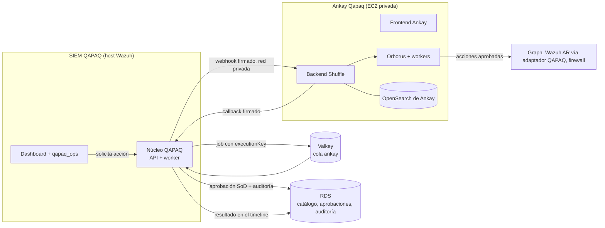

# 13 · Ankay Qapaq: plan de implementación del SOAR

**Ankay Qapaq** es el SOAR de QAPAQ SecOps: Shuffle con identidad QAPAQ, en la red interna,
conectado al SIEM QAPAQ para escalar alertas y automatizar respuestas. Se monta sobre Shuffle sin
reinventarlo, como ya se hizo con Wazuh: upstream fijado más un overlay versionado (ADR-028, A13).

**Alcance:** la UI con marca Ankay, la integración con el SIEM, la infraestructura y los primeros
playbooks. **Fuera de alcance:** los módulos para el equipo de riesgos no financieros, que define el
dueño con Franco.

**Arquitectura de la conexión con QAPAQ SecOps:** [14](14-ankay-conexion-qapaq.md).

**Reparto:** Claude hace este plan y el rebrand del frontend. Codex despliega el SIEM y continúa la
integración. El dueño verifica el DevSecOps de Terraform.

## 1. Componentes de Shuffle v2.3.0 y qué cambia

| Componente | Qué hace | En Ankay |
| --- | --- | --- |
| `frontend` (React 18 + MUI, nginx) | Editor visual de workflows y administración | **Rebrandeado** (`ankay/`): tema, arte, textos y CSP |
| `backend` (Go) | API, workflows, organizaciones, ejecuciones | Sin cambios. Se configura por variables y por API (branding de la organización) |
| `orborus` | Orquesta los workers; necesita el socket de Docker | Sin cambios |
| `worker` y apps | Ejecutan cada acción en contenedores efímeros | Sin cambios. Apps OSS revisadas, sin servicios de terceros no aprobados |
| `opensearch` (base de datos de Shuffle) | Workflows, ejecuciones, credenciales cifradas | Propio de Ankay, pequeño y separado del Indexer de Wazuh (ver tradeoffs) |

## 2. Dónde encaja en el system design actual

Principios de ADR-028 que se mantienen:
- **QAPAQ decide y deja evidencia; Ankay ejecuta.** El catálogo de acciones, las versiones de playbook
  autorizadas, las aprobaciones (nadie aprueba lo que pidió), la idempotencia (`executionKey`) y la
  auditoría viven en el núcleo QAPAQ.
- Un timeout queda como `UNKNOWN` y se reconcilia antes de repetir, sin reintentos a ciegas.
- **Ankay nunca recibe credenciales del Indexer ni del Manager de Wazuh.** Active Response pasa por un
  adaptador QAPAQ con allowlist.

## 3. Tradeoffs analizados

| Decisión | Opciones | Recomendación | Por qué |
| --- | --- | --- | --- |
| **Dónde corre** | (a) en el host del SIEM; (b) EC2 privada dedicada; (c) ECS Fargate | **(b)**, `t3.large` en la subred privada | (a) compite por memoria con el Indexer, el Manager y el núcleo en un `t3.xlarge` ya cargado. (c) no es viable: orborus necesita el socket de Docker para lanzar los workers. (b) aísla fallas y carga |
| **Base de datos de Ankay** | Reutilizar el Indexer de Wazuh o un OpenSearch propio | **Propio**, un nodo pequeño | Reutilizar ahorra unos 2 GB, pero mezcla datos del SOAR con el SIEM, complica el Security plugin y acopla los upgrades. Un fallo de uno no debe tumbar al otro |
| **Identidad** | (a) SSO OpenID nativo de Shuffle contra Entra; (b) edge QAPAQ con `auth_request` | **(b) como puerta obligatoria más (a) para la sesión interna de Shuffle** | Shuffle no admite proxy auth y tiene sesiones propias. Ankay se publica **solo detrás del edge del SIEM** (`/ankay/` en el mismo host), que valida la sesión QAPAQ en cada request y conserva el SSO/roles propios de Ankay. La ruta no cambia autenticación, cookies ni roles QAPAQ. Al revocar la sesión QAPAQ, se pierde acceso al frontend en ≤ 5 s. Los analistas piden acciones desde el SIEM. Detalle en [14](14-ankay-conexion-qapaq.md) |
| **Rebrand** | Fork completo o overlay con codemod | **Overlay** (`ankay/`): 3 parches, arte con los mismos nombres de archivo y un codemod basado en AST | Unas 290 apariciones visibles y 460 colores en 180 archivos. Un fork se desincroniza en cada versión; el overlay se vuelve a aplicar sobre cualquier tag |
| **Servicios externos** (N1: no tercerizar) | Permitir o bloquear la nube de Shuffle, Algolia y servicios en Cloud Run | **Bloquear**: CSP de mismo origen en el frontend (parche 0003) y egress del host solo a destinos aprobados | El frontend llama a `shuffler.io`, Algolia y servicios de terceros. Con la CSP y el egress cerrado, no sale información del SOC. Se pierde la búsqueda de apps en la nube: las apps se cargan localmente |
| **Licencia** (AGPL-3.0) | Uso sin cambios o modificado | **Modificado, con el código fuente servido en `/source/`** | §13 de la AGPL: quien use Ankay por red debe poder obtener el código fuente modificado. `ankay/build.sh` lo empaqueta y lo publica dentro de la imagen. Pendiente: dictamen de Legal (U-022) |
| **Idioma** | Inglés de Shuffle o español | Inglés en la fase 1 y `qapaq_i18n` adaptado a React/MUI en una fase posterior | El editor lo usa un equipo técnico reducido; la UI del SIEM, que usan todos, ya está en español |
| **Costo** | — | Aprox. USD 60/mes (`t3.large` y 50 GB gp3) | Se suma a la demo; se apaga con su propio flag de Terraform |

## 4. Fases y aceptación

| Fase | Contenido | Owner | Acepta cuando |
| --- | --- | --- | --- |
| **F0 · Rebrand del frontend** | Overlay `ankay/` | Claude | **Hecho en esta rama.** Los parches aplican sobre v2.3.0, el codemod pasa 8/8 tests, modifica 101 archivos sin romper sintaxis ni comparaciones y el build local llega hasta la imagen |
| F1 · Infraestructura | EC2 privada con Docker Compose de Shuffle, imagen `ankay-qapaq-frontend` en ECR, TLS interno, SG solo desde el host del SIEM, egress con allowlist, secretos en Secrets Manager y snapshots de su OpenSearch a S3 | Codex, con la verificación del dueño | Ankay responde solo desde la VPC, sin internet salvo destinos aprobados. El plan de Terraform no expone nada público |
| F2 · Conector SIEM ↔ Ankay | Cola `ankay` (docs/11), webhook firmado con HMAC, `executionKey` y callback autenticado hacia el núcleo | Backend | Una acción aprobada llega una sola vez aunque se reintente. Un timeout queda `UNKNOWN` y se reconcilia |
| F3 · Primeros playbooks | `enrich.ip-reputation` (sin efectos) → `endpoint.block-ip` (Wazuh AR) → `m365.revoke-sessions` (Graph), cada uno con aprobación | Backend y SOC | Ciclo completo en un sandbox con auditoría y SoD |
| F4 · Ankay dentro del SIEM | Catálogo, estado de ejecuciones y aprobaciones en `qapaq_ops`, más deep link al editor | Frontend | El analista no necesita entrar a Ankay para pedir ni seguir una acción |
| F5 · Automatizaciones OSS curadas (posterior a F4) | Evaluar contenido mantenido compatible con Wazuh, Shuffle/Ankay, M365, Sophos y Cato; fijar fuentes y versiones; adaptar con atribución/licencia | SOC, Security y Platform | QAPAQ, Ankay y las integraciones están operativas; cada regla/playbook se valida con eventos sintéticos, revisión de falsos positivos, permisos mínimos, aprobación humana para efectos y rollback. No importar ni activar contenido antes de esa aceptación |

## 5. Riesgos y decisiones abiertas

1. **U-022 (Legal):** confirmar el uso de AGPL con el código fuente ofrecido en `/source/`. Si no se
   acepta, el plan B es StackStorm (Apache-2.0), con más trabajo de integración.
2. **CSP estricta:** puede bloquear algún componente que use `eval` (editores de código). Hay que
   probarlo en el navegador. Si falla, se ajusta el parche 0003 sin abrir dominios externos.
3. **Unas 128 apariciones restantes de «Shuffle»** en comentarios, lógica y pantallas de licencias o
   facturación de la nube de Shuffle, que no se ven en una instalación propia. Se revisan en el navegador
   en F1.
4. **Catálogo de acciones (U-008):** cada acción con efectos necesita capacidad propia, aprobación y
   pruebas antes de habilitarse.
