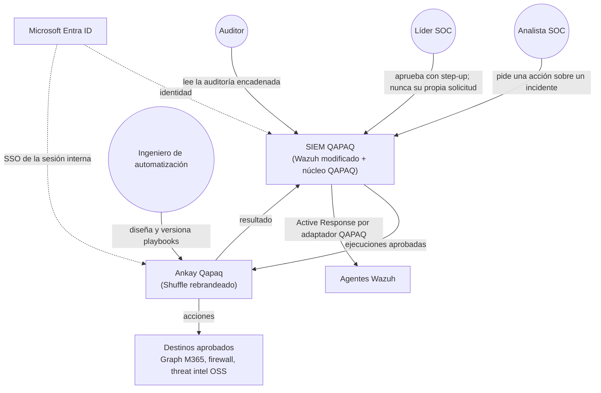
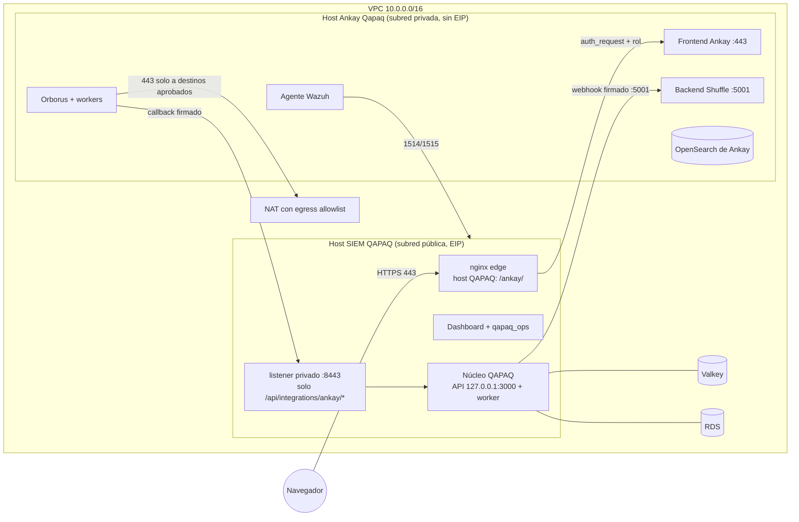
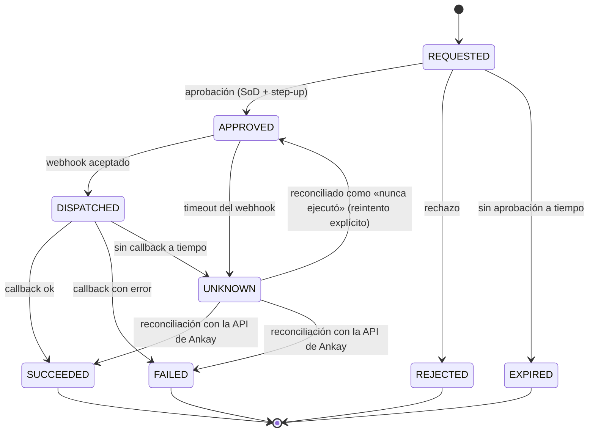

# 14 · Arquitectura: conexión de Ankay Qapaq con QAPAQ SecOps

Propuesta para leer de una sola vez cómo se conecta el SOAR (Ankay Qapaq, [13](13-ankay-qapaq.md)) con el
SIEM QAPAQ. Regla central: **QAPAQ decide y deja evidencia; Ankay ejecuta.** No hay otro camino hacia
Ankay: ni Wazuh, ni el navegador del analista, ni otro servicio lo invocan directamente.

## 1. Contexto: quién usa qué



| Persona | Entra a | Puede |
| --- | --- | --- |
| Analista SOC | SIEM (`qapaq_ops`) | Pedir acciones del catálogo y ver su estado. **No entra a Ankay** |
| Líder SOC | SIEM | Aprobar con step-up (nunca lo que pidió) y entrar a Ankay en modo lectura |
| Ingeniero de automatización (rol nuevo `qapaq.automation.engineer`, **pendiente de aprobación del dueño**) | Ankay | Diseñar workflows y publicarlos como versión candidata. Una versión entra al catálogo solo con la aprobación del Líder SOC |
| Auditor | SIEM | Leer la auditoría de cada ejecución |

## 2. Despliegue y red



| Flujo | Origen → destino | Puerto | Control |
| --- | --- | --- | --- |
| UI de Ankay | Navegador → `https://<host-QAPAQ>/ankay/` → edge → frontend privado | 443 + red privada | `auth_request` contra la sesión QAPAQ; Ankay conserva su SSO/roles propios. Sin acceso público directo a Ankay |
| Disparo de ejecución | Núcleo (host SIEM) → backend de Ankay | 5001 | SG solo desde el SG del host SIEM, cabecera de autenticación del webhook y firma HMAC |
| Callback | Workers de Ankay → listener privado del edge → núcleo | 8443 | SG solo desde el SG de Ankay y firma HMAC. El listener solo expone `/api/integrations/ankay/*` |
| Acciones externas | Workers → Internet | 443 | Egress por el NAT con allowlist de destinos (Graph, threat intel aprobada). Nada más sale |
| Monitoreo | Agente Wazuh en el host de Ankay → Manager | 1514/1515 | El SIEM vigila al SOAR: logs, FIM e integridad del host (N1/SBS) |

## 3. Secuencia de una acción

```mermaid
sequenceDiagram
  autonumber
  participant AN as Analista (qapaq_ops)
  participant CO as Núcleo QAPAQ
  participant LS as Líder SOC
  participant DB as RDS (auditoría)
  participant Q as Valkey (cola ankay)
  participant AK as Ankay Qapaq
  participant X as Destino (p. ej. Graph)
  AN->>CO: POST /api/incidents/:id/actions {actionId, params} + Idempotency-Key
  CO->>CO: capacidad, scope y validación de params contra el catálogo
  CO->>DB: acción REQUESTED + AuditEvent (misma transacción)
  LS->>CO: POST /api/actions/:id/approve (step-up; aprobador ≠ solicitante)
  CO->>DB: APPROVED + AuditEvent + outbox(executionKey)
  CO->>Q: job {actionId} con jobId = executionKey
  Q->>CO: worker toma el job
  CO->>AK: POST webhook del playbook (versión fijada) con firma HMAC
  AK-->>CO: 200 {execution_id}
  CO->>DB: DISPATCHED + execution_id
  AK->>X: acción (credencial de la app en Ankay)
  AK->>CO: callback firmado {executionKey, status, resumen}
  CO->>DB: SUCCEEDED o FAILED + AuditEvent + timeline del incidente
  CO-->>AN: /api/changes despierta la vista (long-poll)
```

## 4. Estados de una acción



`UNKNOWN` nunca se reintenta a ciegas (ADR-028). Antes de repetir, el núcleo consulta en Ankay el
estado de la ejecución por `execution_id` y `executionKey`.

## 5. Contrato

**Catálogo** (en QAPAQ, Postgres; versionado y auditado):

| Campo | Ejemplo | Para qué |
| --- | --- | --- |
| `actionId` | `m365.revoke-sessions` | Identificador estable |
| `playbookRef` | ID del workflow de Ankay y su versión fijada | Qué se ejecuta. Nunca lo elige el navegador |
| `paramsSchema` | `{ userRef: entityRef }` | Solo referencias opacas (D-10b): Ankay resuelve el dato con su propia credencial |
| `risk` | `low`, `medium` o `high` | Define la aprobación y el step-up |
| `capability` | `soar.execute.m365` | Quién puede pedirla |
| `approval` | `lead`, más step-up si es `high` | SoD (N5) |
| `timeouts` | webhook 10 s, callback 10 min | Cuándo pasa a `UNKNOWN` |

**Webhook de QAPAQ hacia Ankay:**

```http
POST https://ankay.internal:5001/api/v1/hooks/webhook_<id>
X-Qapaq-Timestamp: 1791990000
X-Qapaq-Execution-Key: 7f3c…        (idempotencia)
X-Qapaq-Signature: sha256=<HMAC(clave, timestamp + "." + cuerpo)>
Authorization: <secreto del webhook en Shuffle>
{ "executionKey": "7f3c…", "actionId": "m365.revoke-sessions", "version": "3",
  "params": { "userRef": "ent_9a1…" }, "incidentRef": "inc_51…", "callback": "https://siem.internal:8443/api/integrations/ankay/callback" }
```

- El primer paso de cada workflow es una app QAPAQ de validación (Python, versionada en `ankay/apps`, F2).
  Verifica la firma, el timestamp (≤ 5 min) y que `executionKey` no se haya visto antes. Shuffle no
  verifica HMAC de forma nativa.
- Nada de raw, PII, secretos ni cookies en el cuerpo.

**Callback de Ankay hacia QAPAQ:** `POST /api/integrations/ankay/callback`, con la misma firma, que
devuelve `{executionKey, executionId, status, summary}`. El núcleo valida firma, timestamp y estado
esperado y lo registra una sola vez. Un callback repetido responde 200 sin efecto.

**Reconciliación:** el núcleo consulta el estado de la ejecución en la API de Ankay con el
`execution_id`. A verificar en F2: la forma exacta de la respuesta del webhook y del endpoint de
resultados en Shuffle v2.3.0.

## 6. Fronteras de seguridad

| Frontera | Garantía |
| --- | --- |
| Navegador ↔ Ankay | Solo vía edge: sesión QAPAQ en cada request (≤ 5 s tras revocar, N9/N10), rol requerido y CSP de mismo origen (parche 0003) |
| SIEM ↔ Ankay | SG en ambos sentidos, HMAC con timestamp y nonce (`executionKey`), y la clave en Secrets Manager. **No se rota en el despliegue** (A20); su rotación es un procedimiento aparte |
| Credenciales de acción | Las tiene Ankay (p. ej. la app de Graph con permiso mínimo), en Secrets Manager. **QAPAQ nunca tiene escritura sobre Graph** ni Ankay credenciales del Indexer o del Manager. Active Response va por un adaptador QAPAQ con allowlist |
| Datos | Ankay guarda definiciones de workflow y ejecuciones con referencias. La evidencia y la auditoría viven en QAPAQ (RDS, cadena hash; S3 para evidencia) |
| Supply chain | Imagen de Ankay construida desde el tag fijado y su SHA, con el código fuente publicado (AGPL), en ECR con tag inmutable. Las apps de Shuffle permitidas forman una allowlist revisada |
| Monitoreo | Agente Wazuh en el host de Ankay: el SIEM vigila al SOAR (FIM, accesos, Docker) |

## 7. Resiliencia

| Falla | Comportamiento |
| --- | --- |
| Ankay caído o lento | El job queda en la cola con backoff y el breaker se abre. El analista ve «pendiente de ejecución». Nada se pierde: el outbox en Postgres es la verdad |
| Timeout ambiguo | `UNKNOWN` y luego reconciliación. Sin reintento ciego |
| Valkey caído | El núcleo despacha desde el outbox en proceso (degradado, docs/11) |
| Callback perdido | La reconciliación por `execution_id` lo recupera |
| Host del SIEM caído | No hay nuevas solicitudes. Lo que Ankay ya ejecuta termina y su callback se reintenta. La AMI histórica y los releases permiten volver atrás |

## 8. Cómo se ve en el SIEM (F4)

Dentro de `qapaq_ops`, en el incidente: un panel **Respuesta** con las acciones del catálogo permitidas
para la persona, su estado en vivo (por long-poll), quién pidió, quién aprobó, el `execution_id` y el
resumen. El Líder SOC tiene una bandeja de aprobaciones. Hay un deep link al editor de Ankay solo para
ingenieros de automatización.

## 9. Decisiones abiertas

1. **Rol `qapaq.automation.engineer`** para el editor de Ankay. Requiere aprobación del dueño y
   asignación en el sistema de identidad de Ankay; la ruta del edge solo exige la sesión QAPAQ.
2. **U-022:** dictamen de Legal sobre AGPL con el frontend modificado.
3. **App de validación HMAC** en Ankay (F2): Python, versionada en el repo.
4. **Listener privado :8443** del edge para los callbacks: se agrega en `wazuh/edge` en F2.
