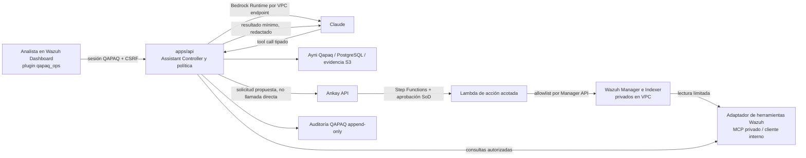

# 23 · Claude y Wazuh MCP para operaciones SOC

**Estado: propuesta en implementación local; no desplegada ni aprobada como cambio de política.** Revisión de código y documentación del repositorio: 2026-11-08. AWS serverless y Wazuh privado son el destino documentado, no evidencia de un despliegue existente. Este diseño no habilita respuesta automática ni cambia el límite de solo lectura de Qapaqzito.

## Objetivo

Dar al analista una ayuda integrada en QAPAQ SOC para priorizar alertas, investigar eventos relacionados y preparar informes de incidente. Una recomendación de Claude nunca modifica Wazuh por sí misma. Contención o remediación se presenta como una solicitud explícita de Ankay y sigue su aprobación humana, separación de funciones (SoD), allowlist, idempotencia y auditoría.

La integración usa el protocolo MCP para exponer herramientas SOC acotadas mediante el backend QAPAQ privado. No significa que Claude reciba acceso de red al Manager o al Indexer. El modelo recibe únicamente resúmenes mínimos a través del backend QAPAQ.

## Estado actual del proyecto y decisiones que gobiernan

- **Qapaqzito ya existe** en el plugin `qapaq_ops` y en `apps/api/src/assistant/`. `modules/assistant` define herramientas y el bucle del modelo; los adaptadores de Claude y las herramientas del SOC viven en la API. Las herramientas de investigación locales consultan datos mediante rutas QAPAQ `GET`, heredan sesión/capacidades y acotan resultados. La API no envía una consulta OpenSearch libre proporcionada por el navegador.
- **Política B10:** Qapaqzito es solo lectura, hereda los permisos de la persona, seudonimiza datos personales y está apagado por defecto. El proveedor Anthropic directo tiene gate legal N1/N2. La recomendación de despliegue es Bedrock privado, sujeto a habilitar el modelo y probar la ruta en la cuenta/región elegidas.
- **Wazuh es el dueño de agentes, manager, reglas e Indexer; QAPAQ es dueño de casos, investigación, evidencia, auditoría y acciones aprobadas.** N3 descarta un segundo SIEM.
- **Ankay** se diseña sobre Step Functions `STANDARD` y `waitForTaskToken`; ninguna persona inicia directamente una ejecución de acción sin pasar por el flujo gobernado. B12 mantiene la contención deshabilitada hasta que una decisión nueva apruebe playbook, permisos y prueba.
- `docs/02`, `docs/09` y `infra/aws-serverless/` describen destino/propuesta. El stack serverless tiene Lambdas en subredes privadas aisladas, endpoint de VPC para Bedrock opcional, y una EC2 Wazuh con reglas de red específicas. No se debe asumir que estos recursos están aplicados en AWS.
- En el árbol de trabajo hay cambios locales sin confirmar en Qapaqzito, configuración, decisiones, frontend y detecciones. Esta propuesta no declara esos cambios desplegados ni altera sus archivos.

Referencias internas: [B10 y B12](10-decisiones.md), [arquitectura](02-arquitectura.md), [Qapaqzito](15-qapaqzito-asistente.md), [Ankay](13-ankay-qapaq.md), [conexión de Respond](14-ankay-conexion-qapaq.md), [frontend](08-frontend-unificado.md), [plan de lanzamiento](09-plan-de-lanzamiento.md).

### Implementación local en curso

- El contexto de Qapaqzito en la cola de alertas ofrece atajos para priorizar y correlacionar; el prompt exige mantener intacta la prioridad original y distinguir evidencia, hipótesis y cobertura faltante.
- El backend ahora rechaza como unverified una conclusión factual cuando hubo herramientas exitosas y citas disponibles, pero el modelo no citó ningún ID real devuelto. El prompt prohíbe inferir compromiso/causalidad desde prioridad o coincidencia temporal solamente.
- En incidentes se ofrece la generación de un borrador ejecutivo, descarga Markdown y guardado explícito como nota inmutable en un incidente citado. La persona selecciona el incidente; el API vuelve a validar la capacidad `incidents.notes.write`. No se presenta como documento versionado.
- Las respuestas muestran acceso a Ankay y exportación de borrador. Qapaqzito sigue sin crear solicitudes ni ejecutar acciones.
- `assistant.ask` registra proveedor/modelo y tokens de entrada, salida y caché en metadata de auditoría; el endpoint administrativo agregado permite recorrer hasta 30 días y no revela prompts, respuestas ni usuario. Qapaqzito invoca su tool loop por el mismo dispatcher JSON-RPC MCP y el API expone `/api/assistant/mcp` con Streamable HTTP stateless, versión `2025-11-25`, sesión QAPAQ + CSRF y herramientas filtradas por capacidades; no hay herramienta de escritura.
- El panel Qapaqzito muestra configuración efectiva y consumo solo a personas con `observability.read_platform`. Presenta explícitamente que la facturación del proveedor no está conectada.

Estos cambios son código local y no están desplegados. El endpoint MCP aún no tiene validación de interoperabilidad contra clientes externos. Tampoco existe una bandeja separada de sugerencias de prioridad persistida, administración operativa del asistente, presupuesto global ejecutable o documento versionado: la prioridad operativa QAPAQ existente y la prioridad Wazuh siguen intactas; el borrador guardado hoy es una nota. Los contratos concretos de esas cuatro brechas están en [24 · Operación gobernada de Qapaqzito](24-qapaqzito-operacion-gobernada.md); son especificación, no evidencia de implementación.

## Correspondencia con el trabajo del SOC

| Necesidad | Automatización segura | Entrega para el analista |
| --- | --- | --- |
| Triaje y priorización | Reglas y deduplicación deterministas primero; Haiku clasifica solo el conjunto nuevo de alertas que supera filtros y umbrales. | Prioridad sugerida, motivos verificables, entidades, alerta fuente, ventana y confianza; analista acepta o corrige la clasificación. |
| Correlación | Consultas de lectura acotadas por tiempo, host, usuario, IP y agente; el servidor devuelve campos normalizados, paginados y con IDs. | Línea temporal ordenada con referencias a alertas/eventos originales; indicar huecos de telemetría y no presentar hipótesis como hechos. |
| Respuesta | Claude puede resumir opciones aprobadas del catálogo; el backend crea una solicitud Ankay, no llama a acciones Wazuh. | Vista previa de alcance/impacto, aprobador distinto del solicitante, ejecución idempotente solo después de aprobar, resultado y auditoría. |
| Informe | Generar borrador a partir del expediente QAPAQ y evidencias citadas; guardar como borrador editado por una persona. | Documento asociado al caso, historial de versiones, exportación autorizada, fuentes y fecha/hora Lima/UTC. No publicar automáticamente. |

El modelo no debe clasificar todos los eventos crudos de forma individual ni sustituir reglas Wazuh. El flujo de alto volumen debe agregar por fingerprint y dejar que la lógica determinista reduzca el conjunto antes de invocar Claude.

## Arquitectura objetivo



### Decisión de integración recomendada

**Fase inicial: mantener Qapaqzito como orquestador y puerta de política; añadir un adaptador privado compatible con MCP solo si aporta compatibilidad o contratos reutilizables.** Para la UI de QAPAQ el backend ya cuenta con un bucle de herramientas y lecturas SOC; migrar a un servidor MCP externo no es requisito para que Claude analice Wazuh. El endpoint integrado reutiliza el modelo de capacidades QAPAQ, las consultas parametrizadas y la red privada existente.

No conectar `claude.ai`/Claude Desktop directamente con un endpoint interno del Manager. Un conector alojado en Claude Platform requiere un endpoint alcanzable por el cliente/servicio y su flujo de autenticación; eso no equivale a mantener el trayecto dentro de la VPC. Para conservar el perímetro, el camino de inferencia de la app es `QAPAQ API → Bedrock Runtime VPC endpoint`. Claude solicita herramientas al runtime de la API; no abre una conexión a MCP ni recibe credenciales Wazuh.

Si la evaluación confirma que hace falta un servidor MCP independiente, ubicarlo en subred privada, sin IP pública ni NAT, con ingreso solo desde el SG de la API y egreso solo a Manager API/Indexer en puertos requeridos. En AWS serverless, preferir primero una función/adaptador desplegado junto al API cuando el transporte y los límites de ejecución lo soporten. Un servicio Fargate interno o sidecar en EC2 agrega costo y operación y requiere decisión/plan revisados. No abrir un ALB público ni hacer port-forward del Manager API. El endpoint MCP no es interfaz administrativa.

## Adaptador Wazuh MCP: criterios de selección

El enlace [Wazuh MCP Server](https://wazuhmcp.netlify.app/) apunta a un producto comunitario, no a una interfaz oficial de Wazuh. El README público encontrado pertenece a `gensecaihq/Wazuh-MCP-Server`; reporta 55 herramientas (41 lectura y 14 escritura), controles de scopes, toolsets y `confirm=true` para herramientas de escritura. La página declara capacidades de respuesta automática. Por tanto:

1. **No desplegar upstream tal cual con credenciales de escritura.** Para cualquier evaluación, fijar commit/release e imagen por digest, revisar licencia, SBOM y dependencias, escanear imagen, leer el código de cada herramienta y ejecutar en cuenta/lab separado.
2. Configurar allowlist explícita de herramientas de lectura y denegar toolsets de escritura, si el servidor lo permite. Validar la denegación en el servidor para `tools/list` y `tools/call`; ocultar herramientas en el prompt no es control de autorización.
3. El servidor debe exigir TLS interno, autenticación de servicio, autorización por capacidad y rotación de secreto. `health`/`ready` no deben revelar configuración ni credenciales. No reutilizar la cuenta admin de Wazuh; crear un principal API de lectura mínima y probar el alcance efectivo.
4. Tratar las alertas, notas, nombres de archivos, nombres de proceso y campos indexados como **datos no confiables** que pueden contener prompt injection. El tool router ignora instrucciones dentro de los datos y jamás permite que estos cambien política, modelo, herramientas o aprobación.
5. Ninguna herramienta MCP hace `POST`, `PUT`, `DELETE`, reinicio, bloqueo, aislamiento, deshabilitación, shell remoto o cambio de configuración en la primera entrega. Si se habilita una acción en el futuro, el modelo solo redacta la propuesta Ankay; la acción real se resuelve fuera del canal MCP de lectura.
6. Las consultas al Indexer se construyen en backend a partir de esquemas tipados, índices permitidos, rangos máximos y límite de resultados. No aceptar DSL, script, regex ilimitada o nombres de índice del cliente.

Las capacidades útiles para este caso son: resúmenes de alertas, eventos de seguridad, detalle de alerta, inventario/salud de agentes, FIM dentro de un caso y búsqueda acotada. El adaptador debe devolver evidencia compacta y referencias estables, no cargar el documento completo del Indexer al contexto del modelo.

## Contratos de datos y herramientas

Cada respuesta que se envía al modelo debe tener esquema y límite de tamaño. Contrato sugerido:

```json
{
  "source": "wazuh.alert",
  "sourceId": "<id estable>",
  "observedAt": "<UTC ISO-8601>",
  "agent": { "id": "<id>", "name": "<nombre visible>" },
  "rule": { "id": "<id>", "level": 0, "description": "<descripción>" },
  "entities": [],
  "fields": {},
  "redactions": [],
  "truncated": false
}
```

Herramientas iniciales sugeridas (nombres lógicos; no son endpoints implementados):

| Tool | Entrada validada | Resultado máximo / uso |
| --- | --- | --- |
| `alerts.list_recent` | `from`, `to`, `severity[]`, `agentId?`, `limit<=50`, cursor | Resumen y referencias; vista previa/cursor en vez de páginas ilimitadas. |
| `alerts.get_context` | `alertId` | Alerta, regla, campos proyectados y enlaces a origen; no dump raw por defecto. |
| `entities.timeline` | una entidad, tipos permitidos, intervalo máximo configurable y `limit<=100` | Eventos de fuentes disponibles y ordenados; marcar tiempo sin cobertura. |
| `agents.health` | grupo opcional con autorización | Estado y última conexión, sin acciones de gestión. |
| `cases.get_evidence` | `caseId` y `sourceIds[]` acotados | Evidencia ya autorizada dentro de QAPAQ, redactada y citada. |
| `reports.draft` | `caseId`, formato, sección | Borrador no publicado asociado al caso; no corre como herramienta de ejecución del modelo si no está habilitado. |

No crear una herramienta genérica `wazuh_api(path, method, body)` ni `indexer_search(query)`. Las herramientas deben responder `unknown`, `degraded`, `empty`, `truncated` y `failed` como estados distintos. Cada afirmación factual del análisis debe citar `sourceId` y tiempo; lo que no tiene fuente se etiqueta como hipótesis.

## Flujos de extremo a extremo

### Triaje priorizado

1. Wazuh produce la alerta; reglas y exclusiones gestionan falsos positivos conocidos. QAPAQ deduplica por fingerprint (regla, agente, entidades y ventana), guarda el estado y calcula severidad operativa reproducible.
2. El backend aplica límites, deduplicación y cuotas antes de la invocación. Solo candidatos nuevos o escalados se enriquecen; lotes pequeños con resumen por alerta evitan llamadas repetidas.
3. Haiku sugiere prioridad, categorías, motivo corto, confianza y evidencia. Un resultado de baja confianza, crítico, o fuera del schema se eleva a revisión humana/Sonnet o se marca como sin clasificación; no cambia la severidad original de Wazuh.
4. El analista acepta/corrige; se persiste la decisión y la versión de regla/prompt/modelo para medir precisión y falsos positivos. No usar la salida del modelo como verdad de datos ni cerrar alertas automáticamente.

### Investigación/correlación

1. El analista abre Qapaqzito desde una alerta/caso con el contexto mínimo (IDs, no el texto de toda la pantalla).
2. API aplica capacidades de la sesión, consulta las herramientas de lectura necesarias, limita el periodo y proyecta campos. Las consultas independientes pueden ejecutarse en paralelo con un máximo fijado.
3. Claude recibe un único paquete compacto; devuelve secuencia temporal, relaciones, contradicciones, huecos de cobertura y referencias citables.
4. La UI permite abrir la alerta/evento fuente y adjuntar el resumen como nota/borrador. La consulta y las fuentes quedan auditadas; el texto del modelo se identifica como asistido por IA.

### Contención gobernada

1. Qapaqzito explica una opción habilitada en el catálogo y prepara resumen/entidades para revisión.
2. Analista presenta una solicitud concreta en Ankay. La API vuelve a validar rol, capacidad, recursos, allowlist y versión de política; no confía en los parámetros sugeridos por el LLM.
3. Step Functions pide aprobación a una segunda persona. Rechazo, timeout, falla de auditoría o fallo del Manager no ejecutan una acción parcial.
4. Solo la Lambda de acción usa el secreto mínimo para la Wazuh Manager API/Active Response; resultado, actor, aprobador, parámetros autorizados y evidencia se auditan.

Este flujo permanece bloqueado por la Gate B12 para acciones específicas que no tengan decisión, permiso y prueba aprobados.

### Informe ejecutivo

El informe se genera desde el caso y su evidencia estructurada: resumen ejecutivo, alcance conocido, cronología, impacto confirmado/desconocido, decisiones, mitigaciones recomendadas, responsables y referencias. Redactar PII, secretos, tokens, IPs según política de exportación. El botón **Guardar borrador** crea una versión en el caso; **Aprobar/publicar/exportar** exige capacidad separada y auditoría. Nunca crear un reporte que afirme contención o impacto sin un evento fuente que lo demuestre.

## Experiencia frontend y administración

El hogar del asistente sigue siendo el panel Qapaqzito de `wazuh/dashboard/plugins/qapaq_ops`; las vistas de alerta/caso son el punto de entrada para tareas contextuales. Conservar QAPAQ oscuro/grafito, selección ámbar moderada y UX en español. No crear una segunda consola independiente ni mostrar controles que no correspondan a un endpoint real.

### Panel del analista

- **Bandeja priorizada:** prioridad sugerida separada claramente de severidad Wazuh, motivo breve, confianza, edad, fuente, agente/entidad, dueño y estado de revisión. Filtros por crítica/nueva, asignada, fuente degradada y sugerencia pendiente.
- **Expediente de investigación:** línea temporal, entidades y relaciones, evidencias citadas, cobertura/faltantes, resumen Claude y acciones del analista. Cada dato permite volver a fuente Wazuh/QAPAQ.
- **Acciones:** «Crear solicitud en Ankay» solo si el usuario tiene capacidad y el catálogo ofrece la acción; botón abre vista previa del alcance y no ejecuta. Mostrar quién debe aprobar y el estado de aprobación.
- **Informe:** editor de borrador con citas, estado «asistido por IA», versión, autor humano y controles de guardar/exportar según capacidad. Mostrar errores recuperables y conservar texto si Claude no responde.
- Diferenciar siempre `sin alertas`, `sin datos`, `fuente degradada`, `respuesta truncada` y `fallo de Claude`. No poner «Todo seguro» cuando no haya telemetría suficiente.

### Administración (solo capacidades administrativas)

Crear una sección **Asistente IA** bajo administración, protegida por capacidades QAPAQ y no por un rol universal. Mostrar y controlar solo ajustes soportados por backend:

1. **Estado y proveedor:** habilitado/deshabilitado; Bedrock/Anthropic según configuración desplegada; modelo e ID allowlisted; versión de prompt; última validación y salud. Un administrador puede usar «Probar conectividad» con un caso sintético, que no exponga datos reales.
2. **Política de datos:** redacción PII, campos permitidos, región/proveedor, logging de invocación y retención. Secretos se representan como `configured`/`missing`; nunca devolver, editar o copiar valores de secreto al navegador. Rotación por Secrets Manager/operación documentada.
3. **Consumo:** solicitudes y tokens input/output/cache, costo estimado por proveedor/modelo/uso/usuario, límite mensual configurado, consumo del periodo, alertas al 50/80/100%, llamadas bloqueadas por presupuesto, errores y latencia. Mostrar «estimado» hasta reconciliar con factura AWS/Anthropic.
4. **Gobierno:** catálogo de herramientas activas y scope (`read`/`write`), capacidades que las habilitan, versión y fecha de revisión. Las herramientas de escritura no se pueden habilitar desde un simple toggle del frontend; requieren cambio de política, código y gate de release.
5. **Cuotas:** límite de solicitudes por persona, límite global por minuto/mes, concurrencia, longitud máxima, `max_tokens`, profundidad de tool loop y ventana de consulta. El backend debe rechazar con razón clara, aplicar idempotencia a jobs de lote y protegerse ante reintentos duplicados.
6. **Trazabilidad:** registros de uso filtrables por fecha, usuario, caso, modelo, resultado, tokens y costo; nunca guardar contenido completo de prompt por defecto. La auditoría guarda IDs, versión y métricas necesarias, no secretos ni alertas crudas.

La configuración normal pasa por un API administrativo tipado y auditado. El cambio de modelo/proveedor exige validación de acceso/model ID, red, región, límite de costo y evaluación de calidad antes de guardar. Estado desconocido se muestra como desconocido; no se infiere un proveedor por un nombre de secreto.

## Red privada y despliegue AWS

Topología consistente con `infra/aws-serverless/`:

- **Inferencia recomendada: Amazon Bedrock Runtime**, mediante interface VPC endpoint y IAM limitado al modelo o inference profile aprobado. Lambdas privadas sin ruta Internet/NAT. Confirmar que Mantle/API SDK actual usa el servicio de endpoint configurado y que el modelo está habilitado en la región; la propia documentación del stack marca esta integración como no verificada.
- **No usar la API directa de Anthropic desde la Lambda privada aislada** si se mantiene la condición sin NAT. Si un gate legal autoriza ese proveedor, documentar claramente que la inferencia sale a Anthropic, definir el egress con proxy/NAT dedicado, controles de dominio y presupuesto; no describirlo como tráfico que permanece dentro de VPC.
- La ruta de aplicación `/api/assistant/mcp` ya exige sesión QAPAQ y CSRF, pero su aislamiento de red en AWS queda como gate: excluirla del encaminamiento público de CloudFront/API Gateway o ubicarla tras ingreso interno antes de habilitar clientes MCP externos.
- **Wazuh MCP y Manager API** permanecen privados. SG de origen API/adaptador hacia SG Wazuh, puertos específicos requeridos, validación TLS y certificado CA. No exponer 55000, 9200 ni MCP en CloudFront/WAF/internet. La consola del analista puede usar CloudFront/API Gateway para UI, pero las rutas de herramientas son server-side y no proxy genérico.
- Secretos de Wazuh, tokens de servicio y claves del proveedor en Secrets Manager cifrado por KMS. Resolver `secretRef` en runtime, rol dedicado, rotación y acceso mínimo. Prohibido guardar clave en `.env` versionado, Terraform state/plan o frontend. El `.env` activo no es parte de esta propuesta ni se requiere leerlo.
- Inference logging de Bedrock puede almacenar cuerpo de prompt y respuesta en CloudWatch/S3. Mantenerlo desactivado para contenido real por defecto, o filtrar/separar, restringir acceso y retención con aprobación de seguridad/Legal. Para métricas de costos registrar contadores de tokens sin guardar cuerpo.
- Para lote de enriquecimiento, usar flujo administrado de SQS/EventBridge/Lambda previsto en B4 solo cuando esté implementado; DLQ, límites de concurrencia, deduplicación, expiración, manejo de poison messages y presupuesto por lote. No ejecutar llamadas a Claude dentro del camino crítico de ingesta Wazuh.
- Si el MCP upstream requiere proceso HTTP persistente, evaluar Fargate privado o integración en el host Wazuh como decisión separada. No añadir NAT solo por el MCP; no instalarlo como contenedor privilegiado que comparta red/volúmenes del Manager sin análisis de aislamiento.

### Despliegue por etapas

1. **Diseño y contrato:** cerrar herramientas read-only, fuentes disponibles, scopes, retención, proveedor/región y responsable de aprobar; registrar decisión si se modifica B10/B12/B1/B5.
2. **PoC aislada:** dataset sintético, fixture de prompt injection, rol de solo lectura, conectividad a Wazuh de prueba; no usar cuenta de producción ni invocar Active Response.
3. **Integración backend:** tool router tipado, controles de sesión/capacidad, redacción, cuotas, presupuesto, auditoría de metadatos, `requestId` y fallback si modelo/MCP se degrada.
4. **UI oscura para SOC piloto:** panel Qapaqzito, lista explicable, expediente, borradores y consola de administración basada en endpoints reales. Funciones sin endpoint se ocultan.
5. **Prueba de calidad y seguridad:** replay de alertas sintéticas/redactadas; precisión de severidad, recall de incidentes críticos, tasa de sugerencias corregidas, citas válidas, robustez a inyección, aislamiento de roles, límites de costo y latencia. No proclamar ahorro de falsos positivos sin medición comparativa.
6. **Canary en entorno autorizado:** analistas designados, lote y cuota limitados, observación diaria, interruptor de deshabilitado, rollback al Qapaqzito de solo lectura existente.
7. **Gate de respuesta:** habilitar cada playbook aparte con decisión B12, pruebas sandbox, aprobación SoD, kill switch y release evidence conforme a `docs/09`.

## Minimización de costos Claude

El costo no es únicamente número de conversaciones. Se debe medir tokenización real por ruta de uso y proveedor, coste del runtime privado/endpoints, logging, base de datos y consultas a Wazuh. Para Anthropic API, la tabla oficial consultada el 2026-11-08 publica Haiku 5.5 a USD 0.10/MTok input (prompts ≤100k) y USD 0.50/MTok output; Sonnet 5.5 a USD 2/MTok input y USD 10/MTok output. Son precios first-party, no son cotización de Bedrock; revalidar en pricing AWS por modelo/región antes de elegir.

Ejemplo orientativo first-party, no factura: 1 MTok input + 0.1 MTok output cuesta aproximadamente **USD 0.15 con Haiku 5.5** o **USD 3 con Sonnet 5.5**, antes de cache, descuentos, impuestos, egress y cómputo. La diferencia surge del modelo y de las tarifas publicadas; un resultado incorrecto que provoca más llamadas puede anular el ahorro. Las tareas que necesitan juicio reciben Sonnet bajo política; Opus se reserva para escalamiento excepcional medido, no como predeterminado.

Controles de ahorro en orden de impacto:

1. **Filtrar antes del LLM:** reglas Wazuh, deduplicación, severidad, allow/deny lists revisadas, ventanas y estado de incidente. No invocar por cada evento/heartbeat.
2. **Agrupar y resumir:** una llamada por lote de alertas similares, con máximo de items/campos por llamada; hash/fingerprint para no repetir. El resumen conserva el ID de cada evidencia.
3. **Enrutamiento por dificultad:** Haiku para clasificación corta; Sonnet para investigación, correlación compleja e informe; no usar Opus de forma rutinaria. Escalar solo ante criterio verificable (baja confianza, crítico, evidencia conflictiva, evaluación).
4. **Contexto pequeño:** consultas con filtros y proyección, IDs en vez de payload duplicado, ventana temporal mínima útil, top-k, no enviar el chat entero ni raw logs. Limitar historial a turnos recientes/resumen compacto.
5. **Límite de salida y vueltas:** `max_tokens` por tarea, una salida JSON compacta, máximo configurable de tool calls, `effort=low/medium` en triaje; sin razonamiento extenso para clasificación.
6. **Caché selectiva:** reutilizar prefijos estáticos (política, catálogo, esquema) y no datos dinámicos de alerta. Solo activar prompt caching cuando el prefijo supere mínimo de modelo, el hit rate medido compense el coste de escritura y retención sea aceptable. No cachear mezcla de tenants/personas si el aislamiento no es probado.
7. **No reintentar a ciegas:** backoff con jitter solo para errores transitorios, máximo de intentos, idempotencia por evento/lote, circuit breaker y fallback a cola/manual. No repetir una operación que pueda crear un segundo informe/caso.
8. **Presupuesto ejecutable:** contadores pre-invocación con token estimate conservador, cuotas usuario/caso/día y presupuesto mensual. Rechazo o degradación a reglas deterministas al alcanzar límite, con aviso visible al admin.
9. **Comparar por calidad y costo:** guardar tokens input/output/cache, modelo, operación, alertas procesadas y correcciones humanas; evaluar costo por alerta útil y por caso correctamente escalado, no solo costo por request.

Fórmula para reporte presupuestario:

```text
costo_modelo ≈ (input_no_cache × tarifa_input
              + input_cache_read × tarifa_cache_read
              + input_cache_write × tarifa_cache_write
              + output × tarifa_output) / 1,000,000
costo_total = costo_modelo + cómputo + endpoints privados + logs + almacenamiento + red
```

Para Bedrock, la API de métricas debe capturar `inputTokenCount`, `outputTokenCount` y, donde aplique, cache-read/write tokens. Correlacionar por `requestId`, modelo y categoría (`triage`, `investigation`, `report`); usar Cost Explorer/CUR para liquidación. Invocation logging contiene cuerpos y no se debe activar simplemente para medir costo.

## Métricas, auditoría y privacidad

Métricas recomendadas, sujetas a establecer baseline antes de publicar SLO: invocaciones/alerta, tokens por uso, costo estimado y liquidado, cache hit, tool calls por respuesta, latencia, error/timeouts, alertas únicas procesadas, tasa de corrección humana, calidad de citas, casos escalados y cobertura de fuentes. Desglosar fuente/modelo/prompt version y no incluir PII en etiquetas métricas.

Auditar: actor QAPAQ, sesión/caso/alert IDs, modelo e ID de proveedor, versión de prompt y catálogo, herramientas llamadas, query window/contadores, hash del resultado si aplica, token/costo, estado y corrección/aprobación. Evitar copiar logs crudos o prompt completo en auditoría. La salida del modelo y notas son datos no confiables; el escape/render debe ser seguro y la retención sigue las decisiones de Legal y `docs/05`.

## Riesgos y mitigaciones

| Riesgo | Control requerido |
| --- | --- |
| Prompt injection en logs/alertas | Tratar datos como contenido, no instrucciones; tools de esquema cerrado; redacción y pruebas adversariales; nunca otorgar autoridad al texto recuperado. |
| Exposición del Manager API/Indexer/MCP | Solo VPC; SG por origen/puerto; TLS verificado; sin endpoint público; secretos fuera del navegador. |
| Error al priorizar incidente crítico | Regla determinista de mínimo de prioridad, revisión humana; no bajar severidad Wazuh; evaluación con fixtures/versionado. |
| Acción destructiva sugerida/ejecutada | Qapaqzito read-only; Ankay separado; aprobación independiente, allowlist, idempotencia, auditoría y gate B12. |
| Cruce de permisos | API resuelve sesión y capacidad por request; MCP no recibe credencial global con más alcance que el actor; prueba de acceso horizontal. |
| Costos descontrolados | Topes antes de invocar, cuotas, batch/dedupe, max output/tool calls, alerta Budget, kill switch y modo reglas/manual. |
| Datos sensibles en logs del proveedor | No habilitar invocation logs de cuerpos por defecto; minimización, redacción, retención y aprobación de seguridad/Legal. |
| Dependencia comunitaria comprometida | Pin de commit/digest, revisión de licencia/código, SBOM, escaneo, pruebas de scopes; opción de no usar upstream y mantener adaptador QAPAQ. |
| Incidente durante caída del modelo | QAPAQ/Wazuh siguen operando; UI muestra degradación; no retener ingesta esperando Claude; ruta manual y reintento con límites. |

## Criterios de aceptación del diseño/piloto

- La UI de Qapaqzito opera con sesión QAPAQ y una persona nunca puede obtener datos que su capacidad no le permitiría consultar en el SOC.
- El trayecto Lambda→Bedrock usa el endpoint privado aprobado; MCP/Manager/Indexer no tiene listener público y los SG expresan solo las rutas necesarias.
- El modelo no puede ejecutar ni listar una herramienta de escritura; intento de tool call de acción no alcanza Wazuh. Contención se solicita por Ankay y requiere aprobador distinto.
- Cada recomendación de prioridad/investigación muestra fuente y tiempo; las respuestas incompletas o sin cobertura se reconocen explícitamente.
- Presupuesto y límite mensual detienen o degradan llamadas con registro auditable; medición por modelo/operación cuadra con métricas del proveedor dentro de tolerancia definida durante piloto.
- Administrador ve proveedor/modelo configurado, salud, uso, límite y herramientas efectivas; ningún secreto aparece en API de lectura o frontend.
- Un informe guardado es borrador/versionado y solo contiene referencias autorizadas; publicar/exportar queda bajo capacidad/auditoría.
- El piloto usa evidencia sintética o entorno autorizado, registra SHA, versiones, configuración de modelo/red, métricas, correcciones humanas y bloqueos restantes en release evidence.

## Fuentes técnicas revisadas

Fuentes web consultadas el 2026-11-08; validar nuevamente versiones, precios y disponibilidad antes de construir/desplegar:

- [Sitio Wazuh MCP enlazado por el usuario](https://wazuhmcp.netlify.app/).
- [README del servidor comunitario Wazuh-MCP-Server](https://github.com/gensecaihq/Wazuh-MCP-Server/blob/main/README.md) y [guía de operación](https://github.com/gensecaihq/Wazuh-MCP-Server/blob/main/docs/OPERATIONS.md).
- [Especificación MCP Streamable HTTP](https://modelcontextprotocol.io/specification/2025-11-25/basic/transports).
- [Documentación oficial de Wazuh Server API](https://documentation.wazuh.com/current/user-manual/api/index.html).
- [Precios oficiales de Claude Platform](https://platform.claude.com/docs/en/about-claude/pricing) (tarifa first-party; Bedrock factura según su tabla propia).
- [Precio/uso de Claude Sonnet 5.5](https://www.anthropic.com/claude-sonnet-5-5).
- [Prompt caching para modelos Anthropic en Bedrock](https://docs.aws.amazon.com/bedrock/latest/userguide/prompt-caching.html).
- [Model invocation logging de Bedrock](https://docs.aws.amazon.com/bedrock/latest/userguide/model-invocation-logging.html), que puede registrar request/response y por ello requiere revisión de privacidad.
