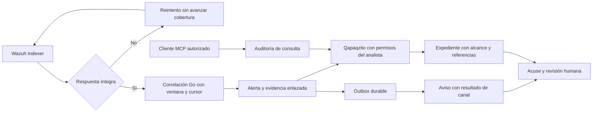

# Programa de confiabilidad e investigacion SOC

> Estado: auditoria inicial completada el 2026-11-11. El release live `20261112T182253-7624`
> reporta API y correlador Go healthy. El push de Manager está habilitado, pero falla TLS por CA
> ausente en `custom-qapaq` y no existe receipt; por tanto no se acredita entrega push. Siguen faltando
> canario Wazuh end-to-end, fixture M365 autorizada, medición de falsos positivos sobre corpus SOC,
> aceptación real de notificaciones y validación funcional/browser de la UI. Ningún objetivo de este
> programa se declara entregado por el healthcheck del release.
> La plataforma vigente es EC2 + Docker + PostgreSQL, sin perfil IAM; ver [02](02-arquitectura.md).

## Estado de runtime live y límites de componentes (2026-11-12)

La revisión de runtime del release `20261112T182253-7624` distingue el estado del proceso de la
entrega funcional de eventos. Los hallazgos live de salud son API **healthy** y correlador Go
**healthy**. El Wazuh Manager tiene la integración `custom-qapaq` activada, pero su llamada HTTPS al
edge falla por CA no configurada en el entorno de la integración Python. No aparece un receipt en
la inbox, consistente con que la petición no completó el handshake TLS ni alcanzó el endpoint API.
El push, por tanto, **no está entregando alertas** en este release. El pull de Indexer de 60 s sigue
siendo la ruta de reconciliación, según `QAPAQ_INGESTION_INTERVAL`; no se debe llamar a esto entrega
instantánea end-to-end.

| Componente | Estado probado | Lo que no demuestra / siguiente gate |
| --- | --- | --- |
| API QAPAQ | Healthy en el release live | No acredita recepción push ni nuevas alertas persistidas; para eso hace falta un receipt y un evento sintético visible en SOC. |
| Wazuh Manager `custom-qapaq` | Integración activada; error TLS por CA ausente | Instalar/configurar la CA que valida el certificado del edge para el runtime Python del Manager; probar handshake desde el contenedor y reintentar evento sintético hasta observar el receipt. |
| Inbox push PostgreSQL | Código, migración y pruebas locales presentes | No hay receipt del release live; no asumir que la ruta push llega a PostgreSQL mientras el Manager no complete TLS y `/api/ingest/wazuh` no confirme `202`. |
| Correlador Go (`services/qapaq-correlator`) | Servicio Compose separado, healthy live; expone endpoints internos `/healthz`, `/readyz`, `/metrics` | El healthcheck `/healthz` confirma proceso, no el `readyz` ni reducción medida de falsos positivos. Verificar readiness/métricas live y usar corpus SOC adjudicado para evaluar FP. |
| Cintel (`services/cintel-worker/vendor/cintel`) | Código Python del CLI está presente en el árbol local | **No conectado ni desplegado como servicio QAPAQ**: no hay Dockerfile, entrypoint worker, servicio Compose, API, cola ni workflow para Cintel. `docs/security/cintel-integracion-qapaq.md` mantiene pendiente la autorización de licencia y los gates de aislamiento/privacidad. |
| Cola y workers | El perfil EC2 define API + PostgreSQL; inbox/outbox y sus despachadores viven en el proceso API | No hay servicio worker BullMQ/SQS independiente en el Compose EC2; `apps/worker` sigue siendo lifecycle-only. Shuffle/Orborus crea workers de Ankay, un subsistema distinto y no un worker de Cintel ni de informes. |

La ruta para corregir el bloqueo push es validar la cadena TLS que presenta el edge y configurar en
el Manager el almacén de CA que usa `urllib`/Python; no desactivar verificación TLS. Después se debe
emitir un evento de prueba aprobado y comprobar, en orden, respuesta `202`, receipt durable,
promoción idempotente y alerta visible. La corrección y el canario no se consideran hechos por el
healthcheck de API/correlador.

## Objetivo

Completar, en orden, la entrega confiable de eventos, la frescura visible de fuentes, las
notificaciones urgentes, la investigacion M365, la calidad medida del correlador, el acceso de
owners SOC y los informes progresivos. Cada bloque requiere contrato documentado, pruebas,
revision cruzada y evidencia. La ruta de despliegue queda separada hasta que el entorno permita
una liberacion y validacion controladas.

## Secuencia, evidencia y aceptacion

| Orden | Bloque | Hallazgo auditado | Criterio para cerrar |
| --- | --- | --- | --- |
| 1 | Ingesta push durable | `POST /api/ingest/wazuh` solo despierta el pull; si el evento no esta indexado puede esperar el ciclo de 60 s. El perfil activo no puede usar SQS/IAM. | El endpoint confirma `202` solo despues del commit en una inbox PostgreSQL. Consumidor con lease/fencing, reintentos y estado terminal procesa un hint minimo y consulta el documento original en Indexer; la promocion usa el normalizador actual para compartir identidad con pull. Pruebas cubren HMAC, replay, commit-antes-de-202, duplicados concurrentes, crash/retry y push/pull superpuestos. Tiempos servidor: `t0` ingreso autenticado a API, `t1` commit inbox, `t2` alerta persistida. Objetivo interno inicial p95(t1-t0)<1 s y p95(t2-t0)<10 s con 10 eventos/s sostenidos por 10 min y burst de 50 eventos/s por 60 s; esto mide el subsistema QAPAQ, no Manager-a-alerta. Medir origen-a-alerta en canario con skew de reloj y fijar umbral tras linea base; no publicar SLO antes de medir. |
| 2 | Frescura y observabilidad end-to-end | No hay medicion live del retraso por etapa ni canario que pruebe entrega de extremo a extremo. | Cada evento de canario registra tiempos de origen, ingreso, persistencia y notificacion. Panel/alerta por fuente muestra lag p50/p95/p99, edad del ultimo evento, backlog, reintentos y fallos. Mantener los objetivos como internos hasta medir una linea base representativa. |
| 3 | Notificaciones fiables | El outbox tiene lease y reintentos; P1 y P2 recientes se priorizan, P2 >1 h y P3/P4 se difieren por politica. Sin salud live del canal no se conoce la causa de avisos ausentes. | Preservar: P1 inmediato con agrupacion repetida de 30 min y sin tope horario; primer P2 menor de 1 h inmediato, P2 >1 h a digest, P3/P4 digest cada 6 h y flush de atrasos hasta 15 min. P2 respeta el tope actual de 12 envios inmediatos/h. Reintentos: maximo 5, base 2 s, exponencial hasta 5 min y timeout por llamada de 10 s. Medir p95 desde outbox durable a HTTP 2xx del proveedor <30 s bajo carga sana documentada; 2xx significa aceptado por proveedor, no leido por usuario. Canario solo en destino sandbox autorizado y fallo terminal visible con owner de escalacion. |
| 4 | Investigacion M365 enviada/recibida | La proyección previa omitía Message IDs y destinatarios y exponía `_source`; ahora existe DTO scrubbed con metadata opcional allowlisted y pivote por ID exacto. No se acredita hilo, dirección ni cobertura de tenant. | Fixtures sintéticos cubren parser, grupos por ID exacto y UI, pero no prueban qué campos emite el tenant real. Comparar el esquema con muestra aprobada/redactada y validar privacidad. Si no cubre el caso, propietario de datos aprueba contrato, permiso mínimo, retención y redacción antes de Graph subscriptions/delta. No leer cuerpo ni adjuntos por defecto; tiempo cercano no prueba causalidad. |
| 5 | Correlador y falsos positivos | Se añadieron conteos TP/FP/revisados/no revisados, ventana y truncamiento del feed en API/Prometheus/report. No hay corpus etiquetado ni medición de calidad; `reductionFactor` no equivale a precisión. | Unidad: candidato de correlación/cluster adjudicado por analistas. Reportar precisión/recall sobre candidatos etiquetados y FP por 1k eventos fuente elegibles; TP/FP/ambiguo tienen etiquetas reproducibles y desconocidos se reportan aparte. Corpus inicial: 90 días, mínimo 200 candidatos adjudicados y 20 TP y 20 FP por familia de detección relevante; si falta volumen, continuar shadow mode. Split temporal, baseline versionado y TP preservados. P1 nunca se auto-suprime. No cambiar el matcher sin corpus: la secuencia actual admite empates de timestamps por resolución de segundos; imponer orden estricto puede descartar señales. |
| 6 | Acceso de owners SOC | Se confirmó que una caché local de owner de 60 s podía conservar el rol tras una baja confirmada. `directoryOwnerSource` ya no mantiene caché y consulta el roster durable en cada autenticación tras el primer sync; Graph queda como fallback previo a la primera confirmación. | Tras una baja confirmada en el roster durable, el siguiente login debe denegarse en todas las réplicas. Evidencia local reportada: API build PASS y 18/18 pruebas de `directory-sync` + `directory-activation`. Falta prueba HTTP/multi-réplica con PostgreSQL y validar permisos/entorno. Medir tiempo máximo de revocación antes de cerrar. |
| 7 | Informes e investigacion progresiva | Se implementó consulta paginada completa y export local CSV, XLSX OOXML auténtico y expediente HTML imprimible como PDF, con progreso, cancelación y retry. Falta job/artefacto durable y renderer PDF server-side. Qapaqzito emite hitos SSE, no fragmentos de texto. | Trabajo durable de reporte, distinto del streaming de Qapaqzito, con estados queued/running/succeeded/failed/cancelled/expired, permisos, paginación, cancelación y reintentos. Límite inicial propuesto: 10.000 eventos, 50 MiB por artefacto y 5 min de ejecución; rechazar o dividir con progreso visible. PDF/XLSX server-side incluye UTC canónico y hora America/Lima de presentación, filtros, fuentes, referencias/hash, redacción y auditoría; pruebas golden visuales y de descarga/ACL. Los fragmentos de texto de Qapaqzito solo se habilitan tras probar el redactor incremental con casos adversariales. |

## Punto 1 · ingesta push durable en el perfil vigente

El diseño acordado para el perfil actual usa una inbox PostgreSQL dedicada; SQS/EventBridge
pertenecen al perfil serverless propuesto y no son una dependencia operativa de esta ruta. El
código local añade el port y el adapter PostgreSQL con hint minimizado, clave única de idempotencia,
estados pending/processing/processed/failed-terminal, `attempt_count`, `available_at`, lease,
fencing por `claim_id`, reintentos y métricas de cola. El worker consulta el documento original
del Indexer por manager, ID y timestamp, y usa el mismo normalizador/promotor que el pull. La
inbox se sondea periódicamente; `LISTEN/NOTIFY` no está implementado ni se requiere para recuperar
trabajo.

El endpoint acepta solo `alertId`, `managerName` y `occurredAt`; no almacena el cuerpo ni
`full_log`. Valida esquema, HMAC, ventana temporal y tamaño; confirma `202` después del commit de
PostgreSQL y responde `503` si no se pudo persistir. La promoción usa el `_id` y `_source` que
devuelve Indexer, por lo que el diseño comparte el conversor con el pull. El pull con cursor sigue
como reconciliación y recuperación ante la entrega best-effort de `integratord`.

**Estado local (2026-11-11):** están implementados el port, migración/adapters, lookup acotado del
conector, controller, consumidor y pruebas unitarias añadidas para controller/worker, más pruebas
de contrato, PostgreSQL y emisor Python. El build selectivo de API/dependencias, `prisma validate`,
el typecheck estricto de tests y `git diff --check` pasaron. La suite unitaria focalizada del punto 1
pasó 77 pruebas en 5 archivos; las pruebas Python del emisor también pasaron. Docker 29.8.1 quedó
accesible con ejecución elevada y se inició un PostgreSQL 18.6 aislado para las pruebas de
integración. La corrida previa al arreglo reportó 99 pruebas aprobadas y 1 fallo de advisory-lock P2;
las 7 pruebas de la inbox push pasaron. Tras cambiar ambos advisory-lock a `$executeRaw`, el archivo
afectado pasó 3/3; la repetición PostgreSQL completa finalizó con 19 archivos y 102/102 pruebas
aprobadas. Esto acredita comprobaciones locales, no aceptación completa.

**Gates abiertos antes de habilitar o desplegar:** validar multi-réplica en el perfil objetivo;
verificar una muestra `_source` redactada y el mapping/query de `manager.name`,
`id` y `timestamp` en un Indexer autorizado; sincronizar URL y secreto HMAC entre API y Manager;
instalar y probar con evento sintético autorizado; y medir visibilidad del Indexer, p95/p99 de
origen a alerta y carga. La nueva política de retry indefinido y backoff capado necesita validación
con caída prolongada de Indexer, carga concurrente y observación del backlog/edad, incluidos
capacidad, retención y alertas de receipts pendientes o terminales. A 10 eventos/s, la inbox puede
acumular aproximadamente 864.000 receipts diarios; no se debe purgar hasta que Legal ratifique N7.
Antes de producción hacen falta la política aprobada, proyección de almacenamiento/índices y prueba de
caída prolongada del Indexer con recuperación. Los objetivos de latencia aún no tienen una línea base
representativa. No declarar el fast path activo por el hecho de existir el código local.

### Medición de carga local (2026-11-12)

Se añadió el benchmark opt-in descrito en [26](26-benchmark-ingesta-push.md). La corrida `acceptance`
usó PostgreSQL 18.6 desechable y procesó el perfil completo: 6.000 hints a 10 eventos/s por 600 s,
seguidos de 3.000 hints a 50 eventos/s por 60 s. El controlador aceptó y el consumidor sintético
procesó 9.000/9.000; al final había cero pendientes y cero en proceso.

| Métrica medida localmente | Resultado | Interpretación |
| --- | ---: | --- |
| p95 autenticación HMAC/controlador → commit inbox, total | 11,86 ms | PASS frente al gate local < 1.000 ms |
| p95 fase sostenida / burst | 13,38 ms / 9,42 ms | Muestras separadas por fase |
| p95 `received_at → processed_at` | 49 ms | Consumer con lookup y promoción sintéticos |
| Resultado del perfil | `PASS_LOCAL_COMPONENT_BENCHMARK` | Solo controlador, adapter PostgreSQL y consumer sintético |
| Indexer → alerta SOC (`t0 → t2`) | `NOT_MEASURED` | No hubo Indexer ni persistencia SOC reales |

La prueba no abrió Fastify ni incluyó red, TLS, balanceador, Manager, visibilidad del documento en
Indexer o promoción persistida de una alerta. Por ello no cierra el gate de canario autorizado ni
acredita un SLO desplegado. La generación observada fue 659,91 s. La corrida smoke complementaria
procesó 300/300, p95 commit 9,92 ms y p95 sintético 44 ms.

Reproducción usada: `pnpm.cmd --filter @qapaq/api exec tsx --conditions=development
scripts/measure-wazuh-push-load.ts acceptance`. Entorno: Node.js 24.21.0, pnpm 12.4.2,
PostgreSQL 18.6 en contenedor Docker local sobre host Windows; no se capturaron CPU/RAM ni carga
externa, así que estos valores no son una línea base generalizable. El checkout partía de
`HEAD d9d2f025017e978f9f2f697dc06441f1c1c1ca1c`; el benchmark y otros cambios estaban en el árbol de
trabajo local, sin commit ni despliegue.

La integración `platform/database/test/postgres-c20.integration.spec.ts`, ejecutada en una base
temporal separada dentro del mismo PostgreSQL aislado, pasó 1 archivo y 7/7 pruebas. Comando:
`pnpm.cmd --filter @qapaq/database exec vitest run --config vitest.config.ts
test/postgres-c20.integration.spec.ts`. El spec aplicó migraciones a su base propia y la eliminó;
no usó ni modificó la inbox del benchmark. Esto verifica el contrato PostgreSQL C-20 local y no
demuestra aceptación de notificaciones en Teams ni despliegue.

**Retry corregido tras revisión cruzada (2026-11-11):** ausencia en Indexer y errores marcados como
retryables ya no llegan a `failed-terminal` por número de intentos. El backoff crece desde 250 ms,
usa jitter determinista derivado de la clave de idempotencia y se limita a 60 s; el receipt permanece
durable y pendiente hasta procesarse. Los fallos permanentes, cuarentenas y búsquedas ambiguas sí
pueden quedar terminales. Un redelivery firmado solo los reabre cuando la clave y los tres campos
de identidad coinciden exactamente; reinicia el receipt con disponibilidad inmediata. `processed`
nunca se reabre. El claim id y el fencing siguen evitando que una réplica antigua modifique la fila.
La edad del receipt pendiente continúa visible como `oldestUnresolvedAt` para alertar backlog. Esta
política evita perder un evento solo porque Indexer tarde más de 18 s, pero una indisponibilidad
prolongada puede acumular receipts; hay que alertar y dimensionar almacenamiento/consumidores.

**Límites del pull:** el solape de 120 s permanece como reconciliación independiente. Con el cursor
en `17:59:00Z`, consulta desde `17:57:00Z`; `17:58:00Z` entra y `17:56:59.999Z` queda fuera. Este
límite de consulta local no prueba la latencia real del Indexer ni garantiza el end-to-end. El canario
autorizado debe medir origen→API→Indexer visible→SOC antes de publicar un SLO.

**Continuación durable del pull (2026-11-13):** cuando una pasada agota el presupuesto de páginas,
el checkpoint guarda el rango fijo `[from,to]` y el cursor opaco `search_after` junto al watermark.
La siguiente réplica retoma desde ese punto con el fencing token vigente; al completar la ventana,
borra el checkpoint. Así el solape de eventos tardíos no vuelve a seleccionar indefinidamente las
primeras páginas cuando hay más eventos empatados en el mismo timestamp. Las filas existentes
inician con continuación nula mediante la migración `20261113110000_soc_ingestion_cursor_continuation`.
La promoción idempotente sigue necesaria: un proceso que cae después de promover una página y antes
de persistir el checkpoint puede volver a leerla.

No usar una cola de AWS en el perfil actual sin cambiar de arquitectura y obtener permisos IAM.
Una futura migracion serverless puede adoptar SQS y DLQ, pero los consumidores seguiran siendo
idempotentes: la entrega de una cola no sustituye la deduplicacion durable de QAPAQ.

**Contrato de firma emisor/API:** ambos serializan los tres campos en orden fijo
`alertId`, `managerName`, `occurredAt`, UTF-8, sin espacios; Python no ordena claves
alfabéticamente. El fixture compartido `tests/fixtures/wazuh-push-hmac-vector.json` fija bytes,
secreto sintético, timestamp y HMAC. El test Python confirma que el emisor genera esos bytes y el
test API verifica esa misma firma antes de aceptar el hint. Validación local: `python -m unittest
wazuh.manager.integrations.tests.test_custom_qapaq` (10/10) y `pnpm.cmd exec vitest run
apps/api/test/wazuh-push.controller.spec.ts --config vitest.config.ts --configLoader native
--pool=threads --maxWorkers=1` (6/6). El vector prueba compatibilidad del contrato, no conectividad
ni activación de la integración en Wazuh.

## Progreso local de los puntos 2 y 3 (2026-11-11)

### 2 · Frescura y observabilidad

- El normalizador separa `occurredAt` (timestamp del evento fuente), `observedAt` (`collectedAt`
  del documento al consultarlo en Indexer) y `receivedAt` (hora del runtime QAPAQ al normalizarlo).
  La inbox conserva aparte `received_at` del commit durable del hint; por ello los hitos no se
  deben mezclar ni etiquetar como un único «tiempo real».
- `GET /api/sources/health` y la vista Salud de fuentes exponen percentiles p50/p95/p99 del lag
  `newestEventAt → completedAt` de hasta 50 observaciones recientes, además del tamaño de muestra,
  hora de medición y muestras con skew. Solo entran polls exitosos no vacíos; timestamps futuros
  se cuentan como skew y se excluyen del percentil. Este lag no separa espera de indexación,
  transferencia, cola ni latencia del Manager a la alerta QAPAQ.
- La salud operativa agrega métricas inbox `received_at → processed_at` de receipts procesadas en
  una ventana de 24 h y muestra p50/p95/p99, conteos/edad pendientes, terminales y leases vencidos
  en la vista Operaciones. Esta instrumentación está en prueba: no hay medición en el entorno
  desplegado ni SLO/canario. Los receipts terminales no son parte de la muestra de completadas.
- **Métrica añadida el 2026-11-12:** la inbox calcula `occurred_at → received_at` a partir del
  timestamp RFC3339 validado que trae el hint y la marca PostgreSQL del primer receipt durable.
  Usa una ventana fija de receipts recibidos en 24 h, máximo 10.000 filas recientes más una
  centinela para indicar truncamiento, índice `(received_at DESC, id DESC)` y percentiles p50/p95/p99.
  Una latencia negativa se cuenta como `clockSkewSamples` y no participa del percentil. Esta etapa
  aproxima evento Wazuh→aceptación durable en API; no mide el inicio HTTP con precisión de commit.
- La métrica `received_at → processed_at` termina después del handler/promoción y puede incluir
  resultados duplicate/not_promoted; su nombre no equivale a «alerta creada». No separa el primer
  momento en que el documento se vuelve visible en Indexer ni prueba que SOC haya persistido una
  alerta nueva. `SourceHealth` mide `newestEventAt → completedAt` de polls no vacíos, no
  Manager→QAPAQ ni el tiempo de indexación. Los tres tramos son señales parciales, no una latencia
  end-to-end.
- La inbox es deployment-scoped y su tabla no tiene `tenant_id`; el controlador solo consulta y
  devuelve estas métricas si `sourceHealth.key.tenantId === actor.tenantId`. Para un actor de otro
  tenant la sección queda `null` y ni siquiera consulta el store. La regresión HTTP del BFF cambia
  el tenant de una sesión de líder, confirma que el store no se llama y restituye el tenant original
  al terminar.
- **Evidencia local del cambio aditivo:** Prisma validate y typechecks de database/API pasan;
  `operations-health.spec.ts` pasó 10/10, `bff.spec.ts` 105/105 y
  `postgres-wazuh-push-inbox.integration.spec.ts` 9/9 en PostgreSQL 18.6 desechable, incluida
  ventana 24 h, interpolación percentil, skew, exclusión de receipts antiguos y aislamiento de
  tenant. La vista reporta muestra, percentiles, skew y límite; ausencia de muestras no genera un
  cero inventado. No hay queries medidos contra el entorno ni SLO/canario.
- **Estado:** cálculo, contrato API/UI y pruebas locales añadidos. La suite unitaria pasó 94 archivos
  y 1.161 pruebas; la suite PostgreSQL aislada posterior al arreglo pasó 19 archivos y 102/102
  pruebas. Siguen pendientes los queries/métricas contra el entorno objetivo y probar las vistas con
  datos del sandbox. La ventana de 50 polls describe muestras disponibles, no una
  cobertura de tiempo fija ni un SLO.

### 3 · Notificaciones fiables

- El dispatch local separa cuota: P1 no consume el límite inmediato de P2; las P2 elegibles reservan
  atómicamente una plaza de ventana móvil por tenant/clave idempotente en PostgreSQL, para no tener
  una carrera de conteo entre réplicas. La tabla de reserva está en la migración
  `20261111140000_notification_p2_rate_reservations`.
- Web Push usa todos los destinatarios resueltos; el límite de 25 se mantiene solo para menciones
  de Teams. Esto evita que analistas fuera de la tarjeta queden fuera de la entrega push.
- **Ciclo de vida de reserva:** el arreglo local confirma la reserva por una hora tras `delivered`
  o fallback; libera en fallos transitorios conocidos; los resultados ambiguos retienen un lease de
  dos minutos. Cada retry renueva la misma clave idempotente. La migración aditiva
  `20261111143000_notification_p2_reservation_leases` incorpora `lease_until`/`confirmed_at` y
  backfill conservador de reservas existentes.
- **Agrupación entre réplicas:** el quiet window por `tenantId+groupKey` usa advisory lock PostgreSQL,
  reserva con fencing token y lease de dos minutos. Entrega/fallback confirma el intervalo;
  fallo conocido libera; ambigüedad conserva lease para reconciliar. El perdedor se guarda como
  `suppressed` con `grouped`, `supersededBy` y permanece elegible para digest. La migración
  `20261111150000_notification_group_dispatch_reservations` añade el estado durable. No hay envío
  externo dentro de la transacción SQL.
- **Estado:** el agente reportó 51/51 pruebas SOAR aprobadas; build/typecheck de database/SOAR y
  `prisma validate` pasaron. Tras la corrección de advisory-lock a `$executeRaw`, la suite PostgreSQL
  completa pasó en 19 archivos y 102/102 pruebas. Aún falta validar multi-réplica en el perfil
  objetivo y fallos/retoma con un proveedor autorizado. No hay canario ni SLO validado. La métrica
  local de outbox→aceptación se documenta abajo; todavía no tiene observaciones de entorno ni acredita
  el objetivo propuesto de p95 <30 s bajo carga sana. Un HTTP 2xx del canal significa aceptación del
  proveedor, no lectura de la alerta.

#### Latencia durable hasta aceptación del proveedor (2026-11-12)

- **Contrato:** `GET /api/operations/health`; el bloque `soc.outboxToProviderAcceptanceMs` solo se
  incluye para quien tiene `observability.read_soc` (la ruta también exige `alerts.read`). Devuelve
  `status` (`OK` si hay muestras, `NO_DATA` si no), `windowHours` (24), `sampleCount`,
  `excludedClockSkewCount`, `sampleCapReached` y percentiles enteros `p50`, `p95`, `p99` en ms.
  Sin datos los percentiles son `null`; `sampleCapReached` indica que la consulta tuvo que limitarse.
- **Fuente y semántica:** `PrismaNotificationAttemptStore.providerAcceptanceLatencySince` enlaza
  `soc_outbox_messages.created_at` con `notification_attempts.delivery` por `(tenant_id, message_id)`.
  Para cada mensaje toma la primera evidencia `outcome = accepted` con `httpStatus` 200–299 y fecha
  válida; mide milisegundos desde la creación durable del outbox hasta esa aceptación HTTP. No mide
  lectura humana, publicación/visualización de tarjeta ni la latencia end-to-end de Wazuh.
- **Ventana, integridad y costo:** ventana fija `[now − 24 h, now]`, acotada a 10.000 mensajes más
  una fila centinela para indicar truncamiento; el muestreo prioriza los más recientes. El join
  conserva aislamiento por tenant. Fechas aceptadas anteriores a `created_at` o posteriores al
  límite `through` se excluyen del percentil y cuentan en `excludedClockSkewCount`. La migración
  `20261112100000_notification_provider_acceptance_latency` añade índices para el recorrido por
  tenant/fecha/mensaje y tenant/mensaje. El store en memoria devuelve `NO_DATA`: carece de la marca
  durable del outbox y no fabrica una duración usando `attempt.createdAt`.
- **Evidencia local reportada:** `apps/api/test/operations-health.spec.ts` pasó 10/10; suites
  relacionadas API/BFF/SOAR, 125/125. `prisma validate` y builds/typechecks de database, SOAR y API
  pasaron. La prueba en `platform/database/test/postgres-c20.integration.spec.ts` cubre tres
  latencias válidas de 1/2/3 s, un timestamp con skew y exclusión de otro tenant; **la integración
  PostgreSQL C-20 aún no se ejecutó**. `ingestion_load_gate` la intentará en su contenedor aislado
  tras el benchmark. No se afirma que esa consulta ya funcione contra PostgreSQL real.
- **Gate:** obtener una ejecución PostgreSQL aprobada, medir con un destino sandbox autorizado y
  carga representativa, revisar tamaño de muestra/truncamiento y comparar el p95 observado con el
  objetivo propuesto. Hasta entonces no hay línea base, SLO alcanzado, canario ni despliegue
  acreditado.

#### Correlador en Salud operativa (cambio local; pendiente de despliegue)

`GET /api/operations/health`, dentro de `sections.soc` para `observability.read_soc`, consulta el
`/readyz` privado del correlador con timeout de 750 ms, únicamente cuando el tenant del actor coincide
con el tenant del runtime (el correlador es deployment-scoped). Otros tenants reciben
`NO_DATA`/`unconfigured` sin ejecutar la lectura. El bloque `soc.correlator` solo proyecta
`status`, `ready`, `feedbackStatus`, `feedbackAgeSeconds` y `lastFeedbackSuccess`; valida el body y
la correspondencia del status HTTP y descarta razones, campos extra y detalles del transporte.
Sin `runtime.correlatorRead`, queda en `NO_DATA`/`unconfigured` sin degradar SOC. Un timeout,
respuesta HTTP incompatible o body inválido degrada SOC con `CORRELATOR_UNREACHABLE`, pero mantiene
`/operations/health` disponible. Un `/readyz` válido con `ready: false` degrada con
`CORRELATOR_NOT_READY` y conserva solo el estado acotado (`pending`, `failed` o `stale`) y su edad y
marca temporal opcionales. Este indicador es local: no se afirma que esté desplegado ni validado en
el release live, y no cambia la emisión del correlador.

## Progreso local del punto 4 · UX de investigación (2026-11-11)

- La pantalla limita a ocho entidades de consulta y deriva los pivotes visibles y la consulta del
  mismo conjunto seleccionado, evitando que una entidad oculta siga filtrando la timeline. El agente
  reportó **20/20 pruebas del plugin**; esto verifica comportamiento de UI/código local, no datos M365
  reales ni autorización en el tenant.
- Cuando la alerta QAPAQ no tiene `_id` de Indexer, la ruta de documento de origen busca por regla,
  descripción y ventana de ±5 min; si no hay hit, relaja la descripción y elige el timestamp más
  cercano por regla. No exige una coincidencia única, así que es un fallback heurístico y no prueba
  que el documento sea el origen exacto. La timeline relacionada busca por
  entidad/ventana y entrega como máximo 100 eventos; no hay paginación hacia resultados posteriores.
- La timeline muestra hasta 100 eventos por página y permite continuar mediante cursor; el estado de
  paginación e informes progresivos está documentado en el punto 7. La agrupación por entidad con
  brecha temporal es una ayuda de triage: no demuestra hilo de correo, dirección enviado/recibido ni
  causalidad. La exportación también separa coincidencias por identificador de mensaje exactamente
  compartido, cuando ese campo existe; tampoco infiere dirección ni confirma un hilo.
- **Estado y gates:** la exportación de navegador genera CSV, OOXML `.xlsx` y una vista imprimible o
  guardable como PDF desde páginas completas. No existe renderer PDF server-side ni job durable; los
  detalles y límites están consolidados en el punto 7. El DTO M365 admite algunos metadatos de correo
  opcionales y acotados, pero no se afirma cobertura completa del tenant: falta validar con fixtures
  sintéticos y evidencia de una muestra de tenant aprobada y redactada.

## Diseño durable de informes para producción (decisión abierta)

**Auditoría de arquitectura:** no existe job de reporte durable, almacenamiento protegido ni renderer
XLSX/PDF server-side. `apps/worker` solo implementa ciclo de vida; no consume trabajo y no está
incluido en el Compose EC2 vigente. La capacidad browser-side descrita en el punto 7 es real, pero
vive en la sesión del analista, no tiene reanudación tras cerrar navegador y no constituye progreso
durable. El contrato siguiente sigue siendo la decisión pendiente para informes de producción.

**Dependencias Python:** ReportLab 5.0.1 y XlsxWriter 3.2.9 se importan en el Python 3.14 local,
pero no son dependencias bloqueadas de QAPAQ. `services/cintel-worker/vendor` declara ReportLab como
rango y pertenece a un paquete interno de otra finalidad/licencia; no se reutiliza como worker de
informes ni se invoca como subprocess por request. Antes de agregar Python se requiere imagen base
con digest fijado, lock reproducible con hashes, escaneo de dependencias, licencia y build CI. La
version local solo sirve de candidato para evaluar compatibilidad.

**Contrato propuesto (aun sin implementacion):**

1. `POST /api/reports` exige la capacidad que autoriza la investigacion fuente y CSRF; recibe
   formato, alerta/origen, filtros y ventana acotados, no filas arbitrarias ni `_source`. La API
   valida tenant y actor, crea `queued` durable y audita el request.
2. Un worker independiente reclama con `FOR UPDATE SKIP LOCKED`, `claim_id` de fencing, lease,
   heartbeat y reintentos idempotentes. La API provee paginas ya autorizadas a partir de un
   `InvestigationReader` de servidor; el renderer Python no consulta Indexer ni acepta credenciales
   de usuario. Cada pagina actualiza `phase`, `processed`, `total`, `progressPercent` y
   `updatedAt`; el porcentaje avanza solo por filas realmente leidas/escritas.
3. Estados: `queued -> running -> succeeded|failed|cancelled|expired`. `GET /api/reports/:id`
   y cancelacion verifican `tenantId`, `ownerId` y capacidad en cada request; status, artifact key
   y error publico nunca exponen path, datos crudos ni secreto. La descarga solo esta disponible
   para `succeeded`; API valida la misma ACL y transmite el fichero. No se exponen links publicos.
4. PDF, XLSX y CSV se generan desde un DTO allowlisted. No incluir `full_log`, contenido/cuerpo,
   adjuntos, `office365.Parameters`, `ModifiedProperties` ni `response`. UTC es canonico; Lima es
   presentacion. Texto de celda con prefijos formula se escapa. Incluir limites, filtros, fuentes,
   hash SHA-256, conteo y aviso de que grupos por proximidad no demuestran causalidad.
5. Tope propuesto para la primera version: 10,000 documentos fuente, 50 MiB por artefacto y
   5 minutos; exceder el tope termina como `failed` con motivo legible o solicita un rango menor.
   Artefactos viven en un volumen privado compartido API/worker, con UID fijo, modo `0600`, nombre
   aleatorio no controlado por cliente y lectura/escritura solo por los contenedores. Requiere
   confirmar cifrado EBS, backups y politica N7 de retencion antes de persistir datos de analisis;
   `expired` no autoriza borrado hasta la matriz Legal.

**Arquitectura y gates:** el perfil EC2 debe incluir una imagen Python separada y reproducible
con renderer (sin subprocess en API), un volumen privado de artefactos, una ruta API de lectura
paginada/autorizada, migracion PostgreSQL, lifecycle worker y endpoints create/status/cancel/download.
No conectar el renderer directamente a Indexer ni concederle permisos de lectura de buzones. Falta
decidir el transporte de pagina API->worker, fijar y escanear dependencias, revisar threat model y
retencion, implementar ACL/auditoria, probar generacion visual, inyeccion CSV/XLSX, progresion,
cancelacion, crash/lease/fencing, expiracion y descargas concurrentes. Este contrato no es una
implementacion ni evidencia desplegada.

**Precision del feed M365:** el esquema de Office 365 Management Activity API define propiedades
opcionales como `MailboxOwnerUPN`, `recipientList` (hasta 1000) e identificadores
`InternetMessageId`/`NetworkMessageId` en ciertos esquemas/eventos. El parser/proyección local ya
permite estos campos de forma opcional y acotada, pero no hay muestra del tenant que pruebe cuáles
eventos/campos se emiten. Por tanto, QAPAQ aún no demuestra envío/recepción ni hilo. Referencias:
[esquema oficial de Office 365 Management Activity API](https://learn.microsoft.com/en-us/office/office-365-management-api/office-365-management-activity-api-schema).
`Mail.ReadBasic.All` es un permiso de aplicacion con admin consent para propiedades basicas de
todos los buzones, sin body/preview/attachments; la autorizacion puede restringirse con Exchange
RBAC. No se incorpora sin demostrar que el Activity Feed no cubre el caso y obtener aprobacion,
limites y retencion: [referencia oficial de permisos Microsoft Graph](https://learn.microsoft.com/en-us/graph/permissions-reference).

### Avance local de paginación e informes de investigación (2026-11-11)

- `GET /api/qapaq_ops/investigation/related` entrega páginas de 100 eventos por `search_after` dentro
  de un PIT de 2 minutos, ordenadas por timestamp descendente y `_shard_doc` ascendente. El cursor
  opaco conserva el PIT, posición y fingerprint SHA-256 de entidades/ancla/ventana/exclusión; el
  servidor rechaza filtros alterados. Las páginas del mismo PIT reflejan el snapshot mientras ese PIT
  siga vivo. Se cierra al finalizar y tras error en la búsqueda inicial; ante abandono/error posterior
  vence por el keep-alive de dos minutos. Toda página usa `asCurrentUser`, filtros originales y la
  exclusión del evento de origen. No hay DSL del navegador ni acceso nuevo al Indexer.
- La UI informa eventos cargados frente al total encontrado, permite cargar la pagina siguiente y
  ofrece reintento conservando filas ya recibidas. El CSV de timeline incluye los resumenes que la UI
  realmente cargo y diferencia ese conteo del total encontrado. Los informes usan el DTO allowlisted,
  incluidos solo los metadatos M365 opcionales descritos abajo; no se incluyen `_source`, `full_log` ni
  campos sensibles descartados. Cargar todas las páginas es explícito para la navegación, pero el panel de informes puede recorrerlas con barra
  de progreso por filas/páginas recibidas. Ese panel genera CSV completo, workbook XLSX OOXML local
  y vista PDF imprimible desde resúmenes scrubeados. CSV y expediente imprimible serializan en
  bloques de 250 filas y ceden el hilo de UI entre bloques; cancelar aborta la petición y el render;
  se rechaza ACL/errores sin entregar parcial, y 10.000 es el límite declarado.
- Límite conocido: el snapshot PIT no vive más allá de su keep-alive; si expira, retry comienza con
  nueva consulta. Las filas consultadas siguen en memoria durante la investigación. La exportación
  XLSX puede escribirse por bloques en un destino elegido por el usuario; el fallback del navegador
  está limitado a 50 MiB. CSV y vista imprimible no tienen destino de archivo por bloques. No existe
  job durable, reanudación, worker, artifact store privado, PDF server-side ni descarga
  ACL-protegida. Estas propiedades siguen como gates del diseño durable arriba. No afirmar
  validación desplegada.

## Calidad, privacidad y liberacion

- Los fixtures de correo y eventos contienen datos sinteticos o redactados. Secretos, cuerpos y
  adjuntos no se agregan a logs de aplicacion ni a trazas.
- Las pruebas unitarias cubren maquinas de estado; las de PostgreSQL cubren restricciones,
  transacciones, leases, fencing, concurrencia y recuperacion tras reinicio. Las pruebas HTTP
  validan HMAC, CSRF/capacidades aplicables y respuesta antes/despues de la persistencia.
- Las pruebas de integracion cubren API, PostgreSQL, gateway/Indexer simulado y plugin OSD con
  dependencias reales. Canary de tenant/host es una etapa distinta; mocks no demuestran estado
  desplegado.
- Cada bloque debe documentar comandos, toolchains, resultados, limitaciones y revision cruzada
  en [22](22-registro-de-cambios.md). Actualizar [10](10-decisiones.md), [19](19-brechas-y-roadmap.md)
  y los runbooks afectados al cambiar contratos.
- No desplegar hasta que build, pruebas aplicables, analisis de migracion, plan/rollback y
  validacion visual/backend tengan evidencia. Un despliegue no se declara hecho por crear codigo,
  archivos de configuracion o un artefacto local.

## Auditoria de partida

La auditoria paralela del 2026-11-11 reviso ingesta/notificaciones, M365/acceso y correlador/
informes. Fuentes de evidencia y estado detallado estan en los documentos enlazados y en el
historial de cambios. Los siete bloques anteriores comienzan como pendientes de implementacion;
el codigo local previo de la conversacion no cuenta como release.

## Puntos 5 a 7: correlador, acceso, privacidad y reportes (2026-11-11)

### 5 - Calidad del correlador

Actualización local del 2026-11-12: `reviewCoverage` es la fracción de candidatos `qapaq-correlator`
materializados como alertas QAPAQ en la ventana de ocurrencia que ya tienen veredicto
`true_positive`, `false_positive`, `benign` o `duplicate`:
`(TP + FP + benign + duplicate) / candidatos materializados como alertas`. `duplicate` cuenta como
decisión humana revisada, pero no se suma a TP/FP ni alimenta propuestas de supresión. El JSON expone
`reviewCoverage` y `reviewCoverageStatus`; sin
candidatos el valor es `null` con `NO_DATA`,
y con feed truncado es `null` con `INCOMPLETE`. Prometheus publica el ratio solo cuando está
disponible; la ausencia del sample significa que no hay una medición válida. Esta cobertura mide qué
parte se revisó, no la calidad de las decisiones: no es precisión (`TP / (TP + FP)`), tasa de falsos
positivos (`FP / (FP + TN)`) ni recall (`TP / (TP + FN)`), y no demuestra reducción de falsos
positivos. En `qapaq_correlator_feedback_alerts{verdict="false_positive"}`, el contador agrupa los
veredictos `false_positive` y `benign`, conforme a `IsFalsePositive`; no es un conteo puro de FP para
evaluación de calidad. El HELP de `qapaq_correlator_review_coverage` enumera TP, FP, benign y duplicate;
duplicate cuenta como revisado, no como TP/FP ni como evidencia de supresión.

- Se añadieron conteos TP, FP, revisados y no revisados, ventana y truncamiento del feed en API,
  Prometheus y reportes. La cohorte de alertas se cuenta por `OccurredAt`; los veredictos se agrupan
  por fecha de adjudicacion y ventana, con filtro de futuro. El runner declara como ventana efectiva
  el mínimo entre la política y el `FeedbackLookback` realmente consultado (696 h por defecto), en vez
  de rotular como 30 días un feed que trae 29.
- Se implementó `services/qapaq-correlator/cmd/evaluate-corpus`, un CLI offline para comparar dos
  versiones congeladas con un holdout temporal adjudicado. Valida esquema estricto, ids duplicados,
  versiones distintas, fechas, hash de snapshot y límites; separa ejemplos de calibración y ambiguos;
  calcula matriz de confusión, precision/recall, FP/1.000 por familia y delta baseline/candidate.
  `go test ./...` incluye pruebas de cálculo, unknowns, temporal split, suficiencia de muestra, pérdida
  de TP, preservación P1, CLI y JSON inválido. No hay corpus real suministrado y no se reporta un
  resultado de precisión/recall ni reducción medida. El contrato y el comando están en [17](17-ingenieria-de-deteccion.md#evaluacion-reproducible-sobre-corpus-adjudicado).
- La suite Go completa pasó en `golang:1.23.12-bookworm` y se aplicó `gofmt` también a la nueva CLI.
- Revision del matcher: la secuencia actual acepta empates de timestamp por la resolucion de segundos.
  Exigir orden temporal estricto podria perder senales; no cambiar ese criterio sin corpus y evaluacion.

El cambio local añade una dimensión de readiness independiente para el feed de feedback; está
pendiente de deploy y no forma parte del release live descrito arriba. Una vez desplegado, `/readyz`
expondrá estado, edad y timestamp del último refresh exitoso. `feedbackStatus` distinguirá `pending`,
`ready`, `failed` y `stale`; una falla reciente o un refresh más viejo que
`max(3 × QAPAQ_CORRELATOR_FEEDBACK_INTERVAL, 30 s)` degradará también la readiness general. El intervalo
predeterminado es 60 s. Prometheus publicará `qapaq_correlator_feedback_ready`,
`qapaq_correlator_feedback_status`, edad, timestamp del último éxito y
`qapaq_correlator_feedback_refresh_errors_total`; si nunca hubo éxito, no inventará edad ni timestamp.
Esto hará visible la salud del refresh, pero no modifica emisión, matcher ni auto-supresión.

### 6 - Acceso de owners SOC y privacidad de investigacion

- **Acceso de owners:** se confirmo que una cache local de 60 segundos podia mantener el rol despues
  de una baja reflejada en PostgreSQL. `directoryOwnerSource` ya no mantiene cache: tras el primer
  sync confirmado, cada autenticacion consulta el roster durable; Graph queda solo como fallback
  previo a esa confirmacion. Se reportaron API build PASS, 18/18 pruebas de `directory-sync` y
  `directory-activation`. Es evidencia local; falta validar revocacion con PostgreSQL/replicas,
  permisos efectivos de Graph y entorno. No hay despliegue.
- **Privacidad de investigacion M365:** el visor `eventOf` trabaja sobre una copia saneada del
  documento, elimina recursivamente `full_log` y `previous_output`, y conserva la exclusión allowlist
  de `office365.Parameters`, `ModifiedProperties`, `response`, `MailboxOwnerUPN`, `recipientList`,
  `InternetMessageId` y `NetworkMessageId` del JSON expandible. El límite se aplica al tamaño real
  UTF-8 de 64 KiB. Los metadatos de correo autorizados siguen en el DTO resumido aparte. Las nuevas
  regresiones cubren texto corto, evento no M365, emojis y ausencia de mutación. Es mitigación local,
  no evidencia de tenant ni despliegue; faltan fixture aprobado/redactado, revisión del contrato y
  validación de retención. No acredita cobertura de buzón ni análisis M365 real.

#### Evidencia de callback, Graph y rutas admin (2026-11-11)

- El callback combina roles de token/deploy con el rol calculado para el OID; no requiere claim `groups` si la consulta de owners devuelve al usuario. Ser owner y ser miembro de un grupo listado en `QAPAQ_ADMIN_GROUP_IDS` son rutas distintas. `Group.Read.All` puede cubrir los lectores configurados, igual que el permiso mínimo documentado `GroupMember.Read.All`, pero la aplicación debe obtener el app role en un token `.default` con admin consent.
- La resolución por nombre requiere `QAPAQ_DIRECTORY_SYNC=graph`, secreto de cliente y un nombre único; un ID configurado evita esa búsqueda. La activación fallida se reintenta sin reinicio. Se corrigió el comentario del template que recomendaba solo `GroupMember.Read.All` y exigía reiniciar.
- `GET /api/admin/users` requiere `users.read`; la edición de grants exige roster y que el objetivo sea miembro elegible. Un owner no recibe permiso de aprobación por ser owner; se conservan las capacidades de aprobación y SoD declaradas.
- Los tests de Graph y role grants usan respuestas sintéticas. No prueban consentimiento, app roles efectivos, client secret, tenant/grupo/owner reales, roster desplegado ni PostgreSQL; no se modificaron esos recursos. No se amplió la política de autorización. El clasificador actual reserva `DIRECTORY_PERMISSION_MISSING` para HTTP 403 con `Authorization_RequestDenied`; los demás 401/403 son `DIRECTORY_FORBIDDEN`. Ante un fallo, distinguir también grupo pendiente/resolución fallida, `NO_ROLE_ASSIGNED`, MFA, token y política de red. Quedan abiertos test HTTP con PostgreSQL/replicas y validación desplegada después de actualizar la release.
- **Sondeo read-only del runtime (2026-11-12):** el token app-only se emitió correctamente para el tenant y el client ID configurado por QAPAQ, pero no contenía `GroupMember.Read.All` ni `Group.Read.All`; `GET /groups` devolvió 403 `Authorization_RequestDenied`. Esto explica que aún no se resuelva ningún nombre de grupo. No demuestra que el consentimiento no exista en otro registro de aplicación; comprobar el app role y admin consent en el mismo registro que usa el API. El nombre de `Accesos_SOC` no puede confirmarse ni descartarse hasta que esa consulta funcione. El diagnóstico detallado de Graph quedó implementado localmente; aún debe desplegarse.
- **Bug corregido localmente:** `createRoleGrantResolver` capturaba `directory.groupId` al construirse, antes de que `lazyOwnerSource` activara el ID obtenido por nombre. Un miembro cuya pertenencia debía otorgar admin por `QAPAQ_ADMIN_GROUP_IDS` seguía sin rol después de la resolución. El cálculo ahora consulta `groupId` por login; `role-grants.spec.ts` incluye regresión para transición de ID ausente a resuelto. El acceso de owner directo usa `owners()` y es una ruta separada. La suite `role-grants` se ejecutó fuera del sandbox: 28/28 pruebas aprobadas. Esto no sustituye la prueba HTTP/multi-réplica con PostgreSQL ni valida el tenant.

| Comprobación | Evidencia local | Evidencia externa pendiente |
| --- | --- | --- |
| OIDC → role resolver | `completeSignInWith` entrega OID y claims al resolvedor; test del resolver demuestra rol de owner sin claim de grupo y ahora cubre el ID lazy de admin group | Claims y causa concreta del callback desplegado |
| Permiso/lector Graph | Tests sintéticos de resolve-by-name, owners paginados y errores; token usa `.default` | App role concedido/consentido y presente en token app-only del tenant |
| Lazy activation | Grupo por ID evita resolver nombre; código reintenta grupo pendiente sin reiniciar | Valor de grupo y estado de activación del proceso real |
| Owner roster | Test demuestra fallback Graph antes del primer sync y autoridad del roster durable tras sync | Owner OID real, lectura Graph, commit y estado PostgreSQL |
| Admin route/capability | `users.read` protege `GET /api/admin/users`; edición requiere padrón y miembro; owner no recibe rol de aprobador | Request/response y sesión del entorno desplegado |

### 7 - Informes progresivos

- No hay job durable de reporte, worker desplegado para reports ni artifact store/ACL. `apps/worker`
  sigue siendo lifecycle-only; no convertirlo en motor de informes de forma implicita. La consulta
  de investigacion vive en `qapaq_ops` y usa `asCurrentUser` contra Wazuh Indexer; moverla a API con
  credenciales de servicio saltaria ese scope de lectura hasta disenar autorizacion y artefactos.
- **Entrega browser-side local:** `InvestigationReportActions` vuelve a consultar las paginas
  completas con el cursor vinculado a los mismos filtros, en la sesion actual de OSD, y recoge solo
  DTOs `InvestigationEventSummary` scrubbed mas el resumen del evento de origen. Nunca descarga el
  `_source`, `full_log`, `Parameters`, `ModifiedProperties`, `response` ni cuerpos de correo. Incluye
  cancelacion con `AbortSignal`, deduplicacion, rechazo de respuestas ACL/error y tope de 10.000
  eventos; un resultado truncado lo declara y pide refinar filtros. CSV reutiliza el encoder existente
  (BOM, separador regional y mitigacion de formulas). XLSX es OOXML autentico: hojas de resumen,
  eventos y actividad agrupada; ZIP32 almacenado con CRC32 y celdas inline string, sin dependencia
  ZIP transitiva. PDF es una vista de expediente HTML A4 horizontal con cabeceras repetidas para el
  dialogo nativo Imprimir/Guardar como PDF, no un PDF generado server-side.
- El progreso es monotónico por etapa: consulta 0–65; CSV/HTML, 65–90 por filas; XLSX, preparación
  de hojas 65–75 y serialización OOXML 75–90; empaquetado ZIP 90–99 y 100 cuando finaliza la
  descarga/expediente.
  La UI toma `percent` como autoridad y conserva el máximo recibido. El progreso reporta páginas/
  filas realmente recibidas y serializadas, no tiempo estimado. El PDF
  imprimible actualiza el estado durante consulta y generación; cancelar aborta la petición y cierra el
  expediente. Los botones quedan disponibles tras error para reintentar. La integración en
  `investigation_view.tsx` está hecha. XLSX solicita el destino antes de la consulta y, cuando el
  navegador ofrece File System Access, escribe el libro por bloques al archivo local elegido; la
  descarga Blob en memoria es la alternativa de hasta 50 MiB. Las filas autorizadas se mantienen en
  memoria durante la consulta. CSV se descarga como Blob y PDF es una vista HTML local que se imprime
  desde el navegador; no hay reanudación durable, job server-side ni artefacto protegido por QAPAQ.
- Ante una página temporalmente no disponible, la exportación reintenta hasta dos veces con espera
  breve y cancelable; si no se recupera, falla sin descargar resultados parciales. Esto mejora la
  tolerancia del cliente, pero no reemplaza el diagnóstico de la respuesta del Indexer ni prueba su
  disponibilidad. Los mensajes antiguos en el dashboard tampoco prueban que el código actual esté
  desplegado; la versión visible debe coincidir con el SHA de la release.
- **Cobertura M365:** el feed actual es Microsoft 365 Management Activity/Audit, no Graph Mail ni
  eDiscovery. La proyección allowlistea `email` opcional con `InternetMessageId`, `NetworkMessageId`,
  `MailboxOwnerUPN`, hasta 50 destinatarios deduplicados y la operación cuando el esquema del evento
  los provee. `recipientCount` y `recipientsTruncated` indican si la lista se acotó, sin exportar
  direcciones adicionales. XLSX y expediente imprimible muestran esos valores solo cuando existen en
  el DTO scrubbed. No se infiere dirección enviado/recibido, hilo ni causalidad; tampoco agrupamos por
  esos IDs en los grupos de actividad temporal. Una sección separada agrupa solo por `NetworkMessageId`
  exacto; usa `InternetMessageId` exacto cuando falta `NetworkMessageId`, nunca junta eventos cuyos
  `NetworkMessageId` difieren. La coincidencia por ID exacto no deriva dirección ni demuestra un hilo.
  La cobertura efectiva requiere validar parser y una muestra de tenant aprobada y redactada.
- **Pruebas/estado:** hay pruebas de recolección completa, cursor, truncamiento incluyendo el evento
  de origen, rechazo de ACL, HTML/XML escapado, metadata opcional, OOXML/XLSX, progreso monotónico y
  cancelación durante serialización; la API cliente reenvía `AbortSignal`. No hay despliegue ni
  validación contra dashboard/Indexer autorizado. En la revisión inicial el typecheck oficial del
  plugin no se había ejecutado por falta de `QAPAQ_TOOLS_DIR`; la validación posterior se registra al
  final de este documento.

## Validacion integrada local (2026-11-11)

- Corrida final: `pnpm.cmd exec vitest run --config vitest.config.ts --configLoader native --pool=threads --maxWorkers=1 --testTimeout=30000` PASS,
  94 archivos y 1.161 pruebas. El primer intento sandbox no pudo crear procesos hijos; la repetición
  con permisos de ejecución y un worker terminó verde.
- `python apps/api/scripts/generate-qapaqzito-knowledge.py --check` PASS; API build PASS; database y
  SOAR typechecks PASS; `go test ./...` PASS y `gofmt` aplicado. La suite Wazuh Python pasó 17/17;
  el receptor AWS pasó 11 pruebas y omitió 1 que requiere OpenSSL. `bash -n` pasó en los seis
  scripts de despliegue/activación modificados.
- La corrida PostgreSQL completa previa al arreglo dio 99 PASS/1 FAIL; después del fix, la suite
  completa pasó en 19 archivos y 102/102 pruebas. Esto no cierra los gates de PostgreSQL
  multi-réplica, plugin build
  completo ni despliegue/validacion de entorno. No equivale a release.

## Coordinación del envío de código (aplicación pendiente)

- Los workflows mutadores del nodo demo, Terraform demo y control de costos comparten un único grupo
  de concurrencia GitHub no cancelable. `ship.sh` prepara una release única fuera de la ruta activa; el host toma un
  `flock` no bloqueante para cambiar el symlink `/opt/qapaq/src` y ejecutar `deploy-host.sh`. Las
  invocaciones directas al script adquieren el mismo lock; un fallo restaura la release anterior.
  GitHub mantiene como máximo un pendiente por grupo, así que una nueva ejecución pendiente puede
  sustituir a otra pendiente; el grupo evita solapamiento activo, pero no es una cola durable.
  Al migrar por primera vez desde un directorio real, moverlo a `releases/legacy-*` precede al
  cambio al symlink y deja una breve ausencia de `/opt/qapaq/src`; el lock serializa escritores, no
  oculta esa transición a lectores externos al deploy.
- El backend Terraform PowerUser sigue apuntando a `061098277310` y
  `aws-poweruser/dev/terraform.tfstate`; los workflows de demo siguen autorizando
  `123456789012`. Estos destinos no se unifican y el lock S3 de Terraform no serializa SSH/SSM.
- Inspección AWS de solo lectura (2026-11-12): STS confirmó `061098277310`; la instancia
  `qapaq-soc-dev-node` está `running`, no hay operaciones CloudFormation activas ni comandos SSM
  recientes. La instancia no está registrada en SSM, así que no se puede descartar un deploy SSH
  manual ni conocer su proceso activo. La cuenta demo `123456789012` no se inspeccionó. No iniciar
  otro deploy hasta confirmar el proceso y host exactos; el mecanismo local todavía no se validó
  en el host.
- El apply remoto de `infra/aws-poweruser` terminó con cinco recursos creados, cero cambios y cero
  destrucciones; creó el endpoint EIC `eice-0eaf1a225d0c59616`, SG y reglas asociadas. No reemplazó
  recursos existentes. `terraform-demo.yml` opera otra raíz (`infra/aws`) y cuenta (`123456789012`),
  por lo que no aplica el stack PowerUser. El código de aplicación sigue siendo un envío separado por
  `ship.sh`/`deploy-host.sh` y no está desplegado.

## Verificación del worktree (2026-11-12)

- `pnpm.cmd test:unit`: PASS, 94 archivos y 1.167 pruebas.
- `pnpm.cmd test:integration`: 27 PASS y 77 omitidas. Las omitidas no cuentan como validación de
  PostgreSQL ni de OpenSearch/Wazuh.
- `pnpm.cmd exec tsx scripts/ci/c04-evidence.ts`: PASS con PostgreSQL 18.6 fijado por digest
  `sha256:86c951e05bf56c93d95d397747fb8820ac76cc3bedb78f43abd83eedbe3666ae`; 13 archivos/86 pruebas
  de `@qapaq/database`, suite y cleanup PASS, cero contenedores de prueba remanentes. Evidencia local:
  `artifacts/integration/c06-5fe80484-73f0-4fe0-a215-494036647606/environment-evidence.json`.
- `python .github/ci/test_workflow.py`: PASS, 12 pruebas. `go test ./...` PASS en `golang:1.23.12-bookworm`.
- Después de los fixes de Qapaqzito y la investigación, `pnpm.cmd test:unit` volvió a pasar: 94 archivos,
  1.170 pruebas. El build de API, typecheck de `@qapaq/assistant`, `prisma validate` y
  `git diff --check` también pasaron.
- Se corrigieron los controles de paginación de investigación para invocar el callback; las dos
  pruebas nuevas de handler pasan con React y un adaptador OUI mínimo. `readOwners()` pide solo el OID
  para no exigir propiedades de perfil que no son necesarias para conceder acceso SOC; sincronización,
  roles y activación pasan 30/30. Esto no reemplaza una prueba contra Graph del tenant real.
- Qapaqzito ya no desenmascara, persiste ni devuelve bloques internos `thinking`; el avance visible sigue
  siendo actividad curada de herramientas. La migración `20261112120000_remove_qapaqzito_thinking` limpia
  filas históricas. Pruebas focalizadas/API 47/47 y PostgreSQL de conversación/migración 6/6.
- Los ZIP de `qapaq_ops` y `qapaq_i18n` compilaron con las dependencias cacheadas y fijadas de OSD 2.19.6:
  `qapaqOps-2.19.6.zip` SHA-256 `9eb3805e5fa40e14410e1e61dd79120a977cbed59be24c31a5d26680f0fe444`,
  `qapaqI18n-2.19.6.zip` SHA-256 `e28ca99c79f0a3da63d0785ae6c8dc67969040efe2ac9bdf0f33a6863fb3f5a9`. Es un build de
  plugin, no evidencia de render o interacción en el dashboard desplegado.
- Estas pruebas no equivalen a canario Wazuh→Indexer→SOC, tenant M365 real, aceptación Teams, varias
  réplicas ni medición de falsos positivos con corpus adjudicado. Tampoco prueban la consola publicada.
- En la comprobación actual de credenciales, `qapaq` está vencida, `default` falla firma y el perfil
  autenticado `qapaq-demo` corresponde a otra cuenta (`955200662475`); no se usó para acceder a
  `061098277310` ni para desplegar.

## Estado operativo posterior (2026-11-12)

La release `20261112T154837-f241` está activa en el nodo dev existente: `/opt/qapaq/src` apunta a esa
release, los contenedores dashboard/API/edge están `running` y el bundle instalado de `qapaqOps`
contiene los marcadores `Canales`, `Sin prueba reciente` y `fallback_email`. Desde el host, el edge
responde HTTP 200 en `/qapaq/login` y `/health/live`. Falta una navegación autenticada para validar el
render y las acciones después del login. El CLI de Windows no abrió EIC; el CLI Linux 2.40.1 del
toolbox local sí permitió esa inspección. El despliegue fue directo desde un worktree local sin
commit/push a `main`. El detalle de evidencia y límites está en el
[registro de cambios](22-registro-de-cambios.md#2026-11-12--estado-posterior-release-dev-activada-y-ui-pendiente-de-smoke-visual).

Validación repetida del worktree: Vitest unitario 95 archivos/1.172 pruebas PASS; plugin `qapaq_ops`
16 archivos/137 pruebas PASS; PostgreSQL aislado con `scripts/ci/c04-evidence.ts` 13 archivos/86
pruebas PASS; `go test ./...` en Go 1.23.12 PASS; checks del workflow 12/12 PASS. Estas corridas
validan componentes y contratos, no prueban el navegador autenticado ni los proveedores reales.

Esto no cierra los gates de canario Wazuh→Indexer→alerta SOC, aceptación del proveedor Teams, tenant
M365 aprobado, corpus SOC adjudicado para falsos positivos, multi-réplica ni reportes durables. Los
límites funcionales vigentes se describen en las secciones anteriores.

### Typecheck oficial del plugin (2026-11-12)

El typecheck del plugin se ejecutó con OSD 2.19.6 y sus dependencias reales, usando el volumen Docker
`qapaq-osd-build:/work` en `node:18.19.0` y `QAPAQ_TOOLS_DIR=/work/osd`. Se alineó el script con el path
real del OUI 1.19.0 instalado como `@elastic/eui`; el compilador TypeScript 4.0.2 pasó. También pasó
el runner `plugin_helpers` de OSD 2.19.6 y el conjunto del plugin (16 archivos/137 pruebas). El ZIP
local se regeneró, pero esta validación no desplegó ese artefacto ni comprueba el render autenticado.

### Carril urgente de notificaciones (2026-11-12)

El runtime mantiene dos despachadores independientes sobre la misma tabla durable. El carril urgente reclama solo alertas `soc.alert.created`/`soc.alert.escalated` con `payload.priority=P1` e incidentes `soc.incident.opened` con `payload.severity=critical`. El carril normal excluye esas filas y conserva la politica de P2/P3/P4 y sus reservas/cuotas. Cada claim sigue usando `FOR UPDATE SKIP LOCKED`, lease, `claim_id` de fencing e idempotencia de intento. Un `kick` despierta tambien el carril urgente aunque el despachador normal espere un transporte P2; no cancela ni altera ese request.

Pruebas de regresion: memoria verifica pertenencia/orden por disponibilidad; API verifica que un P1 active el carril urgente mientras el P2 normal sigue bloqueado; la spec PostgreSQL verifica que claims SQL urgente/normal separen P1, criticos y P2. La prueba PostgreSQL requiere `DATABASE_URL`; sin ella queda omitida. Aun deben medirse latencias reales del proveedor y comportamiento multi-replica con carga. La separacion evita el bloqueo entre carriles dentro de un proceso, no elimina la latencia del transporte urgente.
- Para que el carril no atraviese un backlog grande de prioridades normales, `20261112130000_soc_outbox_urgent_claim_index` añade un índice parcial ordenado por disponibilidad/ID, con el mismo predicado JSONB que el claim urgente. No hay columna de clasificación duplicada que pueda divergir al reintentar o actualizar payloads. La spec PostgreSQL inserta 5.000 P2, ejecuta `EXPLAIN ANALYZE` y exige ese índice; requiere `DATABASE_URL`.

### Diagnóstico del corte de generación de alertas (2026-11-12)

La lectura de la cola outbox vacía durante 24 h no identifica por sí sola en qué etapa se detuvo el flujo. Del mismo modo, una prueba Teams con HTTP 2xx solo prueba que el endpoint aceptó esa solicitud; no prueba un aviso SOC P1/P2 ni su entrega en Power Automate. No se atribuye el síntoma a un proveedor sin evidencia de cada etapa.

El sondeo pull ya guardaba documentos devueltos, cuarentena y alertas promovidas, pero descartaba los resultados `duplicate` y `not_promoted`. El registro nuevo expone el desglose del último poll en Salud de fuentes: documentos devueltos por la consulta, normalizados y en cuarentena, alertas creadas, duplicados y eventos sin promoción. `null` en los dos contadores nuevos significa que la observación es histórica y anterior a la métrica; no equivale a cero. Cero documentos devueltos describe la respuesta de esa consulta, no prueba que la fuente no tuviera actividad.

La promoción ahora confirma el resultado de la transacción SOC: un evento existente se cuenta como duplicado; un fallo de materialización se eleva como error reintentable para no avanzar el cursor como si la alerta/outbox se hubiera creado. Un poll con `promoted > 0` comprueba alertas materializadas, no el despacho ni la aceptación del proveedor; esos pasos requieren revisar outbox e intentos por separado. Este cambio instrumenta y corrige la clasificación local, pero no aporta evidencia de ingesta real ni de un despliegue.

### Motivos de eventos que no ascienden (2026-11-12)

`promoteEvent` conserva ahora el resultado que el motor ya distinguía: `below_threshold` o `suppressed`.
El resultado del endpoint de ingesta manual mantiene `outcome: not_promoted` por compatibilidad y añade
`reason: BELOW_THRESHOLD | SUPPRESSED`. Cada observación del sondeo persiste contadores agregados
`belowThreshold` y `suppressed`; `GET /api/sources/health` los publica en **Salud de fuentes**. El panel
muestra los motivos sin guardar IDs de evento, entidades ni contenido. Las filas históricas conservan
`null`, que significa «sin desglose histórico»; no se convierte en cero. La migración aditiva es
`20261112170000_source_poll_nonpromotion_reasons`.

La vista **Alertas que requieren atención** es independiente: contiene alertas abiertas que ya fueron
promovidas. El nuevo desglose explica eventos del sondeo que no llegaron a esa cola; no cambia reglas,
puntajes ni prioridades persistidas.

### Latencia y concurrencia acotada de notificaciones (2026-11-12)

El outbox ahora despacha hasta cinco mensajes reclamados en paralelo; el claim conserva `SKIP LOCKED`,
fencing e idempotencia y las reservas PostgreSQL existentes mantienen las cuotas P2 y el quiet window
entre réplicas. El runtime pide concurrencia cinco, con máximo cinco mensajes por tanda; el helper y el endpoint manual conservan un
solo mensaje para caber en el timeout de gateway. El cambio elimina la espera serial de hasta cinco
timeouts dentro de una tanda automática; no reemplaza la política de agrupación, antigüedad o digest.

La evidencia de cada intento conserva `at` como inicio del envío y añade `responseAt` al recibir respuesta
del proveedor. La métrica de Operaciones calcula outbox→HTTP 2xx usando únicamente respuestas Teams con
`responseAt`; excluye email y evidencia histórica que solo tiene `at`. Por ello puede haber menos muestras
tras la corrección. HTTP 2xx significa aceptación de Microsoft, no publicación final del Workflow ni lectura
humana. Falta medir p50/p95/p99 con tráfico y validar un canario autorizado.

### Exportación de informes de Qapaqzito (2026-11-12)

El prompt del asistente ahora explica que cada respuesta tiene **Crear informe**, que Excel se descarga
como `.xlsx` y que PDF abre una vista imprimible para **Guardar como PDF** en el navegador. El modelo no
puede iniciar la descarga por chat. Los expedientes de investigación requieren una alerta/evento citado y
la sesión reúne evidencia con los permisos de la persona; si no hay cita, se puede exportar solo la respuesta.
Se documentó el flujo y su progreso/cancelación en [15 · Qapaqzito](15-qapaqzito-asistente.md). La exportación
existente no se convirtió en generación PDF server-side.

### Evidencia M365 por mensaje en PDF/XLSX (2026-11-12)

Los expedientes exportados agrupan eventos de correo únicamente por coincidencia exacta de `NetworkMessageId`; si un evento no contiene ese campo, se puede agrupar por `InternetMessageId` exacto. El resumen del grupo incorpora las operaciones, buzones auditados (`MailboxOwnerUPN`), destinatarios que ya figuran en el DTO allowlisted, indicador de lista truncada e IDs de evento. No amplía la consulta ni el conjunto de campos permitidos. Un buzón auditado no se etiqueta como actor humano.

La clasificación es explícita y conservadora: solo `Send`/`SendAs`/`SendOnBehalf` = salida. El feed actual de Microsoft 365 Management Activity/Audit no permite afirmar recepción: Microsoft documenta que recibir mensajes no se audita por defecto y lista las acciones de buzón admitidas ([Microsoft Purview: Audit mailboxes](https://learn.microsoft.com/en-us/purview/audit-mailboxes)). `Receive`, `Deliver`, operaciones desconocidas o ausentes quedan como «Dirección no determinada», salvo que exista un contrato y fuente aprobados que garanticen esa semántica. Una coincidencia de identificador no prueba causalidad ni un hilo. Las pruebas cubren envío explícito, operación ambigua y campos allowlisted en Common y en ambos formatos.

### Exportación XLSX progresiva en el navegador (2026-11-12)

El generador OOXML ahora admite un destino de escritura asíncrono. Con File System Access, el libro se construye por filas y se escribe directamente al archivo elegido, esperando cada bloque para respetar backpressure. El ZIP usa método Store y data descriptors; CRC, tamaños y offsets se validan en pruebas. El límite local es 50 MiB y el de consulta es 10.000 eventos. La interfaz confirma el 100 % solo después del cierre del destino y aborta la escritura al cancelar.

El navegador que no ofrece selector/escritura directa conserva Blob, limitado a 50 MiB y mostrado como alternativa con memoria completa. PDF va llenando una vista HTML local por lotes de filas y abre el diálogo de impresión cuando termina; no produce un PDF parcial/incremental ni usa renderer server-side. No hay job durable, reanudación ni almacenamiento de artefactos.

La respuesta de Qapaqzito debe dirigir a **Crear informe** y no negar que exista esa función. La persona elige **Solo respuesta de Qapaqzito** o un expediente desde una alerta/evento citado; el segundo consulta evidencia con su propia sesión. El estado final distingue la vista imprimible del libro Excel y explica que el PDF se guarda desde el navegador. Los errores de consulta se muestran como acceso denegado, Indexer no disponible o respuesta inconsistente; no se descarga un parcial.

Validación local del worktree (2026-11-12): plugin `qapaq_ops` 20/20 archivos y 160/160 pruebas; assistant/Qapaqzito 2/2 archivos y 33/33 pruebas; typecheck OSD 2.19.6 con TypeScript 4.0.2, OUI 1.19.0 y React 16.14 OK; Prettier y `git diff --check` OK. Sin verificación visual, canario autenticado ni despliegue de estas modificaciones.

### Contrato de notificaciones consumido por la bandeja

`GET /api/notifications` entrega el contexto en propiedades superiores (`title`, `summary`, `whyItMatters`, `nextStep`, `source`, `sourceId`, `entity`, `ruleId`, `alertId`) y la evidencia en `delivery[]`. El contrato del plugin conserva compatibilidad con `subject`/`deliveries`. `DeliveryEvidence.outcome=accepted` significa aceptación HTTP por el canal, no entrega a una persona ni lectura. La bandeja presenta esa semántica, muestra contexto enmascarado aunque falte `alertId`, filtra únicamente estados que admiten acuse y llama `POST /api/notifications/:id/acknowledge` desde **Acusar recibo del último intento**. El acuse registra actor y hora en QAPAQ y solo se admite para `sent`, `indeterminate` y `fallback`.

Si falta `alertId`, la bandeja presenta el resumen, origen, prioridad, entidad enmascarada, regla y hora que el contexto sí incluya, más el ID lógico del aviso. No fabrica una alerta ni habilita investigación sin evidencia enlazada. **Solo requieren acuse** excluye `failed`, `suppressed` y `superseded`.

## Punto 1 · CA explícita para Wazuh push (2026-11-12; cambio local, sin deploy)

`custom-qapaq.py` exige `QAPAQ_INGEST_CA_FILE`, valida que la ruta sea legible y crea el contexto TLS con ese bundle explicito. No busca rutas CA alternativas ni desactiva la verificacion del certificado/hostname. `compose.qapaq.yaml` monta el bundle del host `/etc/ssl/certs/ca-certificates.crt` como solo lectura en Manager. `deploy-host.sh`, `deploy-respond.sh` y `deploy-provider-monitoring.sh` fallan antes del primer uso de Compose si falta el bundle. El bundle publico del sistema valida la cadena edge de Certbot; URL, certificado, rotacion y secretos HMAC no cambian.

Contrato observado: `infra/aws-poweruser/main.tf` declara que el stack no tiene rol IAM y conserva secretos en `/opt/qapaq/secrets`. Esta raiz Terraform no lee Secrets Manager ni entrega la CA. El certificado edge se gestiona con Certbot desde `deploy-host.sh`; el trust bundle publico del host evita permisos AWS nuevos. Las pruebas cubren falta de config/mount y TLS estricto. Pendiente: deploy por el carril autorizado, verificar handshake dentro de `wazuh.manager` y completar canario con `202`, receipt, promocion y alerta visible. El runtime live aun no tiene entrega push confirmada.

### Acuse de notificación y AuditEvent atómicos (2026-11-12)

El endpoint de acuse solo admite la transición desde `sent`, `indeterminate` o `fallback`. En memoria, una cola serializa cambios concurrentes y un fallo de auditoría conserva la fila previa. En PostgreSQL, el compare-and-set de `notification_attempts` y el append de `soar.notification.acknowledged` comparten el `tx` del pool de notificaciones; `PrismaAuditStore(tx)` encadena el evento bajo el lock de tenant. Actor, correlación, recurso y metadata mínima `previousStatus` forman la evidencia. Los `save` del dispatcher no actualizan una fila ya `acknowledged`, también bajo carrera.

Las pruebas HTTP cubren éxito, duplicado concurrente y rollback de auditoría. Las integraciones PostgreSQL de SOAR y database pasaron 12/12 contra PostgreSQL 18.0 temporal, incluyendo acuse concurrente entre stores, unicidad del AuditEvent, save stale, idempotencia, aislamiento de tenant y recuperación del dispatcher. La primera ejecución detectó que `updateMany` no acepta el selector compuesto `WhereUniqueInput`; `save` ahora expresa la identidad como los dos predicados escalares y mantiene el filtro terminal `status != acknowledged`. Cambio local solamente: no deploy y sin cambios al bloque push.

### Clasificación de fallos de exportación de investigación (2026-11-12)

El colector del informe distingue las respuestas HTTP permanentes de una caída transitoria: `401/403` termina como falta de acceso; `400/404/422` y otros 4xx permanentes terminan como consulta rechazada, sin reintento; los errores de transporte, `429` y fallos transitorios conservan el máximo de tres intentos. Se evita que una validación del endpoint se presente al analista como «Indexer sin respuesta». El mensaje heredado que recomienda reducir la ventana no está en el código actual y evidencia un bundle de frontend anterior todavía servido por el dashboard.

Validación local: plugin `qapaq_ops`, 21 archivos y 167 pruebas aprobadas. Sin despliegue ni consulta de logs de la instancia, no se afirma que el Indexer live esté recuperado. Para verificarlo se requiere publicar el artefacto de dashboard actualizado y repetir la exportación autenticada; si la consulta sigue fallando, correlacionar la hora con los logs del plugin/Indexer.

## 2026-11-12 · Reintentos acotados del emisor Wazuh

`custom-qapaq` ahora realiza hasta tres intentos para fallos de red, timeout y respuestas HTTP 408/425/429/5xx, con timeout de 2 s por llamada y backoff de 250/500 ms. Cada intento vuelve a firmar el mismo hint minimizado con timestamp fresco; el receptor deduplica por manager + alertId para cubrir respuestas perdidas tras commit. Errores 4xx permanentes y TLS/CA inválida no se reintentan; el pull sigue como recuperación final. El objetivo es recuperar fallos transitorios sin convertir la integración Wazuh en cola durable.

Validación local: `python -m pytest wazuh/manager/integrations/tests -q -p no:cacheprovider` pasó 22 pruebas y 19 subtests. Aún falta desplegar y medir el handshake, `202`, receipt durable, promoción y alerta visible; la prueba local no acredita entrega live.

### Salud de leases vencidos del outbox (2026-11-13)

`GET /api/operations/health` expone ahora `expiredProcessing` y `oldestExpiredLeaseAgeSeconds` para la cola de salida. Las subconsultas se ejecutan en un solo round-trip y usan `soc_outbox_messages_pending_health_idx` y `soc_outbox_messages_processing_lease_health_idx`, índices parciales por tenant/estado para excluir filas publicadas. `OUTBOX_LEASE_EXPIRED` degrada la sección SOC mientras haya claims vencidos. La UI muestra la edad solo cuando el conteo es mayor que cero. Este indicador hace visibles claims abandonados, pero no mide la antigüedad de un lease todavía activo ni la latencia de entrega al proveedor.

Las pruebas locales API/SOC pasaron 128/128; `qapaq_ops`, 169/169; y los typechecks de API, SOC y database pasaron. La integración PostgreSQL pasó 15/15 en PostgreSQL 18.6 efímero, ligado a loopback y retirado al terminar; cubrió leases activos/vencidos, aislamiento de tenant y `EXPLAIN` usando los dos índices parciales.

## 2026-11-13 · Informe de investigación: escritura y límites del expediente

En los navegadores con File System Access, el informe relacionado de investigación solicita el destino antes de consultar y escribe XLSX por bloques, respetando el backpressure del archivo. La barra conserva el progreso de consulta y continúa con el render y el empaquetado; el 100 % solo se muestra al cerrar el archivo. En navegadores sin esa API queda la descarga Blob en memoria con límite de 50 MiB, indicado en el estado final.

Los grupos de correo por ID exacto limitan la lista exportada y el conjunto temporal a 100 destinatarios distintos por mensaje. El informe cuenta hasta 101 para señalar el exceso sin retener el resto; el indicador de recorte distingue una lista completa de un mínimo conocido. La fuente también puede limitar destinatarios por evento, así que no se presenta un total global del mensaje cuando el DTO señala truncamiento. PDF sigue siendo una vista HTML local que se completa por lotes y usa el diálogo de impresión del navegador; no se ofrece como descarga PDF server-side ni como PDF parcial en streaming.

Verificación local de esta edición: suite `qapaq_ops` 21 archivos y 169 pruebas PASS; el typecheck OSD 2.19.6 pasó en Node 18.19.0 con las dependencias fijadas en el volumen Docker (`QAPAQ_TOOLS_DIR=/work/osd`); Prettier y `git diff --check` PASS. `go test ./...` pasó en `golang:1.23.12-bookworm`. Sin verificación visual ni despliegue del bundle.

## 2026-11-13 · Flujo verificable de evidencia, investigación y respuesta

**Estado inicial: auditoría del código y plan aprobado para implementación local.** Este bloque mejora
la integridad de la investigación y la continuidad de respuesta; su aceptación en AWS requiere una
prueba posterior al despliegue. El servicio Go es un correlador que consulta Wazuh Indexer; no sustituye
el almacenamiento ni el motor de reglas de Wazuh.

### Hallazgos y decisiones de implementación

| Punto del flujo | Defecto observado | Corrección y criterio de aceptación |
| --- | --- | --- |
| Indexer → correlador Go | HTTP 200 parcial o sin estructura de resultados puede tratarse como consulta completa; al agotar páginas por poll se vuelve a comenzar sin cursor | Rechazar respuestas incompletas, mantener ventana/cursor entre polls y avanzar la marca de tiempo solo al terminar. Probar error parcial, recuperación y eventos con el mismo timestamp |
| Outbox → aviso operativo | Con concurrencia uno, una excepción abandona los demás mensajes reclamados; el backoff parte del inicio de un envío lento | Aislar fallos por mensaje, conservar error observable y calcular el siguiente intento desde la finalización fallida. Probar tandas seriales/paralelas y timeout lento |
| Qapaqzito → expediente del equipo | Un gráfico toma el primer número de cada fila y puede mezclar métricas; un error de acceso puede parecer ausencia de evidencia | Selección explícita de métrica, coherencia de vista/PDF/XLSX, alcance visible, controles estables durante exportación y cancelación. No entregar un expediente parcial como completo |
| Cliente MCP → consultas SOC | El endpoint externo no registra cada invocación de herramienta en la cadena de auditoría | Auditar autorización antes de consultar y resultado antes de devolver datos, con actor/correlación y nombre permitido; sin argumentos ni contenido. Si falla la auditoría, no devolver la evidencia |

### Funcionalidad concreta: investigar una alerta con evidencia íntegra

La persona inicia desde una alerta/evento citado, consulta el contexto disponible, distingue hechos
de hipótesis y selecciona la métrica del gráfico. El expediente conserva el alcance de la consulta,
referencias y limitaciones; un fallo de permisos o de dependencia interrumpe la exportación y permite
reintentar. PDF continúa siendo la vista imprimible del navegador; Excel es OOXML real. El acuse de
aviso registra la atención humana; una aceptación HTTP de Teams no equivale a lectura ni resuelve
un incidente. El escalamiento sigue las políticas vigentes y su prueba operativa debe incluir un aviso
sin acuse; este bloque no cambia arbitrariamente plazos ni destinatarios.

### Precisión de detección y límites de la mejora

Recuperar cobertura y evitar evidencia incompleta reduce decisiones apoyadas en datos defectuosos.
Eso no demuestra un porcentaje de reducción de falsos positivos. No se cambian umbrales, severidad
ni allowlists automáticamente. Para ajustar reglas se necesita un corpus adjudicado por analistas,
separación temporal entre ajuste y evaluación, comparación por regla/fuente y conteo explícito de
verdaderos positivos omitidos. El factor de agrupación del correlador no es precisión ni tasa de FP.
Los grupos temporales por entidad no prueban causalidad ni hilo de correo.

La entrega se valida por cuatro capas: pruebas de regresión del componente, revisión cruzada del
contrato, pruebas locales de integración y canario autenticado en el servicio desplegado. Hasta
completar la última capa, el resultado se describe como código local verificado y no como servicio
renovado en AWS. Las limitaciones de checkpoint ante reinicio, índices en mutación, entrega de canal
y generación de artefactos durables deben quedar registradas con el resultado final de las pruebas.

### Resultado local de este bloque

Implementados: validaci?n de respuestas completas y cursor continuable del correlador, estado
`catching_up` y cobertura temporal; aislamiento de fallos por aviso y backoff desde el final del
fallo; selecci?n coherente de m?trica, evidencia y alcance de informes Qapaqzito. El checkpoint Go
es en memoria: un reinicio reconstruye la ventana de backfill, no conserva un cursor durable.
La paginaci?n sin snapshot no garantiza una vista inmutable del Indexer.

Validaci?n ejecutada: `go test ./...` PASS en Go 1.23.12; SOAR 58/58 pruebas y typecheck PASS;
plugin 185/185 pruebas y typecheck OSD (TypeScript 4.0.2, OUI 1.19.0, React 16.14) PASS;
`git diff --check` PASS. La integraci?n PostgreSQL modificada no se ejecut? en este bloque.
No hubo prueba visual autenticada ni env?o real a Teams. La auditor?a por invocaci?n MCP de la tabla
anterior permanece como dise?o pendiente, sin implementaci?n. No se alteraron umbrales ni se
midi? reducci?n de falsos positivos. Por instrucci?n del usuario, el despliegue queda a su cargo.

## 2026-11-13 ? Atenci?n prioritaria visible por servicio

Las tarjetas del resumen muestran directamente eventos altos/cr?ticos de las ?ltimas 24 horas,
ordenados por nivel y fecha, con t?tulo, regla, equipo, hora y enlace al evento exacto en Discover.
Incluyen filtro de cr?ticas (escala QAPAQ: nivel >= 12), b?squeda sobre filas cargadas y lista con
scroll accesible. La consulta completa mantiene el servicio, severidad y ventana seleccionados.
El bloque aparece tambi?n en las tarjetas de integraciones.

El servidor OSD realiza una b?squeda adicional agregada para todas las tarjetas usando la identidad
actual; solicita solo campos resumidos y hasta 100 eventos por servicio. El total independiente y el
aviso de truncamiento evitan presentar esta vista como exhaustiva cuando supera 100. Wazuh incluye
el conjunto SIEM y SharePoint puede estar tambi?n en M365: no deben sumarse las tarjetas como conjuntos
excluyentes. Las cifras de Snyk conservan su sem?ntica de hallazgos; la lista nueva indica eventos 24 h.
Un fallo parcial, timeout o falta de estructura no se muestra como cero. La ausencia de permiso y la
indisponibilidad se distinguen. No se inventa estado de respuesta en eventos SIEM ni se equipara su
severidad a la prioridad P1/P2 de la cola QAPAQ.

La actualizaci?n utiliza el ciclo existente del resumen y su bot?n Actualizar. La lista completa abre
Discover para paginar todos los resultados; el filtro de texto de la tarjeta solo busca los cargados.
No se despliega por instrucci?n del usuario. Pendiente aceptaci?n visual autenticada en el entorno.

Validaci?n local: 23 archivos, 193 pruebas aprobadas; typecheck OSD 2.19.6 con TypeScript 4.0.2, OUI 1.19.0 y React 16.14 aprobado; diff sin errores de espacios.

## 2026-11-15 ? Expediente del Analista IA como p?gina

La selecci?n `?id=` ahora abre un documento dentro del SOC en lugar del flyout lateral. Conserva
el enlace compartible, el estado de la lista al volver, actualizaci?n del expediente, acciones,
descarga Markdown y confirmaciones de cancelaci?n/reintento. La navegaci?n interna enlaza resumen,
cobertura, cronolog?a, hechos, hip?tesis, vac?os, siguientes pasos y uso/costo. El encabezado recibe
foco al abrir para navegaci?n con teclado; el dise?o adapta el ancho en m?vil.

Validaci?n local: 30 archivos/288 pruebas de frontend aprobados antes de a?adir los enlaces de
navegaci?n; diff sin errores. El intento de typecheck Docker no inici? porque el daemon estaba
apagado; se solicit? su arranque. Sin aceptaci?n visual autenticada ni despliegue. Esta mejora de
presentaci?n no cambia el estado parcial de expedientes existentes ni resuelve todav?a los l?mites
fijos del lector de evidencia; no debe presentarse como investigaci?n exhaustiva.

Verificaci?n posterior: Docker disponible; typecheck OSD aprobado con TypeScript 4.0.2, OUI 1.19.0 y React 16.14.

## 2026-11-15 ? Correcciones de integridad del triaje

Pol?tica `qapaq-analyst-2026-11-15.1`: la cobertura incompleta precede a las salidas baratas de P3/P4;
un P1 ligado a un incidente sigue siendo elegible para an?lisis. Las fuentes de alertas relacionadas
y las t?cticas del riesgo de entidad participan en la decisi?n de nivel. El historial benigno no
prevalece sobre fuentes/t?cticas m?ltiples ni casos hist?ricos abiertos. Una fuente degradada no
se trata como cobertura sana aunque tenga actividad reciente.

El lector detecta cursores repetidos, eventos no normalizados, relacionadas ausentes y muestras
recortadas; estos casos invalidan cobertura completa. El runner fuerza inconcluso/confianza baja
cuando el modelo vio un paquete truncado o evidencia parcial y no publica ese resultado como
completo. La gu?a de an?lisis diferencia intentos/?xitos, datos independientes/duplicados, actor/buz?n,
rol/sesi?n AWS y evidencia/hip?tesis, con verificaciones concretas y citas.

Verificaci?n: 166 pruebas aprobadas en assistant, host, API y flujo E2E local. No mide precisi?n
operativa ni valida el proveedor Claude real. La recopilaci?n durable y reanudable de todas las
p?ginas a?n requiere implementaci?n; este bloque corrige decisiones y evita falsos completos,
pero no elimina los l?mites del lector ni acredita un despliegue.

### Informes del analista con marca QAPAQ (2026-11-15)

El expediente y el resumen del periodo ofrecen **Guardar como PDF** en lugar de descargar Markdown.
Preparan una vista imprimible A4 con el símbolo oficial QAPAQ, cabecera, color coral, tablas y referencias.
El contenido conserva las advertencias de cobertura; exportar no convierte una investigación parcial
en completa. El texto de evidencia se escapa para impedir HTML ejecutable o imágenes externas.

La salida utiliza el diálogo de impresión del navegador: la persona elige **Guardar como PDF**.
No es un archivo PDF binario generado por el API ni una descarga automática. La ventana se abre
al pulsar el botón, antes de esperar la respuesta del informe; las ventanas bloqueadas y los errores
de lectura se comunican. El contrato interno del API sigue transportando Markdown.

Las pruebas cubren branding, cobertura, tablas, escape de contenido, ventana bloqueada e impresión
explícita. La aceptación visual de paginación y el guardado real en los navegadores de los analistas
siguen pendientes; no se acredita despliegue con estas pruebas locales.
