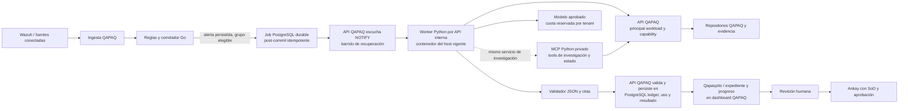

# 27 · Evaluación de AiSOC y plan para un analista QAPAQ continuo

**Estado: especificación previa a implementación; no aprobada ni desplegada.**
Evaluación multiagente y lectura estática al 2026-11-13. Se intentó clonar `beenuar/AiSOC`
en una carpeta temporal aislada; `git clone` no pudo acceder a GitHub por el proxy local
`127.0.0.1:9` y dejó una carpeta incompleta sin `HEAD`. El clon no se considera logrado.
Como alternativa se revisaron por GitHub MCP archivos y código fuente upstream fijados al SHA
indicado abajo. La revisión no equivale a inspeccionar todo el repositorio, construirlo, escanear
su cadena de suministro ni reproducir sus pruebas. No se ejecutó código de terceros ni se
conectaron credenciales o datos reales de QAPAQ.

## Decisión propuesta

No desplegar AiSOC completo en paralelo con QAPAQ. QAPAQ ya es el SIEM y el sistema de registro
de alertas, incidentes, evidencias y auditoría. El stack de AiSOC añadiría otro pipeline,
reglas, casos, agentes, almacenamiento y UI. Eso duplicaría la fuente de verdad y exigiría
mantener sincronización, identidad, retención y respuesta en dos productos.

Usar AiSOC como referencia de diseño para ampliar QAPAQ con un **analista asistido de ejecución
continua**, alojado dentro de los límites de QAPAQ. El punto de entrada seguirá siendo el
dashboard QAPAQ y Qapaqzito. Las investigaciones de fondo se iniciarían desde alertas nuevas o
escaladas que sobrevivan filtros deterministas; devolverían una propuesta con evidencia y
progreso. En la primera entrega, el agente no cierra alertas, no cambia severidades, no
modifica Wazuh y no ejecuta contención. Las acciones continúan en Ankay con capacidad,
aprobación humana, separación de funciones e idempotencia.

El protocolo MCP no es por sí solo un trabajador 24/7. QAPAQ ya implementa
`POST /api/assistant/mcp` para un cliente interactivo: Streamable HTTP stateless, sesión QAPAQ,
CSRF, filtrado por capacidades y herramientas SOC de solo lectura. Qapaqzito reutiliza el mismo
dispatcher dentro del proceso. Ese contrato no proporciona identidad de workload para un
proceso sin persona conectada; no se debe guardar una cookie humana para automatizarlo. La
autonomía debe venir de un worker con trabajos durables, estado persistido y permisos propios;
MCP es el contrato de herramientas, no la cola ni el motor de recuperación.

## Evidencia revisada

| Área | Evidencia y lectura para QAPAQ |
| --- | --- |
| Proyecto identificado | [`beenuar/AiSOC`](https://github.com/beenuar/AiSOC), rama `main`, snapshot revisado el 2026-11-13 en `93d07316f34a014a250f8ea416db0ea554735737`. Se fija el SHA para reproducir esta lectura; actividad o estrellas no son garantía de seguridad ni soporte. |
| Licencia | MIT en el archivo `LICENSE` del commit revisado. Cualquier reutilización debe conservar aviso y licencia, revisar avisos de dependencias y registrar archivos derivados. La licencia no sustituye evaluación de seguridad, privacidad ni compatibilidad. |
| MCP de AiSOC | El código en `services/mcp/src/server.ts` y `http.ts` implementa un servidor MCP en TypeScript: valida argumentos con Zod, ejecuta hooks antes/después de cada llamada y delega autorización HTTP al API AiSOC por credencial/tenant. Expone herramientas de su propia API; no es un adaptador listo para leer QAPAQ. El núcleo de agentes e investigación es Python, así que el producto combina dos lenguajes. |
| Investigación Python | `services/agents/app/agents/` contiene agentes de triage, enriquecimiento, investigación y rutas de ataque; `app/llm/` concentra el loop y sus llamadas seguras. `auto_triage_agent.py` contempla auto-cierre de disposiciones benignas/FP con umbral de confianza configurable. El upstream recibió un reporte de prompt injection que podía provocar auto-cierre ([issue #220](https://github.com/beenuar/AiSOC/issues/220)); su corrección aparece en la PR #219, que fue mergeada. Esta auditoría no ejecutó ni reprodujo sus pruebas. QAPAQ no debe copiar esa acción: primero requiere corpus adjudicado, evaluación de calibración y aprobación del SOC. |
| Costos y deduplicación upstream | `services/agents/app/core/cost_governor.py` define topes por tenant/alerta, deduplicación por huella de evidencia y un modo determinista cuando se abre el circuit breaker. El objeto incluye almacenamiento en memoria por defecto; el cableado durable de producción se debe verificar al clonar y no se toma como garantía de cuota global. |
| Controles MCP upstream | `services/mcp/src/http.ts`, `gate.ts` y `telemetry.ts` separan identidad por petición, decisión de autorización, allowlist y telemetría. El patrón es útil; las credenciales, endpoints, esquema y autorización pertenecen a AiSOC y no se copian a QAPAQ. |
| MCP cliente de AiSOC | La guía de MCP externo documenta allowlist vacía por defecto, rechazo de herramientas marcadas como destructivas/no lectura, caps de respuesta, rechazo de SSRF, proyección de esquemas y registro de interacciones. También reconoce que escanear inyección no es defensa suficiente: su propio corpus externo retenido tuvo baja detección, así que la contención estructural y el límite de datos son controles principales. |
| Arquitectura | La guía de arquitectura describe ingestión, Kafka, fusión, Postgres, Redis, servicios de agentes y realtime, UI, LiteLLM/Ollama y Qdrant. El perfil completo añade ClickHouse, Neo4j y OpenSearch. Esta topología replica piezas que QAPAQ ya posee; no es un MCP pequeño para agregar al nodo actual. |
| Operación continua | La documentación upstream informa una prueba HA en `kind` de tres nodos con una interrupción de réplica y 10.000 eventos. Aclara que no se probó en EKS/GKE/AKS, con almacenamiento persistente ni durante operación sostenida; la corrida fue de pocos minutos. No tomar ese resultado como evidencia de operación 24/7 de QAPAQ. |
| Costos y tokens | AiSOC informa modelo local Ollama y una descarga inicial aproximada de 2 GB; su guía de instalación pide Docker Compose, 8 GB de memoria y 20 GB de disco. No se midió costo ni carga en la EC2 de QAPAQ. Para QAPAQ se deben medir tokens y coste por investigación con alertas sintéticas y límites explícitos antes de habilitar el consumo continuo. |
| Seguridad y supply chain | El repo contiene SECURITY.md, threat models, hardening y CI; son evidencia de prácticas declaradas por el proyecto, no un pentest independiente. Esta revisión no ejecutó tests, scanners, SBOM ni imágenes upstream. Cualquier prueba posterior debe fijar SHA/digests, escanear artefactos y ejecutarse aislada, sin credenciales ni telemetría QAPAQ. |

La inspección cubrió archivos fuente y documentación concretos del SHA indicado mediante GitHub;
no cubrió todos los paquetes del repositorio. El clon completo aislado, la revisión exhaustiva de
manifiestos/lockfiles, SBOM, análisis de artefactos y reproducción de pruebas siguen pendientes
de un entorno con acceso directo a GitHub. No se ejecutaron `make`, npm/pnpm, Docker, scripts de
instalación ni binarios. No se copió código de AiSOC al repositorio QAPAQ.

## Comparación funcional y decisión para QAPAQ

| Capacidad | AiSOC en el SHA revisado | QAPAQ actual | Diseño para QAPAQ |
| --- | --- | --- | --- |
| Autoridad de datos | Stack propio de SIEM, fusión, casos y agentes; su MCP consulta la API AiSOC. | Wazuh e Indexer aportan eventos; la API/PostgreSQL QAPAQ gobierna alertas, incidentes, auditoría y notificaciones. | Mantener QAPAQ como autoridad; no duplicar SIEM, alert store, case store o UI. |
| Investigación | Agentes Python especializados y rutas de auto-triage, triage, enrichment, investigation y attack path. | Qapaqzito usa un loop de tools en TypeScript; el correlador Go y las reglas deterministas producen señales/grupos. | Worker/orquestador Python durable, que empieza después de la alerta/grupo QAPAQ y consume el correlador; no inferir en el hot path de logs. |
| MCP | El servidor inspeccionado está escrito en TypeScript, con registro de tools, esquema Zod, hooks, autorización HTTP y telemetría. | POST /api/assistant/mcp también es TypeScript y hereda sesión/capabilities de una persona conectada. | Python MCP privado para interoperabilidad y trabajos de investigación; misma lógica de dominio del worker y API QAPAQ como única frontera de datos. Mantener el MCP humano existente durante paridad/migración. |
| Identidad | El modo HTTP valida credencial por solicitud y deriva tenant/permiso desde la API; el resultado externo se considera no confiable. | El endpoint actual es humano, con sesión/CSRF/capabilities; no equivale a identidad de proceso 24/7. | Principal M2M separado y app roles/capabilities mínimos. QAPAQ obtiene el tenant del job/alerta confiable y valida que el principal pueda operar allí. Issuer, audience, claims, rotación y revocación son gates por definir; no guardar cookies humanas. |
| Evidencia y auditoría | Agentes citan contexto y la plataforma mantiene un ledger de decisiones; el MCP registra outcomes/latencia sin guardar payload raw por defecto. | Qapaqzito chat registra assistant.ask; la ruta MCP actual no registra cada llamada a tool con el mismo nivel de auditoría. | Ledger append-only por run y tool: actor workload, tenant, IDs/hash de evidencia, tool, policy/model version, estado, latencia y usage. Excluir prompts, secretos y datos de correo crudos salvo requisito aprobado. |
| Falsos positivos | Auto-triage puede auto-cerrar FP/benigno con umbral de confianza y muestreo de calidad. | No hay corpus adjudicado que pruebe reducción atribuible a Qapaqzito/correlador; el resultado de Qapaqzito no debe cambiar severidad o estado. | Solo recomendar prioridad/veredicto y pedir revisión. Sin auto-cierre ni supresión P1/P2; medir precision/recall, calibración y falsas supresiones por fuente antes de ampliar autonomía. |
| Presupuesto | El código incluye deduplicación de investigaciones por huella y circuit breaker; el governor tiene almacenamiento en memoria por defecto y requiere comprobar el cableado compartido. | El rate limit de Qapaqzito está en memoria por proceso; no es una cuota global durable entre réplicas. | Reservar presupuesto transaccional por tenant/run antes de cada llamada; reconciliar usage real, límites por día/mes y circuit breaker compartido. |
| Trabajo durable | AiSOC incluye event spine Kafka y workers de agentes. Sus cifras/documentación no prueban disponibilidad ni rendimiento en QAPAQ. | Hay inbox durable de Wazuh y outbox de notificaciones, pero no job store para investigaciones. | Tabla PostgreSQL de jobs dedicada + API listener/wake-up y barrido de recuperación. SQS/DLQ queda como optimización posterior basada en métricas y Terraform revisado. |
| Informes y experiencia | El producto propio tiene UI/ledger para decisiones y tareas; no se considera artefacto reutilizable para el dashboard QAPAQ. | Qapaqzito no crea directamente un expediente investigativo durable; la UI exporta CSV/XLSX/HTML imprimible por separado. | Mostrar progreso real por etapa, cobertura/fallos y citas en Qapaqzito; persistir el resultado y conectar el generador de informe QAPAQ para PDF/XLSX. |
| Reutilización | MIT declarado en el repo; tamaño, dependencias y composición requieren revisión integral. | El stack vigente ya tiene varias funciones equivalentes bajo límites y contratos QAPAQ. | Inspirarse en patrones. No copiar código ni sumar AiSOC como segundo producto hasta completar clon, licencia/notices, SBOM y análisis aislado. |

La comparación es una lectura selectiva de código/documentación en un SHA fijado, no una
certificación del upstream. Las afirmaciones de disponibilidad, eficacia o costo de AiSOC no son
resultados medidos en QAPAQ. Los controles concretos solo pasan a requisitos del producto tras
implementarlos y probarlos en QAPAQ.

## Ajuste a la arquitectura QAPAQ

Este diagrama es objetivo, no implementación existente. La auditoría del repositorio encontró
que `apps/worker` inicia y drena el runtime, pero no consume trabajos de investigación; el
outbox actual sirve notificaciones, y `wazuh-push-inbox` registra referencias de ingesta. La
infraestructura `infra/aws-serverless` declara SQS/EventBridge, pero el worker Terraform es un
placeholder que devuelve mensajes fallidos y el README indica que no hay un plan/apply real
verificado. Ninguno de esos componentes demuestra que hoy exista un trabajador de investigación.

La primera versión usa una única tabla de jobs durables en el PostgreSQL vigente, separada de la
inbox Wazuh y del outbox de Teams/correo. El alta del job es posterior al commit de la alerta y
usa una clave idempotente. Si falla, la alerta y su lugar en la cola humana permanecen intactos;
la API registra el enqueue pendiente y un reconciliador busca grupos elegibles sin job para
reintentarlo. No se llama al modelo ni se espera al worker dentro de la transacción de alerta.

La API QAPAQ es dueña de la conexión PostgreSQL, del listener LISTEN/NOTIFY y de los estados de
claim/lease. Al confirmarse el job, NOTIFY despierta a los long-pollers internos; el worker
reclama y actualiza el job mediante rutas QAPAQ autenticadas. NOTIFY es transitorio y best-effort,
no es una cola ni un mecanismo de entrega de logs. Si el listener se desconecta, se reconecta y
el barrido periódico recupera trabajos, avisos perdidos y leases vencidos. La señal solo lleva
job_id y versión de esquema, nunca logs ni secretos. SQS/DLQ se añade mediante Terraform solo si
las métricas justifican el relay; no altera la fuente de verdad ni el fast path de ingesta.

El cómputo inicial será un contenedor Python dedicado en el host/Compose activo, con concurrencia
acotada, heartbeat, lease con fencing, checkpoints y deadline. Es la opción que encaja con la
topología vigente EC2 y evita asumir permisos IAM, recursos o serverless que no están desplegados.
Lambda/Fargate quedan como opciones posteriores: se eligen con benchmark de duración, cold start,
carga y costo, más un plan Terraform revisado. No se migra a un backend hipotético durante esta
fase.

El servicio Python mantiene un único dominio de investigación y registro tipado de tools. El
worker llama los handlers directamente; no se llama a sí mismo por MCP. Un servidor MCP Python
privado expone ese mismo dominio a clientes aprobados, con start_investigation,
get_investigation, get_evidence y get_report. El MCP TypeScript QAPAQ sigue atendiendo a Qapaqzito
durante la transición. Hoy no existe identidad worker→API ni autenticación MCP Python para este
servicio. En la etapa 0 hay que definir dos flujos: identidad de usuario para clientes MCP
interactivos y OAuth client-credentials para el worker con app roles/capabilities; el issuer,
audience, claims y método de rotación/revocación deben quedar documentados y probados antes de
activar. La API obtiene el tenant del job/alerta persistido y verifica que el principal puede
operar sobre él. No se considera al token tenant-bound hasta tener ese contrato, y el modelo
nunca proporciona tenantId.

Ambos adaptadores llaman rutas QAPAQ allowlisted; nunca heredan cookies humanas ni reciben un
token administrativo. La API QAPAQ conserva PostgreSQL y expone endpoints internos de claim,
heartbeat, checkpoint, complete/fail, reserva/conciliación de presupuesto, lectura de evidencia
y progreso. El worker no conecta directamente a PostgreSQL, OpenSearch, Wazuh, Microsoft Graph
ni al Indexer/Manager. La API TypeScript conserva la autorización, proyección de DTOs y escritura
del ledger.

El Indexer y Manager siguen privados; ningún MCP externo recibe acceso de red o credenciales
directas a ellos.

### Estado actual frente a objetivo

| Capacidad | Código/configuración revisados | Brecha antes de usarla para autonomía |
| --- | --- | --- |
| Qapaqzito | Loop síncrono acotado, herramientas de lectura, citas, pseudonimización, eventos de progreso y endpoint SSE por petición. | El run no es durable ni reanudable; el cliente humano desconectado aborta esa ejecución. No hay cola de investigaciones continua. |
| Herramientas SOC | Alertas, incidentes, eventos Wazuh normalizados, entidades/riesgo, correlación, auditoría y salud de fuentes; paginado acotado. | M365 no entrega datos en las herramientas inspeccionadas; la cobertura se habilita solo después de verificar permisos, conectividad, frescura y resultados reales. Algunas tools todavía devuelven cuerpos API amplios antes del límite de caracteres. |
| MCP QAPAQ | `POST /api/assistant/mcp`, stateless y restringido a sesión humana, CSRF y capabilities. | Falta workload identity de mínimo privilegio. No reutilizar la cookie del operador. |
| Worker/outbox | `apps/worker` cubre lifecycle/ready/drain; el outbox SOC es para notificaciones. | Falta job store, cola de investigación, lease/fencing, dedupe y ledger durable de análisis. |
| Terraform AWS | La topología serverless declara SQS para ingestión y un event mapping; el código worker inline es un placeholder que devuelve todos los mensajes como fallidos. El README dice que no se ha ejecutado plan/apply real. | El Terraform declarativo no acredita que la API o consumidor real estén cargados ni procesando. Terraform y publicación de código son pasos distintos. |
| Correlación/triage | El correlador Go y reglas deterministas son la fuente de scoring/correlación vigente. | Qapaqzito no debe recalcular ni sustituir severidad oficial. Se necesita corpus adjudicado y evaluación por fuente para demostrar mejora de falsos positivos. |

El worker autentica como principal de servicio QAPAQ con scopes acotados y tenant fijado por
la identidad, no por argumentos del modelo. Puede reutilizar las herramientas de lectura
QAPAQ, pero su autorización debe ser explícita y diferente de la cookie/CSRF de una persona.
Cada consulta se limita por ventana, cardinalidad, índices permitidos y proyección de campos.
El resultado es evidencia estructurada con IDs y timestamps, no un volcado de `_source` ni
un DSL provisto por el modelo.

## Límites de seguridad y de operación

- Las reglas y el correlador filtran/deduplican primero; el LLM solo analiza un conjunto
  pequeño de alertas agrupadas. La coincidencia temporal, una etiqueta del modelo o una
  respuesta incompleta no prueban causalidad ni compromiso.
- El worker procesa al menos una vez con clave idempotente, lease/fencing, retry acotado,
  backoff, cuarentena y recuperación tras reinicio. Una caída del modelo no bloquea la
  ingesta, el Indexer ni la cola humana.
- Los documentos de alerta, tool descriptions, notas y resultados MCP se tratan como datos
  no confiables. El diseño requiere límites de tamaño, JSON/schema allowlisted, fence de
  datos, detección y registro de intentos de prompt injection; el detector nunca es el único
  control.
- El modelo no añade allowlists, no corrige su propia severidad, no descarta alertas y no
  hace writes a Wazuh/M365/Entra. El analista acepta/corrige sugerencias y la señal humana
  queda versionada con regla, modelo y prompt para evaluar falsos positivos.
- El ledger guarda IDs de evidencia, herramientas, duración, tokens, versión de política y
  citas verificadas. No guarda razonamiento privado ni secretos; el contenido sensible se
  redacta antes del proveedor. La salida sin citas válidas queda como no verificada.
- La UI QAPAQ muestra estados `pendiente`, `investigando`, `parcial`, `degradado`, `requiere
  revisión`, `completo` y `fallido`; avance por etapa y datos consultados, cancelar/reintentar
  con idempotencia, timeline navegable, cobertura faltante, citas profundas y exportación
  progresiva existente de informe. No simula progreso con un contador artificial.
- El sistema debe tener límites globales y por tenant de trabajos concurrentes, consultas,
  tokens, duración y gasto; circuit breaker y alarma por backlog/edad. “24/7” significa un
  proceso recuperable y monitoreado, no que la IA sustituya guardias o atención humana P1.
- Antes de cada llamada al proveedor, reservar presupuesto en una transacción PostgreSQL:
  validar límites de despliegue, tenant, tipo de disparador (system o user), iniciador humano
  opcional y prioridad; insertar una reserva idempotente ligada al run/modelo; solo entonces
  permitir el dispatch. La reserva incluye máximos de
  entrada y salida, no un promedio. Al terminar se libera el excedente según usage recibido;
  ante timeout ambiguo queda pendiente de reconciliar, no se vuelve a invocar a ciegas. Este
  mismo mecanismo impide que dos réplicas consuman simultáneamente la última cuota.
- Reportar tres medidas distintas por run y en el panel: **usage reportado por proveedor**
  (tokens input/output/cache), **coste estimado** (tarifa versionada aplicada al usage o a
  la reserva) y **facturación confirmada** (solo con dato importado/recibido del proveedor).
  Sin feed de facturación, la UI dice “estimado” o “no disponible”; no presenta la estimación
  como costo real. Ollama local se informa como consumo de recursos medido, no como costo API
  cero.
- Aplicar cuotas jerárquicas de despliegue/tenant/tipo de disparador y, cuando corresponda,
  analista iniciador; incluir tier P1/P2, límites de concurrencia y techo diario/mensual.
  Prioridad puede consumir una reserva aprobada, pero no saltarse el
  hard cap. Si no alcanza la cuota, no invocar el modelo: mantener la alerta y el expediente
  en `requiere revisión` o `presupuesto agotado` y notificar por el canal normal según política.
- Enrutar cada fase mediante una política versionada: modelo económico para clasificación o
  resumen breve; modelo más capaz solo para investigaciones de alto impacto o ambiguas que
  pasen umbrales deterministas; revisión humana si faltan pruebas o la confianza es baja. El
  modelo no elige su propio tier ni presupuesto. Sin proveedor aprobado, el trabajo queda
  explícitamente degradado/sin IA.
- La caché es tenant-scoped y capability-scoped. Su clave incluye tenant, capacidades
  efectivas, filtros canónicos, watermark de origen, modelo/prompt/esquema y versión de
  política. Se invalida por frescura de origen, cambios de caso/regla/capacidad y TTL. No
  guardar secretos ni respuestas con PII en una caché compartida; no servir hits entre
  tenants. Atribuir tokens enviados, hits y ahorro estimado por separado, sin afirmar ahorro
  hasta compararlo con una ejecución baseline reproducible.
- Tool results se proyectan por allowlist de campos, páginas y límites de bytes **antes** de
  entrar al prompt. Si se corta la respuesta, adjuntar `truncated=true`, filas/bytes recibidos
  y cursor siguiente; nunca truncar en silencio ni tratar una página parcial como resultado
  completo. La UI puede continuar con cursor bajo el mismo run y presupuesto.
- La primera fase de ejecución permanece en **shadow mode**: genera recomendación y
  expediente, sin notificar a terceros ni cambiar estado. La notificación y cualquier
  respuesta se habilitan luego de medir y revisar.

### Progreso, cancelación y experiencia de investigación

El API crea un `runId` antes de procesar y emite estados observables sin exponer chain of
thought: `queued` → `fetching_evidence` → `correlating` → `model_started` por fase →
`validating_citations` → `writing_ledger` → `completed`, o `partial`/`degraded`/`failed` con
motivo legible. Cada evento lleva `runId`, secuencia monotónica, timestamp, etapa, herramienta,
filas/bytes/cursor y resultado sanitizado. La consola usa SSE si el proxy desplegado lo
mantiene y conserva polling/reanudación por `runId` como fallback.

La vista de investigación muestra qué ya se consultó, qué falta y frescura de fuentes; un
timeline navegable con enlaces a evidencia original; contradicciones e hipótesis por separado;
cobertura faltante; citas validadas; y un control explícito para detener. Cancelar bloquea
nuevas reservas y detiene trabajos pendientes. Si el proveedor ya recibió la llamada, la UI
avisa que usage/cargo puede ser desconocido hasta reconciliar y conserva el ledger parcial
marcado como tal. Reintentar es idempotente y no repite fases confirmadas. PDF/XLSX se crean
desde el expediente autorizado e incluyen truncamiento, estado de evidencia, fuente y hora;
no desde la respuesta cruda del modelo.

### Flujo objetivo del analista autónomo

1. **Elegibilidad determinista.** La API y el correlador Go agrupan por tenant, entidad
   normalizada, incidente/táctica, ventana y claves de origen. Reglas de supresión existentes,
   deduplicación y estado de fuente se evalúan antes de llamar a IA. Se conserva toda alerta en
   la cola humana aunque no sea elegible para análisis. El agrupador produce `groupId`, alertas
   miembro, razones de agrupación, watermark, ventana y versión de política.
2. **Creación del trabajo después del commit.** La API inserta en `investigation_jobs` un job
   idempotente para tenant + grupo + versión de política/ventana. Si falla el alta, no revierte ni
   demora la alerta; registra el motivo y un reconciliador crea el trabajo pendiente. La fila del
   job es la cola durable inicial, no se duplica con otro outbox. `NOTIFY` es solo una señal
   transitoria: la API la escucha y despierta sus long-pollers; el barrido recupera desconexiones,
   reinicios y señales perdidas.
3. **Lease y reanudación.** El worker reclama el job mediante API QAPAQ con workload identity;
   PostgreSQL y las operaciones de lease permanecen dentro de la API. Claim, heartbeat, checkpoint
   y complete/fail son idempotentes y usan fencing token. La API deriva el tenant del job persistido,
   autoriza el principal contra ese tenant/capabilities y rechaza cualquier tenant aportado por
   el modelo. Cada fase confirmada queda
   persistida antes de avanzar; el retry retoma fases incompletas.
4. **Evidencia y correlación.** El worker llama rutas internas allowlisted para eventos,
   alertas, incidentes, entidades y salud de fuentes. Usa los grupos y resultados del correlador
   Go; no calcula severidad oficial en Python. Cada página tiene límites de tiempo, filas/bytes,
   campos y watermark. Las respuestas incluyen `complete`, `truncated`, `nextCursor`, frescura
   y lista de IDs de evidencia.
5. **Decisión por política, no por el modelo.** Si reglas/correlador pueden resolver el trabajo,
   se crea el resumen sin inferencia. Si no, una política versionada escoge modelo, máximo de
   entrada/salida y número de llamadas. Un modelo económico procesa grupos rutinarios; el
   modelo más capaz solo recibe casos P1/P2 ambiguos con suficiente evidencia y cuota. El
   modelo no puede aumentar presupuesto ni seleccionar herramientas arbitrarias.
6. **Validación y abstención.** La salida es JSON bajo esquema versionado. Un validador rechaza
   citas inexistentes, referencias de otro tenant, fechas fuera de ventana y campos de salida
   inválidos. Se separan hechos observados, inferencias, hipótesis, nivel de confianza y vacíos.
   Evidencia insuficiente produce `needs_human_review`, no una respuesta inventada.
7. **Ledger y notificación.** Se agregan eventos append-only con herramienta, IDs de evidencia,
   política/modelo, estado, uso y hashes de respuesta. Shadow mode no notifica. Tras aprobación
   SOC, solo P1 y P2 elegibles generan intento según la política vigente de QAPAQ; el mensaje
   incluye grupo/caso, resumen breve, evidencia enlazada, confianza y motivo de prioridad. No se
   muestra “entregado” hasta tener acuse del proveedor; cada canal conserva su intento y error.
8. **Revisión en Qapaqzito.** La UI abre el expediente de grupo, no una llamada aislada por correo.
   El analista puede confirmar/corregir prioridad, marcar falso positivo, abrir evidencia,
   acusar recibo, pedir una consulta adicional acotada, cancelar o reintentar. La etiqueta humana
   se guarda con versión de regla, correlador, prompt y modelo para ajustar offline el sistema.

### Contratos y componentes Python

**Decisión de lenguaje:** Python para el worker analista y el adaptador MCP, por su ecosistema
de orquestación y su integración con el SDK Python de Bedrock. TypeScript se mantiene como
frontera de autorización/API y UI; Go sigue siendo el correlador determinista. Esta elección es
una decisión propuesta, no código existente. La implementación debe fijar versiones y lockfile;
no depender de versiones “latest”.

| Componente | Responsabilidad | Frontera obligatoria |
| --- | --- | --- |
| Worker Python | Consume `jobId`, reclama lease, coordina fases, usa policy/model router, valida salida y escribe resultado/uso por API interna. | No recibe sesión de browser ni acceso directo a DB, Indexer, Wazuh o Graph. OAuth client-credentials/app-role M2M queda por implementar; el API comprueba tenant/capabilities desde el job persistido. |
| Registro de tools Python | DTOs y handlers tipados para lectura SOC, cursor, límites, sanitización y citas. El worker llama handlers localmente. | Rutas GET allowlisted; schemas cerrados; límites de deadline, cardinalidad, bytes y concurrencia; sin SQL/DSL libre del LLM. |
| MCP Python | Adaptador Streamable HTTP privado para herramientas de investigación del mismo dominio. | Identidad M2M por definir; API QAPAQ valida app role/capability y autoriza tenant desde job/solicitud. No asumir tenant del modelo, usar cookie humana ni publicar sin controles. |
| QAPAQ TypeScript API | Autoriza service principal, establece tenant/capabilities, proyecta DTO, consulta repositorios y entrega estado/ledger/exports a la UI. | Política central única; no aceptar `tenantId`, límites o scopes confiados al modelo. |
| Correlador Go | Dedupe y relaciones deterministas existentes; explica señales, ventana y elementos relacionados. | Python y el LLM consumen su salida, no duplican su scoring ni escriben severidad. |
| PostgreSQL + API de jobs | La fila de `investigation_jobs` es la cola durable; la API posee conexión, listener, claim/lease, ledger y presupuesto. El worker usa endpoints M2M. | NOTIFY es transitorio; sweep/reconciliación recupera pendientes. Separado de ingesta y notificaciones; no debe bloquear el commit de alertas. |
| SQS/DLQ (opción posterior) | Transporte de `job_id` únicamente si mediciones muestran que PostgreSQL + worker no alcanzan el SLO aprobado. | Requiere Terraform plan revisado, permisos IAM efectivos, DLQ/redrive, deduplicación y prueba de recuperación; no es prerrequisito ni estado vigente. |

### Contrato M2M propuesto

Estas rutas son diseño, no endpoints implementados. El API QAPAQ controla el almacenamiento y
valida un principal workload con audience explícita y app roles; no acepta una cookie de
analista, token admin ni un tenant solicitado libremente por el agente.

| Operación | Ruta candidata | Control |
| --- | --- | --- |
| Reclamar | POST /internal/v1/ai-investigations/jobs/claim | Long-poll con límite; API elige el job y crea lease/fencing en una transacción. |
| Mantener | POST /internal/v1/ai-investigations/jobs/{jobId}/heartbeat | Solo el propietario del lease vigente; el API resuelve tenant y fencing token. |
| Guardar checkpoint | POST /internal/v1/ai-investigations/jobs/{jobId}/checkpoint | Idempotencia por etapa; DTO validado y tamaño acotado. |
| Cerrar o fallar | POST /internal/v1/ai-investigations/jobs/{jobId}/complete y /fail | Estado final monotónico; error sanitizado, fencing y resultado tipado. |
| Presupuesto | POST /internal/v1/ai-investigations/jobs/{jobId}/budget/reserve y /settle | Reserva atómica con trigger system/user, usuario iniciador opcional, límites y rate card versionada. |
| Leer evidencia | GET /internal/v1/ai-investigations/jobs/{jobId}/evidence | DTO allowlisted, tenant desde el job, cursores, watermark y complete/truncated explícitos. |
| Ver progreso | GET /api/ai-investigations/{jobId} | Autorización de usuario QAPAQ; estado, progreso real, evidencia enlazada y costo estimado. |

La API interna debe declarar timeouts, límite de bytes y semántica de retry por operación. Un
claim repetido con la misma clave no crea otro job; un heartbeat de lease vencido no resucita el
worker anterior; complete/fail con fencing viejo se rechaza. La respuesta API distingue
no-elegible, presupuesto agotado, evidencia incompleta, proveedor degradado y error reintentable.
La identidad exacta (issuer, audience, roles, rotación y revocación) es gate de diseño/seguridad,
no se debe inferir del OAuth usado hoy por otras integraciones QAPAQ.

Contrato mínimo de `investigation_jobs`: `job_id`, `tenant_id`, `group_id`, `alert_ids`,
`source_watermarks`, `priority_snapshot`, `policy_version`, `status`, `attempt`,
`lease_owner`, `lease_until`, `fencing_token`, `next_phase`, `created_at`, `updated_at` y
`last_error_code` sanitizado y trigger type `system|user` más `initiated_by` opcional. La API
escucha la señal de job commit y despierta long-pollers; el worker solo recibe el job autorizado
por endpoints internos. Tablas append-only separadas registran eventos monotónicos del run, IDs
y hashes de evidencia, reservas/conciliación de uso y veredictos humanos. No persistir prompts,
correos completos ni respuestas crudas de herramientas por defecto. La retención, particionado,
RLS y borrado deben alinearse con `docs/05-datos-y-retencion.md` antes de migrar.

El catálogo separa tools de lectura de la acción que incurre en costo. `start_investigation`
no es read-only: requiere capability `investigation.start`, elegibilidad, clave idempotente,
límite de frecuencia/cuota y auditoría. Un cliente interactivo muestra impacto y presupuesto
estimado y exige confirmación humana antes de llamar la tool; una automatización solo inicia runs
mediante una política del SOC aprobada y versionada. La respuesta de MCP indica si creó un job,
si reutilizó uno existente o si se rechazó por cuota.

Primer catálogo MCP objetivo: `start_investigation` (crea/recupera job idempotente),
`get_alert_group`, `get_alert`, `list_related_alerts`,
`get_event_page`, `get_entity_timeline`, `get_entity_risk`, `get_incident`,
`get_source_health`, `get_notification_delivery`, `get_correlation_explanation` y
`get_investigation_run`, `get_investigation_progress` y `get_report`. Las tools get requieren
capability `investigation.read`; `start_investigation` exige la aprobación descrita arriba.
Se publica solo aquello
que esté conectado, autorizado y respaldado
por pruebas. No incluir `query_sql`, búsqueda DSL libre, cierre/cambio de severidad ni dispatch
de Ankay. M365 se habilita únicamente después de comprobar los datos en origen, permisos
Graph, paginado, watermark y evidencia visible; la implementación actual informa que esa fuente
no tiene datos disponibles.

### Costos, tokens y proveedor de modelos

- Hacer primero lo que no requiere IA: agrupación, enrichment, consultas paralelas y resumen
  determinista. Medir cuántas alertas/grupos se resuelven sin inferencia y cuántas llamadas se
  evitan.
- Aplicar proyección allowlist de campos **antes** de serializar el prompt. Reemplazar topes por
  caracteres como control de seguridad por un presupuesto estimado/medido en tokens. Toda
  truncación debe conservar `truncated`, filas omitidas, cursor y motivo.
- Antes de invocar, reservar en una transacción una cota compartida de tokens/costo con input y
  output máximos; no reservar usando promedios. Un timeout ambiguo deja la reserva en reconciliar
  y no repite la llamada sin idempotency key. Un hard cap agotado deja el job en revisión humana.
- Seleccionar modelo y presupuesto con una matriz de riesgo versionada; los datos de alerta no
  pueden cambiarla. Aplicar `maxTokens` explícito, retries solo para errores transitorios,
  deadlines, circuit breaker, concurrencia por tenant y máximo de rondas/tools.
- Para Bedrock, preferir el API común Converse con `bedrock-runtime`; validar el modelo e
  inference profile disponibles en la región/fecha de despliegue. Guardar el modelo/profile ID
  y región en cada run. Instrumentar tokens input/output/cache y latencia. El costo por run se
  estima en QAPAQ con usage del proveedor y una rate card versionada; los cost allocation tags de
  AWS clasifican gasto de recursos/producto, pero no atribuyen cada prompt/tenant por sí solos.
  CUR/Cost Explorer sirven para conciliación agregada. Facturación no conectada se presenta como
  **estimación**, nunca como importe confirmado.
- Prompt caching se habilita solo para un prefijo suficientemente grande, estable y repetido;
  no se cachean alertas dinámicas ni evidencia que pueda cruzar tenants. Los checkpoints tienen
  mínimos/modelos/TTL dependientes del modelo, cache hit no está garantizado y la escritura
  puede tener una tarifa superior. Medir `cacheReadInputTokens`/`cacheWriteInputTokens` y el
  ahorro neto; deshabilitar si la repetición no supera el punto de equilibrio.
- No crear una caché global de respuestas de evidencia en la primera entrega. Si las métricas
  justifican caché compartida posteriormente, la clave incluye tenant, scopes/capabilities,
  filtros canónicos, watermark, modelo, prompt, esquema y política; TTL corto y sin PII.
- Aplicar pseudonimización/redacción de datos sensibles antes del proveedor, egress restringido,
  y logs de telemetría sin prompts/cuerpos completos. Si invocation logging se habilita, revisar
  cifrado, retención y acceso al destino antes de enviar datos SOC.

AWS advierte que los checkpoints explícitos dependen del modelo, umbral, TTL y coincidencia de
prefijo; el uso reportado separa input normal, lectura de cache y escritura de cache. Por ello,
no se fija un modelo ni un porcentaje de ahorro en esta propuesta. [Prompt caching](https://docs.aws.amazon.com/bedrock/latest/userguide/prompt-caching.html),
[Converse](https://docs.aws.amazon.com/bedrock/latest/userguide/conversation-inference.html),
[inference profiles/cost attribution](https://docs.aws.amazon.com/bedrock/latest/userguide/inference-profiles.html).
El SDK Python oficial de MCP soporta stdio y Streamable HTTP; se debe usar una versión fijada y
probar compatibilidad con clientes QAPAQ antes de servicio. [MCP Python SDK](https://github.com/modelcontextprotocol/python-sdk).

### Seguridad, pruebas y gates del SOC

| Riesgo | Control de diseño | Prueba obligatoria |
| --- | --- | --- |
| Token vencido, suplantación o salto de tenant | Principal de workload separado, validación `iss/aud/sub/exp`, scopes mínimos, tenant resuelto en API y rotación/revocación. | Token vencido/revocado/audience incorrecto y job de tenant A intentando leer recurso de tenant B: denegado y auditado. |
| Prompt injection en alertas, notas o resultados | Datos externos marcados como no confiables; handlers allowlisted; salida validada; sin shell, SQL, DSL libre o tools de escritura. Egress bloqueado excepto destinos aprobados. | Corpus de inyección/exfiltración/SSRF; verificar que instrucciones en eventos no habiliten tools ni revelen secretos. |
| Respuesta API demasiado amplia o truncada | Proyección por tool antes del modelo, límite de páginas/bytes, cursor y marca de parcialidad. | Afirmar que ningún campo no permitido o body completo llega al proveedor; probar cursores y respuestas parciales. |
| Duplicados, replay o worker obsoleto | Fila de job idempotente, claim por API, lease/fencing, reconciliación; reservas y ledger transaccionales. | Dos workers reclaman el mismo job; proceso viejo intenta persistir tras takeover; concurrencia compite por la última cuota. |
| Degradación de Wazuh/Indexer/modelo/DB | Timeouts, retry clasificado, backoff, circuit breaker, cuarentena en PostgreSQL y cola humana siempre disponible. | Fallos por etapa, poison job, reintentos, recuperación tras desconexión del listener, reconciliación, y DLQ/redrive solo si se adopta SQS. |
| Autocierre o cambio de severidad | Las tools de lectura no modifican alertas. start_investigation sí tiene efecto/costo acotado; no se entrega dispatcher B12 y las acciones siguen separadas en Ankay. | Tests de contrato niegan close, severity write, Wazuh/M365 write y Respond dispatch; start requiere autorización, confirmación para usuario interactivo y cuota. |
| Fuga en ledger, logs, PDF o XLSX | Separación por tenant, cifrado/retención, redacción; autorización de export por caso; sanitización de hyperlinks y fórmulas. | Export cross-tenant denegado, prompts ausentes de logs, fórmula maliciosa neutralizada, citas/hash verificables. |
| Suministro upstream/dependencias | SHA/digests fijados, licencia/notices, lockfile, SBOM y análisis aislado; no incorporar código sin revisión legal/seguridad. | CI verifica versión, hashes, SBOM y vulnerabilidades; actualización repetible y rollback de imagen probado. |

Corpus de evaluación: casos adjudicados por analistas, estratificados por fuente/prioridad y
con negativos difíciles, incluyendo campañas correladas y ruido benigno. Con el mismo corpus y
versiones se comparan baseline determinista y baseline + IA. Umbrales iniciales propuestos para
aprobación del owner SOC (no son resultados actuales): cero omisiones P1; al menos 99 % de
afirmaciones materiales con citas exactas; reducción de al menos 25 % del costo estimado p50 y
20 % p95 por investigación elegible sin perder más de 2 puntos porcentuales de recall. Si no
se alcanza el umbral, no se activa el análisis automático fuera del shadow mode.

Gates adicionales: precisión/recall por fuente y prioridad, tasa de falsos positivos, abstención,
aceptación de analistas, latencia commit→inicio/resultado/visible, llamadas y tokens por fase,
hard cap, ratio de caché, costo estimado vs facturación, backlog/DLQ, recuperación de lease,
estabilidad en prueba sostenida, y accesibilidad de la UI. Los cambios de scoring no se habilitan
por una mejora agregada que esconda regresión de P1 o una fuente específica.

Los PDF/XLSX se construyen de un expediente estructurado y autorizado, no de texto libre del
modelo. El UI muestra progreso por etapas de consulta, validación, armado de tablas/gráficos y
finalización. La vista previa puede crecer con secciones verificadas; el enlace final se publica
solo cuando el archivo esté completo, se haya validado y tenga checksum. Excel neutraliza celdas
que comiencen con fórmulas y los dos formatos registran fuente, hora, ventana, limitaciones,
truncamiento, citas y versión de política.

## Plan por etapas

| Etapa | Trabajo | Gate de salida |
| --- | --- | --- |
| 0. Baseline QAPAQ | Confirmar en `main` y en el nodo desplegado el login Entra, herramientas MCP actuales, capabilities, tenancy, dispatcher, ingesta durable, alertas, outbox/worker y health. Registrar hashes, versiones y estado real; resolver OAuth antes de usar autenticación en el worker. | Sesión Entra real del grupo SOC validada con casos positivo/negativo y ACL por tenant probadas. No usar tokens de personas para automatización. |
| 1. Sandbox AiSOC | La lectura remota por GitHub MCP está completada para el SHA fijado, incluida una selección de código Python/MCP y documentación. El clon falló por el proxy; cuando exista acceso directo, completar checkout aislado, lockfiles, notices, SBOM, análisis de dependencias, threat model y pruebas upstream con datos sintéticos. | Esta comparación no certifica el producto ni autoriza copiar código. Se requiere inventario de archivos revisados, evidencia de clon/build y reporte de herramientas antes de reutilizar cualquier componente. |
| 2. Contrato del worker QAPAQ | Definir identidad workload y capabilities, PostgreSQL jobs/outbox, estados/checkpoints, lease/fencing, DTO agrupado, ledger/hash de evidencia, presupuesto compartido y retención. El primer worker es un contenedor Python en el host vigente; diseñar SQS/DLQ/Terraform solo si una medición demuestra necesidad. | Revisión de seguridad/backend; aislamiento tenant, lease recovery, cuota concurrente, idempotencia, fallos/reintentos y latencia cubierta por pruebas unitarias, de contrato e integración. |
| 3. Evaluación offline | Construir corpus adjudicado por analistas, estratificado por fuente/severidad y con negativos difíciles. Comparar reglas/correlador solos contra reglas + asistente; preservar cambios de scoring detrás de revisión. | Medir precisión, recall, FP/alerta útil, cobertura de citas, tasa de abstención, tiempo ahorrado, p50/p95 de investigación y tokens/costo por caso. Umbrales aprobados antes de evaluar; no afirmar reducción si el corpus no lo demuestra. |
| 4. Shadow mode en sandbox | Ejecutar el worker con eventos sintéticos y luego canario autorizado; sin avisos externos, autocierre ni respuesta. Validar retry, fallo de Indexer/modelo/DB, backpressure, dedupe, prompt injection, cuarentena y recuperación de lease. | Sin pérdida P1 ni duplicados no idempotentes; ACL negativa; ledger íntegro; alarmas de backlog; presupuesto/latencia dentro de límites aprobados; rollback y redrive de jobs ensayados. |
| 5. UI y adopción SOC | Integrar estado durable, evidencia/citas, progreso real, veredictos humanos y exportación en Qapaqzito/`qapaq_ops`. Mantener preview incremental y finalizar el artefacto solo después de validarlo. | Aceptación de analistas; español claro y accesible; fallos, evidencia parcial y dato no disponible distinguibles; PDF/XLSX validado y sanitizado con expediente sintético. |
| 6. Operación continua | Habilitar el procesamiento continuo por fuente y severidad con cuotas progresivas, horario/cobertura, on-call, runbook y límites. Notificaciones siguen el pipeline normal de QAPAQ y registran recepción/acuse. | Canary sostenido, SLO origen→alerta e investigación medidos, costo mensual aceptado, sin backlog creciente, restauración y rollback probados; aprobación del dueño SOC. |
| 7. Respuesta gobernada | Para cada acción nueva, crear contrato de capacidad, blast radius, reversibilidad, probe, permisos, SoD e idempotencia en Ankay. | Gate B12 y pruebas reales autorizadas por acción. No exponer dispatcher/write tools al modelo MCP. |

## Criterios cuantificables antes de la activación

Los valores de aceptación deben ser aprobados por el owner del SOC antes del benchmark. Como
mínimo se debe registrar:

1. Conteo de alertas entrantes, elegibles, deduplicadas, investigadas, omitidas y pendientes
   por motivo; distribución por fuente y prioridad.
2. Precisión/recall y falsos positivos en un set adjudicado independiente, incluyendo
   incertidumbre y métricas por plantilla/fuente para que una mayoría no esconda una
   regresión.
3. Porcentaje de afirmaciones materiales con una cita exacta y existente; tasa de hallazgos
   sin evidencia y abstenciones; muestras de inyección de prompt.
4. Latencia p50/p95 desde `occurredAt` hasta alerta visible, desde enqueue hasta resultado y
   desde resultado hasta notificación/acuse, con etapas separadas.
5. Tokens in/out reportados, coste estimado, facturación confirmada si está disponible,
   reservas pendientes/liberadas, llamadas al modelo, consultas a herramientas, caché y gasto
   por despliegue/tenant/tipo de disparador/modelo/caso y usuario iniciador si existe.
   Estimados y confirmados no se suman como si fueran una única medida.
6. Recuperación tras muerte del proceso, estado de leases, idempotencia bajo reintentos,
   límites de cuota y funcionamiento del circuit breaker.

## Decisión sobre lenguajes y tokens

La propuesta es Python para el worker analista y el adaptador MCP; TypeScript sigue siendo la
frontera de autorización/API y UI, y Go el correlador determinista. MCP usa el SDK Python oficial
con versión fijada. No portar el agente a Rust solo por expectativa de ahorrar tokens: Rust no
reduce tokens de entrada/salida y el flujo dominante es consulta, modelo y latencia de
proveedores. Primero reducir tokens con DTO compactos antes del prompt, agrupación determinista,
cursor/paging, batch de herramientas, límites de entrada/salida, selección de modelo por riesgo,
hard cap y caché de prefijos estables solo si el hit rate paga la escritura. Reservar presupuesto
antes de invocar y marcar truncamiento antes de formar el prompt. No afirmar ahorro de
tokens/costo ni reducción de falsos positivos hasta comparar contra un baseline reproducible de
las mismas investigaciones y políticas. Evaluar Rust únicamente si un perfil de carga muestra
un cuello CPU/memoria en parsing, normalización o fan-out que no se resuelve con límites y
backpressure.

## Corte implementable: Python, gateway de modelo y evidencia (2026-11-13)

Esta sección concreta el primer incremento implementable; no declara un servicio desplegado.
La lectura local confirma que `modules/assistant/src/run.ts` ya limita el loop y que
`apps/api/src/assistant/claude-model.ts` concentra redacción, SDK y usage. El rate limiter de
`assistant-service.ts` sigue siendo una estructura en memoria y `apps/worker/src/main.ts`
solo inicia/drena el runtime. Ninguna de esas piezas aporta por sí sola una cuota compartida
ni una investigación recuperable tras una caída.

### Decisión y fronteras del primer incremento

| Lenguaje/componente | Decisión verificable |
| --- | --- |
| Python | Orquestador de investigaciones y adaptador MCP del mismo dominio, según la solicitud del producto. Su trabajo inicial es coordinar I/O, política y DTOs; no hay un benchmark que justifique otra implementación por rendimiento. Usar dependencias mínimas y fijadas, concurrencia acotada y ninguna cadena de agentes que multiplique llamadas sin límite. |
| TypeScript | Mantener autorización QAPAQ, PostgreSQL, reserva de presupuesto y validación de resultados. Reutilizar el adaptador Claude y el redactor existentes; no duplicar secretos del proveedor en el contenedor Python. |
| Go | Mantener agrupación, correlación y señales deterministas. El worker conserva IDs y versión de esa salida; no reconstruye ni modifica la prioridad oficial. |
| Rust | No añadir en este incremento. Comparar CPU, RSS y latencia de una operación identificada antes de proponer un componente nativo. A igual modelo y payload, cambiar el lenguaje del cliente no reduce el texto enviado ni los tokens generados. |

Para este corte se afina el diagrama objetivo: la invocación del modelo pasa por un **gateway
interno en la API QAPAQ**. Python solicita una fase con `jobId`, `phase` y versión de checkpoint;
la API deriva tenant, evidencia, prompt, modelo y límites de la política persistida. No acepta
un prompt de sistema, URL de proveedor, modelo o presupuesto elegido por el LLM. Esto sustituye,
solo para el primer incremento, la llamada directa worker→proveedor descrita arriba. El worker
no necesita SDK AWS ni clave Claude; un adaptador Python directo exigiría después los mismos
controles y una razón operativa medida.

Mapa de implementación propuesto, sujeto a contratos y ownership del repositorio:

| Ruta propuesta | Entrega concreta |
| --- | --- |
| `services/qapaq-ai-analyst/` | Modelos de dominio, política determinista, cliente QAPAQ, worker con heartbeat y adaptador MCP del mismo dominio; pruebas de fallo, cancelación y validación. |
| `modules/assistant/` y `apps/api/src/assistant/` | Puertos de investigación, gateway de inferencia y DTOs de resultado/progreso. Preservar el chat existente y su sesión humana. |
| `platform/database/prisma/` y adapters de almacenamiento | Jobs, ledger de fases, reservas e invocaciones con transacciones e índices de unicidad; migración y prueba PostgreSQL multiworker. |
| `wazuh/dashboard/plugins/qapaq_ops/` | Expediente por grupo/run, evidencia enlazada, cobertura, estado y coste estimado. Publicar controles únicamente cuando sus endpoints y capacidades estén disponibles. |
| Compose y `infra/aws-poweruser/` | Contenedor con identidad de workload, límites de recursos, health/readiness y configuración desactivada por defecto hasta aprobar los gates. El cambio Terraform y el de imagen se validan por separado. |

### Estado durable y control del gasto

La identidad idempotente del run incluye tenant, grupo, revisión de sus miembros, watermark,
ventana, versión de política y de contrato. Una nueva evidencia crea una nueva revisión;
reintentar la misma revisión no debe volver a facturar una fase terminada. Cada claim produce
un fencing token creciente; heartbeat, checkpoint y finalización comprueban ese token y el
estado actual. Cancelar impide reclamar fases nuevas y reservar más presupuesto; un resultado
tardío conserva su uso sin reactivar el run.

El gateway registra una invocación única por run/fase/revisión y reserva, en la misma
transacción, la cota de entrada más salida con tarifa versionada. La secuencia mínima es
`reserved → dispatching → settled`, o `released` si se demuestra que no se envió, o
`usage_unknown` cuando pudo llegar al proveedor. Expirar un lease no libera automáticamente
una llamada ambigua. Un takeover consulta ese registro antes de invocar; si no puede resolver
la ambigüedad, se abstiene y deriva a revisión. No prometer exactly-once entre PostgreSQL y
un proveedor externo.

El adaptador Claude actual configura reintentos del SDK. El gateway nuevo debe desactivarlos
para una invocación contabilizada o reservar y registrar cada intento explícitamente; un
timeout de red no demuestra ausencia de cargo. El worker tampoco reintenta automáticamente
esa fase por pérdida del heartbeat. Los errores deterministas de validación y falta de cuota
no consumen otra inferencia. Un presupuesto sin configurar mantiene inferencia automática
deshabilitada y permite producir un expediente determinista identificado como tal.

Antes de solicitar Claude se materializa un paquete de evidencia compacto: IDs, tiempos,
señales del correlador, conteos, ejemplos acotados, frescura, truncamiento y cursores. El informe
conserva el total y las referencias completas autorizadas; el prompt recibe solo el paquete.
No reenviar todo el historial ni hacer una llamada por correo individual. El gateway valida
que cada cita generada pertenezca al paquete del run; hechos, inferencias y vacíos permanecen
separados. El resultado nunca autoriza cierre, supresión ni contención.

El conteo previo de tokens admite mensajes, sistema y esquemas de herramientas en el API de
Claude, pero tiene restricciones para conectores MCP y herramientas de servidor. En este
flujo se cuentan DTOs proyectados como mensajes ordinarios y se concilia después el `usage`
reportado; no se presenta el conteo previo como facturación.
[Referencia oficial: conteo de tokens](https://platform.claude.com/docs/en/build-with-claude/token-counting).

La caché reutiliza prefijos estables; no es una caché de veredictos. Se conservan separado input,
output, escritura y lectura de caché, y se calcula ahorro neto contra el mismo corpus/política.
El batch del proveedor se evalúa solo para trabajos diferibles con revisión de privacidad y
retención; no entra en la ruta P1/P2 ni en la entrega de logs porque su ejecución es asíncrona.
[Caché de prompts](https://platform.claude.com/docs/en/build-with-claude/prompt-caching),
[procesamiento batch](https://platform.claude.com/docs/en/build-with-claude/batch-processing).

### Criterio de primera entrega

La primera entrega útil procesa un grupo autorizado en shadow mode: claim durable, evidencia,
decisión determinista de inferencia, cuota, resultado con citas y progreso visible en QAPAQ.
La herramienta MCP inicia o consulta ese mismo run; nunca ejecuta un segundo loop paralelo.
La autenticación HTTP MCP verifica el principal en cada petición; instalar el SDK no configura
automáticamente issuer, audience ni autorización QAPAQ.
[SDK MCP: autorización](https://github.com/modelcontextprotocol/python-sdk/blob/main/docs/run/authorization.md).

Antes de habilitar ejecución continua deben pasar: dos workers compitiendo por el mismo job y
por la última cuota; caída antes/después del envío al proveedor; takeover con fencing viejo;
cancelación y respuesta tardía; dato de otro tenant; cita inventada; fuente parcial; inyección
en un evento; y ausencia de permisos de cierre/contención. Validar además con proveedor
autorizado un run sintético y su usage, sin usar mocks como evidencia de producción. La UI
distingue `requiere revisión`, `presupuesto agotado`, `uso por conciliar` y `evidencia parcial`.
No habilitar notificaciones autónomas hasta pasar el gate de aceptación de canal ya definido.

## Implementación (2026-11-14)

Estado: **implementado en local, apagado por defecto, sin desplegar**. Verificado con pruebas en
memoria y con PostgreSQL 18 real (almacén); sin llamadas reales al proveedor del modelo.

### Decisión de lenguaje y alojamiento

- **TypeScript**, no Python (decisión del dueño). Motivo: el adaptador de Claude, la minimización
  (`outbound-scrub`), los lectores de evidencia y los casos de uso SOC ya viven en `apps/api` y
  `modules/*`; un servicio Python duplicaría autorización, auditoría y contratos. Esto reemplaza la
  propuesta «Corte implementable: Python» de arriba (queda como alternativa documentada).
- El bucle corre **dentro del proceso API** (`apps/api/src/runtime/analyst-host.ts`), arrancado por
  `bootstrap` y drenado en `stop()` antes del despacho. Las importaciones entre apps están
  prohibidas y el runner del dominio (`InvestigationRunner`) es agnóstico del host: podrá moverse a
  `apps/worker` cuando el worker tenga acceso a la base, sin cambiar el puerto.

### Qué hace hoy

| Pieza | Archivo | Comportamiento |
| --- | --- | --- |
| Configuración | `apps/api/src/assistant/analyst-config.ts`, `platform/configuration` | Variables `QAPAQ_ANALYST_*`; reutiliza proveedor y credenciales de Qapaqzito. |
| Modelo | `analyst-model.ts` | Un intento por reserva (SDK `maxRetries: 0`), sin herramientas, `max_tokens` explícito, caché en el sistema, sin pensamiento extendido (Haiku `disabled`, Sonnet 5.5 `between_tools`), `effort` low/medium. `InferenceNotSentError` solo si se demuestra que no se envió (señal abortada antes, conexión rechazada/DNS, 400/401/403/404/413/422/429/529). |
| Evidencia | `analyst-evidence.ts` | Mismo alcance que Qapaqzito, reunido sin modelo: alerta y regla (MITRE, runbook, falsos positivos conocidos), relacionadas, historial 30 d regla+entidad, incidentes abiertos de la entidad (conteos y títulos, nunca notas), candidato y riesgo del correlador (`/v1/candidates`, `/v1/entity`), eventos ±15 min y actividad (alertas 7 d / eventos 24 h) con el lector del servidor (sin crudo), salud de cada fuente involucrada (las no medidas se nombran), estado de avisos de la alerta y auditoría reciente. Todo lo inalcanzable es un vacío nombrado. Una sola llamada al modelo sobre el paquete. |
| Acciones | `analyst-actions.ts` | Identidad `svc:qapaq-ai-analyst` con capacidades explícitas: lectura `alerts.read`, `incidents.read`, `events.read`, `sources.health.read`, `notifications.read`, `audit.read` + acción `alerts.triage`, `incidents.write`, `incidents.notes.write` (sin `events.read_raw`, `audit.read_sensitive`, `incidents.close`). |
| Host | `runtime/analyst-host.ts` | `QAPAQ_ANALYST_CONCURRENCY` bucles (intervalo + `kick`), encolado post-commit de alertas nuevas, barrido del atraso de alertas (P1 primero, 10 por pasada) y de incidentes abiertos sin expediente (5 por pasada), resumen diario a la hora de Lima. |
| API | `assistant/ai-investigations.controller.ts` | Contrato de `common/ai_investigations.ts` (ver docs/08). |
| Actividad | `GET /activity`, `AnalystHost.status()`, `common/ai_activity.ts` | Panel en vivo: estado del host (memoria del proceso que responde; con varias réplicas cada una informa el suyo), cola actual por prioridad, conteos del día de Lima en curso (`today.from`–`today.to`; el costo estimado suma las invocaciones `settled` creadas en esa ventana, mientras `/budget` usa día UTC), alertas/incidentes abiertos sin trabajo del analista (caché 60 s; lectura incompleta ⇒ `null`) y feed de 24 h (≤ 50) con inicios, cierres y acciones. Sin texto del modelo ni evidencia; títulos enmascarados. Las acciones de «hoy» cuentan por su instante de planificación y la disposición de escalación (nuevo/adjuntado) sale de la bitácora. |
| MCP | `soc-tools.ts`, `mcp-protocol.ts` | `list_investigations`, `get_investigation_run`, `get_investigation_report` (lectura) y `start_investigation` (acción, `readOnlyHint: false`, exige confirmación explícita). |

### Modos y guardas duras

- `shadow`: solo el informe. `assisted`: recomienda y pide revisión; **nunca** cambia una alerta.
  `autonomous`: ejecuta las acciones habilitadas que pasen las guardas y siempre avisa a una persona.
- Guardas que ningún ajuste relaja (`ACTION_HARD_GUARDS`): nunca cierra P1/P2; el cierre benigno
  solo por la vía determinista (`KNOWN_BENIGN_PATTERN`, ≥3 cierres previos como falso positivo y
  ningún verdadero positivo en 30 d, evidencia completa y fuentes sanas), nunca por el veredicto del
  modelo; sin contención ni respuesta (siguen en Ankay con aprobación humana).
- **Reglas primero, modelo solo para lo ambiguo.** Excepción deliberada: **todo P1 se analiza**
  (`P1_ALWAYS_ANALYZED` en `triagePolicy`), con modelo si hay techo diario.
- Escalar (autónomo + `actions.escalate`) **no duplica**: busca un incidente abierto del mismo grupo
  (misma regla + entidad principal opaca; el correlador usa su patrón como regla) abierto en las
  últimas 72 h y le asocia la alerta (`attachAlertToIncident`); solo si no hay, abre uno con título y
  resumen de campos estructurados. Auditoría `ai.analyst.escalation.incident_created|_attached` y
  detalle `incident: created|attached` en la bitácora del run. El expediente se adjunta como nota.
- Barrido de incidentes: cada incidente abierto sin nota del analista recibe un trabajo (`backlog`,
  clave `incident:<id>`) sobre su alerta de mayor prioridad; al terminar se adjunta el expediente
  como nota y, según ajustes, se pide revisión. La nota es la marca durable (idempotente tras
  reiniciar). Nunca cierra ni cambia el estado de un incidente.
- Pedidos de revisión por el outbox existente (`soc.alert.review_requested`): ruteo por rol,
  agrupación, ventanas, tope P2 y resumen. `digest` va al resumen de lo suprimido (un mensaje por
  ventana con una línea por grupo); `immediate` a una tarjeta normal.

### Control de costo

- Techo diario del despliegue `QAPAQ_ANALYST_DAILY_CEILING_USD`; los ajustes de la consola solo pueden
  bajarlo (el API rechaza un valor mayor o un techo sin techo de despliegue). Sin techo, no hay
  inferencia. Reserva del peor caso antes de enviar, una llamada por run, sin reintentos ocultos,
  ambigüedad ⇒ `usage_unreconciled` (no se reintenta). La misma evidencia no se factura dos veces.
- Tarifa versionada `anthropic-list-2026-11-03-estimate` (Haiku 5.5 0,10/0,50 USD por MTok,
  Sonnet 5.5 2/10, caché estimada): **estimación**, nunca facturación (`billing: not_connected`).
  Bedrock factura con su propia lista; ajustar con `QAPAQ_ANALYST_RATE_CARD`.

### Variables y activación

| Variable | Defecto | Uso |
| --- | --- | --- |
| `QAPAQ_ANALYST_ENABLED` | `false` | Arranca el bucle. Apagado: la consola sigue viendo lista, ajustes y presupuesto. |
| `QAPAQ_ANALYST_ECONOMY_MODEL` | `claude-haiku-5-5` | Nivel económico (Bedrock: prefijo `anthropic.`). |
| `QAPAQ_ANALYST_ADVANCED_MODEL` | `claude-sonnet-5-5` | Nivel avanzado. |
| `QAPAQ_ANALYST_DAILY_CEILING_USD` | sin valor | Techo duro diario (0 < x ≤ 1000). |
| `QAPAQ_ANALYST_RATE_CARD` | tarifa de fábrica | JSON `{version, tiers:{economy,advanced}}` en micro-USD/MTok. |
| `QAPAQ_ANALYST_CONCURRENCY` | `1` | 1–4 trabajos simultáneos por proceso. |
| `QAPAQ_ANALYST_BACKLOG_SWEEP` | `true` | Barridos de alertas e incidentes. |

Proveedor: `QAPAQ_QAPAQZITO_PROVIDER` (+ `QAPAQ_QAPAQZITO_API_KEY` en `anthropic`, región AWS en `bedrock`).
Pasos: migración `20261113130000_ai_investigations` aplicada → variables → reiniciar el API → en la
consola (administración de plataforma, sesión reciente) **Analista IA → Configuración**: activar,
elegir modo (empezar en `shadow`) y techo. Roles: `investigations.read` y `.run` para
`qapaq.soc.analyst`, `qapaq.soc.lead` y `qapaq.platform.admin`; `investigations.configure` solo
`qapaq.platform.admin`. Una sesión abierta antes del cambio de capacidades debe volver a iniciarse
(las capacidades se calculan al iniciar sesión).

### Cómo verificar

- Logs `analyst.started`, `analyst.job.enqueued`, `analyst.run.event` (solo ids y códigos).
- `GET /api/ai-investigations/budget`: `enabled`, `inferenceEnabled`, `runs.withoutInference`.
- Pruebas: `apps/api/test/ai-investigations*.spec.ts`, `analyst-host.spec.ts`,
  `analyst-model.spec.ts`, `tests/architecture/ai-investigations-contract.spec.ts`.

### Rollback

`QAPAQ_ANALYST_ENABLED=false` y reiniciar: el bucle no corre y no se encola nada. La migración es
aditiva (tablas `ai_*`), no hay que revertirla. Los pedidos ya encolados en el outbox se despachan
igual; los incidentes y notas creados quedan (auditados).

### Pendiente / con compuerta

- Sin evidencia de entorno real (Bedrock/Anthropic, Teams) ni medición de precisión: no se reclama
  reducción de falsos positivos. Activar `autonomous` solo tras revisar corridas en `shadow`.
- El expediente no persiste la lista de fuentes (solo el conteo de no sanas, en vacíos).
- Salud medida solo para el Indexer de Wazuh; M365/AWS/Cloudflare/Bitdefender/Snyk figuran como
  «no medida por QAPAQ» cuando una alerta los involucra.

## Alternativas

| Alternativa | Evaluación |
| --- | --- |
| Desplegar el stack AiSOC completo junto a Wazuh/QAPAQ | Rechazada para la topología actual: añade otro SIEM/casos/ledger/UI y varios datastore/colas; crea doble fuente de verdad y una superficie de operaciones nueva. Solo reevaluar con decisión formal de migrar QAPAQ, paridad de datos y presupuesto aprobado. |
| Conectar el MCP de AiSOC a QAPAQ como herramienta del agente 24/7 | No listo para uso directo: expone la API y los modelos de identidad de AiSOC, no los contratos QAPAQ. Aunque se instale el paquete, requiere un adaptador QAPAQ revisado y nunca debe usar cookie humana ni credencial admin. |
| Publicar QAPAQ MCP actual a AiSOC | Requiere un principal de workload, autorización tenant-scoped, manejo de CSRF distinto, rate limits y contrato de conexión. El endpoint actual es para una sesión humana y no se expone al internet. Es una fase futura, no un atajo para el worker. |
| Extender Qapaqzito + backend QAPAQ con trabajo durable y UI integrada | Recomendada: conserva QAPAQ como autoridad, reutiliza las consultas y exports actuales y permite medir el analista en shadow mode sin duplicar SIEM. Requiere las etapas y gates anteriores. |
| Rust-first, modelo autónomo que autocierra/remedia | Rechazada: no resuelve costo de tokens ni crea confiabilidad; bypass de juicio humano y B12. No satisface gobierno ni falsos positivos medidos. |

## Riesgos y preguntas abiertas

- ¿Quién es owner/on-call humano para P1/P2 fuera del horario de oficina y qué notificación
  está confirmada por el receptor? La IA no es por sí sola una cobertura de guardia.
- ¿Qué proveedor/modelo está autorizado para datos SOC en la cuenta actual? Bedrock requeriría
  identidad/permiso de ejecución; el perfil EC2 PowerUser documentado no tiene rol de
  instancia. Anthropic directo conserva el gate legal/privacidad de N1/N2.
- ¿Cuál es el presupuesto global, por tenant y por severidad? La cuota por instancia no es
  protección de gasto si se escala o reinicia.
- ¿Cuánto tiempo se guardan los eventos, prompts aprobados, resultados y etiquetas humanas?
  Alinearlo con retención y requisitos de evidencia antes de nueva persistencia.
- ¿Qué datos M365 se permiten en el modelo y en informes exportables? Mantener el contenido
  del buzón fuera de este flujo y usar campos auditables proyectados/redactados.
- ¿Qué partes de AiSOC se quieren tomar como referencia funcional después de un sandbox
  aprobado? No se recomienda un fork mantenido por QAPAQ hasta que una brecha concreta no pueda
  resolverse con el código y las decisiones QAPAQ.

## Fuentes

### QAPAQ

- [23 · Claude y Wazuh MCP para operaciones SOC](23-claude-wazuh-mcp-soc.md)
- [15 · Qapaqzito, el asistente de IA](15-qapaqzito-asistente.md)
- [24 · Operación gobernada de Qapaqzito](24-qapaqzito-operacion-gobernada.md)
- [25 · Programa de confiabilidad e investigación](25-programa-confiabilidad-e-investigacion.md)
- [10 · Decisiones](10-decisiones.md), en particular B10/B12 y A5/A6/A13/A14.
- `apps/api/src/assistant/mcp.controller.ts` y `mcp-protocol.ts` (contrato actual de MCP).
- `modules/assistant/src/run.ts`, `apps/api/src/assistant/assistant.controller.ts`,
  `soc-tools.ts`, `assistant-service.ts` y `assistant-config.ts` (loop, límites, proyección,
  uso, límites del rate limiter y selección actual de proveedor).
- `apps/worker/src/composition-root.ts` y `apps/worker/src/worker-runtime.ts` (worker
  lifecycle); `infra/aws-serverless/api.tf`, `events.tf` y `README.md` (placeholders, colas y
  estado de despliegue documentado).

### AiSOC — fuente primaria, commit revisado

- [Repositorio y README](https://github.com/beenuar/AiSOC/tree/93d07316f34a014a250f8ea416db0ea554735737)
- [MIT LICENSE](https://github.com/beenuar/AiSOC/blob/93d07316f34a014a250f8ea416db0ea554735737/LICENSE)
- [Agentes Python](https://github.com/beenuar/AiSOC/tree/93d07316f34a014a250f8ea416db0ea554735737/services/agents/app/agents)
- [Auto-triage y política de disposiciones](https://github.com/beenuar/AiSOC/blob/93d07316f34a014a250f8ea416db0ea554735737/services/agents/app/agents/auto_triage_agent.py)
- [Cost governor](https://github.com/beenuar/AiSOC/blob/93d07316f34a014a250f8ea416db0ea554735737/services/agents/app/core/cost_governor.py)
- [Loop de herramientas Python](https://github.com/beenuar/AiSOC/tree/93d07316f34a014a250f8ea416db0ea554735737/services/agents/app/llm)
- [Servidor MCP](https://github.com/beenuar/AiSOC/blob/93d07316f34a014a250f8ea416db0ea554735737/services/mcp/src/server.ts)
- [Autorización HTTP MCP](https://github.com/beenuar/AiSOC/blob/93d07316f34a014a250f8ea416db0ea554735737/services/mcp/src/http.ts)
- [Gate de tools MCP](https://github.com/beenuar/AiSOC/blob/93d07316f34a014a250f8ea416db0ea554735737/services/mcp/src/gate.ts)
- [Telemetría de herramientas](https://github.com/beenuar/AiSOC/blob/93d07316f34a014a250f8ea416db0ea554735737/services/mcp/src/telemetry.ts)
- [Architecture](https://github.com/beenuar/AiSOC/blob/93d07316f34a014a250f8ea416db0ea554735737/docs/architecture/README.md)
- [Security policy](https://github.com/beenuar/AiSOC/blob/93d07316f34a014a250f8ea416db0ea554735737/SECURITY.md)
- [MCP client security](https://beenuar.github.io/AiSOC/docs/operations/mcp-client/)
- [LLM cost controls](https://beenuar.github.io/AiSOC/docs/operations/llm-cost/)
- [Human action approvals](https://beenuar.github.io/AiSOC/docs/operations/action-approvals/)
- [HA deployment and explicit test limits](https://beenuar.github.io/AiSOC/docs/operations/ha-deployment/)
- [Issue upstream sobre prompt injection](https://github.com/beenuar/AiSOC/issues/220) y [PR de corrección mergeada](https://github.com/beenuar/AiSOC/pull/219)

### Referencias técnicas oficiales

- [Bedrock Prompt Caching](https://docs.aws.amazon.com/bedrock/latest/userguide/prompt-caching.html)
- [Bedrock Converse API](https://docs.aws.amazon.com/bedrock/latest/userguide/conversation-inference.html)
- [Bedrock inference profiles y atribución de uso/costo](https://docs.aws.amazon.com/bedrock/latest/userguide/inference-profiles.html)
- [AWS Lambda SQS event source mappings](https://docs.aws.amazon.com/lambda/latest/dg/services-sqs-parameters.html)
- [AWS Lambda manejo de fallas parciales SQS](https://docs.aws.amazon.com/lambda/latest/dg/services-sqs-errorhandling.html)
- [SDK oficial MCP para Python](https://github.com/modelcontextprotocol/python-sdk)
- [Spec MCP: tools y control humano](https://modelcontextprotocol.io/specification/2025-11-25/server/tools)
- [MCP: Security Best Practices](https://modelcontextprotocol.io/docs/2025-11-25/tutorials/security/security_best_practices)

