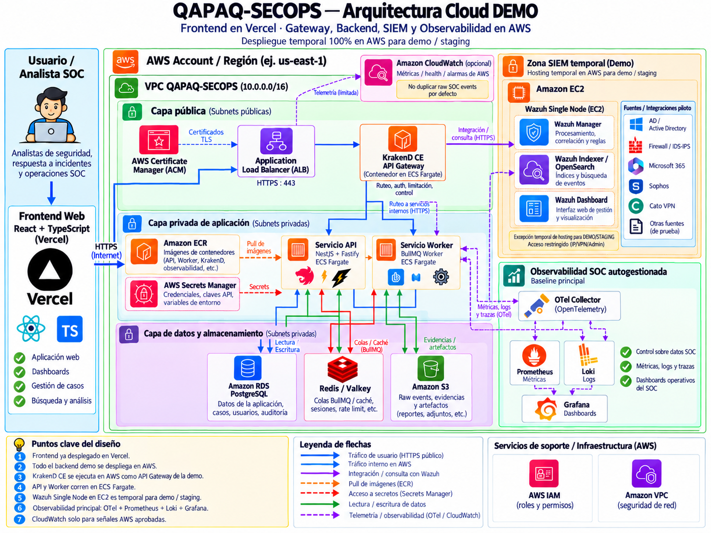

# Arquitectura cloud demo de QAPAQ-SECOPS

**Estado:** arquitectura original de referencia para demo/staging; la mayoría de
los recursos AWS del dibujo aún no está provisionada.

**Actualizado:** 2026-10-05.

**Fuente visual:** diagrama original compartido por el equipo el 2026-10-05,
incorporado sin alterar y en reemplazo de la versión anterior.

## Resumen ejecutivo

La propuesta mantiene la interfaz React/TypeScript en Vercel y despliega en AWS
todo el backend, gateway, SIEM temporal y observabilidad SOC. Un Application Load
Balancer sería la única entrada pública a la aplicación; KrakenD CE, API y worker
correrían en ECS Fargate. PostgreSQL, Redis/Valkey y S3 cubrirían persistencia,
colas/cache y objetos/evidencias. Wazuh se representa temporalmente en una EC2
single-node. La observabilidad SOC principal sería autogestionada con OpenTelemetry,
Prometheus, Loki y Grafana; CloudWatch queda opcional para señales AWS aprobadas.

El alcance actual de fuentes es menor que el del dibujo: **QAPAQ-SECOPS solo
consume Microsoft 365 mediante Wazuh**. Wazuh recolecta y analiza los eventos de
Microsoft 365; QAPAQ consulta las alertas de Wazuh Indexer y gobierna su
normalización y ciclo SOC. No hay un conector Microsoft Graph directo en paralelo.
Active Directory, firewall/IDS-IPS, Sophos y Cato son posibles fuentes piloto, no
integraciones activas. Este recorrido sigue
[ADR-024](../adr/024-microsoft-365-wazuh-mvp-vertical.md).

### Estado por componente

- **Actual:** frontend de demo en Vercel; Microsoft 365 como única fuente
  consumida, a través de Wazuh; conectividad GitHub Actions → AWS probada mediante
  OIDC.
- **Probado en AWS:** `Terraform Demo` se ejecutó manualmente desde `main`. AWS
  autenticó el role; Terraform inicializó el backend remoto S3 y completó `fmt`,
  `validate` y `plan`. El plan consultó la identidad AWS y no propuso cambios de
  infraestructura. Véase la
  [ejecución verificada](https://github.com/CyberStill-GmbH/qapaq-secops/actions/runs/37329776830).
- **Todavía no provisionado por Terraform:** VPC, ALB, ECS, ECR, RDS, Redis/Valkey,
  bucket de artefactos, Secrets Manager y EC2 de Wazuh. La configuración de
  [`infra/aws`](../../infra/aws) solo consulta `aws_caller_identity`; no declara
  recursos de esa pila y el workflow no ejecuta `terraform apply`.
- **Propuesto:** topología cloud de la imagen. No es inventario de recursos
  existentes ni autorización para desplegar producción.

## Diagrama de referencia

*Esta es la imagen original de referencia vigente, reemplaza el diagrama anterior y
describe una topología objetivo. Sus componentes y flujos deben leerse junto con
los estados y salvedades de esta página.*

## Recorrido de datos previsto

1. El analista usa la aplicación web en Vercel. El navegador accede al backend por
   HTTPS; no conecta directamente con PostgreSQL, Redis, S3 ni los nodos Wazuh.
2. El ALB recibe el tráfico público del API y enruta al servicio API de ECS en la
   red privada. El API gestiona solicitudes interactivas; no consume M365
   directamente.
3. La integración nativa de Wazuh recoge eventos Microsoft 365, los procesa con
   decoders/rules y los deja disponibles en Wazuh Indexer.
4. El worker QAPAQ consulta el Indexer, transforma las alertas al contrato interno
   y continúa admisión, detección y ciclo SOC. La primera vertical sigue
   `Microsoft 365 → Wazuh → Wazuh Indexer → QAPAQ`.
5. El worker usa la cola para trabajo recuperable; el estado operacional vive en
   PostgreSQL. S3 almacenaría objetos/evidencias según la política de retención
   aprobada. La cola no es fuente de verdad ni registro de evidencia.
6. Wazuh Dashboard se mantiene restringido a administración por VPN/IP allowlist;
   no se expone como otra interfaz pública de la demo.

### Alineación con las decisiones de arquitectura

El diagrama original fija la intención de la demo: **KrakenD CE como API Gateway
en ECS Fargate dentro de AWS**. ADR-026 todavía registra KrakenD CE on-premises
como gateway para APIs consumidas directamente y especifica que la consulta QAPAQ
→ Wazuh Indexer atraviesa ese gateway. Por tanto, la ubicación del gateway en
esta arquitectura demo difiere de la decisión vigente de ADR-026; antes de
provisionar KrakenD debe actualizarse el ADR o documentarse una excepción de demo.
No desplegar ambas rutas por accidente.

El diagrama original coincide con la baseline de
[ADR-025](../adr/025-security-access-observability-hardening.md): OpenTelemetry,
Prometheus, Loki y Grafana autogestionados forman la observabilidad SOC principal.
CloudWatch es opcional para métricas, health y alarmas de AWS. Clasificar y aprobar
campos, región y retención antes de enviar datos; no duplicar eventos SOC crudos
por defecto.

## Motivos de diseño y tradeoffs

### Vercel para la web, AWS para backend, SIEM y observabilidad

Separar frontend y plano de datos permite entregar cambios de interfaz con
rapidez y mantener base de datos, colas y servicios de integración en una red
privada. El ALB crea una entrada HTTPS única y evita que el navegador hable con
servicios de estado.

El coste es operar dos plataformas y una frontera de identidad/red: CORS, cookies,
redirects de Entra, políticas de contenido y disponibilidad del API deben
alinearse. Secretos y credenciales de proveedores quedan en backend; el frontend
no recibe credenciales AWS ni tokens de ingesta. La sesión humana sigue
[ADR-017](../adr/017-identity-and-authorization.md).

### ECS Fargate para API y worker

Separar procesos permite limitar recursos y escalar API interactiva y trabajos en
segundo plano de manera independiente, sin introducir Kubernetes en una demo.
Fargate reduce la gestión de hosts; ECR permite desplegar imágenes versionadas.

El tradeoff es pagar por capacidad administrada y mantener configuración de
tareas, red, roles y observabilidad. El aislamiento de procesos tampoco ofrece
exactly-once: jobs deben ser idempotentes y la admisión/checkpoint debe ser
durable, como establece [el diseño de flujos](data-flow.md).

### Servicios administrados y datos

- **RDS PostgreSQL:** reduce la carga de operar el motor y facilita backups; añade
  coste fijo, dependencia del servicio AWS y decisiones de versión, tamaño,
  multi-AZ y recuperación. Elegir tamaño según benchmark y probar restore antes
  de declarar continuidad.
- **Redis/Valkey:** ofrece latencia baja para BullMQ/cache; no reemplaza
  PostgreSQL ni almacenamiento durable. Persistencia, memoria, eviction y pérdida
  de Redis deben producir reencolado/reconciliación, no pérdida silenciosa.
- **S3:** escala para raw, evidencias y artefactos con coste por uso; requiere
  cifrado, IAM mínimo, versionado/lifecycle, retención y protección de borrado.
  Objetos y metadatos de PostgreSQL no tienen transacción distribuida: manifiestos
  y reconciliación deben cubrir objetos huérfanos.
- **Secrets Manager:** evita secretos en código e imágenes, a cambio de coste,
  permisos de lectura por tarea, rotación y dependencia de KMS/red. Nunca registrar
  valores secretos ni enviarlos al frontend.

### Wazuh single-node para la demo

Una EC2 única simplifica el piloto y reduce coste inicial; también es un punto
único de fallo, concentra manager, Indexer y dashboard, y tiene límites de
capacidad/almacenamiento. Es aceptable para prueba temporal controlada, no equivale
a alta disponibilidad ni a una garantía 24x7. Antes de producción hay que separar
roles o diseñar recuperación/capacidad, medir volumen y aprobar RPO/RTO.

Mantener Microsoft 365 como única fuente inicial permite validar una vertical
completa y reutilizar recolección/rules de Wazuh sin duplicar Graph y sus scopes.
El coste es depender de cobertura, cuotas, configuración y capacidad de Wazuh;
QAPAQ hereda el contrato de alertas disponibles y no obtiene automáticamente toda
la semántica del evento original. Otras fuentes requieren inventario, autorización,
adapter y pruebas propias.

### CI con OIDC y estado Terraform

GitHub Actions obtiene credenciales temporales por OIDC, en vez de guardar claves
AWS de larga duración. La trust policy limita la identidad al repositorio y la
rama `main`; el estado Terraform usa S3 remoto y locking. Esto reduce exposición
de claves y deriva de estado local, pero concentra riesgo en la identidad del
workflow, sus permisos IAM y el bucket. Antes de añadir `apply`, restringir IAM a
las acciones y recursos necesarios, conservar aprobación protegida y revisar
backups/recuperación del state. `main` como sujeto OIDC no sustituye least
privilege en las políticas del role.

## Límites y decisiones antes de desplegar la pila

1. **Resolver KrakenD:** actualizar ADR-026 o registrar una excepción de demo para
   reconciliar la ubicación en ECS con el gateway on-premises aprobado.
2. **Configurar observabilidad:** desplegar la baseline SOC autogestionada y
   clasificar qué señales operacionales de AWS pueden ir a CloudWatch.
3. **Acotar permisos:** revisar permisos efectivos del role GitHub OIDC; reemplazar
   permisos amplios por permisos mínimos antes de cualquier `apply`.
4. **Cerrar seguridad de red:** confirmar CIDR, subredes, egress, endpoints,
   certificados, administración del dashboard, KMS y exposición pública.
5. **Resolver operación y costes:** estimar tráfico/retención, presupuestar ALB,
   Fargate, NAT, RDS, Redis, S3, Wazuh/EC2 y logs; definir alertas, owners,
   backups y recuperación.
6. **Validar M365/Wazuh:** comprobar scopes, cursor/replay, cobertura, retención,
   mapeo y volumen con una prueba autorizada. No habilitar fuentes dibujadas como
   “otras” sin su gate de [integraciones](integrations.md).
7. **Separar demo y producción:** la instancia Wazuh single-node y el plan
   actualmente sin recursos no satisfacen HA, capacidad, retención aprobada ni
   gates de continuidad del producto.

## Referencias

- [Vertical Microsoft 365 → Wazuh del MVP (ADR-024)](../adr/024-microsoft-365-wazuh-mvp-vertical.md).
- [KrakenD y gateway de APIs de proveedores (ADR-026)](provider-api-gateway.md).
- [Seguridad, acceso y observabilidad (ADR-025)](security-access-observability-baseline.md).
- [Código Terraform demo](../../infra/aws) y
  [workflow Terraform Demo](../../.github/workflows/terraform-demo.yml).
- [Índice de arquitectura](overview.md) y
  [operación/despliegue](../deployment.md).
