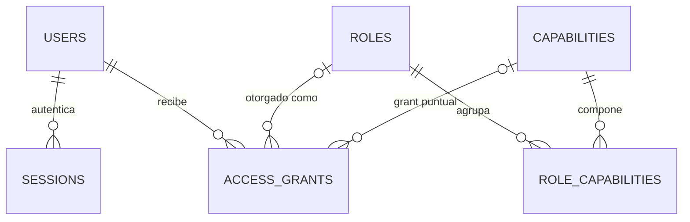
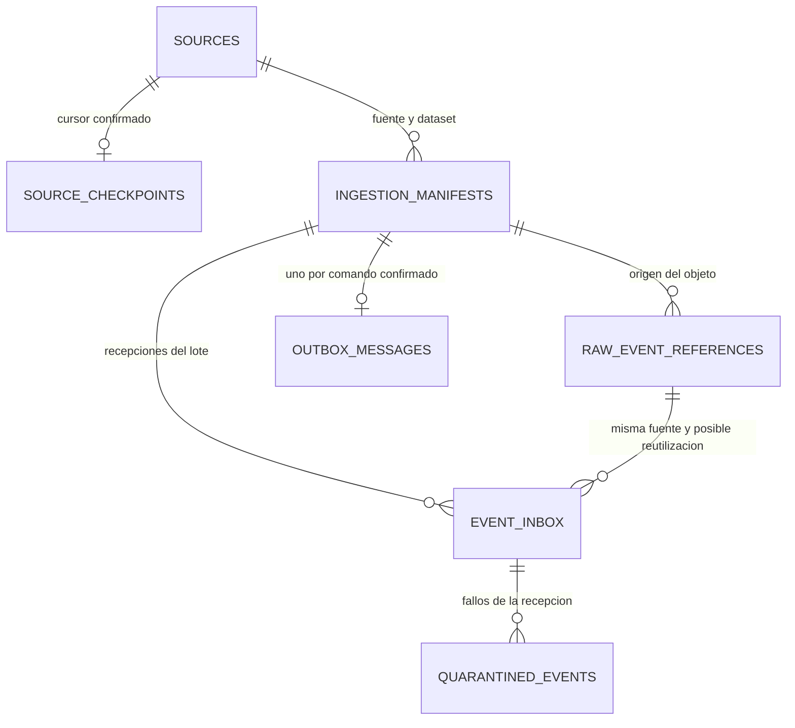
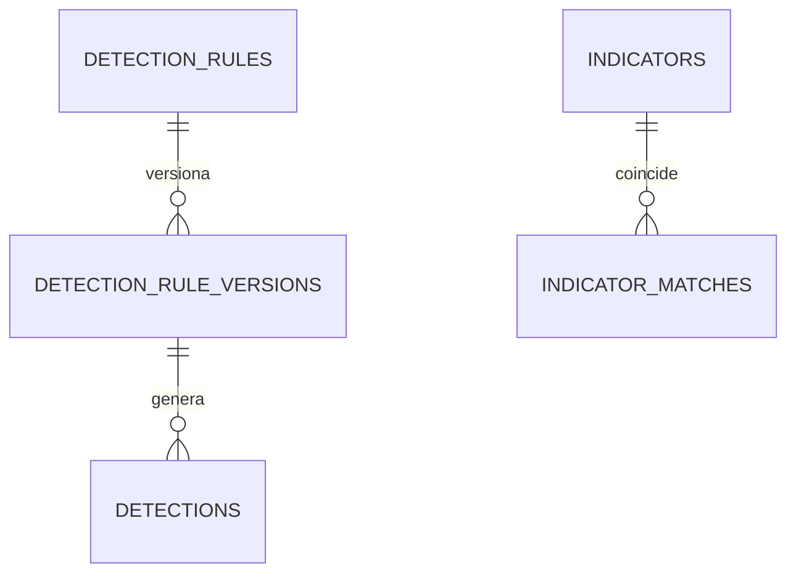
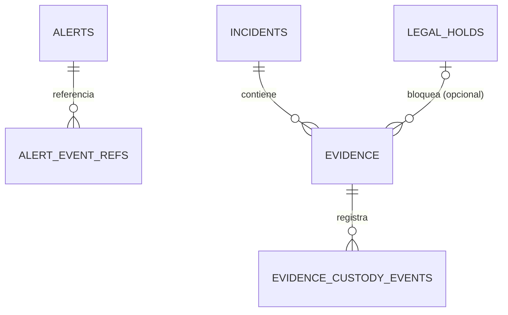
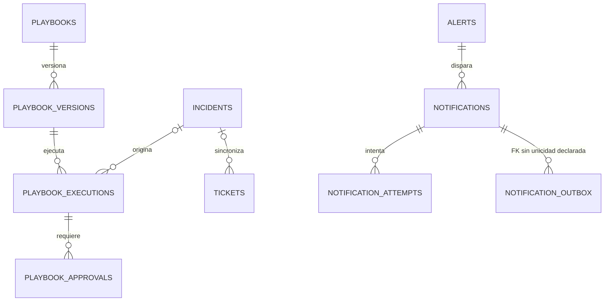
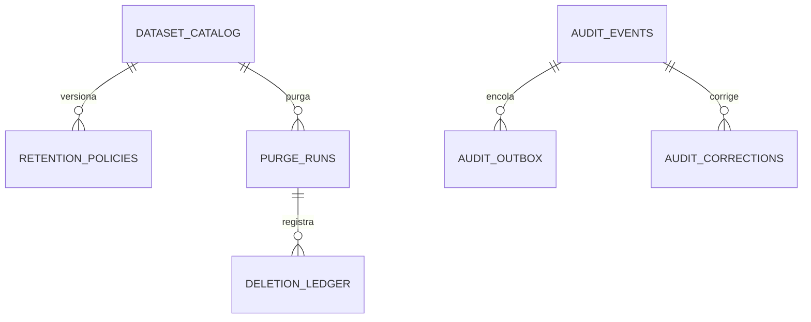
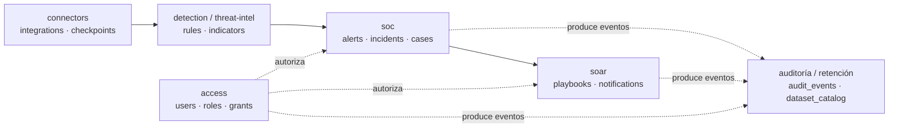

# Modelo Entidad-Relación (MER) — datos operacionales PostgreSQL

Estado: **PROPOSAL**. Ningún ADR acepta todavía un schema físico completo;
[ADR-004](../adr/004-postgresql-operational-data.md) (PostgreSQL para datos
operacionales) y [ADR-009](../adr/009-capability-rbac.md) (RBAC por capabilities)
están *Proposed*, parcialmente sustituidos por [ADR-016](../adr/016-toolchain-and-capacity-baseline.md)
(ORM/versión) y [ADR-017](../adr/017-identity-and-authorization.md) (modelo de
autorización), que aceptan el **concepto** sin fijar el **schema físico**. Este
documento consolida esas fuentes en un MER auditable; no declara una migración
Prisma ejecutada ni una base de datos instalada.

Clasificación aplicada a cada sección: **FACT** (observado en el repo),
**DECISION** (ADR aceptado), **PROPOSAL** (este documento u otro no aceptado),
**ASSUMPTION** (inferencia explícita para poder dibujar el MER) o **UNKNOWN**.
La procedencia funcional no acredita un schema físico ni una restricción SQL.

**Excepción acotada:** el [ER final C-04](c-04-admission-er.md) establece la
baseline de las siete tablas de admisión y resuelve los hallazgos de la
[auditoría](c-04-mer-audit.md). Prevalece sobre §3.2/3.3 y §4.2. Su implementación
sigue pendiente; el resto de este MER permanece PROPOSAL.

## 1. Alcance

Este MER cubre **solo el estado operacional en PostgreSQL** por
[ADR-004](../adr/004-postgresql-operational-data.md) y
[storage.md](storage.md#ownership-por-clase-de-dato): identidad/acceso, activos y
referencias externas, alertas/incidentes/casos resumidos, reglas, integraciones,
políticas, auditoría operacional, notificaciones, catálogo de lotes/objetos,
outbox/inbox y checkpoints.

**Fuera de alcance** (DECISION, no se modela aquí como tablas):

- `SecurityEvent` normalizado y telemetría masiva viven en OpenSearch
  ([ADR-005](../adr/005-opensearch-wazuh-telemetry.md),
  [storage.md](storage.md)); PostgreSQL solo guarda **referencias** (`recordId`,
  `eventUid`) desde las tablas que los necesitan, nunca el evento completo.
- Raw/evidencia física vive en object storage; PostgreSQL guarda referencia,
  SHA-256 y metadata, no los bytes ([event-model.md](event-model.md#raw-privacidad-y-custodia)).
- Índices y alertas propias de Wazuh permanecen en su Indexer
  ([integrations.md](integrations.md#wazuhadapter)).
- Secretos nunca se persisten; solo `secretRef` opaco
  ([critical-alert-notifications.md](critical-alert-notifications.md#canal-y-workflow)).

## 2. Ownership por módulo

Tabla derivada de [modules.md](modules.md) y [storage.md](storage.md); estado
**DECISION** para el ownership funcional, **PROPOSAL** para el nombre exacto de
tabla.

| Módulo | Entidades propuestas | Fuente |
| --- | --- | --- |
| access | `users`, `roles`, `capabilities`, `role_capabilities`, `access_grants`, `sessions`, `service_identities` | [identity-and-authorization.md](identity-and-authorization.md), [rbac.md](rbac.md), ADR-009/017 |
| connectors | `sources`, `source_checkpoints` (C-04); `integrations`, `source_health` (futuro) | [integrations.md](integrations.md), [source-integration-strategy.md](source-integration-strategy.md) |
| telemetry (control plane) | `ingestion_manifests`, `raw_event_references`, `event_inbox`, `outbox_messages`, `quarantined_events` (C-04) | [event-model.md](event-model.md), [storage.md](storage.md) |
| detection | `detection_rules`, `detection_rule_versions`, `detections` | [modules.md](modules.md#4-detection--correlation--detection) |
| threat-intelligence | `indicators`, `indicator_matches` | [modules.md](modules.md#5-threat-intelligence--threat-intelligence) |
| soc | `alerts`, `alert_event_refs`, `incidents`, `cases`, `case_links`, `notes`, `evidence`, `evidence_custody_events` | [modules.md](modules.md#6-alerts-incidents--cases--soc) |
| soar | `playbooks`, `playbook_versions`, `playbook_executions`, `playbook_approvals`, `tickets`, `notifications`, `notification_attempts`, `notification_outbox` | [modules.md](modules.md#7-soar-playbooks--ticketing--soar), [critical-alert-notifications.md](critical-alert-notifications.md) |
| antifraud | `antifraud_signals`, `antifraud_cases` (esqueleto mínimo) | [modules.md](modules.md#8-antifraud-intelligence--antifraud) — **UNRESOLVED**, ver §3.8 |
| transversal (auditoría) | `audit_events`, `audit_outbox`, `audit_archive_manifests`, `audit_corrections` | [audit.md](audit.md) |
| transversal (retención/custodia) | `dataset_catalog`, `retention_policies`, `legal_holds`, `purge_runs`, `deletion_ledger`, `exports` | [retention-privacy-custody.md](retention-privacy-custody.md) |

Cada módulo es dueño exclusivo de sus tablas; ningún otro módulo las consulta
directamente — solo por interfaz pública o evento, por
[dependency-rules.md](dependency-rules.md#entre-módulos).

## 3. Catálogo de entidades

Fuera de C-04, las filas indican **Estado** (R=requisito funcional referenciado,
P=propuesta física de este documento, A=supuesto) y **Fuente**. R no significa que
los campos, tipos, claves o cardinalidades sean un schema físico aceptado: sus
concreciones son propuestas salvo decisión explícita citada. El diccionario
normativo de C-04 está separado para no promover todo el catálogo a DECISION.

### 3.1 access

#### `users`

| Campo | Tipo | Estado | Fuente |
| --- | --- | --- | --- |
| `id` (PK) | uuid | P | — |
| `entra_tenant_id` | text | R | identity-and-authorization.md §"Identidad y restricción del tenant" |
| `entra_object_id` | text | R | idem |
| `display_name` | text | R | idem |
| `email` | text | R | idem (descriptivo, no identificador) |
| `status` | enum(`PENDING`,`ACTIVE`,`SUSPENDED`,`REVOKED`) | R | idem |
| `authorization_version` | int | R | idem §"Versionado, revocación y directorio" |
| `last_login_at` | timestamptz | R | idem |
| `last_directory_sync_at` | timestamptz | R | idem |
| `created_at`, `updated_at` | timestamptz | A | convención estándar |

`UNIQUE (entra_tenant_id, entra_object_id)`: **DECISION** — es el identificador
primario estable, no `email`/`UPN` (identity-and-authorization.md).

#### `roles`

| Campo | Tipo | Estado | Fuente |
| --- | --- | --- | --- |
| `id` (PK) | uuid | P | — |
| `name` | text unique | R | rbac.md — bundles `VIEWER`, `SOC_L1`, `SOC_L2`, `SOC_MANAGER`, `DETECTION_ENGINEER`, `PLATFORM_ADMIN`, `AUDITOR`, `ACCESS_ADMIN` |
| `description` | text | A | — |
| `is_privileged` | boolean | A | soporta el flujo de doble aprobación de rbac.md §"Evitar autoescalada" |
| `created_at`, `updated_at` | timestamptz | A | — |

#### `capabilities`

Catálogo cerrado (resource.action) que **no permite strings libres**
(rbac.md §"Modelo": *"un administrador no crea una capability ejecutable
escribiendo un string nuevo"*).

| Campo | Tipo | Estado | Fuente |
| --- | --- | --- | --- |
| `id` (PK) | uuid | P | — |
| `key` | text unique (`resource.action`) | R | rbac.md §"Catálogo por concretar" (ej. `alerts.read`, `raw_event.export`) |
| `owning_module` | text | R | modules.md — cada módulo registra sus capabilities |
| `is_critical` | boolean | R | identity-and-authorization.md §"Privilegios..." lista capabilities críticas |
| `description` | text | A | — |

#### `role_capabilities` (junction, sustituye `role_permissions`)

| Campo | Estado | Fuente |
| --- | --- | --- |
| `role_id` (FK roles), `capability_id` (FK capabilities) — PK compuesta | R | ADR-009 nombra `role_permissions`; aquí `role_capabilities` para alinear con el vocabulario de capabilities de ADR-017 — **ASSUMPTION de nomenclatura**, no de modelo |

#### `access_grants` (sustituye/extiende `user_roles`)

Modela tanto la asignación de un rol como un grant JIT de una capability
puntual, porque ADR-017 describe grants con esa granularidad
(identity-and-authorization.md §"Se adopta RBAC...").

| Campo | Tipo | Estado | Fuente |
| --- | --- | --- | --- |
| `id` (PK) | uuid | P | — |
| `user_id` (FK users) | uuid | R | idem |
| `role_id` (FK roles, nullable) | uuid | A | un grant puede ser de rol o de capability suelta |
| `capability_id` (FK capabilities, nullable) | uuid | R | idem |
| `scope_type` | enum(`ORGANIZATION`,`BUSINESS_UNIT`,`BRANCH`,`TEAM`,`ASSIGNED_RESOURCES`) | R | idem |
| `scope_id` | text nullable | R | idem |
| `conditions` | jsonb | P | idem — condiciones ABAC acotadas, ver §5.1 |
| `requested_by`, `approved_by` | FK users | R | idem — nunca el mismo actor para grants privilegiados |
| `reason`, `ticket_ref` | text | R | idem |
| `valid_from`, `valid_until` | timestamptz | R | idem — JIT máx. 1 hora inicial |
| `status` | enum(`PENDING`,`ACTIVE`,`EXPIRED`,`REVOKED`) | A | — |
| `created_at` | timestamptz | A | — |

`CHECK (role_id IS NOT NULL OR capability_id IS NOT NULL)`: **ASSUMPTION** —
regla de integridad para que un grant no quede vacío.

#### `sessions`

| Campo | Estado | Fuente |
| --- | --- | --- |
| `id` (PK), `user_id` (FK), `entra_tid`, `entra_oid`, `auth_time`, `auth_strength`, `authorization_version_at_creation`, `created_at`, `last_activity_at`, `absolute_expires_at`, `revoked`, `revoked_at`, `revoked_reason`, `concurrent_slot` | R | identity-and-authorization.md §"Flujo BFF y sesión" — campos mínimos listados explícitamente |

Nunca contiene el token de Entra ni la cookie; solo el identificador de sesión
del lado servidor (idem). ADR-025 fija `concurrent_slot = 1` y una restricción/índice
único aplicable a sesiones no revocadas por `user_id`; Redis no es la autoridad de
esta invariante.

#### `service_identities`

| Campo | Estado | Fuente |
| --- | --- | --- |
| `id`, `kind` (`SERVICE_COLLECTOR`,`SERVICE_WORKER`,`SERVICE_INTEGRATION`,`SERVICE_ANALYTICS`), `name`, `scope`, `credential_ref`, `status`, `rotated_at`, `created_at` | R | identity-and-authorization.md §"Identidades de servicio" |

### 3.2 connectors

#### `integrations`

| Campo | Estado | Fuente |
| --- | --- | --- |
| `id`, `provider` (`wazuh`\|`microsoft`\|`cato`\|`sophos`), `product`, `edition`, `dataset`, `owner_functional`, `owner_technical`, `scope`, `secret_ref`, `status` (`planned`\|`configured`\|`validated`\|`enabled`\|`degraded`\|`paused`), `disabled_reason`, `created_at`, `updated_at` | R | integrations.md §"Ficha de habilitación por conector" |

Solo el registro de `provider = 'wazuh'` puede llegar a `enabled` en el MVP; los
demás quedan en `planned` como máximo — **DECISION**
([source-integration-strategy.md](source-integration-strategy.md#el-mvp-materializa-únicamente-integrationswazuh)).

#### `sources` y `source_checkpoints` — baseline C-04

El [diccionario final](c-04-admission-er.md#diccionario-físico) fija identidad
por tenant/proveedor/producto/dataset/instancia, un checkpoint opcional por fuente,
CAS por revisión y cursor confirmado. Sustituye `integration_checkpoints`; los
estados FETCHED/DURABLE/NORMALIZED/PROCESSED/CHECKPOINTED describen etapas del flujo,
no estados de la fila de checkpoint. `integrations` sigue siendo ficha operativa
futura y `source_health` una propuesta fuera de las siete tablas de C-04.

### 3.3 telemetry — baseline C-04

El [ER final](c-04-admission-er.md) fija:

- `ingestion_manifests`: sustituye `ingest_batches`; lote y cursores de admisión.
- `raw_event_references`: sustituye el catálogo raw propuesto en esta entrega;
  objeto inmutable por registro con manifiesto de origen, sin tier de archivo.
- `event_inbox`: recepción física con recordId e idempotencia de persistencia.
- `outbox_messages`: una referencia al manifiesto por admisión confirmada.
- `quarantined_events`: sustituye `quarantine_entries`; historial ligado al
  inbox/raw/recordId de la misma fuente mediante FK compuesta.

No son tablas adicionales a las siete de C-04. El catálogo de archivo por tier,
la ficha de integración y los outboxes de auditoría/notificación pertenecen a
sus entregas futuras. C-04 no implementa su comportamiento ni un parser.

### 3.4 detection

#### `detection_rules` / `detection_rule_versions`

| Campo | Estado | Fuente |
| --- | --- | --- |
| `detection_rules`: `id`, `name`, `current_version_id`, `status`, `created_by` | P | modules.md §"Detection & Correlation" — "versionado/pruebas de reglas" |
| `detection_rule_versions`: `id`, `rule_id` (FK), `version`, `definition` (jsonb), `severity_baseline`, `mitre_techniques` (text[]), `published_by`, `published_at`, `created_at` | P | idem |

Separar regla de versión evita repetir metadatos inmutables por cada versión
(ver §5 normalización).

#### `detections`

| Campo | Estado | Fuente |
| --- | --- | --- |
| `id`, `rule_id` (FK), `rule_version_id` (FK), `security_event_record_id`, `security_event_uid`, `confidence`, `severity`, `produced_at` | R | event-model.md (identidad del evento) + modules.md (Detection como resultado de una regla) |

### 3.5 threat-intelligence

#### `indicators`

| Campo | Estado | Fuente |
| --- | --- | --- |
| `id`, `type` (`ip`\|`domain`\|`hash`\|`url`\|...), `value`, `source`, `confidence`, `tlp`, `valid_from`, `valid_until`, `created_at`, `updated_at` | R | modules.md §"Threat Intelligence" |

#### `indicator_matches`

| Campo | Estado | Fuente |
| --- | --- | --- |
| `id`, `indicator_id` (FK), `security_event_record_id`, `alert_id` nullable (FK), `matched_at` | R | modules.md — "una coincidencia IOC es evidencia, no confirmación automática" |

### 3.6 soc

#### `alerts`

| Campo | Estado | Fuente |
| --- | --- | --- |
| `id`, `status` (`NEW`\|`ENRICHING`\|`TRIAGE`\|`INVESTIGATING`\|`CONFIRMED`\|`FALSE_POSITIVE`\|`CLOSED`), `severity_normalized`, `severity_score`, `mapping_id`, `mapping_version`, `classification`, `scope`, `assigned_to` (FK users nullable), `created_at`, `updated_at`, `closed_at` | R | modules.md §"Lifecycles aceptados" (estados exactos) + event-model.md §"Severidad" |

#### `alert_event_refs`

Une una alerta con los `SecurityEvent` que la originaron (que viven en
OpenSearch); nunca copia el evento.

| Campo | Estado | Fuente |
| --- | --- | --- |
| `alert_id` (FK), `security_event_record_id` — PK propuesta; `security_event_uid` — atributo de referencia, dependencia por validar | R | event-model.md (identidad `recordId`/`eventUid`) |

#### `incidents`

| Campo | Estado | Fuente |
| --- | --- | --- |
| `id`, `title`, `status` (`OPEN`\|`INVESTIGATING`\|`CONTAINMENT`\|`ERADICATION`\|`RECOVERY`\|`RESOLVED`\|`CLOSED`), `severity`, `scope`, `classification`, `opened_at`, `closed_at`, `created_by` (FK users) | R | modules.md §"Incident lifecycle" |

#### `cases`

| Campo | Estado | Fuente |
| --- | --- | --- |
| `id`, `kind` (`soc`\|`antifraud`), `title`, `status`, `scope`, `owner_id` (FK users), `opened_at`, `closed_at` | R | modules.md — "Case: contenedor de investigación SOC o antifraude" |

#### `case_links` — **cardinalidad UNRESOLVED**

Relaciona `alerts` ↔ `incidents` ↔ `cases`. modules.md es explícito:
*"Cardinalidades físicas, guardas y permisos por transición siguen U-008; no se
aprueba una relación N:M por inferencia."* Este documento **no fija** la
cardinalidad; propone solo la forma de la tabla como placeholder auditable:

| Campo | Estado | Fuente |
| --- | --- | --- |
| `id`, `parent_type` (`incident`\|`case`), `parent_id`, `child_type` (`alert`\|`incident`), `child_id`, `linked_at`, `linked_by` | **UNRESOLVED** | [unresolved.md §U-008](../decisions/unresolved.md#u-008--workflow-soc-y-soar) |

No implementar `UNIQUE`/`CHECK` de cardinalidad hasta que U-008 se resuelva.

#### `notes`

| Campo | Estado | Fuente |
| --- | --- | --- |
| `id`, `parent_type` (`alert`\|`incident`\|`case`), `parent_id`, `author_id` (FK users), `body`, `created_at` | A | modules.md menciona "notas" sin schema; forma polimórfica propuesta aquí |

#### `evidence`

| Campo | Estado | Fuente |
| --- | --- | --- |
| `id`, `incident_id` (FK), `source_collector`, `acquired_at`, `name`, `media_type`, `size_bytes`, `sha256`, `object_version`, `classification`, `key_ref`, `hold_id` nullable (FK legal_holds), `retention_until` | R | retention-privacy-custody.md §"Holds, custodia e inmutabilidad" |

#### `evidence_custody_events`

| Campo | Estado | Fuente |
| --- | --- | --- |
| `id`, `evidence_id` (FK), `event_type` (`acquire`\|`transfer`\|`validate`\|`access`\|`copy`\|`export`\|`custodian_change`\|`hold`\|`delete`), `actor_id`, `occurred_at`, `notes` | R | idem — "Adquisición, transferencia, validación, acceso, copia, export, cambio de custodio, hold y eliminación quedan en cadena de custodia" |

### 3.7 soar

#### `playbooks` / `playbook_versions`

| Campo | Estado | Fuente |
| --- | --- | --- |
| `playbooks`: `id`, `name`, `current_version_id`, `status` | P | modules.md §"SOAR, Playbooks & Ticketing" |
| `playbook_versions`: `id`, `playbook_id` (FK), `version`, `risk_level` (`low`\|`medium`\|`high`\|`critical`), `definition` (jsonb), `created_by`, `created_at` | P | idem |

#### `playbook_executions`

| Campo | Estado | Fuente |
| --- | --- | --- |
| `id`, `playbook_version_id` (FK), `incident_id` nullable (FK), `alert_id` nullable (FK), `requester_id` (FK), `approver_id` nullable (FK), `target`, `parameters` (jsonb, sin secretos), `idempotency_key` unique, `status`, `step_up_verified_at`, `started_at`, `finished_at`, `result` | R | identity-and-authorization.md §"Acciones SOAR altas/críticas" |

`CHECK (requester_id <> approver_id)` para acciones alta/crítica: **DECISION**
(identity-and-authorization.md — *"requester distinto de approver"*).

#### `playbook_approvals`

| Campo | Estado | Fuente |
| --- | --- | --- |
| `id`, `execution_id` (FK), `approver_id` (FK), `decision`, `decided_at`, `reason` | A | derivado de identity-and-authorization.md (aprobación separada del ejecutor) |

#### `tickets`

| Campo | Estado | Fuente |
| --- | --- | --- |
| `id`, `itsm_system`, `external_ref`, `incident_id` nullable (FK), `status`, `created_at`, `synced_at` | A | modules.md — "creación y sincronización de tickets", sin schema detallado |

#### `notifications` / `notification_attempts` / `notification_outbox`

Modelo tomado literalmente de
[critical-alert-notifications.md](critical-alert-notifications.md#entrega-estados-y-deduplicación):

| Campo | Estado | Fuente |
| --- | --- | --- |
| `notifications`: `id`, `alert_id` (FK), `incident_id` nullable, `channel`, `notification_version`, `notification_id` unique (`alertId + channel + notificationVersion`), `status` (`PENDING`\|`SENDING`\|`SENT`\|`FAILED_RETRYABLE`\|`FAILED_TERMINAL`\|`ACKNOWLEDGED`\|`SUPERSEDED`), `acknowledged_by`, `acknowledged_at`, `superseded_by` | R | idem |
| `notification_attempts`: `id`, `notification_id` (FK), `attempt_number` (≤5), `result`, `error_code`, `attempted_at` | R | idem — "Máximo cinco intentos" |
| `notification_outbox`: `id`, `notification_id` (FK), `status`, `created_at`, `processed_at` | R | idem — patrón outbox transaccional con la alerta |

### 3.8 antifraud — **UNRESOLVED**

modules.md acepta el módulo y su independencia de entidades
(*"mantiene reglas, permisos, entidades y vocabulario propios"*), pero no
publica su lifecycle ni schema. Se deja únicamente un esqueleto mínimo para no
inventar campos:

| Tabla | Estado | Fuente |
| --- | --- | --- |
| `antifraud_signals` (`id`, `type`, `subject_ref`, `score`, `explanation`, `created_at`) | **UNRESOLVED** | modules.md §"Antifraud Intelligence" — sin schema aceptado |
| `antifraud_cases` | **UNRESOLVED** | idem |

No implementar sin una decisión/ADR específico de Antifraude.

### 3.9 Auditoría (transversal)

Schema tomado literalmente de [audit.md](audit.md#contrato-de-auditevent) —
**DECISION** condicional por ADR-021.

#### `audit_events` (append-only; rol runtime solo `INSERT`/`SELECT`)

Campos: `audit_event_id`, `occurred_at`, `recorded_at`, `actor_type`, `actor_id`,
`subject_id`, `session_id_hash`, `authentication_context`, `capability`,
`action`, `resource_type`, `resource_id`, `scope`, `decision`, `reason_code`,
`policy_version`, `authorization_version`, `request_id`, `trace_id`,
`source_ip_classification`, `before_reference`, `after_reference`, `outcome`,
`error_code`, `partition`, `sequence`, `previous_hash`, `event_hash`,
`schema_version`.

`UNIQUE (partition, sequence)`: **DECISION** — soporta la cadena de hashes
encadenados (audit.md §"Cadena de hashes").

#### `audit_outbox`

| Campo | Estado | Fuente |
| --- | --- | --- |
| `id`, `audit_event_id` (FK), `status`, `created_at`, `processed_at` | R | audit.md §"Atomicidad y append-only" |

#### `audit_archive_manifests`

Campos literales de audit.md §"Archivo inmutable y firma": `manifest_id`,
`partition`, `first_sequence`, `last_sequence`, `event_count`, `first_hash`,
`last_hash`, `content_hash`, `created_at`, `schema_version`,
`signing_key_version`, `signature`.

#### `audit_corrections`

| Campo | Estado | Fuente |
| --- | --- | --- |
| `id`, `original_audit_event_id` (FK), `correction_audit_event_id` (FK), `created_at` | R | audit.md — "Correcciones crean un nuevo AUDIT_CORRECTION que referencia el evento original" |

### 3.10 Retención y custodia (transversal)

Tomado de [retention-privacy-custody.md](retention-privacy-custody.md) —
**DECISION** condicional por ADR-018.

#### `dataset_catalog`

Campos: `dataset_id` (PK), `name`, `business_owner`, `technical_custodian`,
`purpose`, `source_system`, `classification` (`PUBLIC`\|`INTERNAL`\|`CONFIDENTIAL`\|`RESTRICTED`),
`personal_data_categories` (text[]), `prohibited_fields` (text[]), `locations`
(text[]), `regions` (text[]), `trigger`, `retention_hot_days`,
`retention_total_days`, `legal_authority`, `immutability`, `backup_policy`,
`deletion_policy`, `hold_eligible`, `review_date`. Fuente: retención §"Inventario
y clasificación" — todos listados explícitamente como obligatorios antes de
producción.

#### `retention_policies`

| Campo | Estado | Fuente |
| --- | --- | --- |
| `id`, `dataset_id` (FK), `version`, `hot_days`, `total_days`, `trigger`, `approved_by`, `effective_date`, `status` | R | idem §"Purga y cambios de política" |

#### `legal_holds`

| Campo | Estado | Fuente |
| --- | --- | --- |
| `id`, `case_ref`, `authority`, `requester_id`, `approver_id`, `reason`, `scope`, `datasets` (text[]), `resources` (jsonb), `created_at`, `review_at`, `released_at`, `released_by` | R | idem §"Holds, custodia e inmutabilidad" — "revisado al menos cada 90 días" |

#### `purge_runs`

| Campo | Estado | Fuente |
| --- | --- | --- |
| `purge_run_id`, `dataset_id` (FK), `policy_version`, `range_start`, `range_end`, `object_count`, `bytes_removed`, `started_at`, `finished_at`, `result`, `exceptions` (jsonb), `manifest_hash`, `approved_by` | R | idem §"Purga y cambios de política" |

#### `deletion_ledger`

| Campo | Estado | Fuente |
| --- | --- | --- |
| `id`, `dataset_id`, `subject_ref`, `purge_run_id` (FK), `deleted_at` | R | idem — "El deletion ledger evita resurrección tras restore" |

#### `exports`

| Campo | Estado | Fuente |
| --- | --- | --- |
| `id`, `dataset_id`, `filters` (jsonb), `range_start`, `range_end`, `purpose`, `requester_id`, `approver_id`, `classification`, `manifest_ref`, `checksum`, `encrypted`, `expires_at` (≤30 días), `download_count`, `created_at` | R | idem §"Exports, residencia y salida" |

## 4. Diagramas ER

Dividido en seis diagramas por dominio en vez de uno solo, para que cada uno
sea legible a tamaño por defecto en el visor de Markdown/GitHub — el diagrama
único anterior mezclaba demasiadas entidades y se veía ilegible. `||--o{` = padre obligatorio y cero o muchos hijos; `o|` indica
participación opcional. Una línea punteada Mermaid no significa cardinalidad
desconocida: U-008 se representa sin cardinalidades en un flujo conceptual. Cada diagrama es una vista parcial del mismo modelo del §3; el
[panorama completo](#47-panorama-completo-referencia-rápida) al final los
resume en una sola imagen de solo cajas, sin atributos, para navegación.

### 4.1 Identidad y acceso (access)

### 4.2 Integraciones y telemetría (connectors / telemetry)

Fuente canónica: [14-c-04-admission-er.mmd](../diagrams/14-c-04-admission-er.mmd).
Las FKs compuestas y las reglas de comando que imponen los mínimos del lote
están en el [ER final](c-04-admission-er.md#relaciones-borrado-e-índices).

### 4.3 Detección e inteligencia de amenazas (detection / threat-intelligence)

La transición `Detection → Alert Candidate → Alert` es un lifecycle conceptual
aceptado en [modules.md](modules.md#lifecycles-aceptados) ("no toda detección
genera alerta"), no una FK: `alerts` no declara `detection_id` en el §3.6
porque ninguna fuente fija esa cardinalidad todavía.

### 4.4 Alertas, incidentes y casos (soc)

Las notas polimórficas no tienen tres FKs obligatorias: `parent_type/parent_id`
requiere validación de aplicación o un rediseño posterior. Las cardinalidades de
`case_links` continúan U-008; esta vista solo indica conceptos relacionados:

### 4.5 SOAR, playbooks y notificaciones (soar)

### 4.6 Auditoría, retención y custodia (transversal)

`exports.dataset_id` no declara FK física en este catálogo; no se dibuja como
relación garantizada. Misma transacción no implica cardinalidad 1:1; para imponerla
se necesita UNIQUE y una decisión de la entrega correspondiente.

Nota común a los diagramas: `ALERT_EVENT_REFS`, `DETECTIONS` e
`INDICATOR_MATCHES` referencian `security_event_record_id`/
`security_event_uid`, que **no son FK** — apuntan a documentos en OpenSearch,
no a una tabla PostgreSQL. Se documentan como atributos en el §3, no como
entidades en los diagramas, para no sugerir integridad referencial que la base
de datos no puede aplicar.

### 4.7 Panorama completo (referencia rápida)

Solo cajas y relaciones entre dominios, sin atributos ni entidades internas de
cada uno — para orientarse antes de abrir el diagrama detallado que
corresponda.

## 5. Metodología de normalización

Esta revisión documenta dependencias y límites; no certifica normalización de
un schema todavía no implementado.

1. Las claves compuestas requieren dependencia de toda la clave. En
   `alert_event_refs` se propone `(alert_id, security_event_record_id)` como PK;
   eventUid es referencia dependiente del registro externo, no una tercera columna
   de PK ratificada. Su ubicación definitiva se valida al entregar SOC.
2. `evidence` no declara dataset_id y sí conserva classification; `exports`
   conserva dataset_id y classification sin FK física declarada. No se afirma que
   ambas tablas hereden clasificación automáticamente de dataset_catalog. El
   significado de clasificación propia, snapshot o derivación deberá decidirse
   con custodia/retención antes de sus migraciones.
3. C-04 usa FKs compuestas para pertenencia y documenta redundancia controlada;
   su referencia raw no demuestra existencia ni digest del objeto externo.
4. Las notas y holds polimórficos, referencias OpenSearch, hashes y reglas de
   negocio no quedan protegidos universalmente por FKs. Requieren guardas y
   pruebas de la entrega dueña. No se afirma haber demostrado consistencia de
   todas las mutaciones del MER.
5. Los lifecycles funcionales aceptados no fijan por sí solos enums SQL ni todos
   sus estados iniciales. C-04 adopta CHECKs mínimos y evolución por migración;
   el resto del catálogo conserva su carácter propuesto.

### 5.1 Excepciones deliberadas a la normalización estricta

| Campo | Por qué es `jsonb`/array en vez de tabla | Fuente/justificación |
| --- | --- | --- |
| `access_grants.conditions` | ABAC "limitado a atributos necesarios y probados, sin construir lenguaje de políticas general" — modelarlo como tablas relacionales anticiparía un motor de políticas no aprobado | rbac.md §"Modelo" |
| `playbook_versions.definition`, `playbook_executions.parameters` | Definición de playbook es versionada como unidad atómica, no se consulta relacionalmente en el MVP; normalizarla exigiría un schema de "definición de playbook" que ningún ADR fija todavía | modules.md — SOAR es capacidad de entrega incremental, sin motor completo |
| `dataset_catalog.personal_data_categories`, `.prohibited_fields`, `.locations`, `.regions` | Listas controladas por Legal/Compliance, no relacionadas entre datasets; extraerlas a tablas de catálogo es válido cuando exista necesidad de consulta cruzada, no antes | retention-privacy-custody.md §"Inventario y clasificación" |
| `legal_holds.resources` | Un hold referencia recursos heterogéneos (alertas, incidentes, evidencia, exports); una tabla polimórfica genérica agregaría acoplamiento sin caso de uso probado | retention-privacy-custody.md §"Holds, custodia e inmutabilidad" |

Estas excepciones son **PROPOSAL** de este documento, no decisión aceptada;
deben confirmarse cuando exista un caso de uso de consulta relacional sobre
esos campos (por ejemplo, "listar todos los holds sobre un `alertId`" sí
justificaría extraer `resources` a una tabla `legal_hold_resources`).

### 5.2 Por qué `audit_events` no se "normaliza" como una tabla mutable

`audit_events` requiere validar sus dependencias funcionales al implementar su
schema. Independientemente de esa normalización, su contrato exige que sea
append-only, el rol runtime no tiene `UPDATE`/`DELETE`, y las correcciones se
modelan como una fila nueva (`audit_corrections`) en vez de un `UPDATE` sobre
la fila original. Esto no es una violación de normalización — es un requisito
de integridad de auditoría (cadena de hashes) que prevalece sobre la
conveniencia de "corregir en el lugar" (audit.md §"Cadena de hashes").

## 6. Puntos abiertos para auditoría

Antes de convertir este MER en una migración Prisma ejecutable, deben
resolverse — cada uno referenciado a su fuente para que un auditor pueda
verificar el estado real, no solo este documento:

1. **Schema físico y catálogo final de capabilities**: PROPOSAL en
   [ADR-009](../adr/009-capability-rbac.md); falta ratificación por endpoint.
2. **Cardinalidad `alerts`↔`incidents`↔`cases`** (`case_links`): UNRESOLVED,
   [U-008](../decisions/unresolved.md#u-008--workflow-soc-y-soar). No
   implementar `UNIQUE`/`CHECK` hasta resolverlo.
3. **Antifraud**: sin schema aceptado; solo esqueleto mínimo en §3.8.
4. **Particionado de `audit_events`**: "`partition + day` es una opción, no un
   valor inventado" — [audit.md](audit.md#cadena-de-hashes). Definir antes de
   implementar.
5. **`dataset_catalog` real**: cada fila exige business owner, custodio,
   clasificación y periodos reales, no sintéticos —
   [retention-privacy-custody.md](retention-privacy-custody.md#gate-y-aceptación-productiva).
   No poblar con datos de producción hasta que Legal/Compliance apruebe la
   matriz normativa.
6. **Migraciones Prisma**: ADR-016 acepta Prisma 7.10.0 como ORM, no un schema
   generado. `db push` no es mecanismo productivo
   ([toolchain-and-capacity.md](toolchain-and-capacity.md#prisma-y-persistencia)).

## 7. Cómo auditar este documento

Para distinguir requisitos heredados de decisiones físicas nuevas:

1. Cada fila R del §3 cita procedencia funcional; verificar qué campos están
   expresamente requeridos y cuáles son concreciones físicas propuestas. Una
   inferencia no se convierte en FACT por citar el documento funcional.
2. Toda fila marcada **PROPOSAL**, **ASSUMPTION** o **UNRESOLVED** es una
   decisión de este documento, no un hecho aceptado — no debe copiarse a un
   ADR o a Prisma sin pasar por revisión de Arquitectura.
3. El §6 lista exactamente lo que falta para pasar de MER a migración
   ejecutable; ninguna fila de este documento habilita producción por sí sola
   (ver también [validation.md](../validation.md) y
   [verification.md](../verification.md)).
4. Contrastar con [requirements.md](../requirements.md) (R-04, R-09, R-11,
   R-12, R-14, R-15, R-21) para confirmar que el modelo cubre los
   requerimientos trazables sin excederlos.

[Storage](storage.md) · [Módulos](modules.md) · [RBAC](rbac.md) ·
[Auditoría](audit.md) · [Retención](retention-privacy-custody.md) ·
[SecurityEvent](event-model.md) · [Preguntas abiertas](../decisions/unresolved.md).
