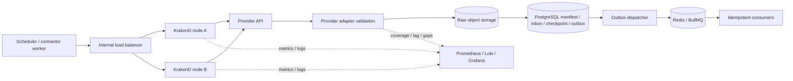

# API Gateway de proveedores: KrakenD on-premises

Decisión normativa: [ADR-026](../adr/026-on-premises-krakend-provider-api-gateway.md).
Estado: **diseño aceptado; despliegue y rutas gated**.

La decisión de sistema y sus gates de implementación están en el [C-28 System Design](c-28-krakend-system-design.md); comandos y operaciones locales, en [platform/gateway/krakend](../../platform/gateway/krakend/README.md).

## Arquitectura objetivo



La flecha de retorno desde el proveedor representa una respuesta que recibe el
adapter a través de KrakenD. No representa escritura del proveedor ni del gateway
en storage. Redis/BullMQ transporta referencias después del commit; nunca es la
única copia del payload ni del progreso.

Para webhooks, el camino de entrada es `proveedor → LB/WAF perimetral → KrakenD →
API QAPAQ → admisión durable → outbox → BullMQ`. Se reutilizan manifiesto, inbox,
idempotencia y observabilidad; solo cambia el iniciador.

## Aplicación al MVP Microsoft 365/Wazuh

El recorrido aprobado sigue siendo:

```text
Microsoft 365 → integración nativa Wazuh → Wazuh Indexer
QAPAQ connector worker → LB interno → KrakenD → Wazuh Indexer
                      → admisión durable → BullMQ
```

KrakenD protege la consulta de QAPAQ al Indexer. No se intercala entre Microsoft
365 y Wazuh. Un adapter Microsoft Graph directo solo se crea mediante ADR/alta de
fuente futura y entonces consume Graph a través de KrakenD.

## Contrato de ruta por proveedor

Cada ruta se declara sin secretos y contiene: `sourceId`, owner, upstream allowlist,
métodos/path permitidos, esquema de autenticación, secretRefs, scopes, versión API,
timeout, límite por réplica, presupuesto total, tamaños, headers allowlisted,
clasificación de datos, health, telemetry route name, rollback y fecha de revisión.

El alta exige cuatro artefactos inseparables:

1. inventario y autorización de la fuente;
2. ruta KrakenD validada y promovible;
3. adapter semántico con cursor/replay/idempotencia;
4. provider specs y pruebas de admisión durable.

Centralizar no significa “plug-and-play”: añadir una ruta sin adapter/mapping y
suite real no habilita la fuente.

## Presupuesto de fallos

| Capa | Puede hacer | No puede hacer |
| --- | --- | --- |
| KrakenD | TLS/OAuth, allowlist, timeout, throttling, circuit breaker, telemetry | retry semántico, cursor, replay, mapping, checkpoint |
| Adapter | paginar, validar, respetar Retry-After, normalizar error, calcular coverage | guardar secreto o publicar raw directamente a cola |
| Admisión | raw/ref/hash, manifiesto, inbox, checkpoint y outbox atómicos | llamar nuevamente al proveedor |
| BullMQ | despertar trabajo recuperable y transportar IDs | actuar como evidencia o única fuente de verdad |

Un circuit breaker abierto produce fuente `DEGRADED` y pausa calls; no adelanta el
cursor. Un 429 respeta `Retry-After` y el presupuesto del adapter. Un timeout de
operación mutante se considera ambiguo y requiere consulta/idempotency key antes de
repetir. Un 401/403 detiene reintentos automáticos, alerta credencial/permisos y no
revela la respuesta externa al usuario.

## Topología y operación

- dos o más nodos stateless detrás de LB con readiness y connection draining;
- configuración separada de secretos, versionada y validada con `krakend check` o
  mecanismo equivalente de la versión fijada;
- canary/rolling update y rollback al digest/config anterior;
- separación en pools cuando mTLS global, blast radius o clasificación lo exijan;
- egress de red explícito por proveedor y denegación por defecto;
- límites por nodo ajustados al número máximo de réplicas; control exacto de cuota
  en el adapter;
- benchmark por ruta con latencia p95/p99, throughput, conexiones, CPU/memoria y
  comportamiento al escalar/fallar un nodo.

## Señales operativas

Grafana debe mostrar por ruta lógica, sin cardinalidad sensible: tasa, latencia,
clase de status, 429, timeout, circuit breaker, TLS/OAuth, nodos disponibles y
config digest. Los paneles de QAPAQ añaden `lastSuccessfulFetch`, lag, cursor age,
coverage, raw admission failures, outbox lag y BullMQ depth.

Las alertas mínimas cubren: cero nodos saludables, error/timeout sostenido,
throttling cercano a presupuesto, fallo de autenticación, configuración divergente,
ausencia de fetch exitoso y outbox/cola estancados. La caída total del stack de
observabilidad usa un canal independiente.

## Criterios de aceptación

- un nodo puede caer durante polling sin perder raw ni adelantar checkpoint;
- 401, 403, 429, 5xx, timeout, TLS inválido y circuit breaker producen estado y
  acción correctos;
- ningún body/token/API key llega a logs, métricas, traces, PostgreSQL o BullMQ;
- un evento aceptado queda durable antes de publicar su referencia;
- repetir publicación o consumo no duplica el efecto;
- límites siguen seguros con el máximo de réplicas y el benchmark conserva
  headroom aprobado;
- el flujo M365/Wazuh y una ruta futura directa se distinguen en lineage.
