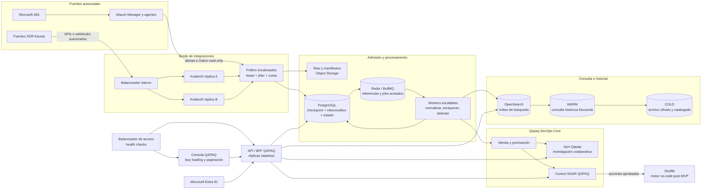

# Arquitectura objetivo resiliente de Qapaq SecOps

**Estado:** diseño objetivo aprobado por [ADR-030](../adr/030-resilient-platform-architecture.md); topología física y gates de despliegue pendientes de evidencia por ambiente.

Qapaq SecOps integra un núcleo SOC, capacidades de adquisición y detección, una
experiencia de investigación compartida y ejecución de respuesta gobernada. El
objetivo es sostener picos y fallas parciales sin perder señales ya aceptadas, sin
trasladar carga descontrolada a las fuentes y sin bloquear el trabajo prioritario
del analista.

## Vista de extremo a extremo



La vista muestra la arquitectura lógica. No prescribe una nube, región, cluster,
cantidad de réplicas ni capacidad no aprobada. La implementación del MVP puede
tener menos nodos mientras conserve los contratos y los estados de degradación.

## Niveles y responsabilidades

| Capa | Responsabilidad | Fuente de verdad |
| --- | --- | --- |
| Acceso | Balancear navegación/API, terminar TLS según ambiente y enrutar a réplicas sanas. | Identidad y políticas de QAPAQ; no la caché del balanceador. |
| Integraciones | KrakenD gobierna rutas, límites, timeouts y circuit breakers para proveedores. | La semántica de cursores y de eventos pertenece a adapters/QAPAQ. |
| Polling | Programar fuentes con leases, jitter y presupuestos por proveedor/dataset. | Checkpoint durable en PostgreSQL. |
| Admisión | Preservar raw/manifiesto, deduplicar, registrar origen y publicar outbox. | PostgreSQL + object storage de acuerdo con la política. |
| Cola | Desacoplar adquisición, indexación, alertas y notificaciones. | Redis/BullMQ entrega trabajo; no es registro único. |
| Qapaq SecOps Core | Normalizar, enriquecer, correlacionar, priorizar y coordinar alertas, casos y auditoría. | PostgreSQL para estado operacional y auditoría transaccional. |
| Investigación | Ayni Qapaq enlaza alertas, tareas, notas, evidencia y decisiones con scopes. | Agregado SOC y audit trail de QAPAQ. |
| Búsqueda | OpenSearch sirve proyecciones para consultas de seguridad acotadas. | Eventos fuente no se alteran; alertas y casos no dependen del índice para su existencia. |
| Retención | HOT/WARM/COLD con catálogo, cifrado, holds, restore selectivo y expiración aprobada. | Manifiestos de archivo y políticas versionadas por dataset. |
| Automatización | Shuffle ejecuta playbooks no-code con entrada y salida controladas por QAPAQ. | Ledger de ejecución, autorización y resultado en QAPAQ. |

## Balanceo, KrakenD y escalamiento

El balanceador de acceso distribuye solicitudes de navegador entre la web y el
BFF/API. API y web deben poder reiniciarse o actualizarse sin perder sesión de
negocio ni depender de disco local. Las consultas se limitan por usuario, scope,
ventana, tamaño y presupuesto de recursos.

KrakenD se conserva en el borde de integraciones definido por ADR-026. Un balanceador
interno distribuye las rutas autorizadas entre un pool de nodos stateless. El
balanceador escala y retira nodos por salud; KrakenD aplica políticas de ruta. No
se usa como almacenamiento, sistema de jobs, caché de seguridad ni sustituto de los
adapters. El control de cuota total se mantiene en QAPAQ porque los límites locales
de varias réplicas pueden exceder el presupuesto combinado del proveedor.

Los workers escalan según presión de cola y latencia del trabajo, con límites por
fuente y clase. Se separan presupuestos para ingestión crítica, indexación, tareas
de Ayni, notificaciones, histórico y exports; una tarea masiva no debe consumir los
recursos reservados a detección.

## Polling continuo sin oleadas

Cada fuente tiene una política de frecuencia, concurrencia, timeout, cuota y replay.
El scheduler reparte las ventanas para evitar que todas las fuentes consulten al
mismo tiempo. Antes de ejecutar, un poller adquiere un lease temporal asociado a
fuente y dataset. Al recuperar el lease tras fallo, continúa desde el último cursor
confirmado; los límites del proveedor se respetan y los intervalos fallidos quedan
visibles para el SOC.

```text
elegir intervalo vencido → adquirir lease → leer cursor
→ solicitar páginas al proveedor → validar/marcar origen
→ persistir raw + manifiesto + checkpoint + outbox
→ encolar referencias → workers procesan e indexan idempotentemente
```

Si la admisión durable falla, no se avanza el cursor. Si la cola cae tras el commit,
un reconciliador vuelve a publicar pendientes desde el outbox. Si el proveedor
devuelve throttling, QAPAQ respeta `Retry-After` y reajusta la ventana; no crea
bucles de reintentos ocultos en KrakenD.

## Indexación de alertas y eventos

Wazuh sigue produciendo las alertas base y su Indexer se consulta con mínimo
privilegio. QAPAQ genera su representación canónica para búsqueda e investigación
sin escribir sobre índices que Wazuh gestiona.

La escritura al índice QAPAQ se realiza en lotes con límites de tamaño y duración.
El document ID deriva de la identidad estable del evento cuando está disponible;
el mapping incluye versión de contrato, tenant/scope autorizado, origen, tiempos,
severidad y campos de investigación. Errores parciales retornan solo los documentos
fallidos a una cola/reconciliación acotada. Cambios de mapping usan nueva versión,
alias y reindexado medible con rollback. Se indexan de forma prioritaria alertas y
actividad reciente; el archivo no se consulta como si fuera hot.

La latencia de búsqueda depende de retención, shards, mappings, cardinalidad,
volumen y hardware. No se fija EPS ni se anuncia cobertura hasta completar benchmark
representativo con consultas del SOC y carga de ingesta simultáneas.

## Redis, backpressure y protección de la carga

Redis/BullMQ desacopla productores y consumidores. Los jobs llevan IDs, rangos,
versiones y referencias pequeñas, nunca grandes payloads crudos ni secretos. Se
usan concurrencia, backoff, prioridad, deduplicación y TTL explícitos. El outbox,
checkpoints y estados críticos quedan en PostgreSQL; al perder Redis, se pausa la
publicación no durable y se reconstruye desde allí.

Las señales operativas incluyen profundidad de cola, antigüedad del job más viejo,
tasa recibida/procesada, reintentos, errores de indexación, cuotas restantes y
tiempo estimado de drenaje. Backpressure reduce trabajo de baja prioridad, limita
consultas costosas y conserva una indicación de cobertura degradada. Ningún evento
se descarta silenciosamente para sostener una métrica de latencia.

## Ayni Qapaq y acceso rápido a respuesta

El analista parte de una alerta autorizada y abre su detalle en la consola QAPAQ.
Desde allí puede relacionar el hallazgo con una investigación Ayni, revisar eventos
y evidencia permitidos, asignar responsables, crear tareas, documentar hipótesis,
registrar decisiones y seguir el timeline. La experiencia toma inspiración de TheHive
para la coordinación, sin copiar su modelo ni convertirlo en otro origen de alertas.

Si el rol y las políticas habilitan respuesta, el detalle presenta los playbooks
disponibles y su impacto previsto. La ejecución requiere parámetros acotados,
versión revisada y aprobación según riesgo. QAPAQ registra solicitante, aprobador,
target, resultado y auditoría; Shuffle no obtiene credenciales de Indexer/Manager y
el navegador nunca recibe secretos o webhooks de ejecución.

## Datos HOT, WARM y COLD

- **HOT:** índices consultables para operación reciente y priorización diaria.
- **WARM:** índices o snapshots preparados para investigación histórica frecuente,
  con latencia y costo diferentes a HOT.
- **COLD:** raw y derivados archivados, comprimidos y cifrados en object storage,
  catalogados por fuente, dataset, rango y hash; recuperar requiere autorización,
  motivo, cuota y vencimiento del material restaurado.

Los plazos los gobierna la matriz aprobada por dataset y finalidad. Las obligaciones
SBS aplicables deben validarse con Legal/Compliance; esta arquitectura no interpreta
por sí sola la regulación ni inventa retenciones. Holds y órdenes de preservación
prevalecen sobre expiración rutinaria. Borrado automático solo se activa después de
probar copia, restore, catálogo, eliminación coherente y evidencia de cumplimiento.

## Lazy loading y consultas eficientes

Las vistas cargan primero el resumen y la página visible de resultados. Detalle,
timeline, raw, historial frío y exports se consultan bajo demanda mediante API con
autorización y cuotas. La paginación usa cursores estables o ventanas temporales;
evita offsets profundos sobre índices grandes. El cliente no descarga listas
completas, no pagina secretos y no llama directamente a OpenSearch o a los
proveedores. Los vacíos, parciales, stale y errores de fuente tienen estados
distintos a “sin amenazas”.

## Despliegues rolling y rollback

1. Construir y escanear imágenes inmutables; registrar commit, SBOM, digest y
   configuración aprobada.
2. Validar esquema/mapping en entorno previo y hacer migraciones expand-contract.
3. Instalar una réplica canary; comprobar readiness, permisos, latencia y flujo real
   de lectura/escritura autorizado.
4. Aumentar réplicas gradualmente mientras se drenan jobs de la versión anterior;
   respetar leases del poller y no ejecutar el mismo intervalo concurrentemente.
5. Vigilar cobertura, lag, index rejects, errores API y auditoría; detener rollout al
   cruzar el umbral acordado.
6. Revertir artefacto/configuración sin deshacer datos ya aceptados. Las migraciones
   irreversibles requieren restore probado y plan de roll-forward.

El número de réplicas y estrategia exacta varían por entorno. Rolling deployment
no equivale a cero downtime ni a alta disponibilidad probada; ambas requieren tests
de fallo y capacidad suficiente durante la actualización.

## Camino de implementación

La secuencia y los gates por etapa viven en [ADR-030](../adr/030-resilient-platform-architecture.md).
Para estimar trabajo, separar al menos estos paquetes:

1. **Inventario y consistencia:** mapear módulos implementados, contratos, rutas,
   tests, branches, secretos y dependencias reales. Corregir docs marcadas como
   históricas sin alterar sus registros.
2. **MVP funcional:** cerrar fuente Microsoft 365/Wazuh autorizada, checkpoints,
   raw, normalización, alertas, investigación, audit y roles.
3. **Rendimiento medido:** definir perfiles con SOC, generar volumen representativo,
   medir indexación/API/colas, fijar cuotas y publicar resultados con margen.
4. **Topología HA:** habilitar balanceadores y réplicas de web/API/KrakenD/worker,
   health, autoscaling si se aprueba, despliegues rolling y pruebas de fallo.
5. **Ayni Qapaq:** pulir colaboración, timeline, notas, evidencia y escalamiento con
   prueba de concurrencia y permisos por objeto.
6. **Tiers y continuidad:** aprobar retención por SBS/Legal/Compliance, automatizar
   HOT→WARM→COLD, hacer restore selectivo y validar RPO/RTO acordados.
7. **SOAR no-code:** instalar Shuffle integrado, publicar catálogo de acciones
   permitidas, probar dry-run, aprobación, timeout, callback, revocación y replay.
8. **Expansión XDR:** activar cada fuente con owner, dataset aprobado, contrato,
   cuota, mapping, runbook y prueba real; no abrir conectores genéricos sin necesidad.

## Indicadores operativos a medir

La plataforma publicará, con dimensiones de bajo cardinality y datos redactados:

- retraso de la última señal por fuente y dataset;
- progreso de checkpoint y porcentaje de cobertura observada;
- tasa recibida, admitida, normalizada, alertada e indexada;
- backlog, antigüedad y tiempo de drenaje por prioridad;
- latencias p50/p95/p99 de API, búsqueda e indexación;
- rechazos y reintentos de OpenSearch, PostgreSQL, Redis, proveedor y Shuffle;
- fallos, errores de autorización y acciones SOAR pendientes/desconocidas.

Los targets de disponibilidad, EPS, RPO/RTO y retención se publican solo tras
aprobación y medición. Los diagramas C4 asociados: [contexto](../diagrams/01-system-context.mmd),
[contenedores](../diagrams/02-containers.mmd) y
[despliegue resiliente](../diagrams/15-resilient-deployment.mmd).
