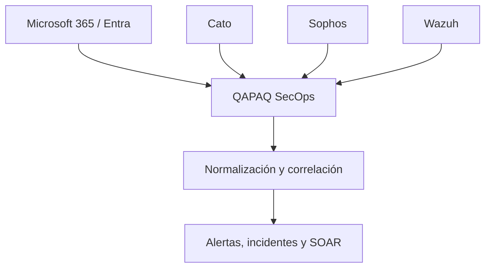

# Estrategia de fuentes y pilotos autorizados

Estado de diseño: **CONDITIONALLY ACCEPTED** por
[U-005/ADR-019](../adr/019-source-boundaries-and-authorized-pilots.md). Fecha
aportada por el usuario: 2026-09-18. La ingesta productiva está **BLOCKED UNTIL
AUTHORIZED PILOTS PASS**.

## Frontera de producto

QAPAQ SecOps es el producto SOC central: ingesta, normalización, correlación,
alertas, casos, dashboards, RBAC, auditoría, reporting y SOAR. Los productos
externos conservan responsabilidades específicas:

- Wazuh: agentes, HIDS, FIM, Security Configuration Assessment, inventario,
  vulnerabilidades, reglas y alertas Wazuh.
- Microsoft 365/Entra: identidad, correo, colaboración y auditoría cloud.
- Cato: telemetría SASE, red, acceso y seguridad.
- Sophos: endpoint, antimalware y alertas de sus productos contratados.
- Infraestructura: operación, licencias, cuentas, configuración, conectividad,
  secretos, upgrades y disponibilidad de esos productos.
- SOC Development: conectores y toda la lógica de QAPAQ SecOps.

Wazuh no reemplaza gestión de incidentes, RBAC, correlación propia ni conectores
directos. Microsoft, Cato y Sophos no están obligados a pasar primero por Wazuh.



## Ownership

Infraestructura administra Manager, Indexer, Dashboard y agentes Wazuh; Microsoft
365/Entra; Cato; Sophos; licencias; auditoría/datasets; app registrations e
identidades técnicas; redes, DNS y TLS; scopes; secretos; versiones y disponibilidad.
Entrega inventario técnico sin secretos.

SOC Development implementa consumo autorizado, paginación, cursores, checkpoints,
normalización, deduplicación, gaps, persistencia autorizada, correlación, reglas,
alertas/casos, RBAC, dashboards, reporting, workflows/SOAR y salud. Recibe
`secretRef`; nunca administra manualmente API keys o contraseñas.

## Slices de integración

Dentro de `Integrations & Collectors` se separan cuatro slices/adapters:

```text
integrations/wazuh
integrations/microsoft
integrations/cato
integrations/sophos
```

No son cuatro módulos funcionales adicionales. Implementan el contrato común de
admisión y conservan diferencias de autenticación, API, cursor, límites, replay,
errores y semántica. No se crea un adapter universal con condicionales.

## Orden de pilotos

### Pilot A — Wazuh

Valida el pipeline y el contrato común con una alerta sintética autorizada. Datasets
candidatos: `wazuh-alerts-*`, inventario de agentes y estado de vulnerabilidades.
`wazuh-archives-*` solo se usa si Infraestructura confirma que está habilitado,
dimensionado y autorizado. Un documento de `wazuh-alerts-*` es `WAZUH_ALERT`, no
el evento raw original.

### Pilot B — Microsoft

Demuestra que una fuente cloud directa se correlaciona con Wazuh sin depender de
su recolección. Infraestructura elige y habilita uno entre Entra audit logs, Entra
sign-in logs o Microsoft 365 unified audit events, según licencia, API, permisos,
retención y valor del caso de uso.

El caso propuesto combina un inicio de sesión anómalo o fallos repetidos en Entra
con actividad sospechosa Wazuh del endpoint asociado y produce una alerta de QAPAQ
que referencia ambos eventos. Sophos sigue en prioridad 3 y Cato en prioridad 4;
el orden reduce riesgo y no expresa menor importancia.

## Inventario y habilitación

La ficha versionada en [source-inventory.yaml](../integrations/source-inventory.yaml)
registra producto/edición, owners, interfaz/versión/región/autenticación, scopes y
ticket, datasets y campos de identidad/tiempo/schema, paginación/cursor, cuotas,
replay y retención. `TO_BE_PROVIDED` mantiene explícitos los valores reales
pendientes. Nunca contiene secretos ni identificadores sensibles.

Una fuente pasa `planned → configured → validated → enabled`. Tener configuración,
SDK o secretRef no autoriza `enabled`. La prueba autorizada demuestra contrato,
licencia, permisos, conectividad, cursor, ventana de replay y comportamiento bajo
throttling.

## Semántica y procedencia

Niveles: `VENDOR_RAW`, `WAZUH_ARCHIVED_EVENT`, `WAZUH_ALERT`,
`NORMALIZED_EVENT`, `CORRELATED_ALERT` e `INCIDENT`. Una alerta Wazuh no sustituye
el evento original. Un evento directo puede coexistir con una alerta derivada si
se vinculan y no se contabilizan como dos hechos independientes.

Todo normalizado conserva `eventId`, `sourceId`, `datasetId`, vendor,
`sourceRecordId`, tiempos de origen/ingesta/recepción, `semanticLevel`, versión,
hash, referencia de cursor y raw. Una alerta correlacionada conserva todos los IDs
de entrada.

## Checkpoint, ACK y replay

Cada conector tiene checkpoint independiente. Estados internos:

```text
FETCHED → DURABLE → NORMALIZED → PROCESSED → CHECKPOINTED
```

El checkpoint avanza únicamente después de almacenamiento durable. Las APIs pull
no tienen un ACK hacia el proveedor. En webhooks, HTTP 2xx se emite cuando el
mensaje fue validado y persistido o encolado de forma durable.

Cada dataset declara `FULL_REPLAY`, `BOUNDED_REPLAY`, `BEST_EFFORT` o `NO_REPLAY`.
No se promete cero pérdida hasta demostrar IDs estables, retención, cursor durable,
replay, deduplicación, reconciliación, throttling y recuperación. Desde la
adquisición durable QAPAQ ofrece at-least-once con consumidores idempotentes; no
cubre datos que el origen nunca entregó.

## Caminos duplicados

Si un dataset llega directo y mediante Wazuh, se documenta una política:

1. El evento directo es canónico y la alerta Wazuh es derivada.
2. Solo se ingiere la alerta Wazuh.
3. Se conservan ambos con `relatedEventIds`.

No se deduplica únicamente por timestamp o texto. La identidad combina source,
dataset, ID estable/cursor/posición y versión; los hashes apoyan integridad, no
prueban por sí solos identidad semántica.

## Gate productivo

U-005 queda resuelta en diseño. Ediciones, versiones, licencias, datasets, APIs,
scopes, cuotas, cursores, retención, endpoints y autorizaciones reales siguen
pendientes de Infraestructura y los dueños de fuente. Antes de `enabled` deben pasar:

1. Wazuh entrega una alerta sintética autorizada.
2. Microsoft entrega un evento sintético autorizado.
3. Ambos eventos se normalizan.
4. Se conserva la procedencia.
5. Reiniciar un worker no duplica efectos.
6. El replay funciona dentro de la ventana comprobada.
7. Un cursor inválido produce `GAP_DETECTED`.
8. La expiración de una API queda visible.
9. Ambos eventos pueden correlacionarse.
10. La alerta correlacionada referencia sus eventos fuente.
11. Ningún secreto aparece en repositorio o logs.
12. Revocar una credencial detiene solo su conector.
13. Caer Wazuh no impide procesar Microsoft.
14. Caer Microsoft no impide procesar Wazuh.
15. El dashboard distingue fuente, evento, alerta derivada e incidente.
