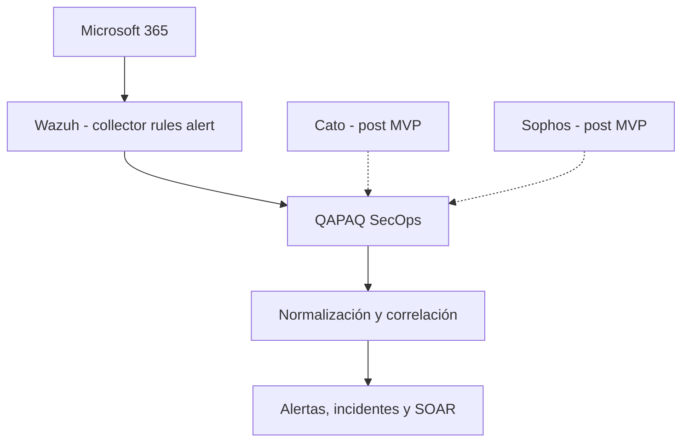

# Estrategia de fuentes y pilotos autorizados

Estado de diseño: **CONDITIONALLY ACCEPTED** por
[U-005/ADR-019](../adr/019-source-boundaries-and-authorized-pilots.md), con orden
revisado por [ADR-024](../adr/024-microsoft-365-wazuh-mvp-vertical.md). Fecha
aportada por el usuario: 2026-09-18. La ingesta productiva está **BLOCKED UNTIL
THE AUTHORIZED MICROSOFT 365/WAZUH VERTICAL PASSES**.

## Frontera de producto

QAPAQ SecOps es el producto SOC central: ingesta, normalización, correlación,
alertas, casos, dashboards, RBAC, auditoría, reporting y SOAR. Los productos
externos conservan responsabilidades específicas:

- Wazuh: agentes, HIDS, FIM, Security Configuration Assessment, inventario,
  vulnerabilidades, reglas y alertas Wazuh.
- Microsoft 365/Entra: identidad, correo, colaboración y auditoría cloud.
- Cato: telemetría SASE, red, acceso y seguridad.
- Sophos: endpoint, antimalware y alertas de sus productos contratados.
- Infraestructura: operación, licencias, cuentas, configuración, conectividad,
  secretos, upgrades y disponibilidad de esos productos.
- SOC Development: conectores y toda la lógica de QAPAQ SecOps.
- KrakenD on-premises: frontera técnica común para APIs que QAPAQ consume
  directamente; no normaliza ni conserva eventos.

Wazuh no reemplaza gestión de incidentes, RBAC, correlación propia ni conectores
directos. Microsoft, Cato y Sophos no están obligados a pasar primero por Wazuh.



## Ownership

Infraestructura administra Manager, Indexer, Dashboard y agentes Wazuh; Microsoft
365/Entra; Cato; Sophos; licencias; auditoría/datasets; app registrations e
identidades técnicas; redes, DNS y TLS; scopes; secretos; versiones y disponibilidad.
Entrega inventario técnico sin secretos.

SOC Development implementa consumo autorizado, paginación, cursores, checkpoints,
normalización, deduplicación, gaps, persistencia autorizada, correlación, reglas,
alertas/casos, RBAC, dashboards, reporting, workflows/SOAR y salud. Recibe
`secretRef`; nunca administra manualmente API keys o contraseñas.

## Slices de integración

La arquitectura objetivo reserva slices independientes por proveedor:

```text
integrations/wazuh
integrations/microsoft
integrations/cato
integrations/sophos
```

No son cuatro módulos funcionales adicionales. Implementan el contrato común de
admisión y conservan diferencias de autenticación, API, cursor, límites, replay,
errores y semántica. No se crea un adapter universal con condicionales.

El MVP materializa únicamente `integrations/wazuh`. Microsoft 365 se configura en
Wazuh y no crea `integrations/microsoft`; ese slice solo nace si una decisión
post-MVP aprueba una API directa. Cato y Sophos permanecen como rutas documentales,
sin carpetas o código vacío.

Todo consumo API directo de un slice habilitado atraviesa KrakenD on-premises según
[ADR-026](../adr/026-on-premises-krakend-provider-api-gateway.md). Para el MVP, el
adapter Wazuh consulta el Indexer a través del gateway; KrakenD no se inserta entre
Microsoft 365 y el collector de Wazuh. Una futura ruta Graph/Cato/Sophos usa el
mismo gateway, pero conserva adapter, autenticación, cursor y cuotas propios.

## Vertical de fuente del MVP

[ADR-024](../adr/024-microsoft-365-wazuh-mvp-vertical.md) sustituye los pilotos
anteriores. Microsoft 365 es la única fuente empresarial; Wazuh es el motor base
que recolecta Office 365, aplica decoders/ruleset y genera alertas. QAPAQ consulta
`wazuh-alerts-*` con mínimo privilegio, preserva la regla/procedencia y normaliza a
SecurityEvent. No implementa un conector Graph paralelo en el MVP.

Infraestructura confirma la edición/versión Wazuh y selecciona un dataset Office
365 soportado según licencia, permisos, retención y valor. `wazuh-archives-*` solo
se habilita si está dimensionado y autorizado. Un documento de `wazuh-alerts-*` es
`WAZUH_ALERT`, no el raw previo de Microsoft; esa diferencia queda en lineage.

Sophos, Cato, una segunda ruta Microsoft y correlación multifuente son post-MVP.
Cada incorporación añade un adapter aislado y supera la misma suite de conformidad;
no modifica el dominio ni los consumidores de SecurityEvent.

## Inventario y habilitación

La ficha versionada en [source-inventory.yaml](../integrations/source-inventory.yaml)
registra producto/edición, owners, interfaz/versión/región/autenticación, scopes y
ticket, datasets y campos de identidad/tiempo/schema, paginación/cursor, cuotas,
replay y retención. `TO_BE_PROVIDED` mantiene explícitos los valores reales
pendientes. Nunca contiene secretos ni identificadores sensibles.

Una fuente pasa `planned → configured → validated → enabled`. Tener configuración,
SDK o secretRef no autoriza `enabled`. La prueba autorizada demuestra contrato,
licencia, permisos, conectividad, cursor, ventana de replay y comportamiento bajo
throttling.

## Semántica y procedencia

Niveles: `VENDOR_RAW`, `WAZUH_ARCHIVED_EVENT`, `WAZUH_ALERT`,
`NORMALIZED_EVENT`, `CORRELATED_ALERT` e `INCIDENT`. Una alerta Wazuh no sustituye
el evento original. Un evento directo puede coexistir con una alerta derivada si
se vinculan y no se contabilizan como dos hechos independientes.

Todo normalizado conserva `eventId`, `sourceId`, `datasetId`, vendor,
`sourceRecordId`, tiempos de origen/ingesta/recepción, `semanticLevel`, versión,
hash, referencia de cursor y raw. Una alerta correlacionada conserva todos los IDs
de entrada.

## Checkpoint, ACK y replay

Cada conector tiene checkpoint independiente. Estados internos:

```text
FETCHED → DURABLE → NORMALIZED → PROCESSED → CHECKPOINTED
```

El checkpoint avanza únicamente después de almacenamiento durable. Las APIs pull
no tienen un ACK hacia el proveedor. En webhooks, HTTP 2xx se emite cuando el
mensaje fue validado y persistido o encolado de forma durable.

El gateway aplica controles de transporte antes de que una respuesta llegue a la
admisión, pero no publica directamente en Redis/BullMQ. El adapter valida; raw y
manifiesto/checkpoint/outbox quedan durables; solo entonces el dispatcher publica
IDs o referencias pequeñas. Detalle en
[API Gateway de proveedores](provider-api-gateway.md).

Cada dataset declara `FULL_REPLAY`, `BOUNDED_REPLAY`, `BEST_EFFORT` o `NO_REPLAY`.
No se promete cero pérdida hasta demostrar IDs estables, retención, cursor durable,
replay, deduplicación, reconciliación, throttling y recuperación. Desde la
adquisición durable QAPAQ ofrece at-least-once con consumidores idempotentes; no
cubre datos que el origen nunca entregó.

## Caminos duplicados

Si un dataset llega directo y mediante Wazuh, se documenta una política:

1. El evento directo es canónico y la alerta Wazuh es derivada.
2. Solo se ingiere la alerta Wazuh.
3. Se conservan ambos con `relatedEventIds`.

No se deduplica únicamente por timestamp o texto. La identidad combina source,
dataset, ID estable/cursor/posición y versión; los hashes apoyan integridad, no
prueban por sí solos identidad semántica.

## Gate productivo

U-005 queda resuelta en diseño. Ediciones, versiones, licencia, dataset, permisos,
retención, endpoints y autorizaciones reales siguen pendientes de Infraestructura
y los dueños. Antes de `enabled` deben pasar:

1. Microsoft 365 genera actividad sintética autorizada.
2. La integración Office 365 real de Wazuh la recolecta.
3. El ruleset Wazuh produce la alerta esperada.
4. QAPAQ accede al Indexer con mínimo privilegio.
5. La alerta se normaliza a SecurityEvent válido.
6. Se conservan procedencia, ruleId, tiempos y raw ref/hash disponibles.
7. Reiniciar un worker no duplica efectos.
8. Replay/checkpoint funciona dentro de la ventana comprobada.
9. Un checkpoint inválido produce gap explícito.
10. Permiso expirado o denegado queda visible sin filtrar secretos.
11. Una alerta inválida entra en cuarentena y puede reprocesarse.
12. Ningún secreto aparece en repositorio, logs o evidencia.
13. Revocar la credencial detiene solo la frontera afectada.
14. Caer Wazuh marca cobertura degradada y conserva trabajo durable.
15. La interfaz distingue actividad Microsoft, alerta Wazuh, SecurityEvent, alerta
    QAPAQ e incidente.
