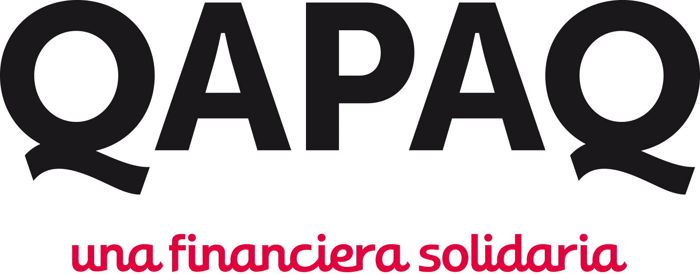

# Identidad visual QAPAQ · Frontend

Sistema visual de QAPAQ SecOps (consola Wazuh, Ankay, informes y avisos). Todo el arte de producto sale de
una sola fuente: la **Q de QAPAQ** vectorizada (la misma silueta del logotipo corporativo), generada por
`wazuh/dashboard/assets/tools/build-brand.mjs` y `ankay/frontend/assets/tools/build-brand.mjs`.

  
  
  

## Paleta

Oscura, neutra y con un único acento. Sin degradados de marca.

| Token | Hex | Uso |
| --- | --- | --- |
| Negro QAPAQ | `#080808` | Fondo de la consola, login, splash, cabecera. |
| Superficie | `#0d0d0f` | Menú lateral, flyouts, modales, paneles. |
| Superficie elevada | `#131315` | Elemento activo del menú, campos, tarjetas. |
| Línea | `#29292d` | Bordes y separadores de 1 px. |
| Línea fuerte | `#49494e` | Bordes de controles, barras de desplazamiento. |
| Tinta | `#f4f4f5` | Texto principal y la Q sobre negro; foco visible. |
| Tinta 2 | `#b0b0b5` | Texto secundario. |
| Tinta 3 | `#8f8f95` | Texto terciario, ayudas. |
| Ámbar | `#c49a5a` | **Único acento de marca**: indicador activo, barra de carga, acción principal de marca, el «ejecutar» de Ankay, la cara de Qapaqzito. |
| Ámbar claro | `#e0bd80` | Ámbar sobre fondos muy oscuros (enlaces, iconos pequeños). |
| Ámbar oscuro | `#8c6a38` | Ámbar sobre blanco (informes, tema claro). |

En tema claro se usan los grises de OUI con tinta `#080808`; el ámbar se mantiene como indicador.

**Severidad y estado no son marca.** Los pasos de prioridad del plugin (`P1 #ff5f57`, `P2 #f0904a`,
`P3 #d8c35c`, ok `#5fb98a`) codifican gravedad y salud, siempre con texto o glifo además del color. El ámbar
nunca significa «aprobado», «sano» ni «contenido».

## Tipografía

Tipografía del sistema, sin fuentes empaquetadas: `'Segoe UI', Inter, 'Helvetica Neue', Arial, sans-serif`
(variable CSS `--qapaq-font-sans`). La consola respeta la tipografía de OUI; el login, el splash y Ankay usan
la misma pila. Los informes PDF usan Noto Sans/DejaVu, disponibles en la imagen del servicio.

## Logotipo y marcas

| Recurso | Archivo | Uso |
| --- | --- | --- |
| Logotipo corporativo | `docs/reference/assets/qapaq-logo.png` | Documentación. |
| Q sola | `wazuh/dashboard/assets/svg/qapaq_mark_on_{dark,light}.svg` | Cabecera, menú, iconos del core. |
| Logotipo «QAPAQ SecOps» | `wazuh/dashboard/assets/svg/qapaq_wordmark_on_{dark,light}.svg` | Login heredado, logo de la app, informes de Wazuh. |
| Icono de la app | `wazuh/dashboard/assets/svg/qapaq_app_icon.svg` | Favicons, PWA, logo de informes. |
| Insignia circular | `wazuh/dashboard/assets/svg/qapaq_head_mark.svg` | Login QAPAQ SOC y login de Ankay. |
| Splash | `wazuh/dashboard/assets/svg/qapaq_splash.svg` | Pantalla de carga (la Q late y una línea ámbar recorre la base). |
| Ankay | `ankay/frontend/assets/svg/ankay_*.svg`, `wazuh/dashboard/assets/svg/ankay.svg` | La Q con el triángulo ámbar de «ejecutar». |

Conservar proporción y aire; no aplicar sombras, contornos ni degradados a la Q.

## Qapaqzito y el Analista IA

**Qapaqzito** (asistente) es la Q de QAPAQ con cara: el hueco de la Q lleva dos ojos y una sonrisa en ámbar,
sobre la insignia negra, con un destello ámbar de «IA». La mascota del **Analista IA** es el mismo personaje
con una lupa ámbar. Fuentes vectoriales: `wazuh/dashboard/assets/svg/qapaq_qapaqzito.svg` y
`qapaq_ai_analyst_mascot.svg`; los WebP/PNG se generan desde ellas.

  
  

Son arte provisional construido con la marca; se reemplazarán por ilustración oficial cuando exista,
manteniendo nombres de archivo y tamaños.

## Login

El panel de marca del login compone la ilustración original de la analista QAPAQ
(`wazuh/dashboard/assets/images/qapaq_analyst.webp`) sobre negro con una luz ámbar tenue y la Q en línea
(`qapaq_login_hero.webp`). El formulario es oscuro: campos `#131315`, botón principal tinta sobre negro,
Microsoft Entra ID como botón secundario.

## Criterios de uso en el SOC

- La marca vive en el shell, la navegación, el login, los estados vacíos y los informes; no cubre tablas,
  alertas densas ni controles de aprobación.
- No usar una mascota para comunicar que una amenaza fue contenida, que una aprobación ocurrió o que una
  fuente está saludable.
- Mantener `alt` descriptivo y contraste AA; no usar el color como único indicador.
- Regenerar el arte: `node wazuh/dashboard/assets/tools/build-brand.mjs --raster` y luego
  `node ankay/frontend/assets/tools/build-brand.mjs --raster` (con `sharp` resoluble desde el cwd).
