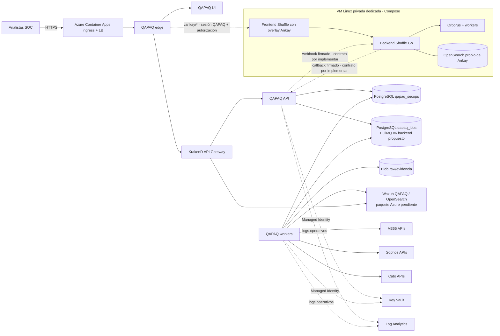

# Arquitectura cloud propuesta — QAPAQ SecOps en Azure

**Estado:** propuesta de despliegue, Terraform preparado y no aplicado.
**Alcance:** un stack Azure con state separado de AWS y datos SOC privados.
**Objetivo de gasto de trabajo:** hasta USD 200/mes; aún no certificado. Los
presupuestos de Azure notifican umbrales y no detienen automáticamente el gasto.
**Región base:** Chile Central (`chilecentral`), elegida por proximidad geográfica
a Perú. Es una estimación de latencia: la ruta del ISP y la ubicación de usuarios
pueden cambiar el resultado; medir RTT desde la red de QAPAQ antes del cutover.
La residencia de datos y la disponibilidad de SKU/cuotas requieren verificación
antes de aplicar.

## Decisiones de arquitectura

1. **Entrada web y balanceo.** Azure Container Apps administra el ingress HTTPS y
   balancea réplicas del edge. El edge entrega la UI QAPAQ y enruta `/api` al
   gateway. KrakenD continúa como API Gateway de aplicación, en red interna. No
   se agrega Azure Application Gateway en esta fase porque duplicaría la capa de
   entrada y su costo debe justificarse por WAF, private ingress o TLS central.
   El entorno ACA configurado es externo. En este modo, el tráfico público llega
   por la IP administrada por ACA; una NSG en su subnet no filtra las peticiones
   públicas. Solo `edge` puede tener ingress externo y la sesión QAPAQ se conserva
   en esa capa. No mapear `app.jappi.net.pe` hasta decidir si el control de
   aplicación es suficiente o si el presupuesto permite un perímetro WAF/LB;
   este control no está implementado ni certificado.
2. **API y workers.** API y worker son Container Apps privadas, con identidad
   administrada. El worker conserva réplicas mínimas 1 para polling/recovery; no
   scale-to-zero mientras deba consumir M365, Sophos y Cato. API/worker escalan
   dentro de límites iniciales modestos, que requieren benchmark.
3. **Cola Azure sin servicio de mensajería separado.** La propuesta usa BullMQ v6
   PostgreSQL backend en una base `qapaq_jobs` separada de `qapaq_secops`, sobre
   un Azure PostgreSQL Flexible Server privado. La cola guarda trabajos/referencias
   pequeñas; la evidencia raw y los eventos viven en sus stores, no en BullMQ.
4. **Idempotencia y pérdidas.** PostgreSQL/outbox es la admisión durable. Solo se
   confirma un cursor tras la escritura durable y transacción de admisión. Los
   workers procesan al menos una vez y son idempotentes; jobs agotados se ponen
   en cuarentena/replay según contrato. BullMQ no reemplaza inbox, manifiestos,
   checkpoints ni auditoría.
5. **Datos y secretos.** PostgreSQL usa subnet delegada privada; Key Vault y Blob
   tienen private endpoints. La identidad de runtime recibe permisos mínimos.
   Terraform crea el vault, no los valores de secretos.
6. **Observabilidad separada.** Log Analytics recibe salud y logs operativos de
   Azure, API y workers. Wazuh/OpenSearch conserva eventos de seguridad; la cola
   no es almacenamiento de telemetría. Redactar tokens, contenido de correo y
   credenciales antes de telemetría.
7. **Wazuh y SOAR.** QAPAQ SecOps es el Dashboard Wazuh con su overlay QAPAQ
   fijado al release compatible. **Ankay Qapaq es Shuffle modificado**: el overlay
   `ankay/` rebrandea y endurece el frontend; backend, Orborus, workers y OpenSearch
   son los componentes de Shuffle fijados en `ankay/upstream.lock`. No es un segundo
   SOAR ni un backend Ayni que reemplace a Shuffle. Por el socket Docker que necesita
   Orborus, el diseño previsto es un host Linux privado dedicado con Compose y
   volúmenes persistentes; no un Container App aislado. El edge del Dashboard debe
   enrutar `/ankay/*` con sesión QAPAQ y autorización, sin acceso directo público.
   El root Azure todavía no despliega Wazuh ni Ankay: faltan el paquete/imagen
   verificable de Dashboard, módulo del host y disco de Ankay, Compose Azure,
   publicación de artefactos por CI y prueba de persistencia/recuperación.

## Diagrama de despliegue



El diagrama editable completo está en
[`diagrams/qapaq-azure.mmd`](diagrams/qapaq-azure.mmd). El dibujo es el estado
objetivo; Wazuh y Ankay están pendientes. Las flechas de proveedores representan
conexiones salientes autorizadas desde adaptadores, no confirman que todos los
conectores estén implementados.

## Cola, conectores y límites de carga

```text
M365 / Sophos / Cato
        │ APIs autorizadas, paginación y cuotas por proveedor
        ▼
QAPAQ provider adapters → raw durable Blob + PostgreSQL inbox/outbox/checkpoint
                                               │ commit durable
                                               ▼
                                  BullMQ v6 / PostgreSQL (qapaq_jobs)
                                               │ referencias, reintentos
                                               ▼
                                      workers QAPAQ
                                               │ validar/normalizar
                             ┌─────────────────┴──────────────────┐
                             ▼                                    ▼
                  QAPAQ SecurityEvent                 Wazuh/OpenSearch
```

La conexión a PostgreSQL es privada y con TLS. No se escribe el body del
proveedor en la cola, secrets, traces ni logs operativos. Los adaptadores conservan
cursores independientes, backoff por `Retry-After`, cuotas y DLQ/replay. El uso
del gateway KrakenD se limita a las rutas de proveedores que tengan contrato
explícito; la API REST de Microsoft/Sophos/Cato no debe tunelizarse por KrakenD
sin decisión y prueba de esos contratos.

## Modelo de resiliencia

- **Demo base:** una región, un Flexible Server sin HA zonal, Container Apps y
  backups automáticos. Resiste reinicios y pérdida de una réplica; no ofrece
  continuidad ante caída regional ni un SLA de producción.
- **Escala vertical/horizontal:** escalar workers en función de backlog y cuotas,
  con concurrencia y límites por conector; confirmar headroom con pruebas propias.
- **Recovery:** restore a entorno aislado, correr migraciones, reconciliar
  checkpoints/outbox y reencolar jobs desde admisión durable. Nunca borrar datos
  con `terraform destroy` como operación de apagado.
- **Falla de PostgreSQL:** detener polls y no avanzar cursores. La plataforma
  queda degradada; configurar alertas de saturación, conexiones, storage y lag.
- **Pérdida de cola:** reconstruir jobs a partir del outbox/checkpoints y ejecutar
  reconciliation; no presentar la cola como única fuente de verdad.

## Costos y escalamiento

La revalidación de
[`cost-feasibility-2026-10-19.md`](cost-feasibility-2026-10-19.md) confirma
USD 173.01/mes de cómputo para el tamaño Wazuh recomendado. Las tarifas previas
de PostgreSQL no se pudieron verificar hoy; el piso completo y la alta
disponibilidad siguen pendientes de cotización actual. El margen de cómputo
Wazuh dentro de USD 200 sería USD 26.99 para PostgreSQL y todo lo demás. Ninguna
estimación incluye todavía todos los discos, backups, tráfico, Container Apps,
Ankay, Log Analytics, ACR ni un Wazuh distribuido para tolerancia a fallos.

No ejecutar apply hasta verificar el costo total bajo el tope de USD 200 ni
presentar el diseño de una región y un nodo como resiliente. La oferta Azure Free para PostgreSQL B1MS es
condicional, limitada a 12 meses y no cubre el tier General Purpose HA; su
elegibilidad y disponibilidad en la suscripción no se han comprobado.
Recalcular el alcance con Cost Management/cotización de la cuenta, cuotas y
volumen real de datos. Azure Cost Management budgets son alertas, no límites
duros de gasto.

## Seguridad y separación AWS

- El state usa un backend Azure Storage dedicado y key distinta; nunca reutiliza
  el S3/state de AWS.
- PostgreSQL, Key Vault, logs y storage vitales tienen `prevent_destroy`; Key
  Vault incluye purge protection y Blob usa versionado y retención de borrado.
- El Key Vault y Blob no tienen red pública; los Container Apps reciben permisos
  mediante managed identity. ACR deshabilita usuario admin.
- DNS, dominios y certificados quedan fuera de este root y del primer apply.
- `terraform destroy` no constituye procedimiento de apagado: retirar primero
  workloads, preservar y verificar copias, y aprobar por separado la baja de
  recursos protegidos.

## Fuentes técnicas de diseño

- [Ingress de Azure Container Apps](https://learn.microsoft.com/azure/container-apps/ingress): termina TLS y balancea el tráfico HTTP entre réplicas, por lo que esta fase no agrega otro Load Balancer HTTP.
- [Redes virtuales para Container Apps](https://learn.microsoft.com/azure/container-apps/custom-virtual-networks): subnet delegada y exclusiva para el entorno.
- [Conectividad entre Container Apps](https://learn.microsoft.com/azure/container-apps/connect-apps): service discovery y routing internos del entorno.
- [Azure Private Link para Key Vault](https://learn.microsoft.com/azure/key-vault/general/private-link-service): private endpoint y DNS privado para acceso desde VNet.
- [PostgreSQL Flexible Server privado](https://registry.terraform.io/providers/hashicorp/azurerm/4.62.0/docs/resources/postgresql_flexible_server): subnet delegada, private DNS y acceso público deshabilitado.
- [BullMQ PostgreSQL](https://docs.bullmq.io/guide/postgresql): backend opcional PostgreSQL; el baseline QAPAQ aún requiere aprobar BullMQ 6.

## Gates antes de habilitar tráfico real

1. Resolver la decisión de BullMQ v6/PostgreSQL en ADR Azure y revisar fin de
   soporte/licencias/compatibilidad; el baseline compartido aún fija BullMQ 5.
2. Implementar y probar productores/consumidores reales. El `apps/worker` actual
   es un lifecycle/health stub, no un poller de M365/Sophos/Cato.
3. CI Azure con OIDC para construir, escanear y publicar cinco imágenes por
   digest; el Terraform crea identidad y ACR, pero no cambia el workflow.
4. Cargar secretos fuera de Terraform, con consentimiento/rotación y permisos de
   solo lectura de las APIs de proveedor.
5. Provisionar Wazuh QAPAQ con paquete/instalación Azure fijada y restore probado.
   Provisionar Ankay desde el overlay fijado más los servicios backend de Shuffle,
   en VM privada dedicada; validar volumen/backup y que la sesión QAPAQ protege
   `/ankay/*` con autorización por rol.
6. Probar synthetic events de cada proveedor: paginación, throttling, replay,
   duplicado, cuarentena, DLQ y disponibilidad visible en SOC/OpenSearch.
7. Revisar plan exacto, destrucciones, residencia, exposición, costo, backup y
   rollback antes de un apply aprobado.
