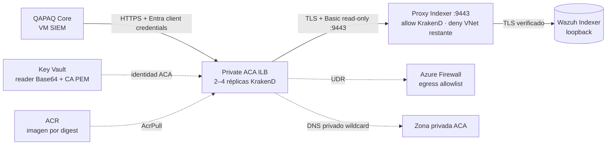

# KrakenD privado para QAPAQ Core en Azure

**Estado:** IaC opcional preparado; no desplegado ni validado en Azure. La ruta queda apagada mientras `krakend_gateway=null`. El módulo cubre el contrato de lectura de ingesta Wazuh y mantiene la decisión [A8](../../10-decisiones.md): KrakenD existe mientras Core lo consume. El acceso directo al Core se mantiene solo en el edge privado del SIEM; este gateway no publica el Core.

## Flujo

El ambiente ACA usa internal load balancer y `public_network_access=Disabled`. La opción `external_enabled=true` de la app significa accesibilidad a nivel VNet para Core, que reside en la VM SIEM y no comparte el environment ACA; el ambiente interno impide el endpoint público. El DNS privado resuelve el FQDN administrado de KrakenD hacia la IP del internal load balancer, nunca crea un registro público.

## Contrato cerrado de rutas

| Método | Ruta que recibe KrakenD | Destino tras el proxy Indexer |
| --- | --- | --- |
| GET | `/wazuh/_cluster/health` | `/_cluster/health` |
| POST | `/wazuh/_search` | `/wazuh-alerts-*/_search` |

Ambas rutas requieren JWT RS256 con issuer, JWKS y audience Entra, el app role exclusivo de aplicación `Qapaq.Wazuh.Read` y un `appid` (token v1) o `azp` (token v2) que coincida con `core_client_id`. `client_scope` señala la app recurso; `core_client_id` señala al service principal QAPAQ Core permitido. Terraform verifica que este ID sea el `QAPAQ_ENTRA_CLIENT_ID` de Core. El rol debe definirse en el registro de la app recurso con `allowedMemberTypes: ["Application"]` y asignarse solo al service principal Core. Límite de tasa por `sub`, timeout de 4 s, TLS verificado a la CA del proxy y Basic auth de un usuario Wazuh read-only. No hay `/api/*`, wildcard de endpoints, escritura, operaciones administrativas de Indexer ni loopback en el upstream. Core usa su implementación actual (`QAPAQ_INGESTION_SOURCE=wazuh`, `QAPAQ_WAZUH_GATEWAY_BASE_URL`, `QAPAQ_INGESTION_GATEWAY_SCOPE`, `EntraClientCredentialsTokenSource`).

El issuer parte del valor v1 ya fijado por el entorno QAPAQ (`https://sts.windows.net/<tenant>/`); la búsqueda de claves usa el JWKS v2 de Microsoft. Antes de activar, comparar ambos con un token sintético de la aplicación porque `accessTokenAcceptedVersion` determina el claim `iss`.

El access log queda desactivado: KrakenD CE no permite cambiar el formato y su logger predeterminado incluye la query en la ruta. Los logs de aplicación INFO y las métricas siguen activos; no registran tokens, headers, cuerpos ni query. No activar el logger hasta que exista un sanitizador allowlist probado.

## Aprovisionamiento del proxy Indexer

El módulo SIEM ahora incluye un bootstrap opcional y versionado para el proxy read-only. Su listener es TCP/9443 en la IP privada estática del host; el Indexer conserva su 9200 local (loopback o IP privada) con certificado verificado. Esto evita el conflicto de bind con Indexer en 9200. Nginx solo admite GET de salud y POST de búsqueda de alertas; Basic auth se reenvía sin access logs, TLS de upstream exige CA/hostname/IP verificados y cualquier ruta adicional devuelve 403. La identidad read-only recibe solo cluster:monitor/health y read sobre wazuh-alerts-*.

El flujo EUS2 exige exactamente dos referencias previamente creadas: wazuh-reader-b64 y wazuh-proxy-ca. El workflow seed permite crear solamente esos dos nombres con el literal bootstrap-pending constante, sin leer el contenido previo y rehusando los nombres existentes. Luego el preflight de Terraform consulta por ARM únicamente la existencia y enabled de ambos recursos; no solicita sus valores. Si están ausentes/deshabilitados, el plan y el apply se detienen antes de Terraform.

Durante el bootstrap de VM, la Managed Identity obtiene esos valores por Key Vault privado. Con el marcador fijo, el script crea credencial y certificado, escribe temporalmente el proxy, valida TLS y ejecuta pruebas: búsqueda/salud 200, Security API y escritura 403. Solo tras esas pruebas publica las referencias generadas por HTTPS a Key Vault. La asignación RBAC es un rol custom con getSecret/action y setSecret/action, cada una limitada al ID individual de uno de esos dos secretos; no incluye listar ni borrar. La identidad KrakenD mantiene solo lectura. Si falla TLS/probe/escritura, el bootstrap intenta restaurar ambos placeholders, Nginx y el rol/mapping/user que creó; el fallo de compensación de Key Vault se registra solo como estado genérico. Si Key Vault confirmó una escritura pero la compensación no pudo restaurarla, la siguiente ejecución reutiliza la credencial/certificado persistidos y verificados, sin imprimirlos ni rotarlos de forma implícita.

## Recuperación ante pérdida o reemplazo del disco de sistema

La clave privada TLS vive solo en `/etc/qapaq/indexer-proxy/key.pem` en el disco de sistema; Key Vault guarda la credencial del lector y el certificado público, nunca la clave privada. Si se pierde o reemplaza ese disco, conserva el disco de datos y deja KrakenD deshabilitado mientras recuperas el host. El bootstrap falla cerrado si Key Vault contiene un certificado pero el host no tiene su clave correspondiente. No reemplaces los secretos por `bootstrap-pending`, no copies la clave a logs/artifacts y no abras el acceso del Indexer para restaurar el servicio.

La recuperación automatizada del par TLS no está implementada ni probada. Antes de habilitar KrakenD, debe quedar aprobado y probado al menos uno de estos controles: restaurar desde un respaldo cifrado de host que contenga el par de clave/certificado, o ejecutar un procedimiento separado de rotación coordinada. En una rotación, genera la clave privada en el host, publica solo el certificado público y la credencial nueva mediante un canal de escritura protegido, actualiza la referencia de KrakenD y verifica búsqueda/salud `200`, escritura y Security API `403`; luego revoca el usuario/mapeo anterior. Mantén el gateway apagado si no puedes completar esa secuencia y demostrarla sin exponer valores. Hasta cerrar este gate, `krakend_gateway` debe permanecer `null`.

**Gate RBAC antes de apply:** la definición personalizada debe crearse con el ID determinista de este módulo y asignarse solo a la identidad SIEM en los dos scopes de secreto. La autorización Terraform EUS2 observada no confirma `Microsoft.Authorization/roleDefinitions/write` para este nuevo ID personalizado; su condición RBAC está limitada a IDs enumerados. El apply puede fallar antes del bootstrap en la definición o asignación del rol. No cambiar a `Key Vault Secrets Officer`, no ampliar la condición a roles arbitrarios y no activar KrakenD hasta que un administrador autorizado revise el permiso exacto para esa definición y sus dos asignaciones.

Este código tiene pruebas locales/CI y no se ha desplegado ni ejecutado en Azure. Por tanto la ruta sigue opt-in: mantener krakend_gateway=null hasta configurar digest ACR, referencias y app role Entra, revisar el plan y desplegarlo mediante el flujo autorizado. La prueba CI no demuestra que Indexer, certificados, red privada o tenant funcionen en Azure.

## Capacidad y costos

La app fija 2–4 réplicas de 0.5 vCPU y 1 GiB. La capacidad de aplicación queda acotada a 1–2 vCPU y 2–4 GiB, pero las dos réplicas mínimas no permiten dormir el servicio ni fijan el precio. El total depende del uso activo/idle, zona, transferencia y Log Analytics. El entorno internal ACA, la Firewall UDR y otros recursos de red tienen cargos separados. No hay presupuesto duro ni destrucción automática; cotejar con Azure Pricing Calculator y el reporte de costo real antes de habilitar.

El módulo desactiva zone redundancy y no equivale a HA regional ni elimina el punto único de falla del SIEM, el Indexer, la VM o PostgreSQL. El límite superior de 4 réplicas es un máximo de este componente, no un límite monetario.

## Pruebas

CI ejecuta el contrato Node, `krakend check` sobre la plantilla Azure y `terraform validate/test` con provider simulado. Ninguna prueba local es evidencia de conectividad Azure. Después de una activación autorizada, validar desde Core y desde fuera de la VNet:

1. FQDN no resuelve a una IP pública y no hay ingreso desde Internet.
2. FQDN resuelve a la IP estática privada del internal load balancer; certificado HTTPS válido.
3. Core obtiene token client-credentials con el scope configurado; issuer/audience/JWKS pasan validación y el token incluye `roles: ["Qapaq.Wazuh.Read"]` junto a `appid`/`azp` igual al ID autorizado.
4. Las dos rutas exactas devuelven 200 al workload autorizado. Token ausente/malformado o emitido para un cliente no permitido (`appid`/`azp`) recibe 401 del validador JWT; token válido del cliente permitido pero sin el app role dedicado recibe 403.
5. Rutas adicionales, escritura y acceso a Security API se rechazan; KrakenD no puede leer/escribir fuera de `wazuh-alerts-*`.
6. QAPAQ informa lecturas correctas y eventos sintéticos indexados; métricas/logs no incluyen token, Basic auth o secreto PEM.

## Referencias

- [Microsoft: integración VNet y UDR de Azure Container Apps](https://learn.microsoft.com/en-us/azure/container-apps/use-azure-firewall)
- [Microsoft: DNS privado para entornos ACA internos](https://learn.microsoft.com/en-us/azure/container-apps/private-endpoints-with-dns)
- [`docs/10-decisiones.md` A8](../../10-decisiones.md)
- [`infra/azure/modules/krakend_gateway`](../../../infra/azure/modules/krakend_gateway/README.md)
- [`docs/cloud/azure/target-architecture-demo-eus2.md`](target-architecture-demo-eus2.md)
