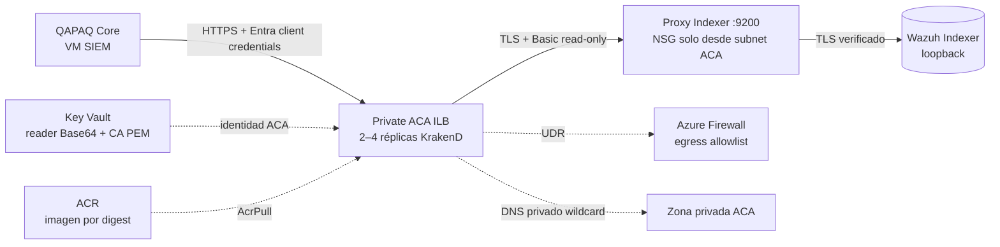

# KrakenD privado para QAPAQ Core en Azure

**Estado:** IaC opcional preparado; no desplegado ni validado en Azure. La ruta queda apagada mientras `krakend_gateway=null`. El módulo cubre el contrato de lectura de ingesta Wazuh y mantiene la decisión [A8](../../10-decisiones.md): KrakenD existe mientras Core lo consume. El acceso directo al Core se mantiene solo en el edge privado del SIEM; este gateway no publica el Core.

## Flujo

El ambiente ACA usa internal load balancer y `public_network_access=Disabled`. La opción `external_enabled=true` de la app significa accesibilidad a nivel VNet para Core, que reside en la VM SIEM y no comparte el environment ACA; el ambiente interno impide el endpoint público. El DNS privado resuelve el FQDN administrado de KrakenD hacia la IP del internal load balancer, nunca crea un registro público.

## Contrato cerrado de rutas

| Método | Ruta que recibe KrakenD | Destino tras el proxy Indexer |
| --- | --- | --- |
| GET | `/wazuh/_cluster/health` | `/_cluster/health` |
| POST | `/wazuh/_search` | `/wazuh-alerts-*/_search` |

Ambas rutas requieren JWT RS256 con issuer, JWKS y audience Entra, el app role exclusivo de aplicación `Qapaq.Wazuh.Read` y un `appid` (token v1) o `azp` (token v2) que coincida con `core_client_id`. `client_scope` señala la app recurso; `core_client_id` señala al service principal QAPAQ Core permitido. Terraform verifica que este ID sea el `QAPAQ_ENTRA_CLIENT_ID` de Core. El rol debe definirse en el registro de la app recurso con `allowedMemberTypes: ["Application"]` y asignarse solo al service principal Core. Límite de tasa por `sub`, timeout de 4 s, TLS verificado a la CA del proxy y Basic auth de un usuario Wazuh read-only. No hay `/api/*`, wildcard de endpoints, escritura, operaciones administrativas de Indexer ni loopback en el upstream. Core usa su implementación actual (`QAPAQ_INGESTION_SOURCE=wazuh`, `QAPAQ_WAZUH_GATEWAY_BASE_URL`, `QAPAQ_INGESTION_GATEWAY_SCOPE`, `EntraClientCredentialsTokenSource`).

El issuer parte del valor v1 ya fijado por el entorno QAPAQ (`https://sts.windows.net/<tenant>/`); la búsqueda de claves usa el JWKS v2 de Microsoft. Antes de activar, comparar ambos con un token sintético de la aplicación porque `accessTokenAcceptedVersion` determina el claim `iss`.

El access log queda desactivado: KrakenD CE no permite cambiar el formato y su logger predeterminado incluye la query en la ruta. Los logs de aplicación INFO y las métricas siguen activos; no registran tokens, headers, cuerpos ni query. No activar el logger hasta que exista un sanitizador allowlist probado.

## Bloqueo de aprovisionamiento de Indexer

El código Azure actual no prepara todavía el endpoint que el módulo consume:

- `wazuh/access/apply-access.sh` crea el usuario de lectura y proxy Nginx, pero su ruta normal escribe lector y CA a AWS Secrets Manager.
- `infra/azure/modules/siem_host` no invoca el script ni crea esos secretos en Key Vault.
- En consecuencia, antes de activar el módulo debe existir una implementación Azure aprobada que cree el proxy read-only y cargue en Key Vault el token Base64 de `qapaq_reader:<password>` y su CA PEM. La identidad de ejecución KrakenD solo lee los dos nombres exactos; no se le concede escritura.
- No basta con que Terraform valide: un plan no verifica contenido ni disponibilidad de esos secretos.

Hasta completar esa ruta, mantener `krakend_gateway=null`. Si se implementa el aprovisionamiento en otra etapa, mantener el proxy en un script versionado con rollback y autopruebas de 200 de búsqueda, 403 de seguridad/índice de escritura, SAN de certificado y rotación coordinada de la CA/credencial.

## Capacidad y costos

La app fija 2–4 réplicas de 0.5 vCPU y 1 GiB. La capacidad de aplicación queda acotada a 1–2 vCPU y 2–4 GiB, pero las dos réplicas mínimas no permiten dormir el servicio ni fijan el precio. El total depende del uso activo/idle, zona, transferencia y Log Analytics. El entorno internal ACA, la Firewall UDR y otros recursos de red tienen cargos separados. No hay presupuesto duro ni destrucción automática; cotejar con Azure Pricing Calculator y el reporte de costo real antes de habilitar.

El módulo desactiva zone redundancy y no equivale a HA regional ni elimina el punto único de falla del SIEM, el Indexer, la VM o PostgreSQL. El límite superior de 4 réplicas es un máximo de este componente, no un límite monetario.

## Pruebas

CI ejecuta el contrato Node, `krakend check` sobre la plantilla Azure y `terraform validate/test` con provider simulado. Ninguna prueba local es evidencia de conectividad Azure. Después de una activación autorizada, validar desde Core y desde fuera de la VNet:

1. FQDN no resuelve a una IP pública y no hay ingreso desde Internet.
2. FQDN resuelve a la IP estática privada del internal load balancer; certificado HTTPS válido.
3. Core obtiene token client-credentials con el scope configurado; issuer/audience/JWKS pasan validación y el token incluye `roles: ["Qapaq.Wazuh.Read"]` junto a `appid`/`azp` igual al ID autorizado.
4. Las dos rutas exactas devuelven 200 al workload autorizado. Token ausente/malformado o emitido para un cliente no permitido (`appid`/`azp`) recibe 401 del validador JWT; token válido del cliente permitido pero sin el app role dedicado recibe 403.
5. Rutas adicionales, escritura y acceso a Security API se rechazan; KrakenD no puede leer/escribir fuera de `wazuh-alerts-*`.
6. QAPAQ informa lecturas correctas y eventos sintéticos indexados; métricas/logs no incluyen token, Basic auth o secreto PEM.

## Referencias

- [Microsoft: integración VNet y UDR de Azure Container Apps](https://learn.microsoft.com/en-us/azure/container-apps/use-azure-firewall)
- [Microsoft: DNS privado para entornos ACA internos](https://learn.microsoft.com/en-us/azure/container-apps/private-endpoints-with-dns)
- [`docs/10-decisiones.md` A8](../../10-decisiones.md)
- [`infra/azure/modules/krakend_gateway`](../../../infra/azure/modules/krakend_gateway/README.md)
- [`docs/cloud/azure/target-architecture-demo-eus2.md`](target-architecture-demo-eus2.md)
