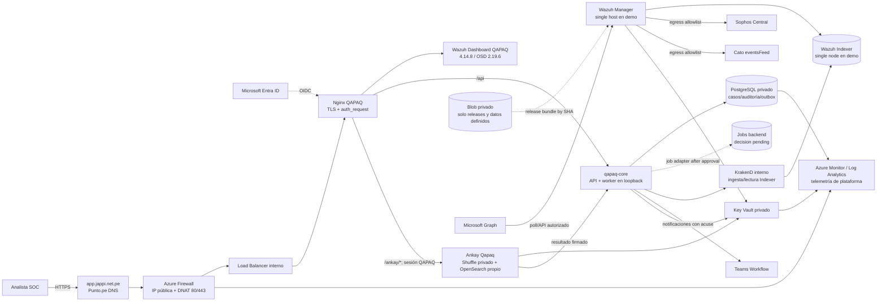
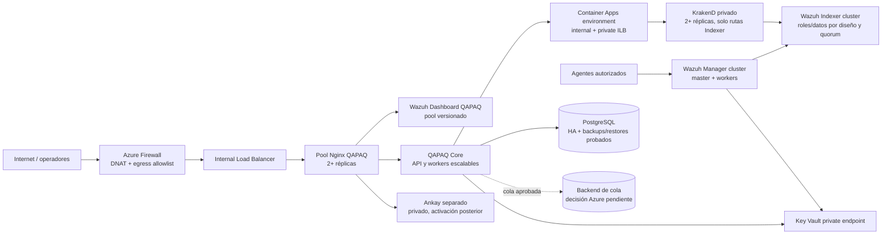

# Arquitectura objetivo y perfil de despliegue — QAPAQ SecOps Azure EUS2

**Propósito:** una fuente única para revisar el diseño cloud y preparar el workflow
`Terraform Azure demo East US 2 plan and apply`. El archivo no declara que el sistema
esté desplegado ni convierte los bloqueos de producto en recursos ficticios.

**Región y state:** `eastus2`, entorno aislado `demo-eus2`, backend
`qapaq-secops/demo-eus2/terraform.tfstate`. El perfil no reutiliza la key de Chile.
El flujo Terraform fija `AZURE_EUS2_*`, usa GitHub OIDC, genera un plan protegido y
solo aplica ese mismo plan después de la aprobación del environment y una referencia
de revisión de costo. El resumen de plan rechaza acciones destructivas.

## Arquitectura objetivo

El dibujo refleja el destino definido en `docs/10-decisiones.md`, `docs/11-cache-y-colas.md`,
`docs/12-backend-en-el-siem.md` y `docs/14-ankay-conexion-qapaq.md`. Las líneas punteadas
identifican enlaces previstos o de telemetría; no son evidencia de conexiones activas.

El budget de 200 en la moneda de facturación es una alerta mensual a nivel de
suscripción; no es un tope, apagado automático ni orden de destrucción.

Este dibujo representa el **primer despliegue demo**, no la arquitectura de alta
disponibilidad. Terraform `siem_host` crea un solo host con Manager, Indexer,
Dashboard y Core. El Load Balancer interno da una dirección estable y health probe,
pero su backend es una sola VM; si esa VM cae, el SOC cae. Wazuh describe la instalación
multi-nodo como la opción para escalabilidad/HA, y exige al menos tres nodos elegibles
como cluster-manager para quorum del Indexer ([guía del cluster Indexer](https://documentation.wazuh.com/current/user-manual/wazuh-indexer-cluster/add-wazuh-indexer-nodes.html)).
No se debe presentar la demo de una VM como resiliente ante falla de host o estrés.

## Topología requerida para carga alta

La evolución de producción requiere separar pools y estado; no se habilita con el
`soc` scope actual. El siguiente dibujo muestra límites y balanceo que deben entrar
en un módulo/stack posterior, después de implementar y medir cada servicio:

KrakenD debe operar como gateway privado y sin estado, con varias réplicas y
balanceo interno. Su primer alcance en Azure debe ser Core → `/wazuh/*` → Indexer;
el gateway actual también contiene `/api/*` hacia el Core, pero ese Core escucha
solo en loopback en el release Azure. Activar el compose actual sin adaptar ese
contrato rompe la ruta o fuerza a abrir el Core. El entorno Container Apps actual,
además, es externo y pertenece al runtime genérico apagado; hace falta un environment
privado dedicado o un servicio equivalente, no reutilizarlo tal cual. Microsoft explica
que un environment internal usa un Internal Load Balancer en la VNet y que las apps
pueden escalar dentro de ese límite
([ingress de Container Apps](https://learn.microsoft.com/en-us/azure/container-apps/ingress),
[networking](https://learn.microsoft.com/en-us/azure/container-apps/networking)).

| Dominio | Demo EUS2 posible tras cerrar inputs | Resiliencia de producción requerida |
| --- | --- | --- |
| Entrada | DNAT + Load Balancer + un host SIEM | Pool de edge con ≥2 instancias y prueba de failover |
| Wazuh | Manager e Indexer single-node; dashboard versionado | Manager cluster e Indexer multi-node con quorum y balanceo de lecturas |
| Core y gateway | Core local; KrakenD todavía no instalado | API/workers escalables y KrakenD interno con ≥2 réplicas; solo ruta Indexer por contrato |
| Persistencia/jobs | PostgreSQL actual; la cola no está elegida | PostgreSQL con HA/restore medidos y cola elegida con idempotencia/reintentos/ACK/DLQ |
| SOAR | Host Ankay opcional, todavía no seguro/reproducible | Aislamiento de ejecución, persistencia y recuperación validados antes de abrir acceso |

No se habilita DNS ni se llama “resiliente” a producción hasta probar caída de nodo,
recuperación de datos, backpressure, ingestión bajo carga y degradación de la cola. El
Terraform de la demo no implementa este pool de alta disponibilidad; el costo de esa
topología debe calcularse aparte.

## Límites del diseño

- **Frontend único:** el navegador llega al Wazuh Dashboard QAPAQ. No se publica Vercel
  ni un frontend Container Apps alternativo.
- **Edge y entrada:** Azure Firewall DNAT hacia un Load Balancer interno y luego Nginx
  en el host SIEM. El host no recibe IP pública. TLS y sesión QAPAQ se terminan en Nginx.
  El ingreso de Dashboard debe usar CIDR aprobados; el ingreso de agentes debe venir de
  redes privadas/vía VPN aprobadas. El módulo no debe usar `0.0.0.0/0` para agentes.
- **Plano SOC:** Manager e Indexer no se publican. Los puertos de Manager/API/Indexer
  permanecen privados; los agentes usan 1514 y enrolamiento 1515 solo desde CIDR
  permitidos. Wazuh API 55000 e Indexer 9200 no se abren al Internet.
- **M365/Sophos/Cato:** el Manager ingiere con configuración de tenant y credenciales
  de Key Vault. Sophos y Cato requieren permisos de API, tenant/región/account y egress
  explícito. Terraform solo prepara red/referencias; un plan exitoso no demuestra que
  los proveedores estén entregando eventos.
- **QAPAQ Core:** API y worker viven con Wazuh, PostgreSQL es la autoridad durable y
  `qapaq_jobs` no equivale a una cola ejecutable. Teams permanece detrás del Core y su
  URL de Workflow se lee desde Key Vault.
- **Cola:** Azure no tiene backend seleccionado. A9 fija Valkey/BullMQ como dirección
  general. ADR-AZ-001 propone BullMQ v6 sobre PostgreSQL para Azure, pero permanece
  propuesta y no aprobada; Azure Managed Redis es otro candidato compatible con Redis,
  no Valkey. Debe quedar privado, con TLS, autenticación, política de memoria y HA
  comprobadas si se elige. Microsoft documenta
  [seguridad y Private Link](https://learn.microsoft.com/en-us/azure/redis/secure-azure-managed-redis)
  y el proveedor tiene [`azurerm_managed_redis`](https://registry.terraform.io/providers/hashicorp/azurerm/latest/docs/resources/managed_redis),
  pero ninguno está cableado en el root actual. El código declara BullMQ/ioredis, pero
  el worker solo gestiona ciclo de vida; no existe productor ni consumidor BullMQ
  verificado. No aprovisionar ni declarar operativa una cola hasta aprobar el backend,
  contrato de jobs, idempotencia, reintentos, ACK/DLQ, degradación y pruebas del cliente.
- **Ankay:** VM privada separada, sin IP pública ni SSH entrante; UI solo por `/ankay/*`
  del edge QAPAQ. Backend, workers, Orborus y OpenSearch no se exponen públicamente.
  El upstream actual monta el socket Docker, publica puertos del host y configura
  `seccomp:unconfined` para Orborus. No habilitar ese Compose sin aislamiento probado,
  fuentes/builds reproducibles y dictamen AGPL. El chart Kubernetes oficial reduce el
  uso del socket, pero requeriría un AKS nuevo con políticas de pod/red y costos que
  no existen en este Terraform.
- **Datos y logs:** alertas y archivos de seguridad viven en Wazuh/OpenSearch; datos
  operativos de casos, auditoría y outbox en PostgreSQL; secretos en Key Vault; telemetría
  de recursos Azure en Log Analytics. El contenedor `security-event-raw` no sustituye
  snapshots S3 ni autoriza copiar datos confidenciales sin una decisión de residencia.
  El blob del diagrama es solo el canal privado del bundle de instalación; no es un
  destino aprobado para eventos, snapshots o evidencia.
- **DNS:** el root Terraform no modifica DNS público. `app.jappi.net.pe` se cambia en
  Punto.pe únicamente cuando el endpoint, certificado, login, ingestión y rollback estén
  probados. El registro anterior se conserva hasta cerrar la aceptación.

## Perfil Terraform versionado

`infra/azure/profiles/demo-eus2.tfvars` fija los valores no secretos que deben ser
iguales en cada run EUS2: región, entorno, address space, SKU PostgreSQL
ya aceptado por la fundación, retención, presupuesto de alertas y tags. El workflow
usa ese archivo al calcular el plan. No contiene contraseñas, claves, URL firmadas ni
credenciales de proveedor.

El workflow aislado consume este perfil desde `infra/azure` con
`.github/workflows/terraform-azure-demo-eus2.yml`. El archivo fija la fundación y
las alertas; **no enciende** el host SIEM, Ankay ni el runtime genérico. Para solicitar
el alcance `siem`, el environment protegido `azure-demo-eus2` debe tener la variable
`AZURE_EUS2_SIEM_HOST_JSON` completa según el objeto `siem_host` de
`infra/azure/variables.tf`; `soc` además requiere `AZURE_EUS2_ANKAY_HOST_JSON`
completo. La validación exige IDs y CIDRs válidos, clave SSH pública, versiones de
Ubuntu y SKU revisadas, nombres de secretos que ya existan en Key Vault, URL/SHA del
release, y digests ACR para Ankay. No hay valores predeterminados que sustituyan
esos perfiles ni se deben pegar valores de secretos en esas variables.

El apply exige `AZURE_EUS2_APPLY_READY=true`, aprobación del environment y una
referencia HTTPS a la revisión de costo. El workflow aplica el plan guardado de ese
mismo run y rechaza `delete`/`replace`. Los pasos disponibles son `foundation`, `siem`
y `soc`; seleccionar `soc` no elimina los gates de publicación segura de Ankay.

### Inputs que faltan para el primer plan `siem`

Se cargan como configuración no secreta del environment GitHub `azure-demo-eus2`;
el JSON completo se valida antes de `terraform plan`:

| Variable | Valores requeridos | Fuente o condición |
| --- | --- | --- |
| `AZURE_EUS2_SIEM_HOST_JSON` | `address_prefix`, `vm_size`, `admin_ssh_public_key`, `ubuntu_image_version`, `data_disk_size_gb`, `dashboard_ingress_cidrs`, `agent_ingress_cidrs`, `core_secret_names`, `wazuh_secret_names`, `core_environment`, `office365`, `provider_ingestion`, `bootstrap_bundle_blob_url`, `bootstrap_bundle_sha256` | `infra/azure/variables.tf`; los CIDR deben ser redes aprobadas reales. `vm_size` del módulo queda fijado a `Standard_F4s_v2`. |
| `core_secret_names` dentro del JSON | nombres Key Vault de Entra client secret y Teams Workflow URL, además de cada secreto Core requerido | Los valores deben existir previamente en el Key Vault EUS2; rotar credenciales que se expusieron en el chat. |
| `wazuh_secret_names` dentro del JSON | nombres de secretos para paquete/certificados Wazuh, M365 y cualquier conector habilitado | La cuenta de Key Vault almacena los valores; los nombres solos van en el JSON. No activar Sophos/Cato sin tenant/región/account IDs, API permissions y egress revisados. |
| `AZURE_EUS2_ANKAY_HOST_JSON` | `private_ip_address`, `admin_ssh_public_key`, `vm_size`, `ubuntu_image_version`, `container_images` (seis digests), `compose_yaml`, `compose_sha256`, `secret_names`, `docker_package_versions` | No definir aún: el runtime upstream no ha pasado los gates de fuentes reproducibles, socket Docker, licencia y endurecimiento descritos en esta arquitectura. |

El workflow ya tiene tenant/subscription OIDC y credencial de PostgreSQL del entorno;
eso solo autoriza y conecta Terraform. No sustituye las variables de hosts anteriores,
los secretos de proveedores ni el acceso de red. El scope `foundation` mantiene el SOC
apagado; no debe presentarse como el producto listo para iniciar sesión.

La forma de `AZURE_EUS2_SIEM_HOST_JSON` debe ser la del objeto `siem_host` en
`infra/azure/variables.tf`; la de `AZURE_EUS2_ANKAY_HOST_JSON` debe ser la del objeto
`ankay_host`. Son configuración no secreta y referencias a nombres de Key Vault. Las
imágenes de Ankay requieren seis digests ACR y un Compose reproducible cuya SHA coincida.
No usar tags `latest`, valores secretos o CIDR de documentación como si fueran valores
de producción. El validador no acepta los placeholders de un ejemplo como configuración.

Los valores reales de secretos se cargan en el vault privado mediante los workflows
create-only autorizados; nunca se guardan en los JSON de hosts, tfvars, plan summary o
Git. Reutilizar una credencial previamente pegada en el chat requiere rotarla primero.

La publicación de SIEM que se puede fijar hoy está verificada en el run
[40453658942](https://github.com/CyberStill-GmbH/qapaq-secops/actions/runs/40453658942):
source SHA `c96e35fc4618ad10db575e110b26625315fece20`, Blob privado
`https://qapaqdemoeus2rel3a2405f3.blob.core.windows.net/siem-release/releases/c96e35fc4618ad10db575e110b26625315fece20/qapaq-siem-c96e35fc4618.tar.gz`,
SHA-256 `89040cb69535da6b7b6b763b77fa0bdb3e15c2089481d139fa9cd2f23c7e5472`.
Ese valor es el digest del bundle comprimido que espera `bootstrap_bundle_sha256`,
no el digest ZIP del artefacto GitHub. El source SHA contiene el paquete de detección
de Active Directory añadido por PR #159; la recolección en agentes de dominio sigue
siendo opt-in. La publicación no demuestra que la VM pueda instalar el bundle ni que
los servicios funcionen; falta probar instalación limpia y configurar las referencias
de secretos.

La configuración de la cola Azure sigue siendo una decisión abierta. El documento
[`ADR-AZ-001`](decisions/adr-azure-queue-postgres.md) presenta PostgreSQL como una
alternativa de menor costo, pero sus pruebas y aprobación aún faltan; no se debe
confundir la base `qapaq_jobs` ya creada con un broker BullMQ operativo.

## Módulos y límites de aprovisionamiento

| Capa | Módulo Terraform | Rol en EUS2 |
| --- | --- | --- |
| Red | `modules/network` | VNet, subredes, DNS privado y Private Endpoints |
| Datos y secretos | `modules/data` | PostgreSQL, bases, Storage, Key Vault privado |
| Identidad y artefactos | `modules/identity_registry` | OIDC, ACR, managed identities y permisos acotados |
| Observabilidad | `modules/observability` | Log Analytics y workspace de plataforma |
| Egress/edge | `modules/egress_firewall` | Firewall, policy, DNAT y reglas de salida cuando SIEM esté habilitado |
| SIEM | `modules/siem_host` | VM Wazuh QAPAQ, disco durable, LB interno e instalación desde bundle con SHA |
| SOAR | `modules/ankay_host` | VM y disco privados de Ankay; requiere Compose e imágenes completas fijadas |
| Runtime alternativo | `modules/runtime` | Se mantiene desactivado porque no es el Dashboard QAPAQ |

La raíz no administra DNS público, no instala agentes en endpoints de terceros y no
configura usuarios de Entra por sí sola. Esas acciones requieren una fuente de identidad,
redes autorizadas y/o administración de endpoints que el state no posee.

## Readiness comprobado y gates pendientes

La fundación EUS2 sí tiene PostgreSQL creado. El último estado de repositorio auditado
no tenía perfiles SIEM/Ankay en `azure-demo-eus2`; los JSON de imágenes y referencias
Key Vault estaban vacíos. Por tanto, el workflow `soc` se detiene antes del plan si
esos perfiles no se cargan.

1. Consumir el Blob y SHA publicados, después probar el instalador en VM limpia antes
   de habilitar el host. El bundle cubre Wazuh, Dashboard QAPAQ, Core y políticas,
   pero no instala el overlay QAPAQ de acceso/roles ni el edge listo para publicar.
   KrakenD tampoco lo administra el módulo `siem_host`; necesita un paquete/servicio
   privado versionado aparte antes de declarar completo el flujo A8. Mantener la
   autenticación sin cambios; probar el control actual antes de habilitar acceso externo.
   Validar también configuración M365 y salida de eventos, no inferirlo del bundle.
2. Resolver la delegación mínima del rol `Storage Blob Data Reader` al seeder/identidad
   adecuada para el contenedor `siem-release`, sin ampliar a Owner/Contributor.
3. Definir host sizes y cotizar el perfil completo EUS2: PostgreSQL + VM SIEM + discos +
   Azure Firewall + Ankay + tráfico + Log Analytics. El documento de fundación no es una
   cotización del SOC y el budget de 200 solo genera alertas, no limita el gasto.
4. Cerrar el consumidor BullMQ y su contrato durable antes de aprovisionar una cola Azure.
5. Completar el build seguro de backend, worker, Orborus y OpenSearch de Ankay; eliminar
   o acotar socket Docker, retirar `seccomp:unconfined`, cerrar puertos de host y revisar
   licencia AGPL. Mantener `/ankay/*` cerrado hasta superar esos checks.
6. Preparar referencias secretas rotadas, SSH pública, CIDR reales de operadores/agentes,
   imagen Linux fijada, blob URL/SHA del release y asignaciones de proveedor.
7. Ejecutar plan remoto, verificar cero destroys/replacements y revisar costo exacto.
   Luego apply del plan guardado, smoke tests y recuperación antes de cualquier DNS.

## Secuencia de lanzamiento

1. `foundation`: no debe contener perfiles SIEM/Ankay; state `demo-eus2`.
2. `siem`: despliega Wazuh QAPAQ y valida TLS, autenticación, Core, PostgreSQL, M365,
   reglas, notificaciones y agentes controlados.
3. `soc`: añade Ankay después del SIEM, con sesión protegida, roles, playbooks aprobados,
   callbacks HMAC y prueba de idempotencia/reconciliación.
4. Cambiar el A/CNAME en Punto.pe solo después de tener target público estable, certificado
   y rollback validado. El Terraform no tiene authority sobre ese DNS.

No declarar el SOC operativo hasta que cada paso tenga run, plan, evidencia de health y
resultados de ingestión/acciones; un recurso creado o un workflow verde no prueba que el
servicio esté conectado.
