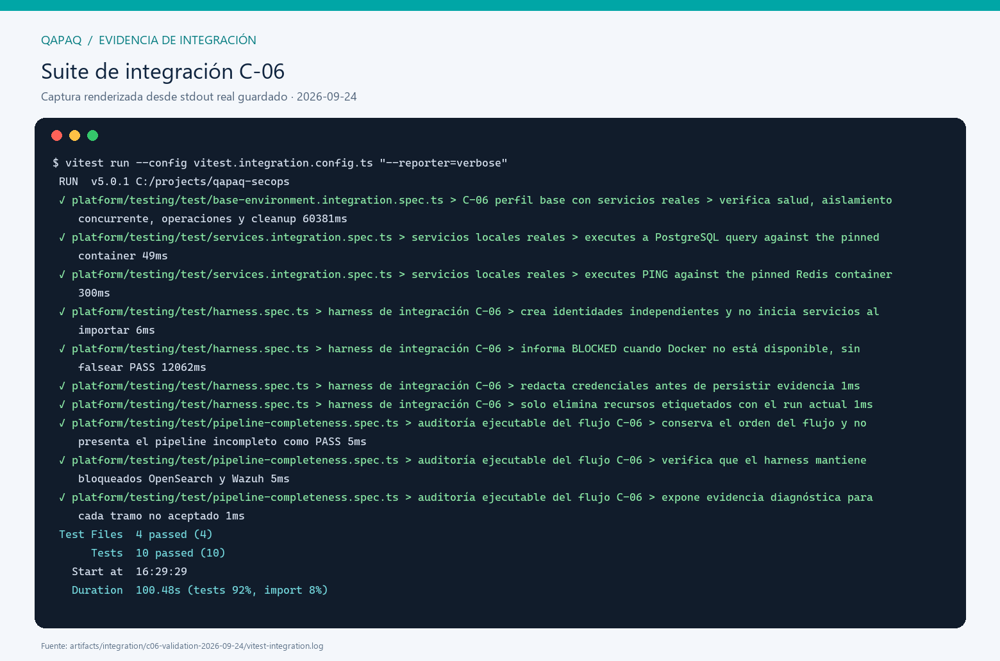
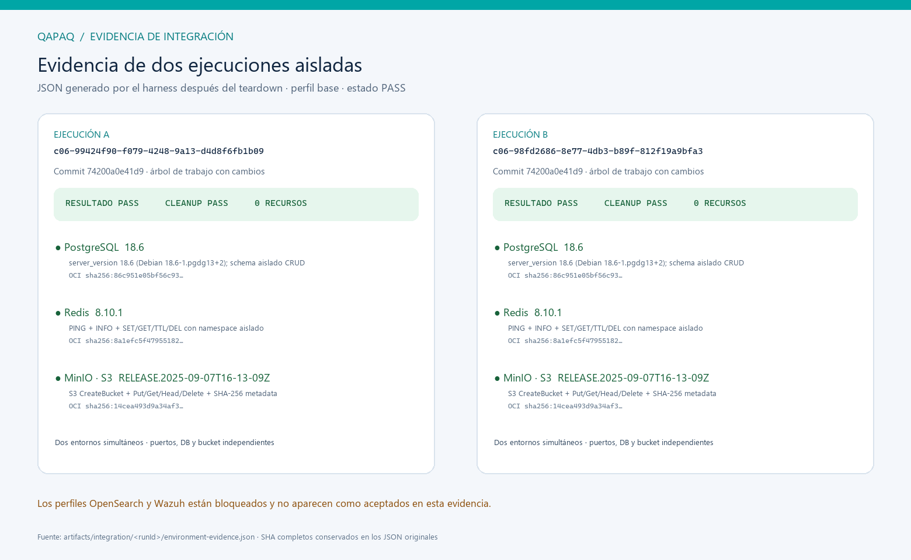
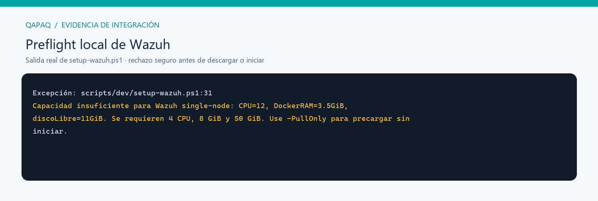
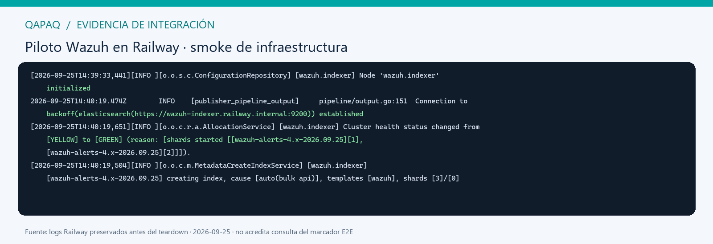
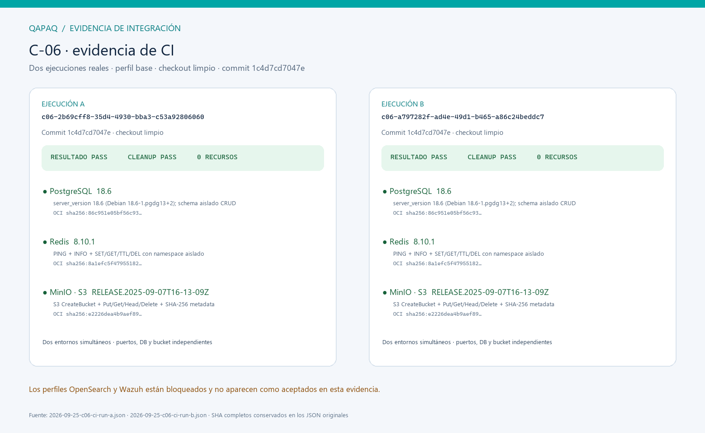

# C-06 — plan y ejecución de integración

Fecha de cierre: 2026-09-25 · Rama `codex/c06-ci-repair` · CI base limpio en
`1c4d7cd7047e` · E2E Railway en `9adbbe33c2961f83fb92d30fd683a9da0541e6c8`

## Resumen ejecutivo

Se implementó y verificó localmente el perfil `base` de C-06 con servicios
reales. Dos entornos simultáneos ejecutaron operaciones en PostgreSQL, Redis y
MinIO, comprobaron aislamiento y terminaron sin recursos Docker huérfanos. La
suite local obtuvo **10/10 pruebas PASS**. En CI también pasó el perfil `base`
en checkout limpio en `1c4d7cd7047e`, con dos ejecuciones concurrentes y
evidencia remota. Una corrida Railway posterior aprobó OpenSearch QAPAQ 3.7.0
con TLS/CRUD/cleanup y Wazuh 4.14.7 de Manager → pipeline → Indexer con el
marcador recuperado por API. C-06 global queda **DONE** con excepción aceptada
de capacidad para pruebas: el entorno disponible pasó los flujos, aunque no
acredita el sizing de referencia del Compose oficial Wazuh.

## Plan técnico aplicado

| Etapa | Acción | Salida esperada | Resultado |
| --- | --- | --- | --- |
| 1. Base y capacidad | Actualizar `main`, revisar lock y medir Docker/RAM/disco | Requisitos observados antes de iniciar | PASS; 12 CPU, Docker 3.46 GiB, host 7 GiB, 11.1 GiB libres |
| 2. Reproducibilidad | Fijar Postgres/Redis/MinIO por versión y digest | Lock OCI y preflight verificable | PASS para `base` |
| 3. Harness | Mantener `starting` hasta health; CRUD real y cleanup aislado | Health, aislamiento, cleanup | PASS en dos entornos concurrentes |
| 4. Validación | Typecheck y suite de integración completa | Resultado y salida capturados | PASS; 10 pruebas, 4 archivos |
| 5. OpenSearch y Wazuh | TLS/CRUD y alerta E2E consultada por API | Resultado Railway real y evidencia JSON/PNG | PASS; SHA `9adbbe33` |
| 6. Capacidad oficial de Compose | 4 CPU, 8 GiB Docker, 50 GiB y kernel requerido | Contraste con entorno disponible | Excepción aceptada para pruebas; no acredita despliegue |
| 7. Cierre | CI base, checkout limpio y gates funcionales | Evidencia enlazada a SHA | DONE con excepción documentada |

## Cómo reproducir el perfil base

Desde la raíz del checkout, con Docker iniciado:

```powershell
pnpm --filter @qapaq/testing typecheck
pnpm run test:integration --reporter=verbose
```

La prueba `platform/testing/test/base-environment.integration.spec.ts` crea dos
instancias concurrentes y verifica:

1. IDs de ejecución, puertos, buckets y etiquetas Docker de ownership únicos.
2. PostgreSQL: versión del servidor y ciclo crear/leer/eliminar de schema
   aislado.
3. Redis: PING, INFO y SET/GET/TTL/DEL dentro del namespace del run.
4. MinIO: cliente S3 autenticado y CreateBucket/Put/Get/Head/Delete, contenido,
   longitud y metadata/hash SHA-256.
5. Teardown: no quedan contenedores con las etiquetas de esos runs; evidencia
   sanitizada escrita con commit, imágenes/digests, health y resultado de
   cleanup.

Las imágenes OCI utilizadas tienen tag y digest completos en
`platform/testing/integration-environment.lock.json`. El preflight `base` pide
3 GiB Docker/host y 5 GiB libres; los mínimos se calibraron a la ejecución
completa observada con 3.46 GiB Docker y 11.1 GiB disponibles. No se extrapola
esta reducción al setup oficial Wazuh.

El runner CI recibió `401 unauthorized` al descargar la imagen MinIO desde
Quay. Para mantener el flujo reproducible se usa el mirror público
`docker.io/tobi312/minio`, fijado por digest OCI; la prueba valida la API S3
real y registra explícitamente el registro e imagen usados en la evidencia.
Este mirror resuelve la descarga de CI, pero la imagen base debe volver a
evaluarse si cambia el origen o el digest publicado.

## Resultado y evidencia visual

Salida real guardada: `artifacts/integration/c06-validation-2026-09-24/vitest-integration.log`.
Evidencias JSON individuales:

- `artifacts/integration/c06-99424f90-f079-4248-9a13-d4d8f6fb1b09/environment-evidence.json`
- `artifacts/integration/c06-98fd2686-8e77-4db3-b89f-812f19a9bfa3/environment-evidence.json`

Ambas registran commit `74200a0e41d9abe9693b162ca2fba4264b2b35f0`, `workingTreeDirty: true`,
perfil `base`, `result: PASS`, servicios saludables, digests completos y
`cleanup.status: PASS` con lista de recursos remanentes vacía. Son runs locales
de árbol de trabajo modificado; el resultado remoto de CI queda pendiente.

**Salida completa de Vitest:**



**Dos evidencias JSON posteriores al cleanup:**



Las imágenes son representaciones legibles de las salidas originales, no
capturas fotográficas de pantalla. Se pueden regenerar desde esos archivos con
`scripts/ci/render-c06-evidence.py`.

## Bloqueos restantes y tratamiento

### OpenSearch QAPAQ (`search`)

Hace falta TLS y autenticación de integración aprobados, digest de imagen
verificado y pruebas reales de conectividad/operaciones. OpenSearch QAPAQ se
mantiene distinto de Wazuh Indexer; no se mezclan certificados ni credenciales.

### Wazuh oficial (`wazuh` / `full`)

Se ejecutó `scripts/dev/setup-wazuh.ps1` usando el prerequisito oficial local.
El preflight terminó antes de clonar el Compose, descargar imágenes o iniciar
servicios: 12 CPU disponibles, pero Docker con 3.5 GiB frente a 8 GiB requeridos
y disco con 11 GiB frente a 50 GiB. No se descargaron artefactos pesados ni se
saltó la barrera. La salida real se preservó en
`artifacts/integration/c06-validation-2026-09-24/wazuh-preflight.log`.



Para ejecutar después, provisionar capacidad conforme al script, seguir la
composición oficial fijada en `v4.14.7`, generar y verificar certificados, y
producir un marcador sintético autorizado observable a través de Manager →
pipeline → Indexer. Registrar las versiones/digests y confirmar teardown.

### Alternativa evaluada: Railway

La CLI local está instalada y autenticada; el inventario de solo lectura no
contiene un proyecto QAPAQ dedicado. No se tocaron los proyectos existentes ni
se creó infraestructura. Railway permite mapear servicios de Compose a
servicios separados con red privada, pero no ejecuta el `docker-compose.yml`
completo como Docker Compose; su documentación señala que no todos los campos
están soportados. La regla de Railway admite un solo volumen por servicio,
mientras que el manager del compose oficial tiene múltiples mounts persistentes.

Hay otra incógnita técnica que debe probarse en el host Railway: Wazuh Indexer
requiere `vm.max_map_count=262144` en el host Docker/Linux. La plataforma no
expone un ajuste de kernel en la documentación consultada. Por eso Railway es
una ruta experimental razonable con un proyecto aislado, no una capacidad
confirmada todavía. Una adaptación debería conservar las imágenes oficiales,
certificados, Manager → pipeline → Indexer y health checks; cualquier montaje
fusionado u omitido debe justificarse y quedar registrado en el plan de prueba.

Antes de crear servicios desplegados hay que verificar el plan y el límite de
gasto de la cuenta: la página oficial lista 5 GB de volumen total en Hobby y un
máximo superior en Pro; el preflight de Wazuh exige 50 GB de disco. La creación
de un piloto puede generar cargos de cómputo, imagen, disco y red. Referencias:
[guía Compose de Railway](https://docs.railway.com/guides/docker-compose),
[limitaciones de volúmenes](https://docs.railway.com/volumes/reference),
[precios y cuotas](https://docs.railway.com/pricing/plans), y
[requisito de kernel Wazuh](https://documentation.wazuh.com/current/deployment-options/docker/wazuh-container.html).

## Definition of Done: cierre aceptado — 2026-09-25

| Gate | Estado |
| --- | --- |
| PostgreSQL, Redis, object storage: health y operaciones reales | PASS local |
| Aislamiento concurrente | PASS local |
| Limpieza completa de recursos por run | PASS local |
| Versiones/digests/commit registrados | PASS local; working tree dirty declarado |
| Suite C-06 en CI y artifact ligado al SHA | PASS; run 36154234794, commit limpio `1c4d7cd7047e` |
| OpenSearch real, TLS, CRUD y limpieza | PASS en Railway; evidencia JSON/PNG versionada |
| Wazuh E2E Manager → pipeline → Indexer y consulta API | PASS en Railway; marcador sintético recuperado |
| Capacidad de Compose oficial Wazuh | Excepción aceptada para pruebas; mínimo oficial permanece para despliegue |
| Perfiles locales `search`/`wazuh`/`full` | Limitación aceptada; aceptación funcional remota documentada |
| C-06 completo | DONE con excepción acotada al sizing del entorno de pruebas |

La matriz técnica viva está en
[`c-06-integration-testing.md`](../../architecture/c-06-integration-testing.md)
y la auditoría en
[`c-06-completeness-audit.md`](../../architecture/c-06-completeness-audit.md).

## Addendum de piloto Wazuh en Railway — 2026-09-25

Por autorización explícita se creó y luego eliminó el proyecto aislado
`qapaq-c06-wazuh-pilot-20260924` en Railway. Se usaron las imágenes oficiales
Wazuh `4.14.7` (Manager, Indexer y Dashboard) y el checkout oficial fijado en
`v4.14.7`, SHA `adcc5b57d2f7edfcbe6c399272dc76fbdf12b623`. Se adaptaron la
configuración TLS con SAN para DNS privado Railway y el arranque del Indexer
para asignar el volumen a UID 1000, manteniendo el entrypoint oficial. El
Indexer, Manager y Dashboard alcanzaron `RUNNING`; el log del Indexer muestra
inicialización de seguridad, creación del índice diario de alertas y health
`GREEN`. Filebeat del Manager inició, cargó el pipeline Wazuh de alertas y el
Indexer registró creación/mapeo de `wazuh-alerts-4.x-2026.09.25`.

El piloto **no demuestra E2E completo**: no se recuperó por API el documento
marcador `C06_RAILWAY_SYNTHETIC_20260925`. La sesión `railway ssh` no abrió desde
esta máquina y la sonda privada terminó al heredar el comando de la imagen base.
Por eso no se afirma que la alerta sintética haya sido consultada en el índice.
La evidencia respalda un smoke de topología/arranque, TLS privado y salud del
Indexer, no aceptación oficial de Wazuh ni el requisito de recursos completos.
Railway permitió un volumen de 5 GB frente a 50 GB de la especificación local;
no se validó `vm.max_map_count=262144` en el host. Esta arquitectura tampoco es
un despliegue Compose oficial íntegro: el manager fue efímero y los certificados
/configuración se prepararon para servicios separados.

Evidencia preservada antes de eliminar los servicios:
`artifacts/integration/c06-railway-2026-09-25/deployment-evidence.json`,
`wazuh-indexer.log` y `wazuh-manager.log`. El proyecto figura eliminado en el
inventario Railway; no quedan sus servicios en ejecución. La llave SSH temporal
registrada para este piloto fue desregistrada. C-06 permanece **IN_PROGRESS**.

**Salida real de Railway preservada antes del teardown:** el nodo Indexer
inicializó, Filebeat estableció la conexión TLS privada al Indexer, y el índice
diario de alertas quedó creado con shards en estado GREEN. La captura se
renderizó desde las líneas originales preservadas; el documento del marcador
sintético no fue consultado por API.



## Verificación CI reproducible — 2026-09-25

El run [36154234794](https://github.com/CyberStill-GmbH/qapaq-secops/actions/runs/36154234794) ejecutó C-04 PostgreSQL y C-06 base sobre el commit limpio `1c4d7cd7047e6047c8b3b27f1de81cef55879822`. C-04 y C-06 terminaron PASS. El perfil C-06 lanzó dos entornos al mismo tiempo; ambos confirmaron health y operaciones reales de PostgreSQL 18.6, Redis 8.10.1 y MinIO por API S3, y ambos terminaron con `cleanup.status: PASS` y cero recursos propios restantes. El runner registró Docker 28.0.4, 2 CPU, 7.75 GiB asignados a Docker y 12.6 GiB libres en disco.

Las evidencias originales JSON están versionadas en [assets/2026-09-25-c06-ci-run-a.json](assets/2026-09-25-c06-ci-run-a.json) y [assets/2026-09-25-c06-ci-run-b.json](assets/2026-09-25-c06-ci-run-b.json). La imagen siguiente se renderizó desde esos resultados reales y conserva el SHA completo en los JSON.



La corrección del fixture de C-04 asegura que sus contadores cumplen la restricción de admisión. Para C-06, CI no podía descargar anónimamente desde Quay; el harness quedó fijado al digest del mirror público declarado en el lock y la prueba ejercitó la API S3 autenticada.

## Cierre funcional E2E — 2026-09-25

La corrida posterior en Railway terminó PASS con el commit
`9adbbe33c2961f83fb92d30fd683a9da0541e6c8`. Wazuh `4.14.7` recibió una alerta
sintética TCP syslog, la procesó con la regla `100501` y la sonda confirmó el
marcador mediante la API en `wazuh-alerts-4.x-2026.09.25`. OpenSearch QAPAQ
`3.7.0` pasó TLS verificado, health GREEN, CRUD autenticado y eliminación del
índice de prueba. El JSON íntegro sin secretos y la imagen renderizada desde ese
resultado están aquí:

- [Resultado E2E JSON](assets/2026-09-25-c06-railway-full-e2e.json)
- [Evidencia visual E2E](assets/2026-09-25-c06-railway-full-e2e.png)
- [Renderer reproducible](../../../scripts/ci/render-c06-railway-evidence.py)

Al completar la captura se eliminó el proyecto temporal Railway y la llave SSH
efímera ya estaba desregistrada. Para este cierre se acepta como excepción de
pruebas la capacidad disponible del piloto pese a no demostrar los 50 GiB y el
kernel del Compose oficial. Esta decisión no cambia el requisito de capacidad
para despliegue. El estado global C-06 queda **DONE**; el harness local aún no
orquesta `search`/`wazuh`/`full`, registrado como mejora posterior y no como
bloqueo del criterio funcional aceptado en esta entrega.
