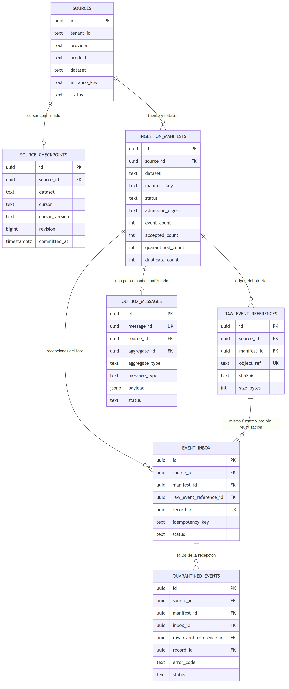
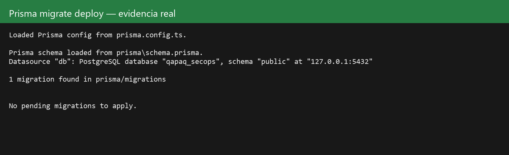
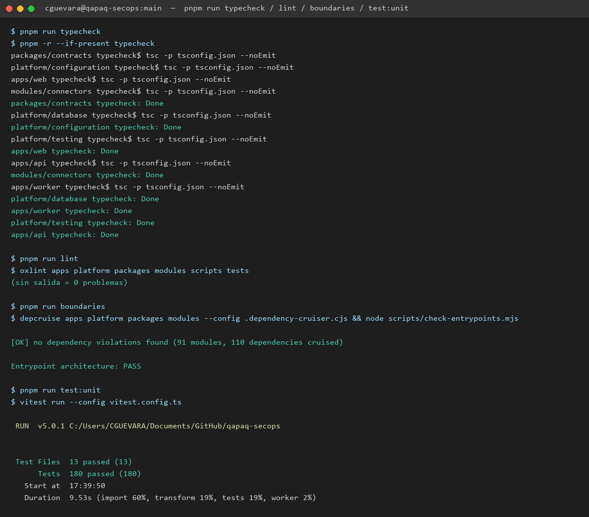

# Informe de avance — 2026-09-22

Preparado para el Daily Scrum de **2026-09-23**. Sprint 1 — Base ejecutable y
contratos (2026-09-19 → 2026-10-02). Facilitador: Cesar Adrian Guevara Salcedo.

Formato y vocabulario según [Daily Scrum](../daily-scrum.md) y
[Definition of Done](../definition-of-done.md): estados admitidos `PLANNED`,
`READY`, `IN_PROGRESS`, `IN_REVIEW`, `BLOCKED`, `DONE`. Un componente solo pasa
a `DONE` con specs y evidencia real; "casi terminado" queda `IN_PROGRESS`. Este
informe no reemplaza el registro diario en `daily-scrum.md`; lo alimenta.

## Resumen ejecutivo

`main` está sincronizado con `origin/main` (commit `0500fc3`) y el pipeline de
CI (`CI Security`) pasa **completo**, incluido el `CI gate`, después de
corregir dos fallas reales detectadas hoy. Cinco componentes de Sprint 1 tienen
evidencia ejecutable (`C-01`, `C-02`, `C-03`, `C-05`, `C-07`); `C-04` tiene
diseño físico cerrado, código de persistencia con contrato estático verificado
y ahora una primera evidencia real de conexión/migración contra PostgreSQL,
aunque sin cubrir los criterios de rollback/concurrencia; `C-06`, `C-08` y
`C-09` siguen `IN_PROGRESS` con evidencia parcial.

## Avance por componente

| ID | Estado | Evidencia |
| --- | --- | --- |
| C-01 — workspace | `DONE` | Install congelado, format, lint, typecheck y build reproducibles; verificado hoy de nuevo (ver captura). |
| C-02 — entrypoints | `DONE` (2026-09-22) | API/worker/web con lifecycle, health y composition roots propios, sin dependencias simuladas. Detalle completo en [`c-02-entrypoints.md`](../../development/c-02-entrypoints.md). CI job `entrypoints` verde, incluida la suite Playwright de arranque/recuperación en Chromium. |
| C-03 — configuración | `DONE` (2026-09-21) | Perfiles tipados, `SecretProvider`, fallo seguro ante configuración ausente. |
| C-04 — persistencia de admisión | `IN_PROGRESS` | ER de diseño cerrado en [`c-04-admission-er.md`](../../architecture/c-04-admission-er.md) y su [resolución de auditoría](../../architecture/c-04-mer-audit.md#resolución-documental-del-mer--2026-09-22). Prisma schema y migración con siete tablas (`sources`, `source_checkpoints`, `ingestion_manifests`, `raw_event_references`, `event_inbox`, `outbox_messages`, `quarantined_events`) verificadas **estáticamente** (contrato sobre el SQL, 24+ constraints) **y ahora también con conexión real**: `prisma migrate deploy` contra PostgreSQL local (`qapaq_secops`, `127.0.0.1:5432`) confirma la migración aplicada sin drift (ver evidencia abajo). Sigue **sin** evidencia de migración desde vacío, rollback inyectado ni carreras concurrentes — los 7 criterios de cierre de [`c-04-admission-er.md`](../../architecture/c-04-admission-er.md#encaje-en-componentes-y-evidencia-para-cerrar-c-04) solo están parcialmente cubiertos (criterio 1). No se acepta como Done. |
| C-05 — contrato SecurityEvent | `DONE` | Schema JSON, catálogos, validador y corpus de 41 fixtures (válidos/inválidos) en `packages/contracts/src/security-event`; contract specs incluidos en los 180 tests unitarios verdes. |
| C-06 — entorno de integración real | `IN_PROGRESS` | Solo existe `platform/testing/test/services.integration.spec.ts`; arranque/teardown real de PostgreSQL, Redis, object storage, OpenSearch y Wazuh sigue sin demostrarse en CI. |
| C-07 — reglas de dependencia | `DONE` | `dependency-cruiser` + `scripts/check-entrypoints.mjs` activos: "no dependency violations found (91 modules, 110 dependencies cruised)" y "Entrypoint architecture: PASS" (ver captura). |
| C-08 — probe Wazuh | `IN_PROGRESS` | Solo existe el esqueleto `modules/connectors/src/infrastructure/wazuh-indexer-client.ts`; falta la suite de conformidad y la consulta real al Indexer autorizado. |
| C-09 — CI y ownership | `IN_PROGRESS` | Pipeline completo (`discover`, `codeql`×2, `secrets`, `filesystem`, `pnpm-audit`, `quality`, `entrypoints`, `containers`, `gate`) verde hoy. Pendiente: activar protección de rama en `main` — hoy mismo se empujaron commits directos sin bloqueo, lo que contradice el objetivo de "PR confiable/no confiable" de la aceptación de C-09. |

## Diagrama ER de C-04 y decisiones de diseño

Siete tablas de admisión (`sources` → `source_checkpoints`/`ingestion_manifests`
→ `raw_event_references`/`event_inbox`/`outbox_messages` → `quarantined_events`),
renderizado directo del `schema.prisma` real, no un boceto aparte — ver
[`c-04-admission-er.md`](../../architecture/c-04-admission-er.md) para el
diccionario físico completo.

Decisiones de diseño cerradas hoy (resolución de la
[auditoría del MER](../../architecture/c-04-mer-audit.md#resolución-documental-del-mer--2026-09-22)):

- **Checkpoint minimalista:** `source_checkpoints` guarda solo el último cursor
  confirmado (CAS por `revision`); no persiste estados de pipeline.
- **Reutilización de raw acotada:** un `event_inbox` puede referenciar un raw de
  otro manifiesto, pero solo de la **misma** `Source` — nunca de otro tenant.
- **Cuarentena por FK compuesta:** `quarantined_events` cuelga de la combinación
  completa `(sourceId, manifestId, inboxId, rawEventReferenceId, recordId)`, no
  de una tabla independiente sin pertenencia verificada.
- **Outbox de un solo mensaje por manifiesto:** payload cerrado a 4 KiB, con
  solo `manifestId`; generalizarlo requiere nueva migración, no se improvisa.
- **Sin cascadas de borrado:** todas las FK son `ON DELETE/UPDATE RESTRICT`;
  evidencia y raw no desaparecen por una eliminación en cadena.
- **Contadores disjuntos:** `accepted_count`/`quarantined_count`/`duplicate_count`
  son una foto de admisión (`duplicate_count = 0` en esta entrega), no se
  recalculan por fallos posteriores del parser.

Estas decisiones cierran el diseño físico; **no** cierran C-04 como componente
— la verificación contra PostgreSQL real sigue **parcialmente** pendiente (ver
evidencia y bloqueos).

### Primera evidencia real de conexión y migración

Salida real de `prisma migrate deploy` contra una instancia PostgreSQL en
`127.0.0.1:5432`, base `qapaq_secops`: reconoce la única migración en
`prisma/migrations` y reporta "No pending migrations to apply" (sin drift).
Esto confirma conectividad real y consistencia del estado de migración, **no**
sustituye los criterios de cierre restantes de
[`c-04-admission-er.md`](../../architecture/c-04-admission-er.md#encaje-en-componentes-y-evidencia-para-cerrar-c-04):
falta migración desde vacío con reaplicación por historial, rollback inyectado
tras cada escritura, carreras concurrentes, casos de rechazo (cruces de
Source/tenant, IDs inválidos, etc.) y evidencia adjunta desde CI. C-04
permanece `IN_PROGRESS`.

## Incidencia de CI resuelta hoy

El pipeline en `main` fallaba en `secrets`, `entrypoints` y `quality` desde el
merge de C-02/C-04. Diagnóstico y corrección (commit `91529b7`, detalle en su
mensaje):

1. **`secrets` (gitleaks):** falso positivo de historial — un fixture sintético
   (`tests/smoke/support.mjs`) se llamó `secret` en un commit y se renombró
   después; gitleaks escanea todo el historial y seguía marcándolo. Se agregó
   `.gitleaks.toml` con un allowlist acotado a ese commit + archivo (`extend.useDefault`
   conserva el resto de reglas activas).
2. **`entrypoints`/`quality`:** faltaba `prisma generate` explícito antes de
   `typecheck`/`build`. El workflow instala con `--ignore-scripts` (correcto por
   seguridad), lo que también bloquea el postinstall de Prisma. Se agregó el paso
   `pnpm --filter @qapaq/database run generate` en ambos jobs. El error asociado
   `Parameter 'tx' implicitly has an 'any' type` era consecuencia del mismo
   problema (TypeScript no podía resolver `Prisma.TransactionClient` sin el
   cliente generado), no un bug de tipos independiente.

Verificado en el run real `35793054805`: los 9 jobs aplicables y el `CI gate`
terminaron en `success` (`codeql` incluido en ambos lenguajes).

## Evidencia de pruebas

Ejecución local de hoy (`main`, commit `91529b7`), después de `prisma generate`:

- `pnpm run typecheck`: 8/8 paquetes `Done`.
- `pnpm run lint`: 0 problemas (oxlint sin salida).
- `pnpm run boundaries`: sin violaciones de dependencia (91 módulos, 110
  dependencias) y arquitectura de entrypoints `PASS`.
- `pnpm run test:unit`: **180 tests, 13 archivos, todos en verde**, 9.53 s.

Esta captura corresponde a una ejecución real local, no a un run de CI; el run
de CI equivalente es `35793054805` (enlace en la sección de CI/CD).

## Bloqueos y riesgos vigentes

| Elemento | Estado | Dueño | Siguiente acción |
| --- | --- | --- | --- |
| Tenant, permisos, Wazuh/Indexer y secretRefs de Microsoft 365 | Por confirmar | Franco Clavo Santander | Fecha objetivo no posterior al 2026-09-25 (PBI-006), sin la cual C-08 no puede cerrar. |
| C-04 con evidencia parcial contra PostgreSQL real | Riesgo activo | Cesar | Conectividad y estado de migración confirmados hoy; requiere C-06 (entorno de integración reproducible) para demostrar migración desde vacío, rollback y concurrencia. |
| Protección de rama en `main` no configurada | Riesgo de proceso | Cesar / Franco | Definir política de PR obligatorio antes de que más de una persona escriba en `main`. |

## Ajuste propuesto para el Daily Scrum de mañana (2026-09-23)

1. Confirmar si C-06 (entorno de integración real) entra como próximo
   componente: es prerrequisito de C-04, C-08 y C-09 para dejar de depender de
   verificación estática.
2. No declarar C-04 `DONE` en ningún reporte hasta tener migración/rollback
   reales — el diseño y el código existen, la evidencia productiva no.
3. Escalar a Franco el acceso Microsoft 365/Wazuh si no hay avance para el
   2026-09-25, según lo ya registrado en `daily-scrum.md`.
4. Mantener el límite de WIP de dos componentes; hoy se tocaron efectivamente
   C-02 (cierre) y C-04 (diseño+código parcial) más la corrección de CI, que
   no cuenta como un tercer componente de negocio.

[Daily Scrum](../daily-scrum.md) · [Plan de componentes](../component-delivery-plan.md) ·
[Product Backlog](../product-backlog.md) · [Definition of Done](../definition-of-done.md) ·
[Run de CI](https://github.com/CyberStill-GmbH/qapaq-secops/actions/runs/35793054805)
