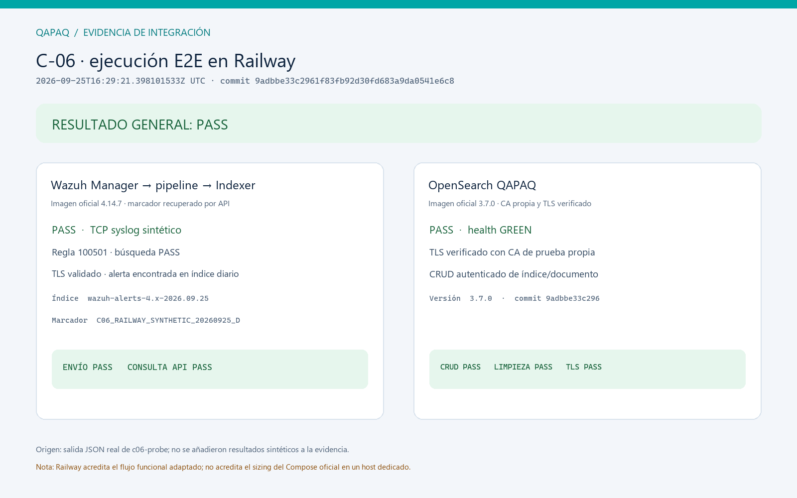
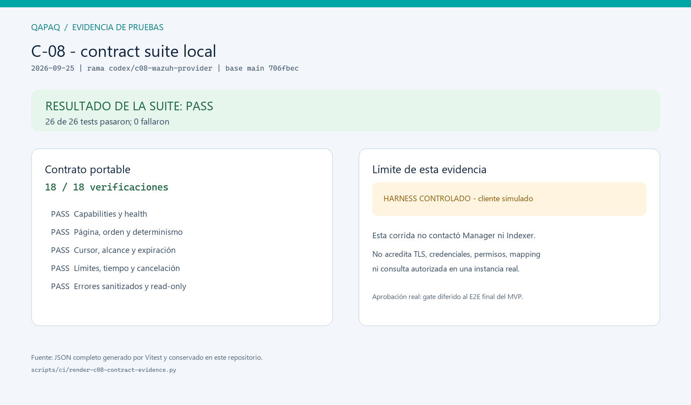

# Daily Scrum — Informe de avance — 2026-09-25

**Sprint 1 — Base ejecutable y contratos** · 2026-09-19 a 2026-10-02  
**Facilitador:** Cesar Adrian Guevara Salcedo · **Zona horaria:** America/Lima

## Resumen ejecutivo

`main` está en `706fbec`, que conserva el cierre funcional C-06 integrado desde
PR #14. C-06 está DONE con excepción aceptada de capacidad para pruebas. Este
corte también registra avances sin commit en `codex/c08-wazuh-provider`, basada
en `main` `706fbec`; esos cambios todavía no están en `main`.

## Avance en `main`

| Componente | Estado en `main` | Evidencia / lectura |
| --- | --- | --- |
| C-04 — admisión transaccional | DONE | Rechazo por pertenencia y límites, pruebas de aislamiento y merge integrado en `df44dc7` |
| C-06 — integración | DONE | CI base y aceptación real OpenSearch/Wazuh integradas por PR #14; sizing de pruebas aceptado por excepción documentada |
| C-08 — contrato operativo Wazuh | DONE para Sprint 2 (excepción PO) | Contrato local aceptado para avanzar; E2E real autorizado obligatorio antes de aceptar el MVP y sigue pendiente |
| C-09 — gobierno de CI/main | IN_PROGRESS | CI existe; el estado de protección requerida de rama se debe confirmar |

## Trabajo de hoy en la rama de cierre C-06

- CI base acreditó dos ejecuciones concurrentes en checkout limpio con health,
  aislamiento y cleanup PASS para PostgreSQL, Redis y MinIO.
- OpenSearch QAPAQ 3.7.0 pasó TLS verificado, health GREEN, CRUD autenticado y
  cleanup.
- Wazuh 4.14.7 recibió un evento sintético por TCP syslog; la regla 100501 creó
  una alerta que se recuperó por API desde el índice diario.
- La decisión de cierre acepta la capacidad disponible del piloto Railway para
  pruebas aunque no demuestre el sizing del Compose oficial. La excepción queda
  documentada y no cambia los requisitos de despliegue.
- Se capturó evidencia JSON del resultado real y se renderizó una imagen legible.
  El proyecto temporal Railway se eliminó al terminar.

## Avance de hoy en la rama C-08

- Implementados `SecurityEventProvider`, health separado de Manager/Indexer,
  consulta read-only con allowlist y cursor firmado con TTL.
- La contract suite reusable cubre 18 comportamientos. El test dirigido pasó
  26 casos (18 contractuales sobre cliente simulado) y el unit completo pasó
  237/237; typecheck, lint y boundaries también pasaron.
- La verificación de endpoints locales HTTPS falló con `SocketException`; el
  proyecto Railway aislado no tiene servicios y Docker Desktop no inicia en esta
  máquina. Por tanto, no se afirma una consulta C-08 real ni se recicla evidencia
  C-06 para cubrir ese gate.
- Se recuperaron los digests Wazuh Manager/Indexer 4.14.7 de la evidencia previa
  C-06 y se fijaron en el lock C-06 para reproducibilidad; todavía no están
  ligados a una ejecución del provider C-08.

## Gates C-06 al corte de trabajo

| Gate | Estado |
| --- | --- |
| PostgreSQL, Redis, object storage: health/operaciones | PASS local y CI |
| Aislamiento concurrente y limpieza | PASS local y CI |
| OpenSearch con TLS, CRUD y limpieza | PASS Railway |
| Wazuh Manager → pipeline → Indexer y consulta API | PASS Railway |
| Capacidad del Compose oficial Wazuh | Excepción aceptada para pruebas; no acredita despliegue |
| C-06 global | DONE en `main`, con excepción de capacidad documentada |

## Plan y riesgos

1. Avanzar Sprint 2 con los contratos C-08 y pruebas locales; dejar los PBI que
   requieren Wazuh/tenant real en `BLOCKED` mientras no haya acceso.
2. Ejecutar las pruebas autorizadas C-08 y el E2E Microsoft 365 → Wazuh → QAPAQ
   durante la aceptación final del MVP.
3. Confirmar branch protection/checks requeridos de C-09.
4. Mantener como trabajo posterior la orquestación local de los perfiles
   `search`, `wazuh` y `full`.

**Cambios aceptados al Sprint Backlog:** C-06 acepta el entorno de prueba disponible
para cerrar su aceptación funcional, con excepción de capacidad documentada. C-08
habilita desarrollo de Sprint 2 mediante el contrato local; la prueba autorizada
real se difiere al E2E final del MVP. Los PBIs dependientes siguen `BLOCKED`; la
excepción no permite declarar completo el Sprint Goal ni MVP Candidate sin esa evidencia.

**Confianza en el Sprint Goal:** ÁMBAR. C-04/C-06 están cerrados y C-08 permite
avanzar el trabajo local de Sprint 2; la integración corporativa real se valida
antes de aceptar el MVP. El wordmark tipográfico QAPAQ mantiene la identidad visual
del informe del día.

## Evidencia visual de C-06

La imagen se renderizó desde la salida JSON original real de la sonda Railway;
no se reconstruyeron resultados de prueba.

## Verificación local de la contract suite C-08

La imagen se genera desde el JSON completo de Vitest versionado junto a ella.
Los 26 tests pasaron; 18 de ellos comprueban el contrato neutral sobre un
cliente Indexer simulado. Este resultado valida el comportamiento local del
adapter, no la conectividad ni la autorización contra Wazuh.

El run JSON es [2026-09-25-c08-contract-run.json](../c-08/assets/2026-09-25-c08-contract-run.json)
y puede renderizarse de nuevo con `scripts/ci/render-c08-contract-evidence.py`.

Fuentes: [auditoría C-06](../../architecture/c-06-completeness-audit.md),
[plan y ejecución C-06](../c-06/README.md), y `origin/main` en `df44dc7`.
