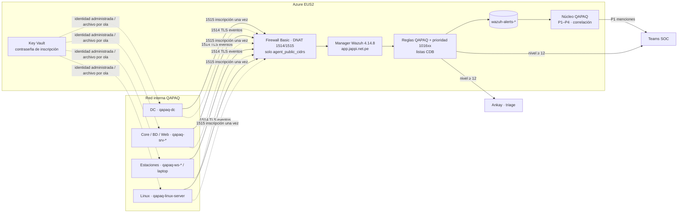

# Arquitectura de agentes y elevación de severidad

## 1. Flujo

## 2. Responsabilidades

| Componente | Hace | No hace |
|---|---|---|
| **Agente** (perfil por grupo) | Recoge canales filtrados, FIM, SCA, inventario. | Ejecutar comandos remotos o Active Response. |
| **Grupo Wazuh** (`agent.conf`) | Define qué recoge cada clase de activo. | Mezclarse con otro perfil (un agente, un grupo). |
| **Reglas QAPAQ** (AD, endpoint, launch, office365) | Detectan la técnica. | Saber qué activo es crítico. |
| **Reglas de prioridad** (101600–101699) | Cambian el nivel según el activo/identidad (listas CDB); rebajan ruido justificado; etiquetan `qapaq_ctx_*`. | Suprimir con nivel 0; ejecutar respuestas. |
| **Núcleo QAPAQ** (`modules/detection` 1.2.0) | Ordena la cola (P1–P4) con reason codes, correlación, cadenas y mantenimiento; avisa P1. | Volver a contar contexto que Wazuh ya etiquetó. |
| **Ankay** | Triage y acciones con aprobación SoD. | Recibir eventos directo de los agentes. |

## 3. Decisiones

| # | Decisión | Motivo | Alternativa descartada |
|---|---|---|---|
| AG-1 | Grupos autocontenidos por clase de activo (8). | Wazuh no fusiona `localfile` por canal; con capas, un canal se duplica o pierde su filtro. | Grupo base + grupos de perfil superpuestos. |
| AG-2 | Canales de Windows siempre con XPath cerrado. | El costo de ingesta lo dominan 4624 tipo 3, 4768/4769, 5156 y Sysmon 3/7/22. | Recoger todo y filtrar con reglas nivel 0 (se paga la ingesta igual). |
| AG-3 | Elevación en Wazuh con listas CDB, además del contexto del núcleo. | Las integraciones Teams y Ankay se disparan por nivel ≥ 12: si la elevación no está en Wazuh, un evento crítico sobre un DC no llega a tiempo. | Solo P1–P4 en el núcleo. |
| AG-4 | El núcleo lee `qapaq_ctx_*` y cuenta el contexto una vez. | Una sola verdad de inventario (CDB) sin obligar a duplicar listas en variables. | Exigir las mismas listas en `QAPAQ_DETECTION_*`. |
| AG-5 | Contraseña de inscripción nunca en argv ni en propiedades del MSI. | `msiexec` registra propiedades en su log y `argv` es visible a otros procesos. | `WAZUH_REGISTRATION_PASSWORD`. |
| AG-6 | Sin actualización remota WPK. | Un WPK no pasa por el manifiesto con hash de QAPAQ. | Upgrade desde el manager. |
| AG-7 | Rebajas a nivel 3–6, nunca 0. | Nivel 0 no genera alerta: se pierde el rastro forense. | `level="0"` / `noalert`. |

## 4. Límites conocidos

- La elevación por host en Wazuh usa `win.system.computer` (Windows) y `qapaq_host`
  (adaptadores de proveedor). Para Linux nativo (syslog/auditd) no hay un campo de host
  decodificado fiable en la regla: el contexto de esos eventos lo pone el núcleo con
  `QAPAQ_DETECTION_CRITICAL_ASSETS` sobre `agent.name` (el instalador registra el FQDN en
  minúsculas como nombre del agente).
- `<time>` usa la hora local del manager (UTC en EUS2). El horario laboral real es
  TO_BE_PROVIDED.
- 101625 (ráfaga SSH contra activo crítico) no se prueba en la misma sesión de logtest que 101626
  por el `ignore` de 101213; se valida en el piloto.
- Los nombres de proveedor Sophos en Application y la instancia SQL se confirman en el piloto.
