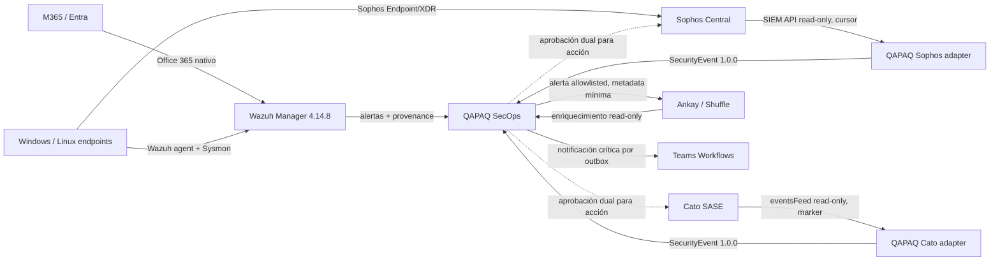

# Perfil multifuente para la demo SOC QAPAQ

**Estado:** propuesta implementable; no desplegada ni aprobada como política de
tenant. **Fecha:** 2026-10-20. **Versión objetivo del overlay Wazuh:** 4.14.8 / OSD
2.19.6, sujeta a confirmar el artefacto que se publique a Azure. **Ámbito:** demo
aislada de la financiera, con telemetría autorizada y datos reales solo después de
validar acceso, región, retención y permisos.

Este documento interpreta la instrucción de incorporar Sophos XDR y Cato a la demo
que ya usa Wazuh para M365. Propone una enmienda limitada a ADR-024: mantener Wazuh
como colector y motor de reglas para M365, y permitir incorporar Sophos y Cato como
fuentes read-only posteriores al MVP, sin cambiar el contrato `qapaq.security-event`
ni convertir Wazuh en dueño de la respuesta externa. La decisión final del ADR queda
pendiente de revisión de Arquitectura/Seguridad.

## Estado comprobado y límites

- Azure no tiene recursos aplicados en la suscripción revisada. No existe Manager,
  Indexer, Dashboard, Ankay ni endpoint de agentes Azure donde instalar el perfil.
- `infra/wazuh/office365/` tiene módulo, reglas y runner versionados. Su ejecución
  real corresponde a un Manager AWS previo; no demuestra que esté instalado en
  Azure ni que lea ahora el tenant.
- `infra/wazuh/endpoint/` contiene la regla `101100` como **candidata**; requiere
  eventos Sysmon reales y no forma parte de la instalación del Manager.
- `infra/wazuh/shuffle/` reenvía metadatos permitidos para triage. La URL/workflow
  de Ankay no está provisionada; ese adaptador no aprueba ni ejecuta acciones.
- El inventario marca los productos, planes, regiones, permisos y credenciales de
  Sophos/Cato como pendientes. No hay conectores backend implementados para esos
  proveedores ni prueba contra sus tenants.
- La extensión de Ankay es Shuffle fijado con overlay de frontend; no importa
  playbooks directamente ni suple el dispatcher/outbox QAPAQ.

Fuentes de estado: [runbook Azure](../cloud/azure/runbook-preparacion-y-corte.md),
[inventario de fuentes](../integrations/source-inventory.yaml),
[ADR-024](../adr/024-microsoft-365-wazuh-mvp-vertical.md), [paquete endpoint](../../infra/wazuh/endpoint/README.md) y
[catálogo Ankay](ankay-playbooks/catalog.yaml).

## Arquitectura propuesta

**Responsabilidades:** Sophos conserva prevención, XDR y el estado de remediación
del endpoint; Wazuh conserva agentes, inventario, FIM, SCA, decoders y reglas;
QAPAQ correlaciona eventos de los tres proveedores, prioriza, lleva casos y audita;
Ankay ejecuta flujos aprobados, con credenciales segregadas. No se crea un segundo
SIEM ni se presenta una alerta de Wazuh como evento raw del proveedor.

Para una demo demostrable se recomienda ingerir Sophos y Cato mediante adaptadores
QAPAQ separados y luego mostrar los SecurityEvent/casos en QAPAQ. Wazuh puede recibir
una copia acotada de alertas si existe un requisito de búsqueda unificada allí, pero
esa segunda ruta debe usar un `sourceRecordId`/lineage común y no contabilizarse como
un segundo incidente. No se debe meter una API de polling dentro del script de
integración saliente del Manager ni instalar una regla como sustituto del conector.

## Perfiles de agentes Wazuh

Las configuraciones se distribuirán por grupos administrados en `agent.conf` y se
probarán primero en un grupo piloto. Las reglas locales quedan bajo `/var/ossec/etc/`
y nunca modifican el ruleset upstream. La configuración central soporta `syscheck`,
`rootcheck`, `localfile`, `sca`, `syscollector` y `client_buffer`; no habilitar
comandos remotos compartidos para esta demo.

| Grupo | Telemetría y controles | Criterio de admisión |
|---|---|---|
| `qapaq-demo-windows-pilot` | Wazuh agent; canales Windows Security/System; Sysmon Process Create si la política corporativa lo instala; SCA; syscollector; FIM en persistencia y configuración crítica acotada; Sophos activo con política Endpoint separada | Equipos de laboratorio o usuarios piloto nominados por owner; validar impacto y eventos antes de ampliar |
| `qapaq-demo-privileged-pilot` | Perfil anterior; señales de autenticación privilegiada y cambios de defensa; revisar eventos PowerShell/Sysmon; evitar excluir administradores del monitoreo | Solo dispositivos de administración autorizados; acceso a resultados limitado |
| `qapaq-demo-linux-pilot` | Wazuh agent; auth/journald/audit según distro; SCA de política compatible; syscollector; FIM de `/etc`, binarios/configuración y rutas de servicio definidas | SO/version soportado y owner del servidor aprobado |
| `qapaq-demo-lab-malware` | Perfil de piloto más YARA/ClamAV opcional, aislado y con muestras benignas; no compartir muestras ni habilitar cuarentena automática | Laboratorio separado de identidad/datos financieros |

No desplegar agentes por descubrimiento masivo ni distribuir claves por artefactos,
correo o Shuffle. Para cada dispositivo registrar owner, sistema/versión, grupo,
heartbeat, versión de agente, hash de configuración, Sophos protegido/no protegido y
fecha de baja. Los agentes “active” no prueban que Sysmon, FIM o la política Sophos
estén funcionando; aceptar cada módulo con evento/prueba específica.

### Política base de Sophos

Sophos Endpoint/XDR es el control primario de endpoint. Confirmar edición/licencia y
compatibilidad antes de habilitar cada función. Propuesta inicial: Threat Protection,
Live Protection y protección contra ransomware/exploits según el plan contratado;
Tamper Protection bajo rol administrativo separado. Mantener perfiles de workstation
y server distintos; hacer piloto con medición de CPU, falsos positivos e impacto en
aplicaciones críticas. Las exclusiones son puntuales, documentadas con owner,
evidencia, ticket y expiración. No desplegar una acción de limpieza/aislamiento por
una regla de Wazuh, una puntuación de reputación o una señal sin corroborar.

## Fuentes, conectores y reglas

### M365 / Entra por Wazuh

Mantener la integración Office 365 como colector M365 principal. Validar frescura,
errores y última lectura por `Audit.AzureActiveDirectory`, `Audit.Exchange`,
`Audit.General` y `Audit.SharePoint`; el silencio de un workload es `degraded/unknown`,
no `healthy`. Reglas locales priorizan password spray/success-after-fail, cambios de
roles y métodos MFA, consentimiento OAuth, alteración de auditoría y forwarding o
reglas de inbox. Las operaciones sin fixture de tenant permanecen marcadas como
pendientes de evidencia; no aumentar severidad hasta confirmar el `Operation` real.

### Sophos Central SIEM API

Implementar un adapter read-only aparte con `client_credentials`, `X-Tenant-ID`, host
regional aprobado y scopes mínimos del producto. Leer `/siem/v1/events`; respetar
`next_cursor`, límite/documentación vigente y ventana de eventos de 24 horas; persistir
el cursor solo después de admisión durable. Manejar `401/403`, `429`/`Retry-After`,
timeouts, `5xx`, cursor expirado y respuesta inválida. No guardar token ni body en
logs. Mapear severidad original, endpoint ID opaco, SHA-256, estado de remediación y
timestamp a `qapaq.security-event`; preservar el registro raw bajo la política de
retención acordada.

### Cato GraphQL `eventsFeed`

Adapter separado con API key de permisos mínimos (`Events` si basta para el dataset),
cuenta/site bajo alcance aprobado y un `marker` durable guardado sin analizar ni
reconstruir. Avanzar checkpoint después de persistir lote/eventos. Medir lag contra
la retención aproximada de tres días y alertar antes de perder la ventana. Separar
eventos de seguridad/detección de conectividad, administración, routing y sistema;
no asignar nivel alto a `allowed` o cambios normales de conectividad.
Confirmar que `eventsFeed` esté habilitado para la cuenta: la referencia API indica
disponibilidad gradual/EA para algunas operaciones.

### Reglas de detección y malware

- Promover la regla QAPAQ `101100` solo con Sysmon Event ID 1 presente, decoder
  correcto, CI `wazuh-logtest` verde y observación de ruido del piloto. No reducir el
  umbral global de envío a Ankay por una regla nivel 8.
- Crear correlación `sophos-malware ↔ host Wazuh ↔ hash ↔ Cato network event ↔ M365
  identity` con ventana temporal y entidad común; conservar eventos base separados y
  explicar la puntuación con señales, no sumar severidades ingenuamente.
- Usar YARA/ClamAV como análisis controlado en laboratorio/caso aprobado; FIM avisa
  sobre cambios en ubicaciones acotadas. Sophos toma la decisión de prevención y
  remediación endpoint.
- VirusTotal solo con licencia Enterprise para el caso comercial aprobado. Al inicio
  limitar a hash SHA-256 no sensible; no subir archivos, correos, URL con token,
  PII ni direcciones internas. Reputación externa no es prueba ni orden de bloqueo.
- Conservar `ruleId`, versión de regla, decoder, origen, `sourceRecordId`, `raw.ref`,
  hash y `ingestionPath`. `SecurityEvent` normalizado no debe perder la severidad
  nativa del proveedor.

## Playbooks iniciales Ankay

| Playbook | Trigger | Automatización inicial | Efecto |
|---|---|---|---|
| `triage.m365-suspicious-mail` | Regla M365 allowlisted o reporte admitido | Correlacionar sign-in, inbox forwarding, consent y proceso relacionado; normalizar URL como texto; resumen con evidencia/procedencia | Solo lectura; nunca abrir URL o adjunto |
| `triage.sophos-malware` | Detección Sophos alta/crítica correlacionada con agente Wazuh | Consultar estado/remediación y hash; verificar endpoint y contexto del caso; notificar por outbox | No aislar/limpiar automáticamente |
| `triage.cato-threat` | Evento de seguridad Cato allowlisted | Enriquecer tipo/veredicto, site/asset/hora; correlacionar con endpoint/M365 | No cambiar firewall ni políticas |
| `triage.correlated-phishing` | Dos o más señales independientes en una entidad/ventana | Línea de tiempo, lista de evidencia y preguntas para analista; crear/actualizar caso QAPAQ | No revocar sesión ni bloquear URL |
| `response.sophos-isolate` | Solicitud de acción con caso y aprobaciones duales | Dry-run, validar endpoint exacto, ejecutar API, consultar estado y registrar compensación | Deshabilitado hasta validar SoD y rollback |
| `response.cato-block-indicator` | Solicitud de acción con IOC exacto y expiración | Dry-run, validar alcance/política, aprobar, bloquear solo IOC, verificar y retirar al vencer | Deshabilitado hasta validar aprobación/rollback |

El webhook Wazuh→Ankay existente se limita a metadatos mínimos y triage de reglas
allowlisted. El dispatcher/outbox QAPAQ es la única entrada para acciones con
efectos. No colocar tokens de Sophos/Cato/Graph en variables ordinarias de Shuffle;
usar adaptadores/identidades segregados, referencias de evidencia y credenciales
read-only. La autenticación del webhook no equivale a autorización para operar.

## Entrega segura por fases

1. **Fundación:** crear backend remoto Terraform separado, reconciliar suscripción,
   costo/retención, región, redes, Key Vault, almacenamiento y política de backup.
   No habilitar DNS de producción todavía.
2. **Wazuh y Ankay:** fijar imágenes/paquetes por digest, desplegar con discos
   persistentes, TLS, red privada y acceso `/ankay/*` con sesión QAPAQ; restaurar un
   backup en entorno aislado.
3. **M365 y reglas:** adaptar Office 365 desde AWS Secrets Manager a Key Vault por
   identidad, instalar reglas en Manager Azure y probar actividad sintética
   autorizada y lag por workload.
4. **Agentes piloto:** exportar baseline previa, dar de alta grupo Windows piloto,
   validar heartbeat/config hash y una prueba por módulo; después Linux y servidor.
   Rollback es quitar/retroceder la configuración compartida, no desinstalar agentes
   ni borrar evidencia.
5. **Sophos y Cato read-only:** propietario del proveedor crea scopes/API y carga
   secretos directamente a Key Vault; implementar adapters, cursores y mappings;
   probar con actividad sintética o dataset sandbox real. Cato pasa `planned →
   configured → validated → enabled` solo si su API está habilitada.
6. **Ankay:** importar JSON exportado desde la versión de Shuffle fijada, revisar
   diff/Apps/permisos y validar duplicados, reintentos, timeouts, 401/403/429/5xx,
   firma, replay y redacción. Triage read-only primero.
7. **Corte DNS:** solo tras smoke HTTPS, permisos, backup/restore, source-health,
   runbook de rollback y verificación por URL; separar aprobación de cambio DNS.

El orden no autoriza un `terraform apply` por sí solo. El plan requiere state remoto,
variables aprobadas, imágenes por digest, secret refs existentes y revisión del diff
exacto. Mantener `prevent_destroy` de datos y nunca pasar secretos por Terraform vars,
artefactos o este documento.

## Aceptación de demo funcional

Marcar la demo `operational` únicamente cuando exista evidencia para todos estos
criterios:

1. Wazuh Manager, Indexer y Dashboard saludables en la versión fijada; TLS y acceso
   solo por la ruta aprobada.
2. M365 entrega un evento sintético autorizado por cada workload aceptado, la regla
   esperada lo detecta y QAPAQ conserva lineage; un workload detenido cambia a
   `degraded`.
3. Agente piloto Windows y Linux aparecen activos; se observa config hash, inventario,
   SCA, FIM acotada y el evento Sysmon requerido por `101100`.
4. Sophos reporta una detección de prueba aprobada/simulada, cursor progresa y su
   estado se correlaciona con el agente correcto; el proveedor muestra que el
   endpoint permanece protegido.
5. Cato `eventsFeed` devuelve un lote y marker válidos para cuenta/scope autorizados;
   replay y pérdida de cursor se comportan según la ventana declarada.
6. Ingesta soporta duplicado, evento fuera de orden, schema inválido, rate limit,
   timeout, token expirado, reinicio y replay sin pérdida silenciosa ni acciones
   duplicadas. Raw y logs cumplen redacción/retención.
7. Ankay completa triage read-only con referencias de ejecución y audit trail; la
   prueba negativa muestra que un payload sin firma/allowlist no dispara workflows.
8. Simulaciones benignas de malware y phishing generan alertas; ninguna contención
   se ejecuta sin acción aprobada separadamente.
9. Health distingue `healthy`, `degraded` y `failed`; métricas incluyen last-success,
   lag, checkpoint age, eventos aceptados/cuarentena, throttles, duplicados y
   heartbeat de agentes.
10. Informe de CI/release registra SHA, versiones, configuración no secreta,
    hallazgos de escaneo y resultados redacted de pruebas reales.

Mientras alguno de los criterios dependa de licencia, credenciales, recurso Azure o
endpoint de QAPAQ que no exista, el estado sigue `BLOCKED` o `PENDING`; no se rellena
con fixtures como evidencia de integración real.

## Referencias técnicas y OSS

- Wazuh, [configuración central de agentes](https://documentation.wazuh.com/current/user-manual/reference/centralized-configuration.html),
  [SCA](https://documentation.wazuh.com/current/user-manual/capabilities/sec-config-assessment/index.html),
  [malware/YARA/VirusTotal](https://documentation.wazuh.com/current/user-manual/capabilities/malware-detection/index.html).
- Reglas Wazuh: [repositorio upstream](https://github.com/wazuh/wazuh-ruleset); personalizaciones QAPAQ solo en `infra/wazuh/` y probadas con `wazuh-logtest`.
- SigmaHQ, [reglas](https://github.com/SigmaHQ/sigma) y [DRL 1.1](https://github.com/SigmaHQ/Detection-Rule-License): adaptar por decoder y licencia, no importar masivamente.
- Sophos, [SIEM API](https://developer.sophos.com/siem/) y [eventos/cursor](https://developer.sophos.com/reference/siem-v1/events/get-events/); repositorio de referencia: [Sophos-Central-SIEM-Integration](https://github.com/sophos/Sophos-Central-SIEM-Integration). Confirmar licencia/plan Central y host de región antes de consumir.
- Cato, [referencia GraphQL/eventsFeed](https://api.catonetworks.com/documentation/): usar marker opaco y confirmar elegibilidad/API scope con el owner del tenant.
- Shuffle, [documentación de workflows](https://github.com/Shuffle/shuffle-docs/blob/master/docs/workflows.md) y [workflows upstream](https://github.com/Shuffle/shuffle-workflows); importar/exportar desde la versión fijada y revisar licencia de cada artefacto/connector antes de redistribuir.
- QAPAQ: [ADR-011 SecurityEvent](../adr/011-security-event-normalization.md), [ADR-019 piloto autorizado](../adr/019-source-boundaries-and-authorized-pilots.md), [ADR-021 observabilidad/auditoría](../adr/021-observability-and-audit-separation.md), [baseline de proveedores](qapaq-sophos-cato-wazuh-baseline.md), [catálogo Ankay](ankay-playbooks/catalog.yaml).
