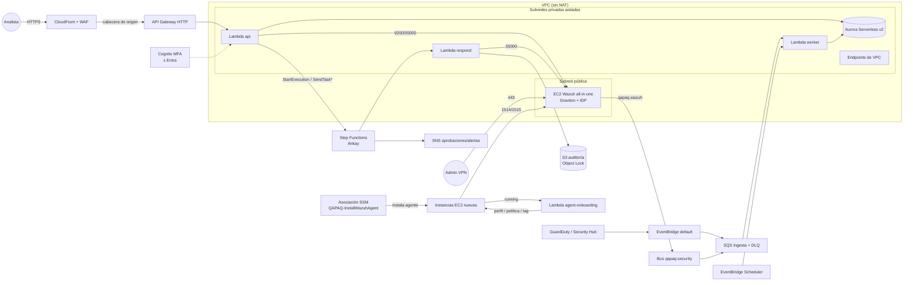

# QAPAQ SOC en AWS: stack serverless (`infra/aws-serverless`)

Implementación Terraform de la arquitectura de [02 · Arquitectura](../../docs/02-arquitectura.md) y
[AWS serverless](../../docs/cloud/aws/architecture.md). Es el stack **vigente**; `infra/aws/` es el
diseño legado (ECS, RDS, ALB, NAT) y no se modifica.

> **Estado:** `terraform fmt`, `terraform validate` y `terraform test` (proveedores simulados) pasan.
> **No se ha ejecutado `plan` ni `apply` contra una cuenta AWS real.** Ver
> [Qué no está verificado](#qué-no-está-verificado).

## Principios aplicados

- **Serverless salvo Wazuh**: Lambda arm64, API Gateway HTTP API, SQS, EventBridge, Step Functions,
  Aurora Serverless v2 (0 ACU con pausa). El nodo Wazuh es la única pieza con servidor.
- **Sin NAT Gateway**: subredes privadas aisladas; los servicios AWS se alcanzan por endpoints de VPC
  (gateway S3/DynamoDB gratis, interfaz con toggle).
- **Graviton/arm64** en EC2 y Lambda. **KMS** en todo (dos CMK con rotación). **TLS-only** en S3,
  SQS y SNS. **IMDSv2** obligatorio. **Menor privilegio** por función/rol. Retención de logs acotada.
- **Sin secretos en tfvars ni en variables de entorno**: Aurora gestiona su contraseña
  (`manage_master_user_password`); el password de registro de agentes es `random_password` en
  Secrets Manager; la clave admin de Wazuh y la API key de Anthropic son secretos *contenedor* que
  carga el nodo o el dueño.

## Diagrama



## Despliegue con un solo `apply`

```bash
cd infra/aws-serverless

# 1. Estado remoto (una vez por cuenta/entorno): crea el bucket y escribe backend.hcl
./scripts/bootstrap-state.sh qapaq dev us-east-1

# 2. Variables: partir de environments/dev.tfvars o terraform.tfvars.example
#    (allowed_admin_cidrs es obligatorio; nunca 0.0.0.0/0)
export TF_VAR_entra_client_secret=...   # solo si se federa con Entra

# 3. Init + apply
terraform init -backend-config=backend.hcl
terraform apply -var-file=environments/dev.tfvars
```

Todo (red, KMS, buckets, Aurora, Cognito, Lambdas, API, CloudFront/WAF, Step Functions, nodo
Wazuh, agentes) se crea en ese apply; no hay pasos manuales intermedios. Después:

1. Confirmar las suscripciones de correo de SNS (alertas y aprobaciones).
2. Esperar ~15–25 min a que el bootstrap de Wazuh termine (`/var/log/qapaq-wazuh-bootstrap.log`,
   accesible con `terraform output wazuh` → `session_command`).
3. Crear usuarios en Cognito (solo alta por administrador) y asignarlos a los grupos
   `qapaq.soc.analyst`, `qapaq.soc.lead`, `qapaq.auditor`, `qapaq.platform.admin`.
4. Subir el código real de las Lambdas (ver [Operación](#operación)).

Pruebas offline: `terraform init -backend=false && terraform test`.

## Qué se despliega

| Archivo | Contenido |
| --- | --- |
| `network.tf` | VPC en 2–3 AZ, subredes públicas (solo Wazuh) y privadas aisladas, sin NAT; SG por defecto vacío; endpoints gateway S3/DynamoDB e interfaz (secretsmanager, ssm, states, sqs, kms, + bedrock-runtime con Qapaqzito); Flow Logs opcionales |
| `kms.tf` | CMK `data` y CMK `audit`, con rotación y políticas para logs, events, sns, cloudwatch, cloudtrail |
| `storage.tf` | Buckets `audit` (Object Lock, réplica opcional a log-archive), `wazuh-snapshots`, `logs` (CloudTrail y salida SSM), `artifacts` |
| `data.tf` | Aurora Serverless v2 PostgreSQL 16, 0 ACU con pausa, contraseña gestionada por RDS, IAM auth, `rds.force_ssl`, backups y snapshot final |
| `identity.tf` | Cognito (MFA TOTP obligatorio, contraseña ≥ 14, alta solo por admin, grupos), cliente BFF con secreto, dominio hospedado, IdP OIDC Entra opcional; parámetros SSM con la config no secreta |
| `api.tf` | Lambdas `api`, `worker`, `respond` (Node 22 arm64, en VPC), HTTP API `$default` con throttling y access logs, cabecera secreta de origen |
| `events.tf` | Bus `<name>-security`, reglas GuardDuty / Security Hub / `qapaq.wazuh` → SQS + DLQ → worker (ReportBatchItemFailures), Scheduler cada 5 min |
| `respond.tf` | Ankay en Step Functions STANDARD con `waitForTaskToken` (24 h), auditoría y notificación en todas las ramas |
| `wazuh.tf` | Nodo EC2 Graviton Ubuntu 24.04 + EIP, SG restringido, IMDSv2, root gp3 cifrado, alarmas de recover/reboot, DLM diario |
| `agents.tf` | Documento SSM, asociaciones por tag, política de enrolamiento, perfil base, Lambda de onboarding, activación híbrida |
| `edge.tf` | CloudFront + WAFv2 (Common, KnownBadInputs, IpReputation, límite de tasa) |
| `security.tf` | CloudTrail multi-región, GuardDuty, Security Hub (FSBP), Access Analyzer, EBS cifrado por defecto, bloqueo público S3 de cuenta |
| `monitoring.tf` | SNS de alertas cifrado, alarmas (Lambda, DLQ, 5xx, Step Functions, Aurora, Wazuh), Budget mensual 80/100 % |
| `cicd.tf` | OIDC de GitHub + rol de despliegue de código (solo con `github_repository`) |
| `qapaqzito.tf` | Permisos, red y variables de entorno del asistente IA Qapaqzito |

## Toggles de costo

Órdenes de magnitud **estimados** para un entorno pequeño en `us-east-1`; no son cotización. Usar la
calculadora de AWS con el volumen real.

| Variable | Default | Qué controla | Orden de magnitud mensual |
| --- | --- | --- | --- |
| `wazuh_instance_type` / `wazuh_root_volume_gb` | `m7g.xlarge` / 200 GB | Nodo Wazuh | Cientos de USD (rubro dominante) |
| `enable_interface_endpoints` + `interface_endpoint_subnet_count` | `true` / 1 | Endpoints de interfaz (5–6 servicios × subredes) | Decenas de USD; ×2 con 2 subredes |
| `aurora_min_capacity` / `aurora_max_capacity` / `aurora_instance_count` | 0 / 4 / 1 | ACU de Aurora | De casi cero (pausado) a cientos según carga |
| `enable_waf` | `true` | WebACL + reglas gestionadas | Decenas de USD + por petición |
| `enable_guardduty` | `true` | GuardDuty | Variable por volumen de eventos |
| `enable_security_hub` | `false` | Security Hub + FSBP | Variable por controles evaluados |
| `enable_cloudtrail` | `true` | Trail propio (primera copia de eventos de gestión es gratis) | Unidades de USD (S3/KMS) |
| `enable_flow_logs` | `false` | VPC Flow Logs a CloudWatch | Variable por tráfico; puede ser decenas |
| `enable_qapaqzito` | `false` | Bedrock + endpoint `bedrock-runtime` | Decenas de USD (endpoint) + tokens |
| `log_retention_days` | 30 | Retención de CloudWatch Logs | Unidades a decenas de USD |
| `wazuh_snapshot_retention_days` | 14 | Snapshots EBS | Unidades a decenas de USD |
| `monthly_budget_usd` | 500 | Aviso de presupuesto (no limita gasto) | — |

Para un entorno de pruebas efímero: `enable_interface_endpoints = false` reduce costo, pero las
Lambdas en VPC no alcanzan Secrets Manager/SSM/SQS/Step Functions (un `check` lo advierte).

## Enrolamiento dinámico de agentes Wazuh

**Instancias EC2 (automático).**

1. La instancia se lanza con el tag `qapaq-agent=enabled` (o cualquier instancia con
   `agent_target_mode = "all"`, salvo `qapaq-agent=disabled`). Grupo opcional en `qapaq-agent-group`.
2. Al pasar a `running`, EventBridge invoca `agent-onboarding`: si no tiene perfil, le asocia
   `qapaq-agent-baseline-<env>` (SSM core + enrolamiento); si tiene rol propio, le adjunta la política
   `qapaq-agent-enroll-<env>` (el rol de la Lambda solo puede adjuntar esa política); en modo `all`
   pone el tag. Un barrido diario repite el proceso; lo que no puede arreglar llega por SNS.
3. La asociación SSM (tag `qapaq-agent=enabled`, `rate(1 hour)`, aplicación inmediata a nuevos
   destinos) ejecuta `QAPAQ-InstallWazuhAgent-<env>`: instala AWS CLI si falta, lee el password de
   registro de Secrets Manager con el rol de la instancia e instala `wazuh-agent` en la versión
   fijada con `WAZUH_MANAGER`, grupo y nombre (`hostname-instanceid`). Si ya está activo y apunta al
   manager, sale sin cambios. Salida en `s3://<logs>/ssm/wazuh-agent/`.

Requisitos: SSM Agent instalado (viene en las AMI de Amazon Linux, Ubuntu y Windows) y alcance a
los endpoints de SSM y a 1514/1515 del manager. Por defecto el manager es la **IP privada** del
nodo (misma VPC o red enrutada). Para otras VPC/cuentas, fijar `agent_manager_address` (EIP o DNS)
y añadir sus IP públicas a `agent_cidrs`. El grupo se lee del tag por IMDS (si
`instance_metadata_tags` está habilitado) o con `ec2:DescribeTags`.

**Endpoints fuera de AWS (híbridos).** Con `hybrid_activation_limit > 0` se crea una activación
SSM (29 días, rol con SSM core + enrolamiento) etiquetada `qapaq-agent=hybrid` y una asociación que
apunta a la **EIP**. `terraform output -raw hybrid_install_script_linux` imprime el script de
registro. Para renovar la activación: `terraform apply -replace=time_offset.hybrid_activation_expiry`.

**Manual.** `terraform output -raw agent_registration_password` (o leer el secreto) e instalar el
agente con `WAZUH_MANAGER=<EIP> WAZUH_REGISTRATION_PASSWORD=...`; o ejecutar el documento SSM con
`aws ssm send-command --document-name QAPAQ-InstallWazuhAgent-<env> --targets Key=InstanceIds,Values=<id>`.

## Operación

- **Recuperación del nodo Wazuh.** Falla de host → la alarma `StatusCheckFailed_System` ejecuta
  `ec2:recover` (misma instancia, EBS, IP y EIP); falla del SO → `ec2:reboot`. Se eligió esto en
  lugar de un ASG `min=max=1` por simplicidad y porque conserva disco e IP sin reconfigurar
  agentes. Pérdida del volumen: crear un volumen desde el último snapshot DLM y reemplazar la raíz
  (`aws ec2 create-replace-root-volume-task`) o `terraform apply -replace=aws_instance.wazuh` y
  restaurar el Indexer desde `wazuh-snapshots`. `ami` y `user_data` se ignoran para que un cambio
  de AMI no reemplace el nodo.
- **Rotación de secretos.** Aurora: rotación nativa del secreto gestionado por RDS. Registro de
  agentes: `terraform apply -replace=random_password.agent_registration` y volver a ejecutar el
  bootstrap de authd en el nodo (la asociación reescribe `authd.pass` en los agentes). Cabecera de
  origen: `-replace=random_password.origin_verify` (CloudFront y el secreto cambian juntos; la app
  debe releer el secreto). Admin de Wazuh: cambiarla con la herramienta de contraseñas de Wazuh y
  actualizar el secreto.
- **Código real de las Lambdas.** Terraform crea placeholders (api → 503, worker → reintenta a la
  DLQ, respond → falla y audita) e ignora cambios de código. El CI (rol `github_deploy_role_arn`)
  sube `api.zip`/`worker.zip`/`respond.zip` al bucket `artifacts` y ejecuta
  `aws lambda update-function-code --function-name <fn> --s3-bucket <artifacts> --s3-key <zip>`.
  Alternativa: `api_artifact = { bucket, key = "releases/x.zip" }` (busca `x-api.zip`,
  `x-worker.zip`, `x-respond.zip`) solo en la creación.
- **Contrato de la app.** Leer configuración de SSM `QAPAQ_CONFIG_SSM_PATH`; **rechazar con 403 toda
  petición sin la cabecera `X-Qapaq-Origin-Verify` correcta** (el `execute-api` es público);
  conectarse a Aurora como `qapaq_app` con IAM auth (crear el rol en la migración: `GRANT rds_iam`);
  para Ankay, nombrar la ejecución con el id de la solicitud y cerrar la espera con
  `SendTaskSuccess({"decision":"approved"|"rejected"})` o `SendTaskFailure(error="Rejected")`.
- **Qapaqzito.** `bedrock` (cliente Mantle, IDs `anthropic.<modelo>`, por defecto
  `anthropic.claude-opus-5-5`) es el camino recomendado porque no hay NAT. `anthropic` directo solo
  funciona si se añade salida a Internet y se declara `qapaqzito_internet_egress_available = true`.
  Variables en la Lambda api: `QAPAQ_QAPAQZITO_ENABLED`, `_PROVIDER`, `_MODEL`, `_API_KEY_SECRET_ARN`,
  `_REDACT_PII` (true), `_EFFORT` (medium).

## Limitaciones conocidas

- El **dashboard de Wazuh no pasa por CloudFront**: se accede por `https://<EIP>/` (certificado
  autofirmado de Wazuh) solo desde `allowed_admin_cidrs`/VPN.
- El Indexer all-in-one escucha en loopback por defecto: para que la Lambda use `:9200` el overlay
  debe ajustar `network.host` y el certificado del Indexer. La API de Wazuh (`:55000`) sí escucha
  en todas las interfaces.
- El repositorio de snapshots del Indexer en S3 lo configura el overlay (`wazuh_overlay_s3_uri`).
- El Budget filtra por la etiqueta `Project`: hay que activarla como etiqueta de asignación de
  costos en Billing.

## Qué no está verificado

- **No hubo `plan` ni `apply` contra AWS.** `validate` y `terraform test` con proveedores simulados
  no detectan errores de API (cuotas, nombres de servicio de endpoint, combinaciones inválidas).
- **Bootstrap de Wazuh**: instalación all-in-one 4.14.x en Ubuntu 24.04 arm64, extracción de la
  clave admin, edición de `<auth>` en `ossec.conf` y overlay; no ejecutado.
- **Script de agentes** en cada distribución/Windows (paquetes `wazuh-agent=<ver>-1`, MSI, IMDS).
- **SSM híbrido**: que las etiquetas de la activación se hereden en los nodos y que el AWS CLI del
  nodo híbrido use las credenciales del SSM Agent para leer el secreto.
- **Bedrock**: el acceso al modelo se habilita en la consola; el ARN/ID exacto del modelo
  (`anthropic.claude-opus-5-5`), el uso de perfiles de inferencia y el nombre del servicio de
  endpoint de VPC que usa el cliente Mantle (añadir en `qapaqzito_bedrock_endpoint_services`) no se
  comprobaron.
- **Aurora 0 ACU** requiere una versión de motor que lo soporte (`aurora_engine_version`, 16.6 por
  defecto); confirmar en la región.
- Políticas KMS para SNS cifrado publicado por CloudWatch/EventBridge/Budgets.
- Réplica del bucket con Object Lock a la cuenta log-archive (requiere configuración en destino).
