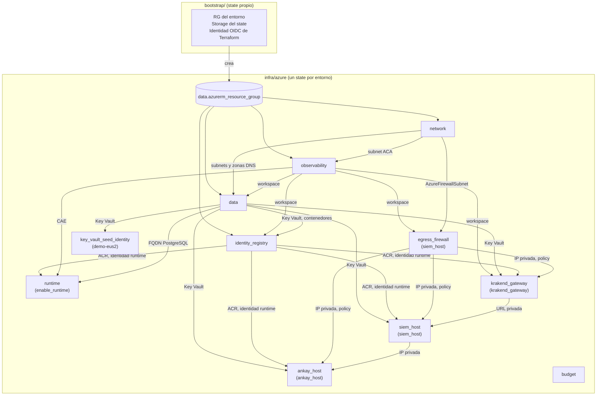

# Arquitectura Terraform Azure

Índice técnico del root `infra/azure`: qué módulo crea cada recurso, cómo fluyen los
valores entre módulos, en qué orden se crean y qué convenciones son contrato del state.
Las tablas de inputs, outputs y recursos de cada módulo están en su `README.md`.

## Estructura del repositorio

```text
infra/azure/
├── ARCHITECTURE.md              # Este índice
├── README.md                    # Uso, seguridad y referencia terraform-docs del root
├── .terraform-docs.yml          # Configuración para regenerar los README
├── versions.tf                  # required_version, required_providers y backend azurerm
├── providers.tf                 # Configuración del provider azurerm
├── variables.tf                 # Contrato de entrada con validaciones
├── main.tf                      # Locals de nombres y composición de módulos
├── outputs.tf                   # Salidas consumidas por workflows y operadores
├── cost-governance.tf           # Presupuesto mensual de suscripción
├── moved.tf                     # Migraciones de direcciones de state (no borrar)
├── terraform.tfvars.example     # Plantilla local; terraform.tfvars está ignorado
├── profiles/
│   └── demo-eus2.tfvars         # Perfil versionado sin secretos del entorno EUS2
├── tests/
│   └── root_inputs.tftest.hcl   # terraform test con provider simulado
├── bootstrap/                   # Stack separado: RG, state backend y OIDC de Terraform
├── modules/
│   ├── network/                 # VNet, subnets y DNS privado
│   ├── observability/           # Log Analytics y Container Apps Environment
│   ├── data/                    # PostgreSQL, Storage, Key Vault, Private Endpoints
│   ├── identity_registry/       # Identidades, OIDC, ACR y RBAC
│   ├── key_vault_seed_identity/ # Identidad de carga de secretos (solo demo-eus2)
│   ├── runtime/                 # Container Apps genéricas (apagado)
│   ├── egress_firewall/         # Azure Firewall y policy (con siem_host)
│   ├── siem_host/               # VM Wazuh QAPAQ, LB interno, NSG, UDR
│   ├── krakend_gateway/         # KrakenD privado en ACA interno
│   └── ankay_host/              # VM Shuffle/Ankay
├── overlays/                    # Parches de build de Wazuh Indexer
├── scripts/                     # Utilidades de operación (carga de secretos EUS2)
└── secrets/                     # Plantillas ARM con parámetros secureString; sin valores
```

## Mapa de módulos



Los nodos con condición entre paréntesis usan `count` y no crean nada mientras su
variable esté en `null` o `false`.

## Recursos por módulo

| Módulo                    | Condición                                      | Recursos Azure                                                                                                                                                                                                                                                                                                                                                                                                                                           |
| ------------------------- | ---------------------------------------------- | -------------------------------------------------------------------------------------------------------------------------------------------------------------------------------------------------------------------------------------------------------------------------------------------------------------------------------------------------------------------------------------------------------------------------------------------------------- |
| root                      | siempre                                        | `data.azurerm_resource_group` (creado por bootstrap), `azurerm_consumption_budget_subscription`                                                                                                                                                                                                                                                                                                                                                          |
| `network`                 | siempre                                        | `azurerm_virtual_network`; `azurerm_subnet` ×3 (Container Apps `/27` delegada, PostgreSQL `/28` delegada, Private Endpoints `/28`); `azurerm_private_dns_zone` ×3 + `azurerm_private_dns_zone_virtual_network_link` ×3                                                                                                                                                                                                                                   |
| `network`                 | `ankay_host` / `krakend_gateway` / `siem_host` | `azurerm_subnet` Ankay `/27`, KrakenD `/27` delegada, `AzureFirewallSubnet` `/26`                                                                                                                                                                                                                                                                                                                                                                        |
| `observability`           | siempre                                        | `azurerm_log_analytics_workspace`                                                                                                                                                                                                                                                                                                                                                                                                                        |
| `observability`           | `enable_runtime`                               | `azurerm_container_app_environment` (Workload Profiles, `Consumption`)                                                                                                                                                                                                                                                                                                                                                                                   |
| `data`                    | siempre                                        | `azurerm_postgresql_flexible_server` + `_database` ×2 + `_configuration` ×2; `azurerm_storage_account` ×2 (evidencia, releases) + `azurerm_storage_container` ×3; `azurerm_key_vault`; `azurerm_private_endpoint` ×3; `azurerm_monitor_diagnostic_setting` ×4                                                                                                                                                                                            |
| `identity_registry`       | siempre                                        | `azurerm_user_assigned_identity` ×2; `azurerm_federated_identity_credential` (1 + adicionales); `azurerm_container_registry`; `azurerm_role_assignment` ×6; `azurerm_monitor_diagnostic_setting`                                                                                                                                                                                                                                                         |
| `key_vault_seed_identity` | `environment == "demo-eus2"`                   | `azurerm_user_assigned_identity`; `azurerm_federated_identity_credential`; `azurerm_role_definition` ×2; `azurerm_role_assignment` ×2                                                                                                                                                                                                                                                                                                                    |
| `runtime`                 | `enable_runtime`                               | `azurerm_container_app` ×5                                                                                                                                                                                                                                                                                                                                                                                                                               |
| `egress_firewall`         | `siem_host != null`                            | `azurerm_public_ip`; `azurerm_firewall_policy` + `_rule_collection_group`; `azurerm_firewall`; `azurerm_monitor_diagnostic_setting`                                                                                                                                                                                                                                                                                                                      |
| `siem_host`               | `siem_host != null`                            | `azurerm_subnet`; `azurerm_network_security_group` + asociación; `azurerm_route_table` + asociación; `azurerm_user_assigned_identity`; `azurerm_role_assignment` (AcrPull, Blob Reader/Contributor, Key Vault Secrets User por secreto); `azurerm_network_interface`; `azurerm_lb` + pool, probes y reglas; `azurerm_managed_disk`; `azurerm_linux_virtual_machine`; `azurerm_virtual_machine_data_disk_attachment`; `azurerm_virtual_machine_extension` |
| `krakend_gateway`         | `krakend_gateway != null`                      | `azurerm_route_table` + asociación; `azurerm_user_assigned_identity`; `azurerm_role_assignment` (AcrPull, Key Vault Secrets User ×2); `azurerm_container_app_environment` interno; `azurerm_private_dns_zone` + link + registro `A` comodín; `azurerm_container_app`                                                                                                                                                                                     |
| `ankay_host`              | `ankay_host != null`                           | `azurerm_network_security_group` + asociación a NIC; `azurerm_network_interface`; `azurerm_route_table` + asociación; `azurerm_user_assigned_identity`; `azurerm_role_assignment` (AcrPull, Key Vault Secrets User por secreto); `azurerm_managed_disk`; `azurerm_linux_virtual_machine`; `azurerm_virtual_machine_data_disk_attachment`                                                                                                                 |
| `bootstrap/`              | stack aparte                                   | `azurerm_resource_group` ×2 (state, entorno); `azurerm_storage_account` + `azurerm_storage_container` del state; `azurerm_user_assigned_identity` + `azurerm_federated_identity_credential` de Terraform; `azurerm_role_assignment` (Contributor y RBAC Administrator condicionado sobre el RG, Blob Data Contributor sobre el state, Cost Management Contributor)                                                                                       |

## Orden de creación y dependencias

Las dependencias son implícitas: un módulo consume un output de otro. Solo se declara
`depends_on` cuando Azure exige un orden que ninguna referencia expresa.

| Dependencia explícita                                                                                                 | Motivo                                                                                                                |
| --------------------------------------------------------------------------------------------------------------------- | --------------------------------------------------------------------------------------------------------------------- |
| `module.data` → `module.network`                                                                                      | PostgreSQL con integración VNet exige que la zona DNS privada ya esté enlazada; los outputs solo referencian la zona. |
| `module.runtime` → `module.identity_registry`, `module.data`                                                          | Las Container Apps extraen de ACR y leen Key Vault al crearse; las asignaciones RBAC deben existir antes.             |
| `module.siem_host`, `module.krakend_gateway`, `module.ankay_host` → identidad, red, firewall                          | El primer arranque descarga del ACR, lee Key Vault y sale por la UDR al Firewall.                                     |
| VM y extensión de `siem_host`, VM de `ankay_host`, Container App de `krakend_gateway` → sus `azurerm_role_assignment` | cloud-init y el ingress resuelven secretos e imágenes en el primer arranque.                                          |
| `ssl_min_protocol_version` → `require_secure_transport`                                                               | Azure rechaza actualizaciones concurrentes de parámetros del mismo servidor PostgreSQL.                               |

## State y backend

- Un state por entorno en el contenedor `tfstate` del storage creado por `bootstrap/`, con key
  `qapaq-secops/<env>/terraform.tfstate`. El bootstrap tiene su propio state.
- `backend "azurerm"` con `use_azuread_auth = true`: Entra ID en lugar de claves de cuenta.
  El bloqueo del state es nativo, mediante un lease sobre el blob, y no requiere recursos extra.
- Los valores que cambian por entorno (resource group, cuenta, contenedor, key) llegan por
  `-backend-config` desde las variables del GitHub Environment.
- `moved.tf` (root) y los `moved.tf` de `observability` e `identity_registry` registran
  migraciones de direcciones ya aplicadas. No se eliminan mientras exista algún state anterior.

## Convenciones de nombres

Los nombres derivan de `name_base` (proyecto + entorno sin guiones, máximo 18 caracteres) y
de un sufijo determinista de 8 caracteres: `sha256("<subscription>:<project>:<environment>")`.
Los nombres son parte del state: cambiar `project`, `environment` o la suscripción reemplaza
recursos, y `prevent_destroy` bloquea ese plan.

| Prefijo                                           | Recurso                                     | Ejemplo (`demo`)                        |
| ------------------------------------------------- | ------------------------------------------- | --------------------------------------- |
| `rg-`                                             | Resource group                              | `rg-qapaqsecopsdemo-66f8c73b`           |
| `vnet-` / `snet-`                                 | VNet / subnet                               | `vnet-qapaqsecopsdemo`, `snet-postgres` |
| `psql-`                                           | PostgreSQL Flexible Server                  | `psql-qapaqsecopsdemo-66f8c73b`         |
| `kv-`                                             | Key Vault                                   | `kv-qapaqsecopsd-66f8c73b`              |
| `pe-`                                             | Private Endpoint                            | `pe-qapaqsecopsdemo-vault`              |
| `law-` / `cae-`                                   | Log Analytics / Container Apps Environment  | `law-qapaqsecopsdemo`                   |
| `id-`                                             | Managed Identity                            | `id-qapaqsecopsdemo-runtime`            |
| `diag-`                                           | Diagnostic setting                          | `diag-qapaqsecopsdemo-key-vault`        |
| `afw-` / `afwp-` / `pip-`                         | Firewall / policy / IP pública              | `afw-qapaqsecopsdemo`                   |
| `vm-` / `nic-` / `nsg-` / `rt-` / `lb-` / `disk-` | Cómputo y red del SIEM y Ankay              | `vm-qapaqsecopsdemo-siem`               |
| sin guiones                                       | Storage Account, ACR (restricción de Azure) | `qapaqsecopsdemo66f8c73b`               |

## Decisión: Azure Verified Modules

**Estado: no se adoptan AVM para los recursos existentes (2026-10-27).**

- Los recursos de `demo` y `demo-eus2` ya están aplicados con recursos `azurerm_*` nativos.
  Un módulo AVM cambia todas las direcciones de state. Los bloques `moved` no pueden mapear
  recursos hacia el interior de un módulo de registry con otra estructura sin un `import`
  manual recurso por recurso. Cualquier error en ese mapeo produce `delete` o replace sobre
  PostgreSQL, Key Vault o Storage, protegidos por `prevent_destroy` y por el guard de CI.
- Los módulos `avm-res-*` agregan los providers `azapi`, `modtm` y `random`, y telemetría
  activada por defecto. Eso amplía la superficie de supply chain del pipeline de un SOC.
- Los controles que AVM aportaría ya están en el código: TLS mínimo, acceso público
  deshabilitado, RBAC, Private Endpoints, diagnósticos, bloqueos y validaciones.

AVM es aceptable para un subsistema **nuevo** sin state previo, con `enable_telemetry = false`,
versión fijada y revisión de sus providers en `.terraform.lock.hcl`.
